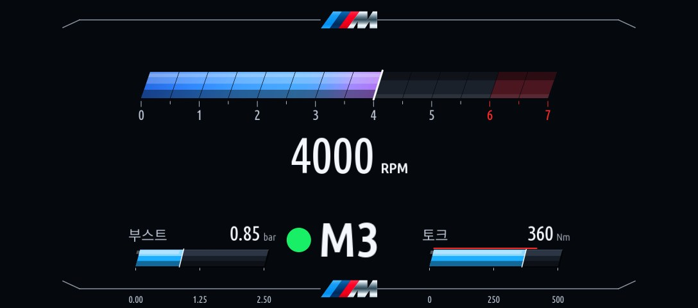
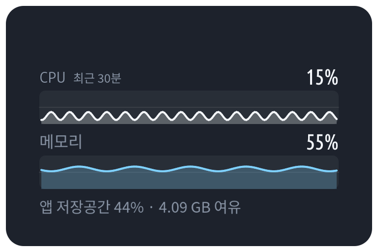
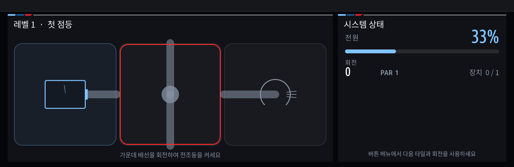
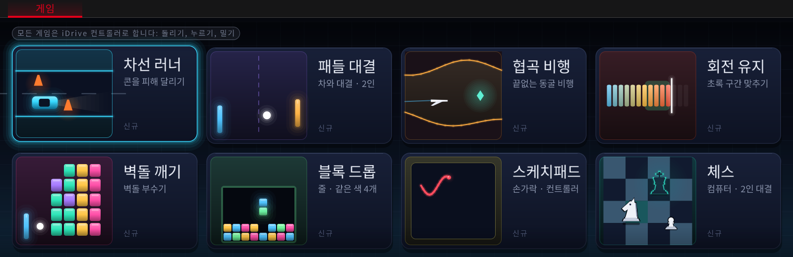
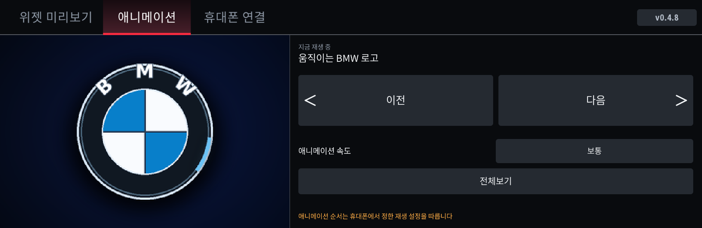
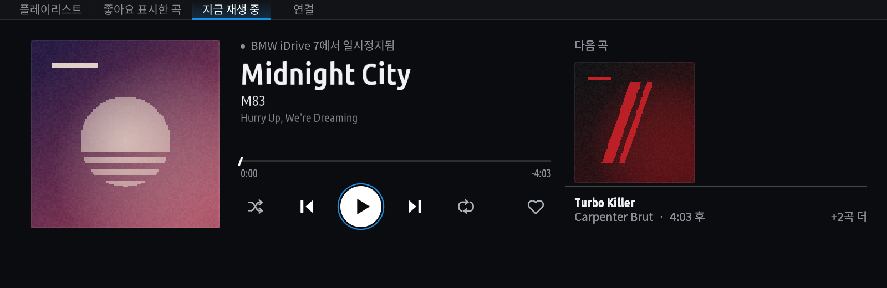
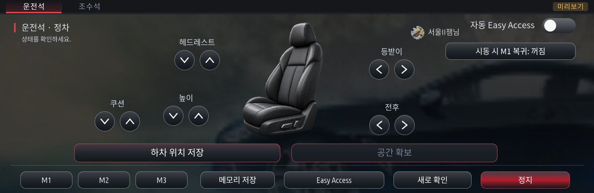

# 잼님의 iDrive 앱 모음 (MGU Store)

[English](README.md)

BMW iDrive 7·8 헤드유닛의 **MGU Store**에서 설치하는 앱 모음입니다. 모든 앱은 한국어판이 있고, 대부분 영어판도 있습니다.

**제작: 잼님**

| | |
|---|---|
| MGU Store 소스 | 저장소 **`jaimeen77-cmyk/apps`** · 브랜치 **`main`** |
| 다운로드 (GitHub) | [github.com/jaimeen77-cmyk/apps](https://github.com/jaimeen77-cmyk/apps) |
| 함께 쓰는 소스 | **`jaimeen77-cmyk/appsKOR`** · `main` — GPU 렌더러·컨트롤러 연결 도구와 한국어 앱 15개 ([appsKOR](https://github.com/jaimeen77-cmyk/appsKOR)) |
| 설치 방법 | **[설치 안내](docs/INSTALL.ko.md)** |
| 네이버 블로그 | [blog.naver.com/jaimeen77](https://blog.naver.com/jaimeen77) |

## 앱 소개

### 계기판 레드라인 1.3.91 · iDrive 7·8 · 한국어/English

계기판과 HUD에 회전수·변속 알림·기어·부가정보(부스트·토크·오일 온도 등)를 그립니다. 디자인은 계기판 24종·HUD 20종(차분한 시계·레트로 VU 미터·길안내 중심·G-G 궤적 포함), 애니메이션(내 M3 그림 또는 내 GIF), 주행 모드 묶음별 화면, BC 버튼 따라가기, 3D·형광 아이콘 HUD 길안내, 차량 알림, 앞차 간격과 앞차 출발 알림, 차선 표시, 상황 기록, 운전자별 설정과 즐겨찾기를 지원합니다.
→ **[설명서](docs/CLUSTER-REDLINE.ko.md)**

### MGU 모니터 1.1.10 · iDrive 7·8 · 한국어/English

헤드유닛의 저장공간, 앱별 CPU·메모리 사용량과 30일 기록을 봅니다. 홈 화면 위젯에 최근 30분 CPU·메모리 그래프가 나옵니다.
→ **[설명서](apps/storage/README.ko.md)**

### 아이드라이브 회로 1.0.5 · iDrive 7·8 · 한국어/English

주차 중에 즐기는 회로 퍼즐입니다. 타일을 돌려 모든 장치에 전기를 연결합니다. 30개 레벨.
→ **[설명서](apps/idrive_circuit/README.ko.md)**

### 8게임즈 0.2.4 · iDrive 7 · 한국어

주차 중에 iDrive 컨트롤러로 하는 게임 8개(차선 러너, 패들 대결, 협곡 비행, 회전 유지, 벽돌 깨기, 블록 드롭, 스케치패드, 체스).
→ **[설명서](apps/parked_games/README.ko.md)**

### GIF 플레이어 0.4.8 · iDrive 7 · 한국어

휴대폰에서 올린 GIF를 홈 화면 위젯과 애니메이션 화면에 재생합니다. 올린 GIF는 계기판 레드라인의 애니메이션 레이아웃에서도 씁니다.
→ **[설명서](apps/gif_home/README.ko.md)**

### 스포티파이 (Spotify 한국어판) 2.0.0 · iDrive 7 · 한국어

Spotify Connect로 재생 중인 곡을 차에서 보고 조작하며, 플레이리스트와 좋아요 표시한 곡을 커버 아트와 함께 고릅니다. 한글 곡 제목도 표시합니다. 인터넷이 필요합니다. 원본: hexlay/idrive7-custom-apps.
→ **[설명서](apps/spotify/README.ko.md)**

### 시트 Easy Access 0.7.10 · iDrive 7·8 · 한국어/English

운전석·조수석 시트 조절, 메모리 M1~M3, 타고 내릴 때 시트를 비켜 주는 Easy Access.
→ **[설명서](apps/seats_easy_access/README.ko.md)**

## 설명서 모음

| 앱 | 한국어 | English |
|---|---|---|
| 설치 | [설치 안내](docs/INSTALL.ko.md) | [Installation](docs/INSTALL.md) |
| 계기판 레드라인 | [설명서](docs/CLUSTER-REDLINE.ko.md) | [User guide](docs/CLUSTER-REDLINE.md) |
| MGU 모니터 | [설명서](apps/storage/README.ko.md) | [Guide](apps/storage/README.md) |
| 아이드라이브 회로 | [설명서](apps/idrive_circuit/README.ko.md) | [Guide](apps/idrive_circuit/README.md) |
| 8게임즈 | [설명서](apps/parked_games/README.ko.md) | — |
| GIF 플레이어 | [설명서](apps/gif_home/README.ko.md) | [Guide](apps/gif_home/README.md) |
| 스포티파이 | [설명서](apps/spotify/README.ko.md) | — |
| 시트 Easy Access | [설명서](apps/seats_easy_access/README.ko.md) | [Guide](apps/seats_easy_access/README.md) |

[업데이트 이력](CHANGELOG.md) · [계기판 레드라인 이전 설명서](docs/CLUSTER-REDLINE-HISTORY.ko.md)

설명서의 그림은 모두 실제 앱 패키지의 그리기 코드로 만든 예시 화면입니다(예시 데이터). 차의 화면과 색·위치가 조금 다를 수 있습니다.

## 라이선스

- **계기판 레드라인** 1.3.10부터: **허락 필요** 라이선스([apps/cluster_redline/LICENSE](apps/cluster_redline/LICENSE)). 본인 차량에 설치해 쓰는 것은 자유이고, 복사·재배포·수정·상업적 이용은 허락을 받아야 합니다. 1.3.9까지는 MIT. 다른 사람이 만든 구성 요소는 원래 라이선스를 따릅니다([NOTICE](NOTICE.cluster-redline.md)).
- **GIF 플레이어**: 원본 GIF Home(NamelsMissing/mgu-apps)의 GPL-3.0을 따릅니다([NOTICE](NOTICE.gif-home.md)).
- **스포티파이**: 원본 Spotify(hexlay/idrive7-custom-apps)의 GPL-3.0을 따릅니다([NOTICE](NOTICE.spotify.md)).
- **8게임즈**: 원작 Parked Games의 MIT([NOTICE](apps/parked_games/NOTICE)).
- 그 밖의 앱과 런타임 킷: MIT([LICENSE](LICENSE)). MGU 모니터의 출처는 [NOTICE](apps/storage/NOTICE).
