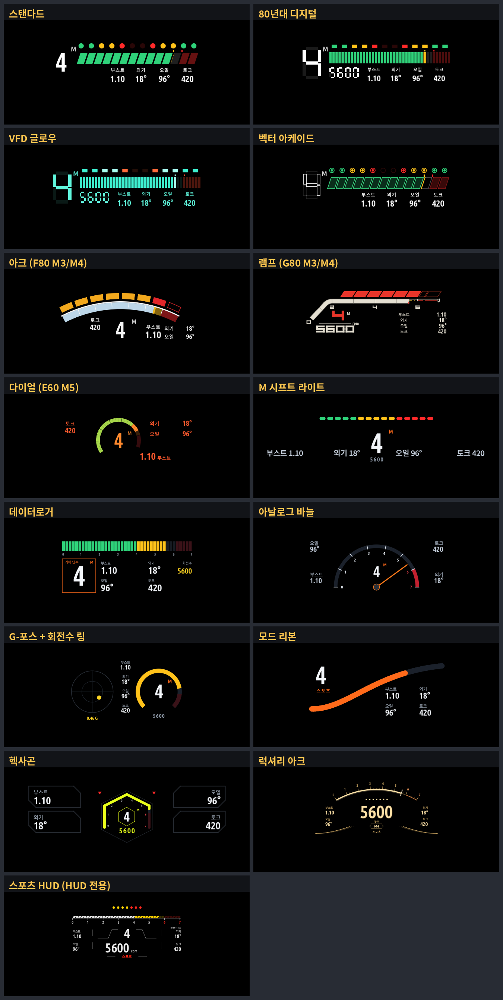

# 계기판 레드라인 · iDrive 7 앱 모음 (한국어)


**제작: 잼님**

| | |
|---|---|
| 다운로드 (GitHub) | **[github.com/jaimeen77-cmyk/apps](https://github.com/jaimeen77-cmyk/apps)** |
| MGU Store 소스 | 저장소 **`jaimeen77-cmyk/apps`** · 브랜치 **`main`** |
| 한국어 앱 15개 소스 | **`jaimeen77-cmyk/appsKOR`** · 브랜치 **`main`** ([appsKOR](https://github.com/jaimeen77-cmyk/appsKOR)) |
| 네이버 블로그 | **[blog.naver.com/jaimeen77](https://blog.naver.com/jaimeen77)** |
| 설치·사용 설명서 | **[계기판 레드라인 설치·사용 설명서](docs/CLUSTER-REDLINE.ko.md)** (메뉴별 자세한 설명) |



## 빠른 설치

1. 차량에서 **MGU Store → Settings → 소스 추가** 를 엽니다.
2. 저장소 **`jaimeen77-cmyk/apps`**, 브랜치 **`main`** 을 입력하고 **새로고침** 합니다.
3. **계기판 레드라인 (한국어)** 를 **Install** 합니다. `cluster-render` 0.4.0 이상 설치 안내가 나오면 따릅니다.
4. 앱을 열어 **기본설정 → 앱 실행 → 앱 켜기**. 자세한 메뉴 설명은 [설치·사용 설명서](docs/CLUSTER-REDLINE.ko.md)를 보세요.

---

**계기판 레드라인 1.2.44** · HUD에 길안내가 뜨면 클러스터 양보(웨이즈 포함), HUD 레이아웃 기본 위치·크기 조정, 외기 온도 수정 (1.2.8: Redline 레이아웃 요소별 조절, 시계 한국 시간). **아이드라이브 회로 1.0.0**, **저장공간 1.0.1**도 함께 제공합니다.

[English](README.md)

| 설명서 | 한국어 | English |
|---|---|---|
| 설치 | [설치 안내](docs/INSTALL.ko.md) | [Installation](docs/INSTALL.md) |
| 레드라인 설치·사용 | [설치·사용 설명서](docs/CLUSTER-REDLINE.ko.md) | [User guide](docs/CLUSTER-REDLINE.md) |
| 저장공간 사용 | [저장공간](apps/storage/README.ko.md) | [Storage](apps/storage/README.md) |
| Circuit 사용 | [회로 퍼즐](apps/idrive_circuit/README.ko.md) | [Circuit](apps/idrive_circuit/README.md) |

MGU Store에서 소스 **`jaimeen77-cmyk/apps`**, 브랜치 **`main`**을 추가하고 새로고침한 뒤 한국어 또는 English판을 설치하세요. 레드라인은 `cluster-render` **0.4.0 이상**이 필요합니다. 기존 설치는 Installed에서 업데이트하고 앱 상단 **v1.2.5**을 확인하세요. 한국어·영어판을 함께 설치했다면 사용하지 않는 판의 앱 실행과 자동 시작을 끕니다.

| HUD circle | HUD bar |
|---|---|
|  |  |

| Cluster circle | Cluster bar |
|---|---|
|  |  |

[전체 스크린샷: 부가정보·안내·설정·빨간 알림](screenshots/README.md). 모든 그림은 실제 앱 렌더러의 예시 데이터이며, 이번 버전의 실차 확인은 남아 있습니다.

[Source integration / 소스 통합](docs/JAM-INTEGRATION.ko.md) · [Changelog / 업데이트 이력](CHANGELOG.md) · [Licenses](NOTICE.cluster-redline.md)

한국어 원본 iDrive 앱 15개는 별도 저장소 [appsKOR](https://github.com/jaimeen77-cmyk/appsKOR)에서 제공합니다. 이 저장소는 Circuit·계기판 레드라인·저장공간 세 앱의 한국어/영어판을 제공합니다.

일반 한국어 앱 15개의 Store 등록과 설치 레이어는 최신 버전 그대로 [appsKOR](https://github.com/jaimeen77-cmyk/appsKOR)로 이동했습니다. MGU Store에서 두 소스의 main 채널을 새로고침하세요. 이 소스에는 Circuit·Cluster Redline·Storage의 한국어/영어 항목 6개를 제공합니다. 저장공간은 두 언어 모두 1.0.1입니다.

## Seats 한국어판

상단 운전석/조수석 탭, 시트 조절, M1~M3, Easy Access와 Make room을 제공합니다. MGU Store에서 `jaimeen77-cmyk/apps`의 **main** 채널을 새로고침하고 **시트 Easy Access**를 설치하세요. 원본 Comfort 도구를 받으려면 `IterioDev/car-apps` 소스가 필요합니다.

기존 앱과 같은 overlay 명령을 사용합니다: `python tools/install-overlay.py /path/to/idrive7-apps --apps seats_easy_access`. 대상에는 원래 공용 빌드·runtime·deploy 파일이 있어야 합니다. [빌드·설치 안내](docs/SEATS-OVERLAY.ko.md)

Seats 소스 경로는 `apps/seats_easy_access`입니다. overlay 적용 후 대상 프로젝트에서 공용 명령으로 빌드합니다.

```sh
python3 kit/tools/build.py --language ko seats_easy_access
```

결과는 다른 앱처럼 `dist/seats_easy_access@0.4.0-ko.1.mgu`와 `.tgz`입니다. `python kit/tools/make_kit.py seats_easy_access --language ko`로 설치 키트도 생성합니다. MGU Store는 기존 앱과 같은 SDK 없는 템플릿 빌드를 사용합니다.
