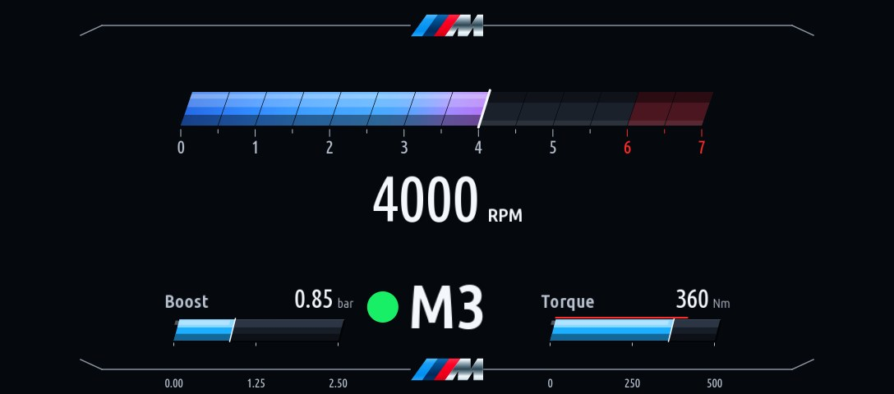
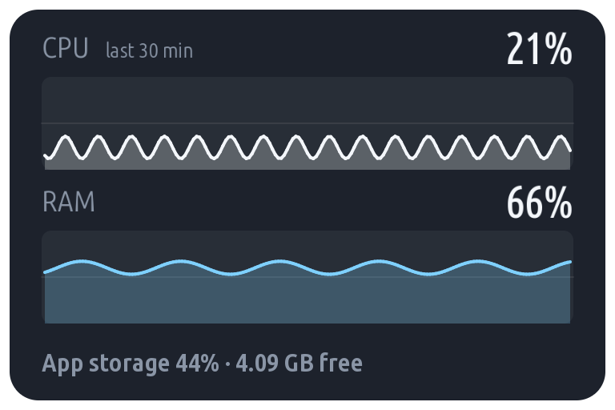
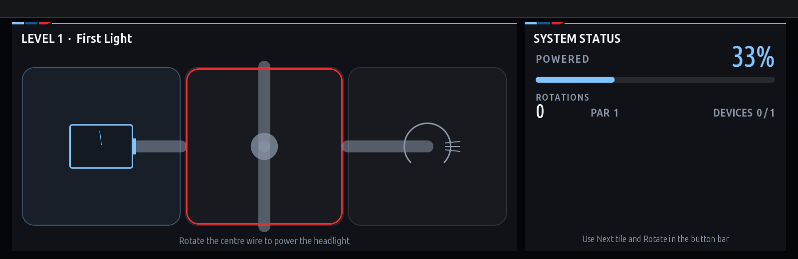
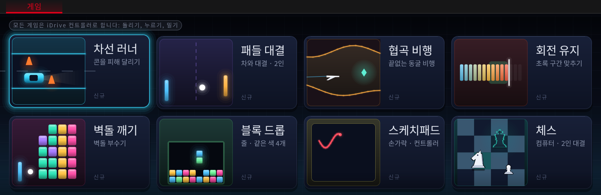
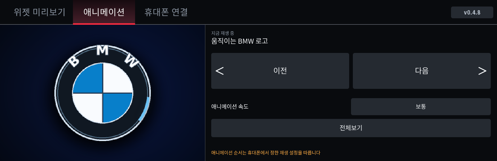
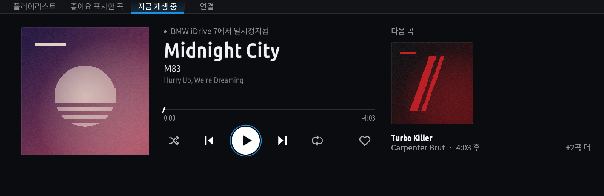
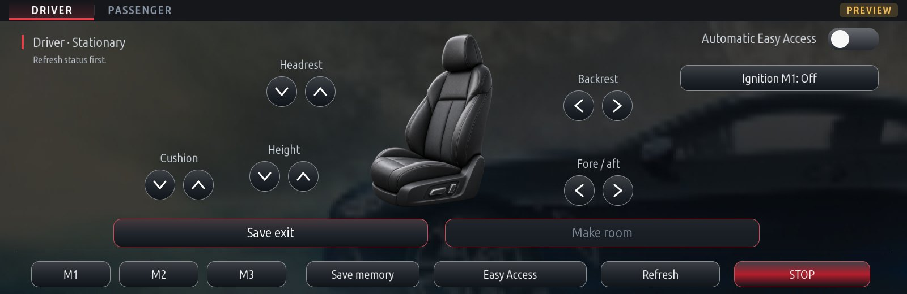

# Jam's iDrive apps (MGU Store)

[한국어](README.ko.md)

Apps for BMW iDrive 7 and 8 head units, installed from **MGU Store**. Every app has a Korean edition and most have an English one.

**Made by 잼님 (jaimeen77)**

| | |
|---|---|
| MGU Store source | repository **`jaimeen77-cmyk/apps`** · branch **`main`** |
| Download (GitHub) | [github.com/jaimeen77-cmyk/apps](https://github.com/jaimeen77-cmyk/apps) |
| Companion source | **`jaimeen77-cmyk/appsKOR`** · `main` — the GPU renderer and controller gate tools, and 15 Korean apps ([appsKOR](https://github.com/jaimeen77-cmyk/appsKOR)) |
| How to install | **[Installation](docs/INSTALL.md)** |

## The apps

### Cluster Redline 1.3.67 · iDrive 7·8 · English/Korean

Draws rpm, shift alerts, the gear and auxiliary information (boost, torque, oil temperature…) on the instrument cluster and the HUD. 20 designs on the cluster and 18 on the HUD, an Animation layout (an animated car or your own GIFs), following the BC button, HUD navigation and vehicle alerts, settings per driver and favourites.
→ **[User guide](docs/CLUSTER-REDLINE.md)**

### MGU Monitor 1.1.10 · iDrive 7·8 · English/Korean

The head unit's storage, CPU and memory by app, and 30 days of usage logs. Its home-screen widget draws CPU and memory over the last 30 minutes.
→ **[Guide](apps/storage/README.md)**

### iDrive Circuit 1.0.5 · iDrive 7·8 · English/Korean

A circuit puzzle for when the car is parked: rotate tiles to bring power to every device. 30 levels.
→ **[Guide](apps/idrive_circuit/README.md)**

### 8게임즈 (Parked Games) 0.2.4 · iDrive 7 · Korean

Eight games played with the iDrive controller while parked (lane runner, paddle duel, canyon glide, rev keeper, brick breaker, block drop, sketchpad, chess). The Korean edition of Parked Games.
→ **[Guide (Korean)](apps/parked_games/README.ko.md)**

### GIF 플레이어 (GIF player) 0.4.8 · iDrive 7 · Korean

Plays GIFs uploaded from your phone in the home-screen widget and on its Animation screen. Cluster Redline's Animation layout uses the same uploaded GIFs.
→ **[Guide](apps/gif_home/README.md)**

### 스포티파이 (Spotify, Korean edition) 2.0.0 · iDrive 7 · Korean

The Spotify Connect player and cover-art library of hexlay/idrive7-custom-apps in Korean, with a Hangul font so Korean song titles show. Needs the internet.
→ **[Guide (Korean)](apps/spotify/README.ko.md)**

### Seats Easy Access 0.7.10 · iDrive 7·8 · English/Korean

Driver and passenger seat adjustment, memories M1–M3, and Easy Access that moves the seat out of the way to get in and out.
→ **[Guide](apps/seats_easy_access/README.md)**

## Guides

| App | English | 한국어 |
|---|---|---|
| Installation | [Installation](docs/INSTALL.md) | [설치 안내](docs/INSTALL.ko.md) |
| Cluster Redline | [User guide](docs/CLUSTER-REDLINE.md) | [설명서](docs/CLUSTER-REDLINE.ko.md) |
| MGU Monitor | [Guide](apps/storage/README.md) | [설명서](apps/storage/README.ko.md) |
| iDrive Circuit | [Guide](apps/idrive_circuit/README.md) | [설명서](apps/idrive_circuit/README.ko.md) |
| 8게임즈 | — | [설명서](apps/parked_games/README.ko.md) |
| GIF player | [Guide](apps/gif_home/README.md) | [설명서](apps/gif_home/README.ko.md) |
| Spotify (Korean edition) | — | [설명서](apps/spotify/README.ko.md) |
| Seats Easy Access | [Guide](apps/seats_easy_access/README.md) | [설명서](apps/seats_easy_access/README.ko.md) |

[Changelog](CHANGELOG.md)

The pictures in the guides are drawn by the apps' own drawing code from the actual packages, with example data. Colours and positions on the car can differ a little.

## Licenses

- **Cluster Redline** 1.3.10 and later: **permission required** ([apps/cluster_redline/LICENSE](apps/cluster_redline/LICENSE)). Installing and using it in your own car is free; copying, redistributing, modifying or commercial use needs permission. Up to 1.3.9: MIT. Components by others keep their own licenses ([NOTICE](NOTICE.cluster-redline.md)).
- **GIF player**: GPL-3.0, as the original GIF Home (NamelsMissing/mgu-apps) ([NOTICE](NOTICE.gif-home.md)).
- **Spotify (Korean edition)**: GPL-3.0, as the original Spotify (hexlay/idrive7-custom-apps) ([NOTICE](NOTICE.spotify.md)).
- **8게임즈**: MIT, as the original Parked Games ([NOTICE](apps/parked_games/NOTICE)).
- The other apps and the runtime kit: MIT ([LICENSE](LICENSE)). MGU Monitor's sources: [NOTICE](apps/storage/NOTICE).
