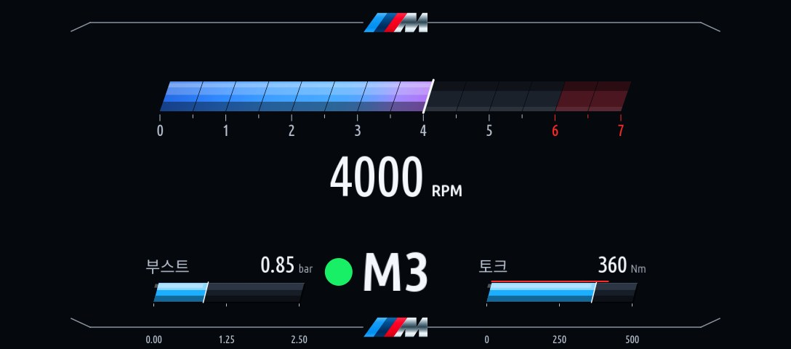

# 계기판 레드라인 1.3.67

[English](README.md)

계기판(클러스터)과 HUD에 회전수·변속 알림·기어·부가정보를 그리는 iDrive 7·8 앱입니다. 애니메이션 레이아웃(자동차 그림 또는 GIF 플레이어에서 가져온 내 GIF), BC 버튼 따라가기, HUD 길안내·차량 알림, 운전자별 설정과 즐겨찾기를 지원합니다.

- [설명서](../../docs/CLUSTER-REDLINE.ko.md) — 기본설정부터 즐겨찾기까지, 내 그림 넣기
- [설치 안내](../../docs/INSTALL.ko.md)
- [스크린샷 모음](../../screenshots/README.md)
- [업데이트 이력](../../CHANGELOG.md)
- 라이선스: 1.3.10부터 허락 필요([LICENSE](LICENSE), [NOTICE](NOTICE))
