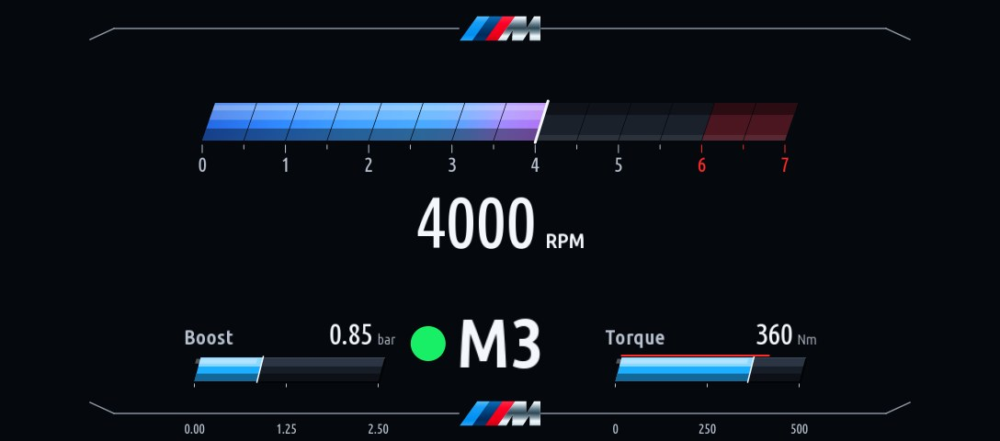

# Cluster Redline 1.3.93

[한국어](README.ko.md)

An iDrive 7 and 8 app that draws rpm, shift alerts, the gear and auxiliary information on the instrument cluster and the HUD. Animation layout (an animated car, or your own GIFs from the GIF player), a screen per drive-mode group, following the BC button, HUD navigation (3D or neon icons) and vehicle alerts, the lead-car headway, departure alert, lane lines and scene recording (with the lead-car helper `redline-lead`), settings per driver and favourites.

- [User guide](../../docs/CLUSTER-REDLINE.md) — from Basic settings to Favorites, adding your own pictures
- [Installation](../../docs/INSTALL.md)
- [Screenshots](../../screenshots/README.md)
- [Changelog](../../CHANGELOG.md)
- License: permission required from 1.3.10 ([LICENSE](LICENSE), [NOTICE](NOTICE))
