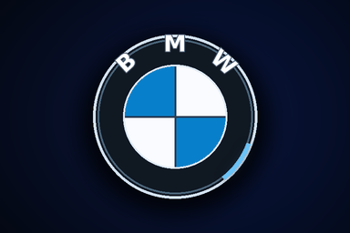
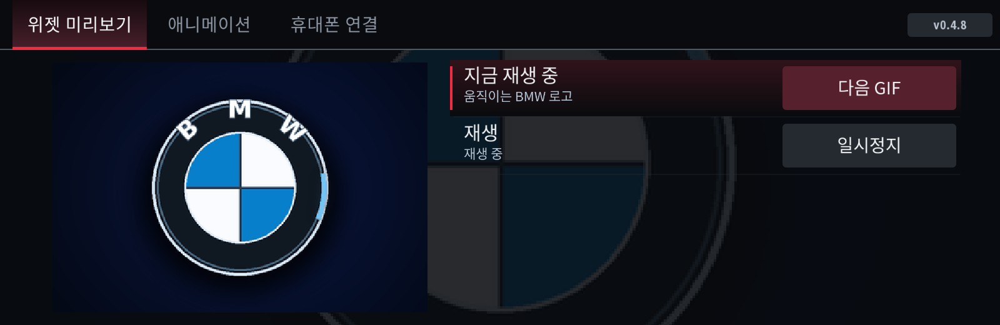
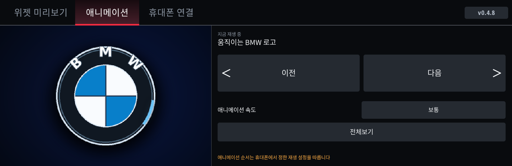
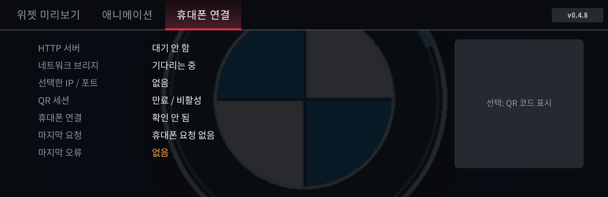
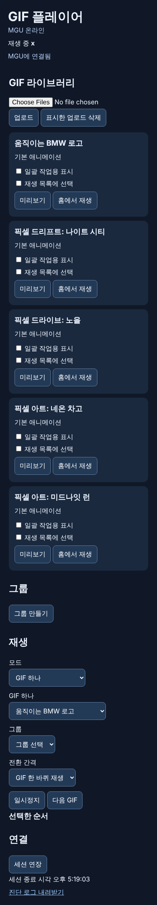
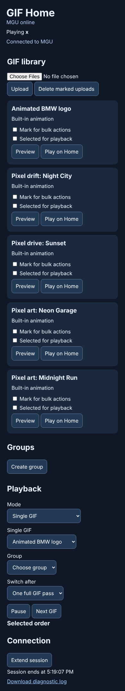

# GIF 플레이어 0.4.8 설명서 (한국어판)

[English](README.md) · [설치 안내](../../docs/INSTALL.ko.md) · [앱 소개](../../README.ko.md)

GIF 플레이어는 움직이는 GIF를 iDrive 7 **홈 화면 위젯**과 **애니메이션 화면**에 재생합니다.
GIF는 **휴대폰**에서 차의 Wi-Fi로 올리고, 재생 방식도 휴대폰에서 정합니다. 기본 애니메이션 5개가 들어 있습니다.
여기에 올린 GIF는 **계기판 레드라인의 애니메이션 레이아웃**에서도 그대로 씁니다([아래](#계기판-레드라인에서-쓰기)).

원작은 NamelsMissing의 **GIF Home**(GPL-3.0)이고, 이 판은 차 화면과 휴대폰 페이지를 한국어로 옮기고 애니메이션 화면을 더한 수정본입니다.

> 그림은 실제 설치 패키지의 그리기 코드로 만든 예시 화면입니다. 휴대폰 페이지는 같은 코드를 PC 브라우저로 연 모습입니다.

## 1. 설치

1. MGU Store에 소스 **`jaimeen77-cmyk/apps`**와 **`jaimeen77-cmyk/appsKOR`**(둘 다 브랜치 `main`)를 등록합니다.
2. **GIF 플레이어 (한국어)**를 설치합니다. 다음 도구가 함께 설치됩니다.
   - **GPU 렌더러**(`idrive7-renderd`)와 **iDrive 컨트롤러 연결**(`mgu-inputgate`): appsKOR 소스에서. 애니메이션 화면을 빠르게 그리고 터치를 받습니다.
   - **GIF Home Network Bridge**(`mgu-gif-net`): 이 소스에서. 휴대폰이 접속할 수 있게 차의 방화벽을 잠깐 여는 도우미입니다.
3. **iDrive 7 전용**입니다(원작과 같음). iDrive 8에서는 Store가 설치를 거부합니다.

원본 GIF Home(영어판)을 함께 설치했다면 하나만 쓰세요. 둘 다 TCP 18883을 써서 동시에 실행하면 하나는 휴대폰 연결을 열지 못합니다.

## 2. 홈 화면에 위젯 놓기

1. iDrive **HOME** 화면에서 컨트롤러를 **위로** 밀어 위쪽 메뉴를 엽니다.
2. **메인 메뉴 편집(Customize main menu)**을 고릅니다.
3. 놓을 칸을 고르고 목록에서 **GIF 플레이어**를 추가합니다.
4. **큰 타일**을 고르면 GIF가 재생되고, 좁은 타일에는 지금 재생 중인 GIF 이름이 나옵니다.
5. 저장합니다.

위젯은 홈 화면의 그림 칸이라 초당 1~6장(기본 4장)으로 바뀝니다. 부드러운 재생은 애니메이션 화면에서 봅니다.

## 3. 차 화면

아래 버튼: **페이지**(세 페이지를 차례로), **다음 항목 / IP**(선택 옮기기 / 다른 IP 주소), **선택**(강조된 행의 버튼 누르기), **휴대폰**, **진단**, **설정**.

> 위젯 미리보기와 휴대폰 연결 화면은 HMI가 그리는 화면이라 터치가 되지 않고 아래 버튼으로 조작합니다. 터치는 애니메이션 화면에서 됩니다.

### 1 위젯 미리보기

홈 위젯에 나오는 GIF를 위젯 모양으로 봅니다. **다음 GIF**, **일시정지 / 다시 재생**.

### 2 애니메이션

이 페이지로 오면 애니메이션 화면이 열립니다. 왼쪽에 GIF, 오른쪽에 버튼이 있습니다.

- **< 이전 / 다음 >**: 바로 전에 재생한 GIF / 다음 GIF(재생 모드는 그대로)
- **애니메이션 속도**: 이 화면에만 적용(절반 · 보통 · 1.5배 · 2배)
- **전체보기**: 탭·버튼 없이 GIF만 화면 가운데에 크게 보여 줍니다. 화면을 누르거나 컨트롤러를 누르면 다시 이 화면으로 돌아옵니다.
- 재생 순서는 휴대폰에서 정한 재생 설정을 따릅니다(위젯과 같은 GIF가 나옵니다).
- GPU 렌더러가 있으면 GIF 원래 속도(화면 새로 고침마다 최대 한 장)로 그리고 터치가 됩니다. 없으면 초당 몇 장으로만 보이고 아래 버튼(이전 / 다음 / 애니메이션 설정)으로 조작합니다.

### 3 휴대폰 연결

휴대폰을 연결하는 QR 코드와 연결 상태를 보여 줍니다(아래 4번).

**진단**은 아래 **진단** 버튼으로 엽니다. 최근 기록을 보여 주고, **다음 항목 / IP**로 넘기며, **선택**을 두 번 누르면 지웁니다.

## 4. 휴대폰으로 GIF 올리기

1. 휴대폰을 **차의 Wi-Fi(핫스팟)**에 연결합니다.
2. 차에서 **휴대폰** 버튼(또는 휴대폰 연결 페이지)을 열고 **선택**을 누르면 QR 코드가 나옵니다.
3. 휴대폰 카메라로 QR을 스캔하면 휴대폰 브라우저에 GIF 플레이어 페이지가 열립니다. 휴대폰 언어가 한국어면 페이지도 한국어입니다.

| 휴대폰 페이지 (한국어) | 휴대폰 페이지 (영어) |
|---|---|
|  |  |

휴대폰 페이지에서 하는 일:

- **GIF 라이브러리**: **업로드**로 GIF를 올리고, **미리보기**, **홈에서 재생**(그 GIF 하나만 재생), 표시한 GIF 한꺼번에 삭제.
- **그룹**: 그룹을 만들고 GIF를 넣고 빼기.
- **재생**: 모드, GIF 하나, 그룹, 전환 간격, 일시정지, 다음 GIF, 선택한 순서.
- **연결**: **세션 연장**(QR은 30분 뒤 만료), 진단 기록 내려받기.

| 재생 모드 | 재생 |
|---|---|
| GIF 하나 | 고른 GIF를 반복 |
| 무작위 – 선택한 GIF | 체크한 GIF를 섞어서 |
| 무작위 – 그룹 | 그룹의 GIF를 섞어서 |
| 차례대로 | 체크한 GIF를 정한 순서대로 |
| 무작위 – 전체 | 올린 GIF와 기본 애니메이션 모두 섞어서 |

전환 간격은 GIF 한 바퀴, 5·10·15·30초(또는 직접 입력, 최대 1시간)입니다. 설정을 바꾸면 페이지에 `MGU가 확인함`이 나옵니다.

**올릴 수 있는 GIF**: 파일당 6 MB, 최대 640 × 360, 90프레임. 라이브러리는 64개 또는 96 MiB까지. 넘는 GIF는 줄이지 않고 거절합니다. 올린 파일은 원본 그대로 저장합니다.

### 연결이 안 될 때

- **안드로이드**: 차 핫스팟은 인터넷이 없어서, 휴대폰이 요청을 모바일 데이터로 보낼 수 있습니다. 그러면 페이지는 열려도 설정이 차에 닿지 않습니다(`MGU가 응답하지 않습니다`). GIF를 관리하는 동안 **모바일 데이터를 끄거나**, "인터넷 없음" 알림에서 **연결 유지**를 고르세요.
- **아이폰**: 무선 CarPlay로 연결된 경로에서는 Safari가 접속하지 못하는 경우가 있습니다.
- 휴대폰 연결 페이지의 **HTTP 서버**, **네트워크 브리지**, **QR 세션**, **휴대폰 연결**, **마지막 오류** 줄을 확인하세요. 다른 주소를 시도하려면 **다음 항목 / IP**.
- 도우미(`mgu-gif-net`)는 차 Wi-Fi(`wlan_bridge`)의 사설 주소에서 오는 TCP 18883만, 연결 세션이 유효한 동안에만 엽니다. 외부 서비스나 포트 포워딩은 쓰지 않습니다.

## 5. 설정 (아래 설정 버튼)

재생 설정은 휴대폰에서 하고, 위젯 그림과 애니메이션 화면 설정은 여기서 합니다.

| 설정 | 선택지 |
|---|---|
| 애니메이션 화면 | GPU 렌더러 (mgu-renderd, 부드럽게)(기본) / GPU 없이 (초당 몇 프레임) |
| 위젯 그림 맞춤 | 꽉 채우기 / 가장자리 자르기 · 그림 전체 / 여백(기본) |
| 위젯 속도 | 절반 속도 / 보통 / 1.5배 속도 |
| 위젯 새로 고침 빈도 | 초당 1~6(기본 4) |
| BMW 기본 위젯 배경 | 켜짐 / 꺼짐(기본) |
| 홈 위젯 밝기 | GIF 원래 색(기본) / 예전 밝기 보정 / 가장자리 보정 강화 / 원래 색, 기본 배경 끔 |

## 계기판 레드라인에서 쓰기

GIF 플레이어에 올린 GIF는 **계기판 레드라인**의 **애니메이션** 레이아웃(계기판·HUD)에서도 씁니다. GIF 플레이어에서 따로 할 일은 없습니다.

1. GIF 플레이어에 휴대폰으로 GIF를 올려 두고, GIF 플레이어를 한 번 실행합니다.
2. 계기판 레드라인 → **계기판 표시 설정 → 디자인 변경 → 애니메이션**에서 주행(필수)·정지·후진·좌회전·우회전 장면마다 GIF를 고릅니다.
3. **GIF 플레이어에서 가져오기**를 누릅니다.

- GIF 플레이어는 원본을 이 헤드유닛 안에서만(127.0.0.1) 계기판 레드라인에 빌려줍니다. 계기판 레드라인은 계기판 그림 칸에 맞게 줄인 사본(320 × 180 안, 최대 30장)을 따로 저장합니다.
- 가져온 뒤에는 GIF 플레이어가 꺼져 있어도 됩니다. GIF를 바꾸면 계기판 레드라인에서 다시 **가져오기**를 누르세요.
- 작은 GIF일수록 계기판에서 빠르게 움직입니다(160 × 90 권장). 자세한 내용은 [계기판 레드라인 설명서](../../docs/CLUSTER-REDLINE.ko.md#6-2-애니메이션-자동차-그림--내-gif).

## 저장

GIF는 앱 data 폴더의 `gifs/`에, 목록·그룹·재생 설정은 `library.json`에 저장되어 업데이트해도 남습니다.

## 라이선스와 출처

원작 GIF Home(NamelsMissing/mgu-apps)의 **GPL-3.0**을 따릅니다. 전체 소스는 이 저장소에 있습니다. 자세한 내용은 [NOTICE](NOTICE)와 [NOTICE.gif-home.md](../../NOTICE.gif-home.md).
QR 생성기는 Kazuhiko Arase의 QR Code Generator(MIT, [LICENSE](LICENSE)). 아이콘 그림은 저장소 소유자가 제공한 것으로 GPL 코드에 포함되지 않습니다.
