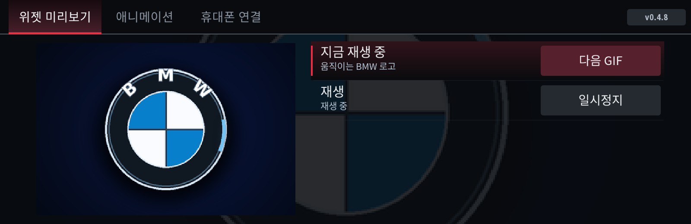
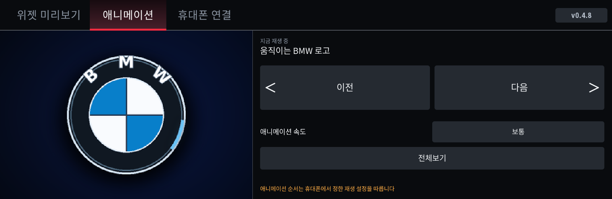
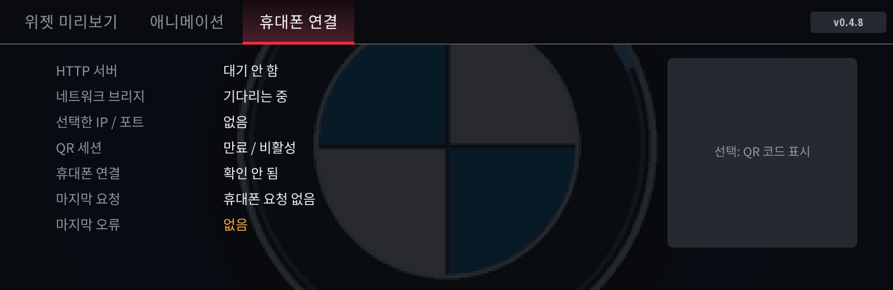
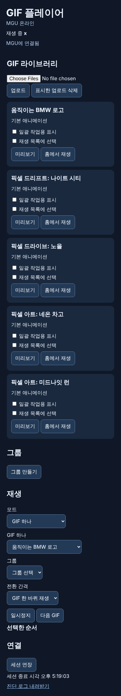
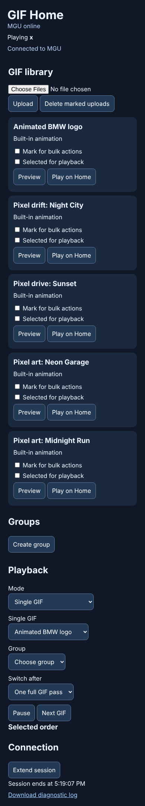

# GIF 플레이어 (GIF player) 0.4.8 guide — Korean edition

[한국어](README.ko.md) · [Installation](../../docs/INSTALL.md) · [The apps](../../README.md)

The GIF player plays animated GIFs in the iDrive 7 **home-screen widget** and on its **Animation screen**.
You upload the GIFs from your **phone** over the car's Wi-Fi, and choose how they play there too. Five built-in animations are included.
The GIFs uploaded here are also used by **Cluster Redline's Animation layout** ([below](#using-them-in-cluster-redline)).

It is NamelsMissing's **GIF Home** (GPL-3.0), modified: the car screens and the phone page in Korean (the phone page in English on a phone set to another language), and an Animation screen added. The car screens of this edition are in Korean; the guide gives the Korean labels with their meaning, and the settings by their original English names.

> The pictures are drawn by the actual package's drawing code; the phone page is the same page opened in a PC browser.

## 1. Install

1. Add MGU Store sources **`jaimeen77-cmyk/apps`** and **`jaimeen77-cmyk/appsKOR`** (both branch `main`).
2. Install **GIF 플레이어 (한국어)**. These tools are installed with it:
   - The **GPU renderer** (`idrive7-renderd`) and the **iDrive controller gate** (`mgu-inputgate`), from appsKOR: they draw the Animation screen fast and give it touch.
   - **GIF Home Network Bridge** (`mgu-gif-net`), from this source: a helper that opens the car's firewall briefly so the phone can connect.
3. **iDrive 7 only** (like the original). On iDrive 8 the Store refuses it.

If the original GIF Home (English) is installed too, use only one: both use TCP 18883, so run together one cannot open the phone connection.

## 2. Placing the widget on the home screen

1. On the iDrive **HOME** screen push the controller **up** to open the top menu.
2. Choose **Customize main menu**.
3. Choose a slot and add **GIF 플레이어** from the list.
4. A **large tile** plays the GIF; a narrow tile shows the name of the GIF playing.
5. Save.

The widget is a picture slot of the home screen, refreshed 1–6 times a second (4 by default). For smooth playback use the Animation screen.

## 3. The car screens

The bottom buttons: **페이지** (Page: the three pages in turn), **다음 항목 / IP** (Next item / IP), **선택** (Select: press the highlighted row's button), **휴대폰** (Phone), **진단** (Diagnostics), **설정** (Settings).

> The Widget preview and Phone connection pages are drawn by the HMI itself: touch does not work there, use the bottom buttons. Touch works on the Animation screen.

### 1 위젯 미리보기 (Widget preview)

The GIF the home widget shows, in the widget's shape. **다음 GIF** (Next GIF), **일시정지 / 다시 재생** (Pause / Resume).

### 2 애니메이션 (Animation)

Paging here opens the Animation screen: the GIF on the left, buttons on the right.

- **< 이전 / 다음 >** (Previous / Next): the GIF played before / the next GIF (the playback mode stays)
- **애니메이션 속도** (Animation speed): this screen only (half, normal, 1.5×, 2×)
- **전체보기** (Full view): the GIF alone, large, in the middle of the screen, without tabs or buttons. A tap or a press of the controller brings the screen back.
- The order follows the playback settings made on the phone (the same GIFs as the widget).
- With the GPU renderer the GIF plays at its own speed (up to one frame per screen refresh) and takes taps. Without it, a few frames a second and the bottom buttons (Previous / Next / Animation settings).

### 3 휴대폰 연결 (Phone connection)

The QR code that connects the phone, and the connection state (see 4).

**진단** (Diagnostics) opens with its own button: the latest log lines; **Next item / IP** pages through them, **Select** twice clears them.

## 4. Uploading GIFs from your phone

1. Connect the phone to the **car's Wi-Fi (hotspot)**.
2. In the car open **휴대폰** (Phone) and press **선택** (Select): a QR code shows.
3. Scan the QR with the phone's camera: the GIF player page opens in the phone's browser, in Korean on a Korean phone, in English otherwise.

| Phone page (Korean phone) | Phone page (English) |
|---|---|
|  |  |

On the phone page:

- **GIF library**: **Upload** GIFs, **Preview**, **Play on Home** (play that one alone), delete the marked ones together.
- **Groups**: make groups, add GIFs to them and take them out.
- **Playback**: mode, single GIF, group, interval, pause, next GIF, the selected order.
- **Connection**: **Extend session** (the QR expires after 30 minutes), download the diagnostic log.

| Mode | Plays |
|---|---|
| Single GIF | The chosen GIF, over and over |
| Random – Selected GIFs | The ticked GIFs, shuffled |
| Random – Group | The group's GIFs, shuffled |
| Sequential | The ticked GIFs in the order set |
| Random – All | Every uploaded and built-in GIF, shuffled |

The interval is one full GIF pass, 5, 10, 15 or 30 s (or typed in, up to an hour). After a change the page says the MGU confirmed it.

**GIFs accepted**: up to 6 MB a file, 640 × 360, 90 frames. The library holds 64 GIFs or 96 MiB. A larger GIF is refused, not shrunk; uploaded files are stored exactly as uploaded.

### When the phone does not connect

- **Android**: the car's hotspot has no internet, so the phone may send requests over mobile data; the page opens but the settings never reach the car ("The MGU did not respond"). While managing GIFs **turn mobile data off**, or choose **stay connected** on the "no internet" notice.
- **iPhone**: over a wireless CarPlay link Safari sometimes cannot reach the car.
- Check the **HTTP server**, **Network bridge**, **QR session**, **Phone connection** and **Last error** lines of the Phone connection page. **Next item / IP** tries another address.
- The helper (`mgu-gif-net`) opens only TCP 18883 from private addresses on the car's Wi-Fi (`wlan_bridge`), and only while a session is valid. No outside service or port forwarding is used.

## 5. Settings (the Settings button)

Playback is set on the phone; the widget's picture and the Animation screen are set here.

| Setting | Choices |
|---|---|
| Animation screen | GPU renderer (mgu-renderd, smooth) (default) / Without GPU (a few frames a second) |
| Widget picture fit | Fill / crop edges · Full picture / bars (default) |
| Widget speed | Half speed / Normal / 1.5x speed |
| Widget refresh rate | 1–6 a second (default 4) |
| Native widget background | On / Off (default) |
| Home widget brightness | Original GIF colours (default) / Legacy brightness compensation / Extended edge compensation / Original colours, native background off |

## Using them in Cluster Redline

The GIFs uploaded to the GIF player are also used by **Cluster Redline**'s **Animation** layout (cluster and HUD). Nothing needs doing in the GIF player.

1. Upload GIFs to the GIF player from your phone and run the GIF player once.
2. In Cluster Redline → **Cluster display setting → Design → Animation**, choose a GIF for each scene: driving (required), standing still, reverse, turning left, turning right.
3. Press **Fetch from GIF player**.

- The GIF player lends the originals to Cluster Redline only inside the head unit (127.0.0.1). Cluster Redline keeps its own copy, scaled to the cluster's picture box (within 320 × 180, at most 30 frames).
- Once fetched, the GIF player may be off. After changing GIFs, press **Fetch** again in Cluster Redline.
- Smaller GIFs move faster on the cluster (160 × 90 recommended). More in the [Cluster Redline guide](../../docs/CLUSTER-REDLINE.md#6-2-animation-the-animated-car--your-gifs).

## Storage

GIFs are kept in the app's data folder under `gifs/`; the list, groups and playback settings in `library.json`. Updates keep them.

## License and origin

**GPL-3.0**, as the original GIF Home (NamelsMissing/mgu-apps); the complete source is in this repository. See [NOTICE](NOTICE) and [NOTICE.gif-home.md](../../NOTICE.gif-home.md).
The QR code generator is Kazuhiko Arase's QR Code Generator (MIT, [LICENSE](LICENSE)). The icon is a picture supplied by the repository owner and is not part of the GPL-licensed code.
