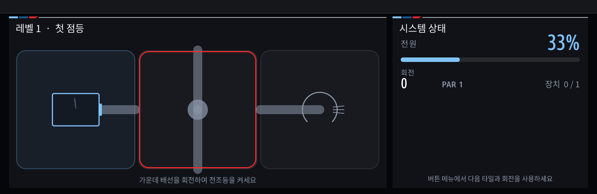
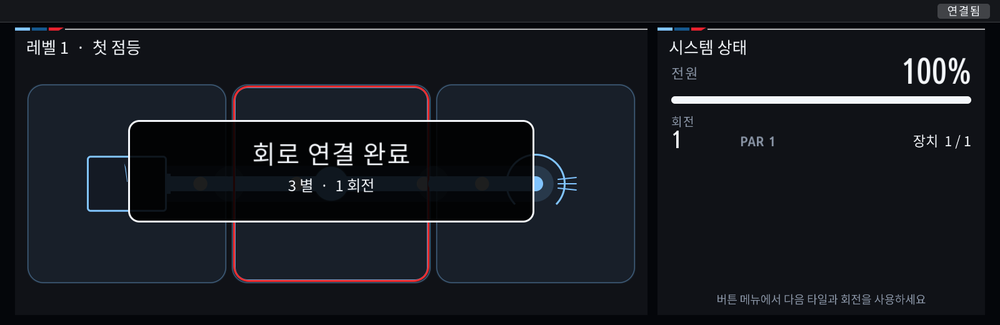

# 아이드라이브 회로 1.0.5 설명서

[English](README.md) · [설치 안내](../../docs/INSTALL.ko.md) · [앱 소개](../../README.ko.md)

주차 중에 iDrive 컨트롤러나 터치로 즐기는 회로 퍼즐입니다. 배선 타일을 돌려 배터리의 전기가 모든 장치(전조등 등)에 닿게 하면 레벨을 통과합니다.
회로와 전기는 게임 속 시뮬레이션이며, 차의 실제 장치와는 관계없습니다.

> 그림은 실제 설치 패키지의 그리기 코드로 만든 예시 화면입니다.

## 설치

MGU Store에 소스 **`jaimeen77-cmyk/apps`**(브랜치 `main`)를 등록하고 **아이드라이브 회로 (한국어)**(영어판은 iDrive Circuit (English))를 설치합니다. iDrive 7과 iDrive 8에 설치됩니다. 계기판 렌더러 같은 다른 도구는 필요 없습니다.

## 화면

- **왼쪽**: 회로판. 빨간 테두리가 지금 고른 타일입니다. 배터리(왼쪽)에서 장치(오른쪽)까지 선이 이어지도록 가운데 타일들을 돌립니다.
- **오른쪽 시스템 상태**: **전원**(전기가 닿은 비율 %), **회전**(돌린 횟수), **PAR**(목표 회전 수), **장치**(전기가 닿은 장치 / 전체).
- 아래 줄에 지금 레벨의 안내가 나옵니다.

모든 장치에 전기가 닿으면 **회로 연결 완료**와 별 개수, 회전 수가 나옵니다.

## 조작

| 방법 | 동작 |
|---|---|
| 컨트롤러 돌리기 | 타일 고르기 |
| 컨트롤러 밀기 | 옆 타일로 이동 |
| 컨트롤러 누르기 / 타일 터치 | 고른 타일 회전 |
| 버튼 메뉴 | **다음 타일**, **회전**, **되돌리기**, **힌트**, **다시 시작**, **이전 레벨**, **다음 레벨**, **설정** |

GPU 렌더러가 없어 소프트웨어로 그릴 때는 버튼 메뉴의 **다음 타일**과 **회전**으로 조작합니다.

## 레벨과 별

- 튜토리얼을 포함해 **30개 레벨**입니다. 레벨을 통과하면 다음 레벨이 열립니다(열리지 않은 레벨은 `다음 레벨 (잠김)`).
- 별: PAR 이하로 풀면 ★3, PAR + 3 이하면 ★2, 그보다 많으면 ★1. **힌트**를 쓰면 최대 ★2입니다.
- 진행 상황(열린 레벨, 레벨별 최고 기록과 별)은 자동으로 저장됩니다.

## 설정

| 설정 | 선택지 |
|---|---|
| 주차 중에만 실행 (주행 중 일시 중지) | 켜짐(기본) / 꺼짐. 켜져 있으면 3 km/h를 넘을 때 퍼즐 입력이 잠깁니다 |
| 화면 색상 | M 레드 / M 삼색 / 아이스 화이트 / 나이트 앰버 |
| 화면 배치 | 전체 화면 / 표준 |
| 렌더러 | GPU 60 fps(기본) / 소프트웨어 |

차량 속도 신호만 읽고, 차에 아무것도 쓰지 않습니다. **운전 중에는 퍼즐을 조작하지 마세요.**

## 라이선스

MIT([LICENSE](../../LICENSE)).
