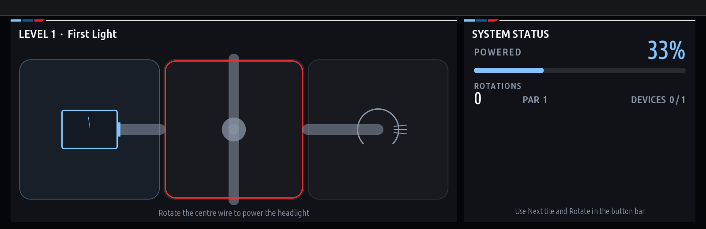
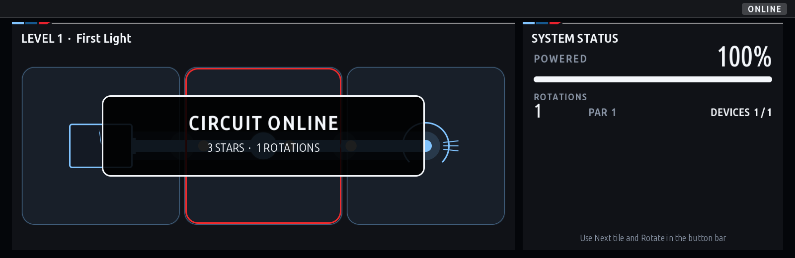

# iDrive Circuit 1.0.5 guide

[한국어](README.ko.md) · [Installation](../../docs/INSTALL.md) · [The apps](../../README.md)

A circuit puzzle for when the car is parked, played with the iDrive controller or touch. Rotate the wiring tiles until the battery's power reaches every device (the headlight and so on) to clear the level.
The circuit and its power are a simulation inside the game; nothing in the car is involved.

> The pictures are drawn by the actual package's drawing code.

## Install

Add MGU Store source **`jaimeen77-cmyk/apps`** (branch `main`) and install **iDrive Circuit (English)** (the Korean edition is 아이드라이브 회로 (한국어)). It installs on iDrive 7 and iDrive 8 and needs no other tools.

## The screen

- **Left**: the board. The red frame is the selected tile. Rotate the tiles in between until a wire runs from the battery (left) to the devices (right).
- **System status, right**: **Powered** (the share that has power, %), **Rotations** (your turns), **PAR** (the target number of rotations), **Devices** (powered / all).
- The line below gives the level's hint.

With power at every device, **CIRCUIT ONLINE** shows with your stars and rotations.

## Controls

| Input | Action |
|---|---|
| Turn the controller | Choose a tile |
| Push the controller | Move to the neighbouring tile |
| Press the controller / tap a tile | Rotate the chosen tile |
| Button menu | **Next tile**, **Rotate**, **Undo**, **Hint**, **Restart**, **Previous level**, **Next level**, **Settings** |

Without the GPU renderer (software drawing), use **Next tile** and **Rotate** in the button menu.

## Levels and stars

- **30 levels**, tutorial included. Clearing a level unlocks the next one (a locked one says `Next level (locked)`).
- Stars: at or under PAR ★3, up to PAR + 3 ★2, more ★1. Using a **Hint** gives at most ★2.
- Progress (unlocked levels, best result and stars per level) is saved automatically.

## Settings

| Setting | Choices |
|---|---|
| Parked only (pauses while driving) | On (default) / Off. On: the puzzle's input locks above 3 km/h |
| Colour theme | M Red / M Tricolour / Ice White / Night Amber |
| Screen layout | Full screen / Standard |
| Renderer | GPU 60 fps (default) / Software |

It only reads the vehicle speed and writes nothing to the car. **Do not play while driving.**

## License

MIT ([LICENSE](../../LICENSE)).
