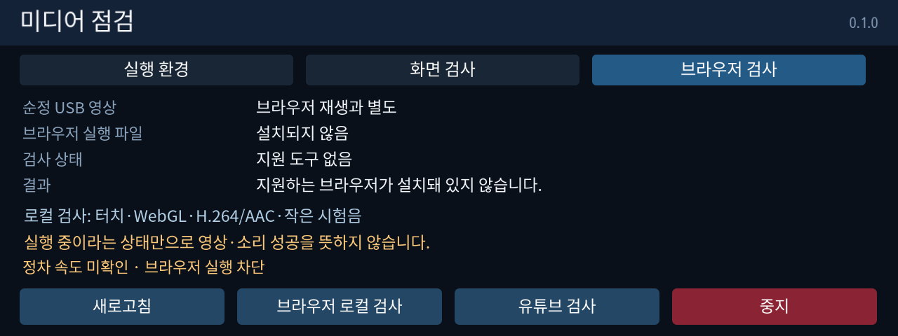

# 미디어 점검 0.1.0

**브라우저를 설치해 주는 앱이나 완성된 유튜브 플레이어가 아닙니다.** 차량에 호환되는 Chromium/Firefox 실행 파일이 이미 있는지 확인하고, 있는 경우 브라우저의 영상·소리·입력 경로를 시험하는 앱입니다. 순정 USB 영상이 재생돼도 브라우저 경로가 지원된다는 뜻은 아닙니다.

MGU Store 소스 `jaimeen77-cmyk/apps`의 main을 새로고침하면 **미디어 점검 (한국어)** 또는 **Media Check (English)**를 선택할 수 있습니다. 기본판은 영어이며 수동 실행입니다. 기존 레드라인 앱은 바뀌지 않습니다. 표준 소스 빌드는 `python kit/tools/build.py --language ko media_check`입니다.

- **실행 환경:** CPU·Node·glibc, GPU 장치 파일과 화면 환경 변수, 브라우저 경로, 이 앱의 RSS/JS 힙입니다. 파일·환경 변수가 있다는 사실만으로 가속이나 출력 성공을 판정하지 않습니다.
- **화면 검사:** 색상 막대·명암·움직이는 점·터치 버튼을 보여줍니다. 이것은 앱의 그리기 경로이며 브라우저 화면의 성공과 별개입니다.
- **브라우저 로컬 검사:** 설치된 브라우저에서 로컬 페이지를 엽니다. 터치 횟수, WebGL 컨텍스트 생성, 선언된 코덱 지원, 실제 H.264/AAC 시험 영상과 작은 시험음을 확인합니다. 재생·시험음은 사용자가 페이지에서 눌러야 시작됩니다.
- **유튜브 검사:** 별도로 누르면 같은 브라우저로 `https://www.youtube.com/`을 엽니다. 인터넷 연결과 브라우저 호환성이 필요하며 유튜브 동작은 아직 차량에서 확인하지 않았습니다.
- **중지:** 앱이 실행한 브라우저 프로세스 그룹을 종료합니다. 화면을 벗어나거나 최신 정차 속도가 사라져도 중지합니다. 브라우저 검사는 최대 90초입니다.

## 사용 순서

1. 차량이 정차한 상태에서 앱을 엽니다. `Vehicle2.statusCarSpeed2`가 3초 이내에 수신되고 0.5km/h 이하여야 브라우저를 실행합니다. 신호를 받을 수 없으면 실행을 차단하며 수동 우회는 없습니다.
2. **실행 환경** 화면의 브라우저 실행 파일을 확인합니다. `설치되지 않음`이면 현재 지원하는 경로의 Chromium/Firefox가 없으므로 이 앱만으로 유튜브를 틀 수 없습니다. 이 앱은 브라우저 다운로드·설치를 하지 않습니다.
3. 브라우저가 있으면 **브라우저 로컬 검사**부터 실행하고 실제 화면·터치·움직이는 영상·소리를 확인합니다. 순정 오디오 포커스와의 연동은 미확인입니다.
4. 정상 동작할 때 **유튜브 검사**를 별도로 눌러 웹사이트 호환성을 확인합니다. 자동 로그인은 없습니다. 검사 프로필은 일반 브라우저 프로필과 분리하고 비공개 창을 요청합니다.
5. 안 되면 앱의 **브라우저 검사** 화면을 사진으로 보내주세요. `프로세스 실행 중`이나 종료 코드 0을 영상·소리 성공으로 간주하지 않습니다.

로컬 검사는 `127.0.0.1`의 임시 포트에서 HTML과 시험 영상 두 개만 제공합니다. 외부 장치에 페이지를 공개하거나 파일 목록을 내보내지 않습니다. 앱 종료 시 서버를 닫습니다. 앱의 진단 파일·연속 로그는 만들지 않지만, 브라우저가 자체 시험 프로필/캐시를 앱 데이터 폴더에 생성할 수 있습니다. 환경 설정·시스템 서비스·볼륨·순정 플레이어는 변경하지 않습니다. `--no-sandbox` 같은 보안 해제 옵션도 넣지 않습니다.

## 검증 범위

호스트 Chromium에서 로컬 페이지의 터치·Web Audio 요청·실제 H.264 프레임 진행·중지를 확인했습니다. 이는 PC 결과이며 차량의 화면 합성·오디오 포커스·실제 스피커 출력·유튜브 호환성을 증명하지 않습니다. 차량에 브라우저가 없다면 브라우저 이식은 후속 작업입니다.

시험 MP4는 FFmpeg의 `testsrc2` 320×180 / 15fps / 6초와 낮은 진폭의 440Hz 톤으로 생성한 원본 테스트 데이터입니다. 브라우저·FFmpeg 실행 파일이나 BMW SDK는 저장소에 배포하지 않습니다.

실제 앱 UI에 예시 상태를 넣은 화면이며 차량의 브라우저 설치 현황을 측정한 결과는 아닙니다.
