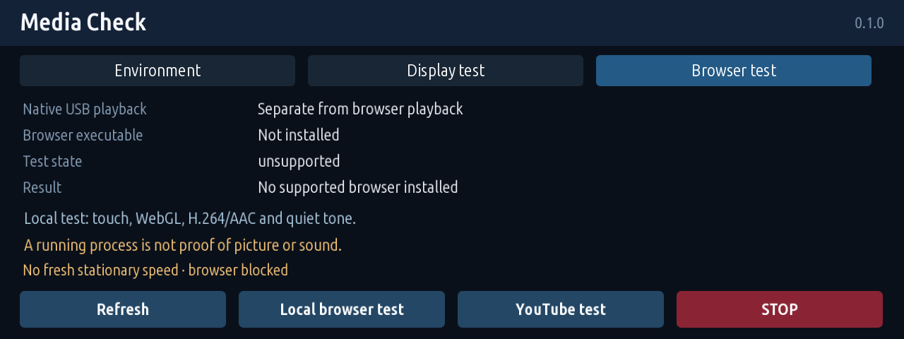

# Media Check 0.1.0

**A compatibility probe, not a bundled browser or a finished YouTube player.** Native USB video playback and browser playback use different software paths. This app checks for an existing Chromium/Firefox, provides an app display/input pattern, and can open a local browser test page or, on a separate button press, YouTube.

Install **Media Check (English)** or **미디어 점검 (한국어)** from `jaimeen77-cmyk/apps`, branch `main`. English is the default. Standard build: `python kit/tools/build.py media_check`; add `--language ko` for Korean. The app starts manually and does not change Cluster Redline.

- Environment: CPU/Node/glibc, GPU device presence, display environment, browser executable and app memory. Presence is not a compatibility pass.
- Display test: colour bars, gradient, moving marker and touch targets through the app's own rendering path.
- Local browser test: loopback-only HTML with touch counting, WebGL context and codec declarations, a six-second H.264/AAC test pattern and a quiet user-triggered Web Audio tone. No external page requests.
- YouTube test: explicitly opens `https://www.youtube.com/` in the installed browser; requires a working browser and internet access. No automated sign-in.
- STOP: terminates the browser group. Leaving the app, losing fresh stationary-speed data or the 90-second deadline also stops it. Process startup or exit zero never means audiovisual success.

Browser launch requires `Vehicle2.statusCarSpeed2` within three seconds at no more than 0.5 km/h. There is no missing-speed override. Browser detection covers common executable paths; an embedded HMI engine or Qt library alone does not qualify. No browser download, root escalation, sandbox disabling, system-service change, volume change or native-player modification is performed.

No diagnostic file or continuous app log is written. The browser may create its isolated test profile/cache in app data; private/incognito mode is requested. The loopback server serves exactly the test page and generated media, not arbitrary files, and closes on app shutdown.

Host Chromium tests cover page interaction, a Web Audio request, actual H.264 frame progress and stop. They do not establish vehicle compositing, speakers, audio focus or YouTube compatibility. Vehicle validation remains pending. [Korean instructions](README.ko.md).

Example-data render of the actual app UI; not a vehicle measurement.
