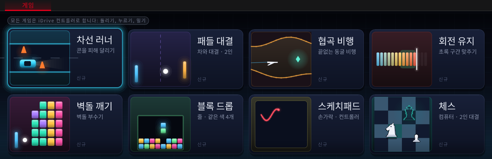
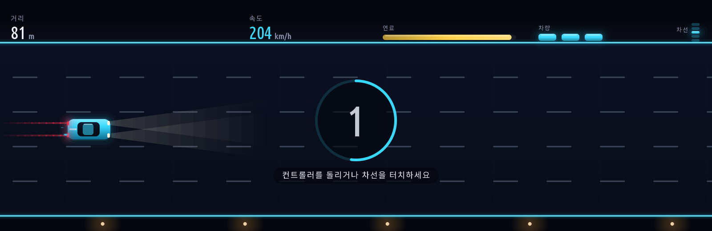
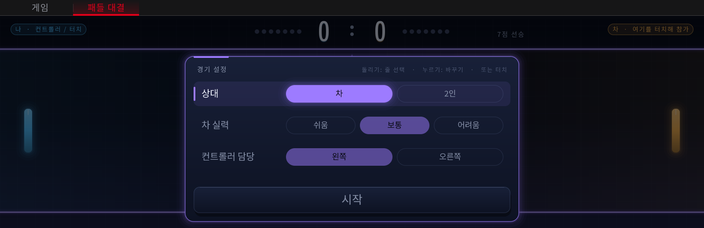
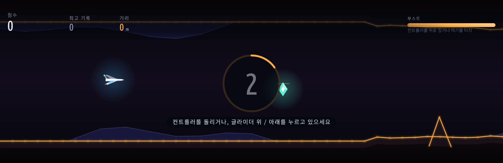
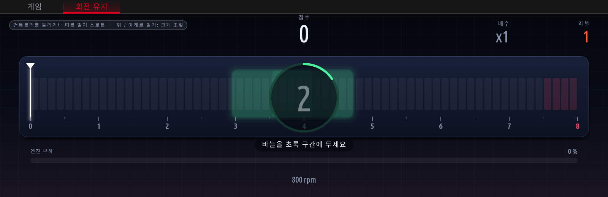
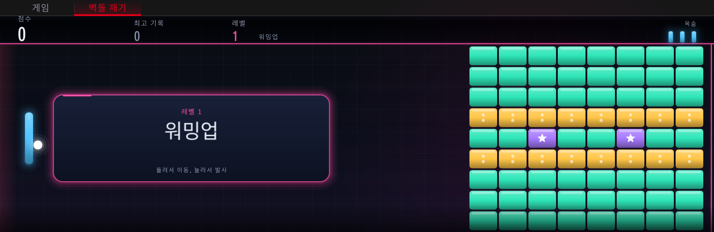
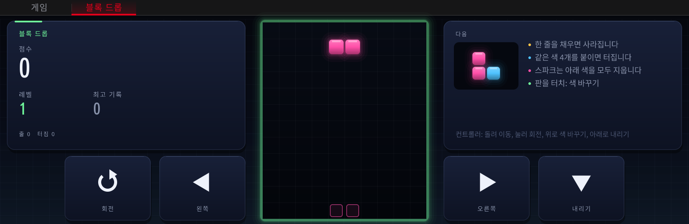
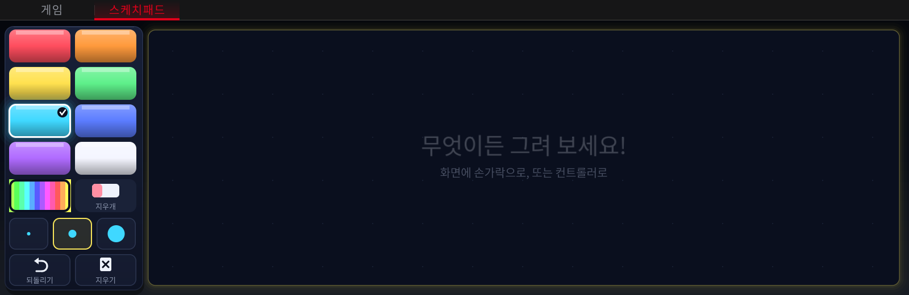
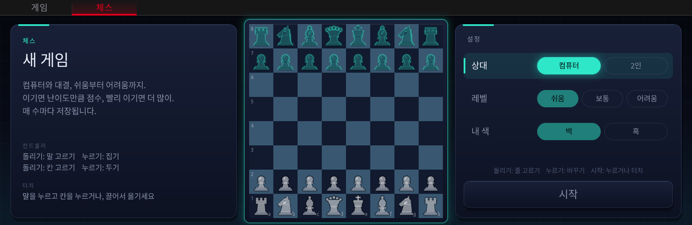

# 8게임즈 0.2.4 설명서

[설치 안내](../../docs/INSTALL.ko.md) · [앱 소개](../../README.ko.md)

주차 중에 iDrive 컨트롤러(와 터치스크린)로 즐기는 게임 8개를 한 앱에 담았습니다.
원작은 MaxxxFoka의 **Parked Games**(MIT)이며, 이 판은 화면 문구를 모두 한국어로 옮긴 한국어판입니다.

> 그림은 실제 설치 패키지의 그리기 코드로 만든 예시 화면입니다.

## 설치

1. MGU Store에 소스 **`jaimeen77-cmyk/apps`**와 **`jaimeen77-cmyk/appsKOR`**(둘 다 브랜치 `main`)를 등록합니다.
2. **8게임즈**를 설치합니다. 게임을 그리는 **GPU 렌더러**(`idrive7-renderd`)와 **iDrive 컨트롤러 연결**(`mgu-inputgate`)이 appsKOR 소스에서 함께 설치됩니다.
3. **iDrive 7 전용**입니다(원작과 같음). iDrive 8에서는 Store가 설치를 거부합니다.

## 메뉴

- 게임마다 타일이 있습니다. 컨트롤러를 돌려 고르고 누르거나, 타일을 터치하면 시작합니다.
- 타일 아래에 그 게임의 **최고** 기록이 나옵니다(처음이면 `신규`).
- 위쪽 탭: **게임**(메뉴) / 지금 하던 게임.
- **주차 중에만**: 차가 움직이면 게임이 멈추고, 메뉴에 `주차 중에만: 차가 움직이면 게임이 멈춥니다`가 나옵니다.
- **일시정지**: 게임 중 컨트롤러를 **길게 누르면** 일시정지됩니다. 거기서 계속하거나 **게임 메뉴**로 돌아갑니다. 한 판이 끝나면 점수와 순위표가 나오고 **한 판 더**를 고를 수 있습니다.

모든 게임은 **iDrive 컨트롤러만으로** 할 수 있습니다(돌리기·누르기·위아래좌우 밀기). 터치는 거들 뿐이고 꼭 필요하지 않습니다. 운전대와 페달은 쓰지 않습니다.

## 게임

### 차선 러너

차선을 바꿔 콘을 피하며 달립니다.
조작: 컨트롤러를 돌리거나 차선을 터치합니다.

### 패들 대결

차(컴퓨터)와 또는 2인으로 하는 탁구입니다. 시작 전에 상대(차 / 2인), 차 실력(쉬움·보통·어려움), 컨트롤러를 쓸 쪽(왼쪽·오른쪽)을 고릅니다.
조작: 컨트롤러를 돌리거나 내 쪽 화면을 끌어 패들을 움직이고, 위 / 아래로 밀어 크게 움직입니다.

### 협곡 비행

끝없는 동굴을 글라이더로 날아갑니다. 벽에 닿지 않게 오래 버티세요.
조작: 컨트롤러를 돌리거나 위로 밀고 있기, 또는 글라이더 위 / 아래를 손가락으로 누르고 있기.

### 회전 유지

움직이는 초록 구간 안에 회전수 바늘을 맞춰 둡니다(게임 속 회전수이며 차의 엔진과는 관계없습니다).
조작: 컨트롤러를 돌리거나 띠를 따라 밀어 가속, 위 / 아래로 밀면 크게 움직입니다.

### 벽돌 깨기

공을 튕겨 벽돌 벽을 부숩니다. 레벨 8개.
조작: 컨트롤러를 돌려 패들을 움직이고, 누르거나 터치해서 공을 발사합니다.

### 블록 드롭

떨어지는 블록으로 줄을 채우거나 같은 색 4개를 붙여 없앱니다.
조작: 돌리기 이동, 누르기 회전, 위로 밀기 색 바꾸기, 아래로 밀기 내려놓기. 블록 칸을 터치해도 색을 바꿉니다.

### 스케치패드

손가락이나 컨트롤러로 그림을 그립니다. 왼쪽에서 색과 굵기를 고르고, 되돌리기·지우기를 할 수 있습니다.
조작: 펜을 든 상태에서 밀어 이동하고 누르면 그리기 시작, 그리는 중에는 밀거나 돌려서 긋고 누르면 펜을 듭니다. 왼쪽 끝으로 가면 도구입니다.

### 체스

컴퓨터(쉬움·보통·어려움) 또는 2인으로 둡니다. 시작 전에 상대, 레벨, 내 색(백 / 흑)을 고릅니다. 컴퓨터를 이기면 난이도만큼, 빨리 이길수록 더 많은 점수를 받습니다.
조작: 돌려서 말을 고르고 누르면 잡기, 다시 돌려 칸을 고르고 누르면 두기. 말을 누르고 끌어서 옮겨도 됩니다.

## 저장

게임별 최고 기록과 순위표는 앱의 data 폴더에 저장되어, 앱을 업데이트해도 남습니다.

## 라이선스와 출처

원작 Parked Games(MaxxxFoka)와 App Kit(cauliflowermossgrape) 모두 MIT입니다. 자세한 내용은 [NOTICE](NOTICE).
게임은 모두 원작자의 오리지널 디자인입니다.

게임을 새로 추가하는 방법(개발자용)은 [GAMES.md](GAMES.md)(영어)에 있습니다.
