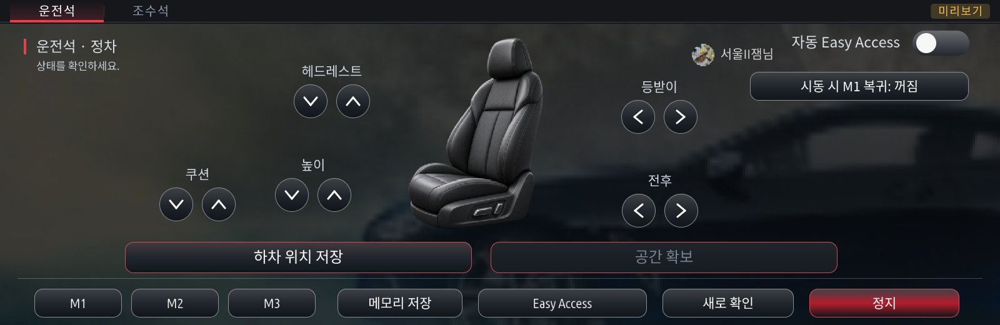
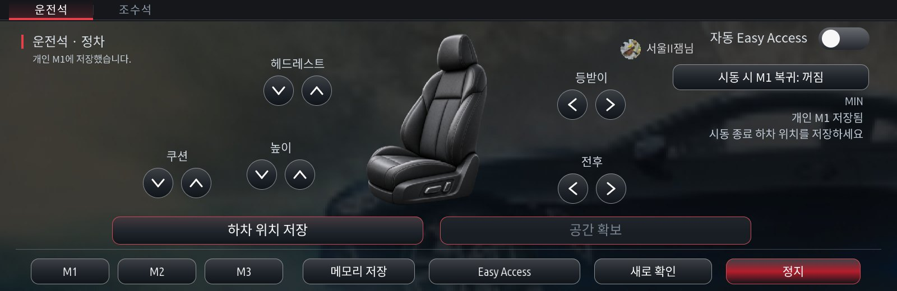
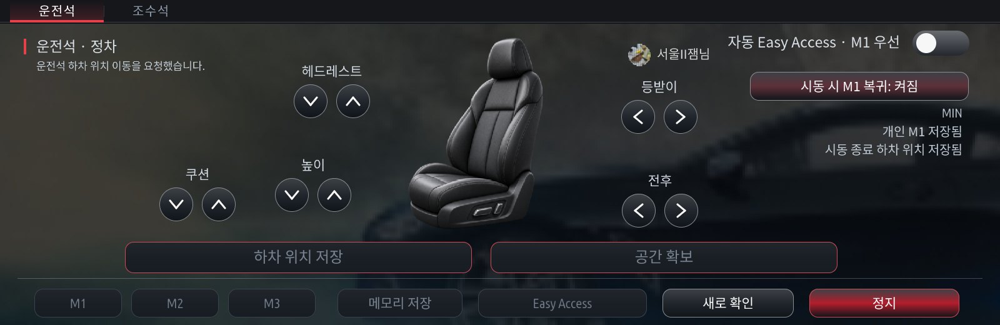

# 시트 Easy Access 0.7.12 설명서

[English](README.md) · [설치 안내](../../docs/INSTALL.ko.md) · [앱 소개](../../README.ko.md)

iDrive 화면에서 운전석·조수석 시트를 조절하고, 메모리(M1~M3)를 저장·호출하고, 타고 내릴 때 시트를 비켜 주는 **Easy Access**를 쓰는 앱입니다.
운전자마다 **개인 M1**을 두고 시동을 켤 때 자동으로 불러오는 **시동 시 M1 복귀**도 있습니다.

실제 시트 제어와 문·시동·착좌 판단은 IterioDev의 **Comfort**(`iteriodev-comfort`)가 합니다. 이 앱은 Comfort에 요청을 보내는 화면입니다.

> 그림은 실제 설치 패키지의 그리기 코드로 만든 예시 화면입니다(PC 미리보기, 예시 상태). 오른쪽 위 `미리보기` 표시는 PC에서만 나옵니다.

## 1. 설치

1. MGU Store에 소스 **`jaimeen77-cmyk/apps`**와 **`IterioDev/car-apps`**(둘 다 브랜치 `main`)를 등록합니다.
2. **시트 Easy Access (한국어)**(영어판은 Seats Easy Access (English))를 설치합니다. **Comfort 0.6.1 이상**과 `mgu-deploy` 0.7.11 이상이 함께 설치됩니다. Comfort는 이 저장소에 들어 있지 않고 IterioDev 소스에서 받습니다.
3. iDrive 7과 iDrive 8에 설치됩니다.

## 2. 화면

| 위치 | 내용 |
|---|---|
| 위쪽 탭 | **운전석 / 조수석**: 조작할 시트. 요청을 처리하는 동안에는 바뀌지 않습니다 |
| 왼쪽 위 | 지금 시트와 차 상태(`운전석 · 정차`)와 마지막 안내 |
| 가운데 | 시트 그림과 조절 버튼: **헤드레스트**, **쿠션**, **높이**, **등받이**, **전후** |
| 오른쪽 위 | **자동 Easy Access** 스위치, (운전석) **시동 시 M1 복귀** 버튼과 운전자 상태 |
| 가운데 아래 | **하차 위치 저장**, (조수석) **공간 확보** |
| 맨 아래 | **M1 / M2 / M3**, **메모리 저장**, **Easy Access**, **새로 확인**, **정지** |

- **조절**: 화살표를 누르고 있는 동안 시트가 움직이고, 손을 떼면 멈춥니다(GPU 화면에서 터치나 iDrive 컨트롤러). 일반 HMI 버튼으로는 짧게 조절합니다.
- **정지**: 움직이는 시트에 멈춤을 요청합니다. 요청일 뿐이므로, 항상 순정 시트 스위치에 손이 닿는 상태에서 쓰세요.
- **새로 확인**: Comfort에서 시트 위치와 상태를 다시 받아 옵니다.

## 3. 처음 설정

1. 차를 안전한 곳에 세우고 시트가 움직일 자리에 사람·짐이 없는지 확인합니다.
2. **새로 확인**을 누릅니다.
3. 순정 시트 스위치(또는 화면의 조절 버튼)로 내릴 때 편한 위치를 만듭니다.
4. **하차 위치 저장**을 누릅니다. 조수석도 필요하면 조수석 탭에서 같은 방법으로 저장합니다.
5. **자동 Easy Access** 스위치를 켭니다.
6. 처음에는 **Easy Access** 버튼으로 하차 위치까지 한 번 움직여 보고, 이상하면 바로 순정 시트 스위치나 **정지**를 쓰세요.

## 4. 메모리 M1~M3

- **호출**: **M1 / M2 / M3**를 누르면 저장된 위치로 움직입니다.
- **저장**: 원하는 위치로 맞춘 뒤 **메모리 저장**을 누르고(`저장할 M1~M3 버튼을 누르세요`), 이어서 **M1 / M2 / M3** 중 하나를 누릅니다.
- 운전석과 조수석이 따로 3칸씩입니다.
- 주행 중에는 저장·호출, Easy Access, 공간 확보가 잠깁니다. 위치 센서가 없는 시트에서는 저장·Easy Access 버튼이 잠깁니다.

## 5. Easy Access (타고 내리기)

- **자동 Easy Access 켜짐**: Comfort의 규칙대로, 정차해서 운전석 문을 열면 하차 위치로 물러나고, 문을 닫고 차를 켜면 원래 운전 위치로 돌아옵니다. 조수석은 차의 착좌 센서 지원 여부에 따라 다르게 동작할 수 있습니다.
- 이 스위치는 Comfort의 스위치라 **운전석과 조수석에 함께** 적용됩니다.
- **Easy Access** 버튼은 지금 시트를 저장된 하차 위치로 바로 움직입니다(수동).

## 6. 공간 확보 (조수석)

| 조수석 탭 | 공간 확보 뒤 |
|---|---|
|  |  |

조수석 탭의 **공간 확보**를 누르면 Comfort가 조수석을 앞으로 보내고 등받이를 기울여 뒷좌석 자리를 만듭니다. 그 뒤 버튼이 **조수석 원위치**로 바뀌고, 누르면 원래 자리로 돌아옵니다. 정차 중, 위치 센서가 있는 조수석에서만 쓰세요.

## 7. 운전자별 개인 M1과 시동 시 M1 복귀

| 개인 M1을 저장했을 때 | 시동 시 M1 복귀 켜짐 |
|---|---|
|  |  |

운전석 화면은 iDrive의 지금 **BMW 운전자 프로필**을 알아보고, 읽을 수 있으면 이름을 보여 줍니다(오른쪽 위 시동 시 M1 복귀 버튼 아래).

1. 각 운전자가 iDrive에서 **자기 프로필**을 고른 뒤 시트를 원하는 운전 위치로 맞춥니다.
2. **메모리 저장 → M1**을 누르면 그 운전자의 **개인 M1**이 저장됩니다(`개인 M1 저장됨`).
3. 운전석을 내릴 때 편한 뒤쪽 위치로 맞추고 **하차 위치 저장**을 한 번 누릅니다(`시동 종료 하차 위치 저장됨`). 모든 운전자가 같이 쓰는 위치입니다.
4. **시동 시 M1 복귀**를 눌러 **켜짐**으로 둡니다.

이제 그 운전자가 정차 후 시동을 끄면 문이 닫혀 있어도 운전석이 하차 위치로 물러나고, 다시 시동을 켜면 그 운전자의 개인 M1으로 돌아옵니다.

- 시동 후 약 8초를 기다렸다가 정차·운전석 위치·M1 저장 여부를 다시 확인하고, Comfort가 쉬고 있을 때 호출합니다. 준비되지 않으면 최대 45초 뒤 취소합니다. 한 번 호출 뒤에도 위치가 많이 다르면 한 번만 다시 호출합니다.
- 개인 M1은 Comfort의 운전석 메모리 3칸 중 빈 칸을 하나씩 씁니다. 그 칸은 운전석의 공용 M2/M3에서 잠깁니다. 빈 칸이 없으면 바꿀 칸을 알려 주고, 덮어써도 될 때만 30초 안에 **메모리 저장 → M1**을 다시 누르게 합니다.
- 한 명이라도 시동 시 M1 복귀를 켜면 Comfort의 **자동 Easy Access**가 꺼지고, 스위치 이름이 **자동 Easy Access · M1 우선**으로 바뀝니다. 수동 Easy Access와 시트 조절은 그대로 쓸 수 있습니다. 자동 Easy Access를 다시 쓰려면 켜 둔 운전자의 시동 시 M1 복귀를 끈 뒤 스위치를 켜세요.
- 앱은 자동으로 시작되고 화면이 닫혀도 뒤에서 확인합니다. 앱이 차가 꺼지는 것을 한 번도 보지 못했다면 그 시동에서는 하차 이동이 일어나지 않을 수 있습니다.

## 안전

- 저장과 수동 이동은 Comfort가 **정차**라고 알려 줄 때만 됩니다.
- 앱의 **정지**는 요청일 뿐 물리적 정지를 보장하지 않습니다. 항상 순정 시트 스위치에 손이 닿는 상태에서 쓰세요.
- 어린이 시트, 사람, 짐이 있는 조수석에서는 공간 확보·Easy Access를 쓰지 마세요.
- 처음 설치는 실험용으로 생각하고, 사람이 없는 상태에서 짧게 시험하세요.

## 문제 해결

| 증상 | 확인할 것 |
|---|---|
| 버튼이 모두 흐리게 잠김 | Comfort가 설치·실행 중인지(IterioDev 소스), **새로 확인**, 정차 중인지 |
| 저장·Easy Access 버튼만 잠김 | 그 시트에 위치 센서가 없는 경우입니다 |
| 하차 후 원래 위치로 돌아오지 않음 | 자동 복귀는 Comfort가 합니다. [복귀 진단 안내](../../docs/SEATS-DIAGNOSTICS.ko.md)의 순서로 Comfort 로그를 받아 주세요 |
| 시동 시 M1 복귀가 안 됨 | 운전자 프로필이 인식되는지(이름 표시), 개인 M1이 저장되었는지, 시동 종료 하차 위치를 저장했는지 |

## 라이선스와 출처

MIT([LICENSE](LICENSE)). 공개된 Comfort JSON 프로토콜을 쓰는 독립 클라이언트이며 IterioDev의 소스나 실행 파일을 포함하거나 고치지 않습니다. 시트 그림 등 다른 구성 요소는 [NOTICE](NOTICE)와 [THIRD_PARTY_LICENSES](THIRD_PARTY_LICENSES).
개발자용 빌드 방법은 [빌드·설치 안내](../../docs/SEATS-OVERLAY.ko.md).
