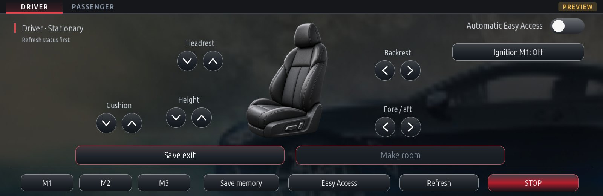
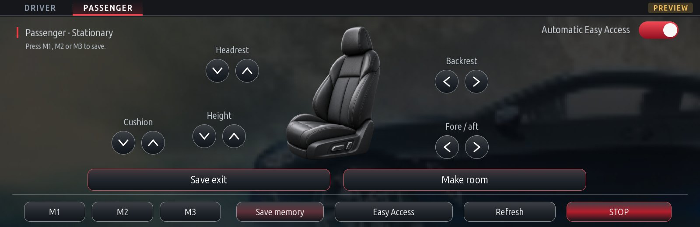
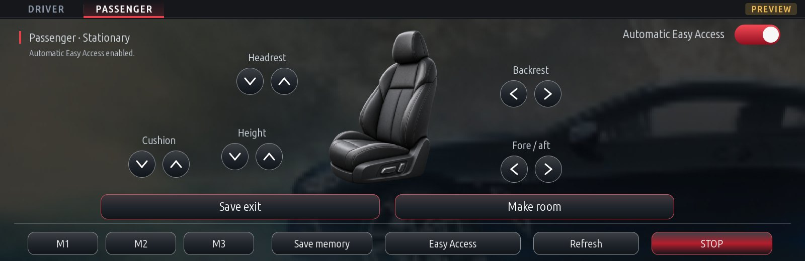
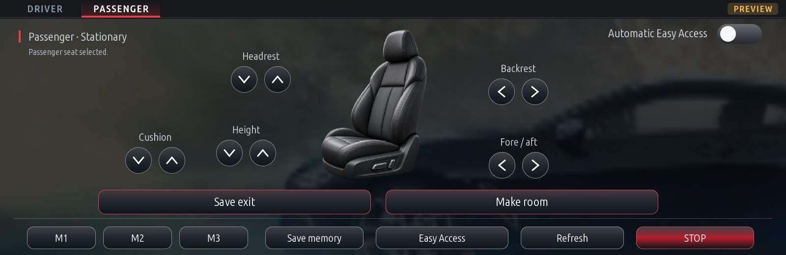
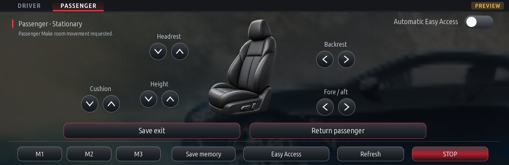
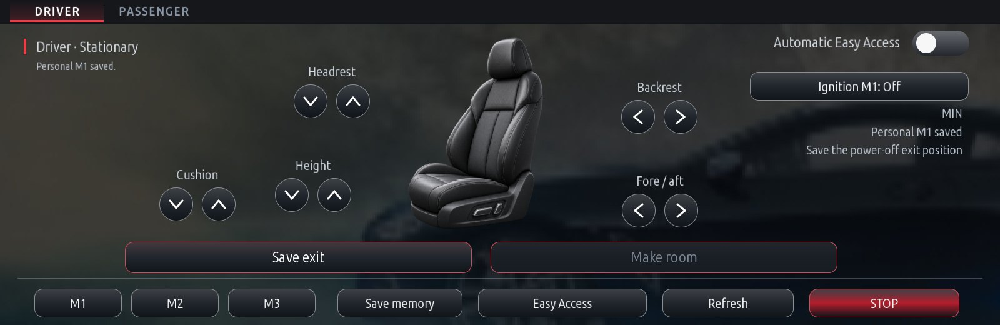
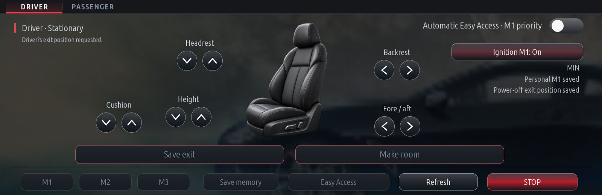

# Seats Easy Access 0.7.12 guide

[한국어](README.ko.md) · [Installation](../../docs/INSTALL.md) · [The apps](../../README.md)

Adjust the driver's and the passenger's seat on the iDrive screen, save and recall memories (M1–M3), and use **Easy Access**, which moves the seat out of the way to get in and out.
Each driver can have a **personal M1** that **Ignition M1** recalls when the car starts.

The seats themselves, and the door, ignition and occupancy logic, are handled by IterioDev's **Comfort** (`iteriodev-comfort`). This app is the screen that sends Comfort its requests.

> The pictures are drawn by the actual package's drawing code (PC preview, example state). The `PREVIEW` badge at the top right shows on a PC only.

## 1. Install

1. Add MGU Store sources **`jaimeen77-cmyk/apps`** and **`IterioDev/car-apps`** (both branch `main`).
2. Install **Seats Easy Access (English)** (the Korean edition is 시트 Easy Access (한국어)). **Comfort 0.6.1 or later** and `mgu-deploy` 0.7.11 or later come with it. Comfort is not in this repository; it comes from IterioDev's source.
3. It installs on iDrive 7 and iDrive 8.

## 2. The screen

| Where | What |
|---|---|
| Tabs on top | **DRIVER / PASSENGER**: the seat to control. Locked while a request runs |
| Top left | The seat and the car's state (`Driver · Stationary`) and the last message |
| Middle | The seat and its buttons: **Headrest**, **Cushion**, **Height**, **Backrest**, **Fore / aft** |
| Top right | The **Automatic Easy Access** switch; on the driver's side the **Ignition M1** button and the driver's state |
| Lower middle | **Save exit**; on the passenger's side **Make room** |
| Bottom row | **M1 / M2 / M3**, **Save memory**, **Easy Access**, **Refresh**, **STOP** |

- **Adjusting**: the seat moves while you hold an arrow and stops when you let go (touch or the iDrive controller on the GPU screen). The plain HMI buttons give short moves.
- **STOP** asks Comfort to stop a moving seat. It is a request only: always keep a hand near the car's own seat switches.
- **Refresh** reads the seat positions and state from Comfort again.

## 3. First setup

1. Park somewhere safe and make sure nobody and nothing is where the seat moves.
2. Press **Refresh**.
3. With the car's seat switches (or the screen's buttons), set a position that is easy to get out at.
4. Press **Save exit**. Do the same on the PASSENGER tab if you want.
5. Turn the **Automatic Easy Access** switch on.
6. Try it once first with the **Easy Access** button, ready to use the seat switches or **STOP**.

## 4. Memories M1–M3

- **Recall**: press **M1 / M2 / M3** to move to the saved position.
- **Save**: set the position, press **Save memory** (`Press M1, M2 or M3 to save.`), then one of **M1 / M2 / M3**.
- The driver and the passenger have three each.
- While driving, saving, recalling, Easy Access and Make room are locked. On a seat without position sensors the save and Easy Access buttons are locked.

## 5. Easy Access (getting in and out)

- **Automatic Easy Access on**: by Comfort's rules, opening the driver's door while stationary moves the seat back to the exit position, and closing the door and switching the car on brings it back to the driving position. The passenger's side depends on the car's occupancy sensors.
- The switch is Comfort's, so it applies to **both seats**.
- The **Easy Access** button moves the current seat to its saved exit position now (by hand).

## 6. Make room (passenger)

| Passenger tab | After Make room |
|---|---|
|  |  |

On the PASSENGER tab, **Make room** has Comfort move the passenger seat forward and tilt its backrest, to make room in the back. The button then becomes **Return passenger**, which brings the seat back. Use it only while stationary, on a passenger seat with position sensors.

## 7. A personal M1 per driver, and Ignition M1

| Personal M1 saved | Ignition M1 on |
|---|---|
|  |  |

The driver's screen recognises iDrive's current **BMW driver profile** and shows its name when it can be read (under the Ignition M1 button).

1. Each driver chooses **their own profile** in iDrive and sets the seat to their driving position.
2. **Save memory → M1** saves that driver's **personal M1** (`Personal M1 saved`).
3. Set the driver's seat to a position back that is easy to get out at and press **Save exit** once (`Power-off exit position saved`). All drivers share it.
4. Press **Ignition M1** to make it **On**.

Now, when that driver switches off while stationary, the driver's seat moves back to the exit position even with the door shut; at the next start it returns to that driver's personal M1.

- After the start it waits about 8 s, checks again that the car is stationary, the seat's position and that an M1 is saved, and recalls it when Comfort is idle. Not ready within 45 s, it gives up. If after one recall the seat is still far off, it recalls once more, once only.
- A personal M1 takes one free slot of Comfort's three driver memories; that slot is locked out of the shared driver M2 / M3. With no free slot it shows which one would be replaced, and you press **Save memory → M1** again within 30 s only if that may be overwritten.
- As soon as one driver turns Ignition M1 on, Comfort's **Automatic Easy Access** turns off and the switch reads **Automatic Easy Access · M1 priority**. Manual Easy Access and adjusting still work. To use Automatic Easy Access again, turn Ignition M1 off for the drivers who have it on, then turn the switch on.
- The app starts by itself and keeps checking with its screen closed. If it never saw the car switch off, that start may not move the seat.

## Safety

- Saving and moving by hand only work while Comfort reports the car **stationary**.
- **STOP** is a request, not a guaranteed physical stop. Always keep a hand near the car's seat switches.
- Do not use Make room or Easy Access with a child seat, a person or luggage on the passenger seat.
- Treat the first install as experimental and try it briefly with nobody in the seats.

## Troubleshooting

| Symptom | Check |
|---|---|
| Every button greyed out | That Comfort is installed and running (IterioDev source), **Refresh**, that the car is stationary |
| Only the save and Easy Access buttons locked | That seat has no position sensors |
| The seat does not return after getting out | The return is Comfort's. Collect Comfort's log as in the [return diagnosis guide (Korean)](../../docs/SEATS-DIAGNOSTICS.ko.md) |
| Ignition M1 does nothing | That the driver profile is recognised (name shown), a personal M1 saved and the power-off exit position saved |

## License and origin

MIT ([LICENSE](LICENSE)). An independent client of Comfort's published JSON protocol; it does not contain or modify IterioDev's sources or binaries. Other components (the seat picture and so on): [NOTICE](NOTICE) and [THIRD_PARTY_LICENSES](THIRD_PARTY_LICENSES).
Developer build steps: [build and install guide (Korean)](../../docs/SEATS-OVERLAY.ko.md).
