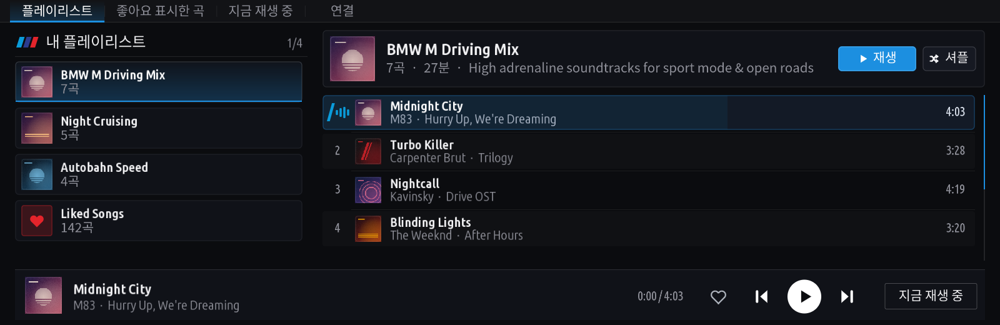
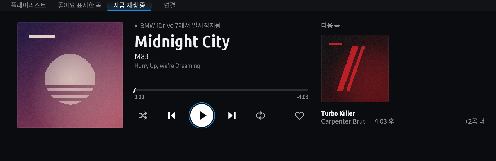
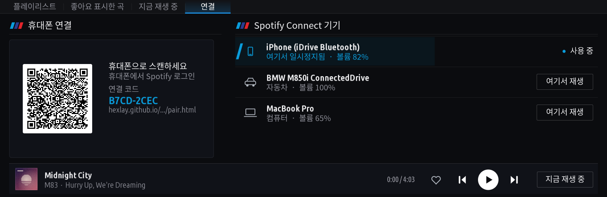

# 스포티파이 (Spotify 한국어판) 2.0.0

[hexlay/idrive7-custom-apps](https://github.com/hexlay/idrive7-custom-apps)의 Spotify 2.0.0을 한국어로 옮긴 판입니다.
차의 iDrive 화면에서 Spotify Connect로 재생 중인 곡을 보고 조작하며, 플레이리스트와 좋아요 표시한 곡을 커버 아트와 함께 고릅니다.
iDrive 7 전용이며 차가 인터넷에 연결되어 있어야 합니다.





## 무엇이 한국어인가요

- 탭(플레이리스트 · 좋아요 표시한 곡 · 지금 재생 중 · 연결), 버튼, 안내 문구, 오류 알림
- 차의 메뉴 이름(스포티파이), 화면 아래 버튼(다음 페이지 · 설정), 설정(재생 모드, 재생 상태 갱신 간격)
- **한글 곡 제목·아티스트·플레이리스트 이름**: 원본에는 한글 글꼴이 없어 한글이 물음표(?)로 나왔습니다.
  한국어판은 Noto Sans CJK KR 한글 글꼴(KS X 1001 한글 2,350자)을 넣었습니다.

곡 제목, 아티스트, 앨범, 플레이리스트, 기기 이름은 **번역하지 않습니다.** "Play That Funky Music" 같은 제목이
"재생 That Funky Music"으로 바뀌지 않도록, 앱이 쓰는 문장 전체가 번역 목록과 같을 때만 바꿉니다.

**휴대폰 연결 페이지**(QR을 스캔하면 열리는 hexlay.github.io의 페이지)는 원작자의 웹페이지라 영어 그대로입니다.

## 설치

1. MGU Store에 `jaimeen77-cmyk/apps` 소스를 추가하고 `main` 브랜치를 고릅니다(이미 있으면 건너뜁니다).
2. GPU 렌더러(`idrive7-renderd`)와 컨트롤러 연결(`mgu-inputgate`)이 필요합니다. 원본처럼
   `cauliflowermossgrape/idrive7-apps` 소스에서 받습니다. 다른 앱 때문에 이미 설치되어 있는 경우가 많습니다.
3. **Spotify (한국어)** 를 설치합니다. Store가 차에서 빌드합니다.

한국어판은 앱 id가 `spotify_ko`라서 원본 Spotify(`spotify`)와 **따로 설치됩니다**. 둘 다 둘 필요는 없으니 원본은 지워도 됩니다.
계정 연결도 따로라서 한국어판에서 처음 한 번 **연결** 탭의 QR로 다시 연결해야 합니다.

## 사용



1. **연결** 탭의 QR을 휴대폰으로 스캔하고 Spotify에 로그인합니다.
2. 휴대폰, 컴퓨터, 스피커 등 Spotify Connect 기기에서 Spotify를 열어 두면 오른쪽 목록에 나타납니다. **여기서 재생**으로 기기를 고릅니다.
3. 곡을 고르고 재생·일시정지·이전/다음 곡·셔플·반복을 조작합니다. 재생은 Spotify Premium이 필요합니다.

**설정**의 **재생 모드**를 **데모 모드 (오프라인)** 로 바꾸면 계정 없이 예시 플레이리스트로 화면을 둘러볼 수 있습니다.

## 원본과 업데이트

- 원본: hexlay/idrive7-custom-apps `apps/spotify` (GPL-3.0), 커밋 `db900984c13e`. 출처와 바꾼 점: [NOTICE](NOTICE), [NOTICE.spotify.md](../../NOTICE.spotify.md)
- 원작자가 새 버전을 내면 이 저장소에서 다시 가져와야 Store에 새 버전이 뜹니다:

```sh
python3 tools/prepare-spotify.py import   --upstream <idrive7-custom-apps 사본> --commit <커밋>
python3 tools/prepare-spotify.py template --upstream <idrive7-custom-apps 사본> --commit <커밋> \
        --kit-root <appsKOR 사본> --kit-commit <커밋>
node tests/spotify-ko.test.js
```

새 문구가 생기면 `localization/spotify.ko.json`에 더하고 `template`을 다시 실행합니다.

화면 그림은 실제 패키지를 PC에서 데모 모드로 그린 예시입니다. 차의 화면과 조금 다를 수 있습니다.
Spotify는 Spotify AB의 상표이며, 이 앱은 Spotify가 만들거나 보증한 것이 아닙니다.
