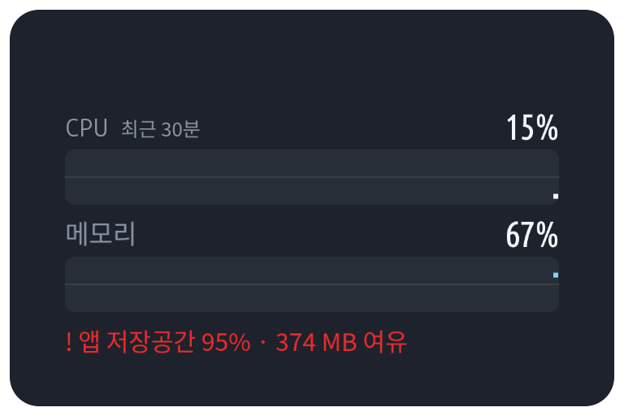
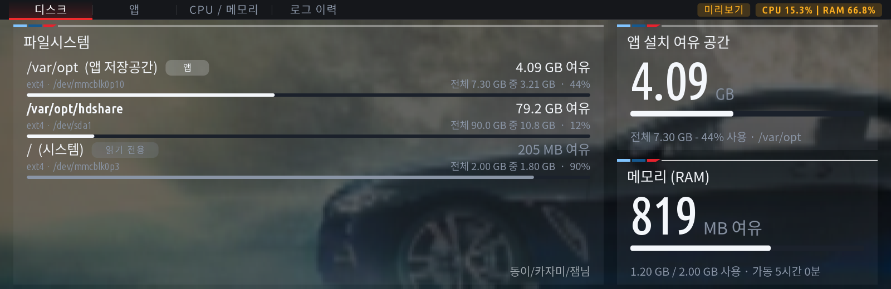
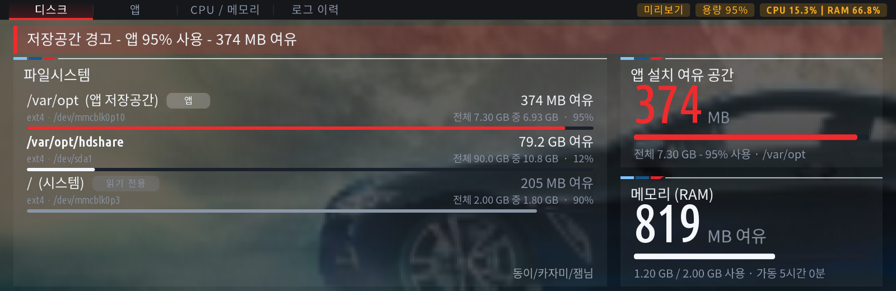
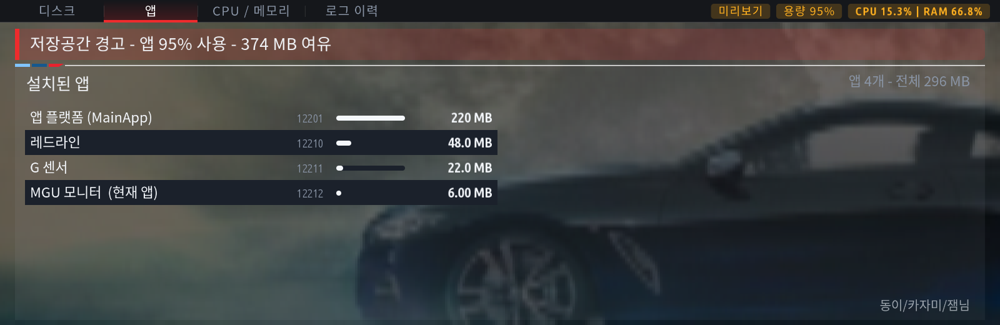
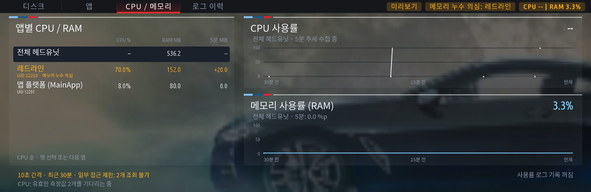
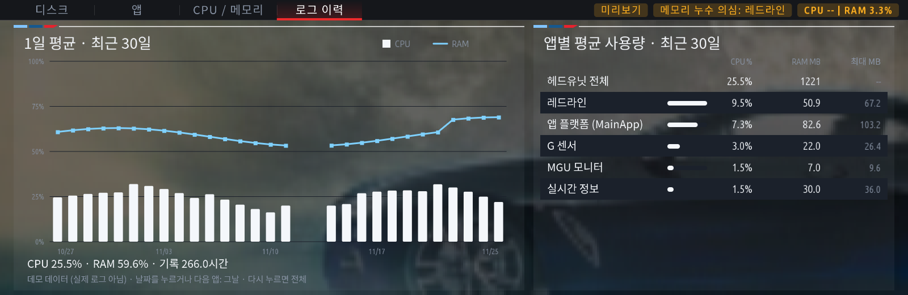
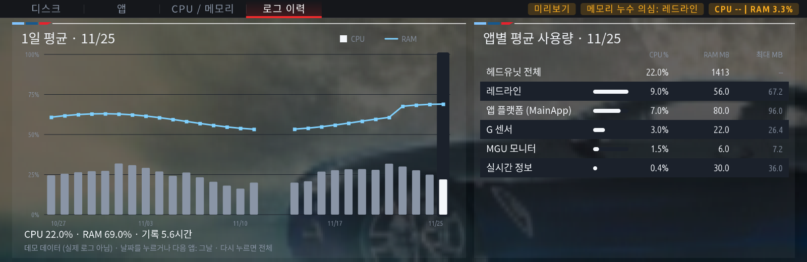

# MGU 모니터 1.1.10 설명서

[English](README.md) · [설치 안내](../../docs/INSTALL.ko.md) · [앱 소개](../../README.ko.md)

MGU 모니터는 헤드유닛(MGU)의 상태를 보는 앱입니다.

- **디스크**: 파일시스템별 여유 공간, 앱 설치 공간, 메모리(RAM)
- **앱**: 설치된 앱마다 차지하는 용량
- **CPU / 메모리**: 앱별 CPU·메모리 사용량과 최근 30분 그래프, 메모리가 계속 늘어나는 앱 알림
- **로그 이력**: 30일 동안 저장한 사용량 기록의 1일 평균과 앱별 평균
- **홈 화면 위젯**: 최근 30분 CPU·메모리 그래프와 앱 저장공간

앱은 값을 **읽기만** 하고, 자기 사용량 로그만 저장·정리합니다. 차량 설정은 바꾸지 않습니다.

> 그림은 실제 설치 패키지의 그리기 코드로 만든 예시 화면입니다(예시 데이터).

## 1. 설치

1. MGU Store에 소스 **`jaimeen77-cmyk/apps`**, 브랜치 **`main`**을 등록하고 Check now를 누릅니다.
2. **MGU 모니터 (한국어)**(영어판은 MGU Monitor (English))를 Install합니다.
3. 앱 이름을 보여 주는 보조 도구 **mgu-monitor-names**가 함께 설치됩니다. Store가 재시작을 안내하면 한 번 따라 주세요.

iDrive 7과 iDrive 8에 설치됩니다.

## 2. 홈 화면에 위젯 놓기

| 큰 위젯: CPU·메모리 그래프 | 저장공간 경고일 때 |
|---|---|
|  |  |

1. iDrive **HOME** 화면에서 컨트롤러를 **위로** 밀어 위쪽 메뉴를 엽니다.
2. **메인 메뉴 편집(Customize main menu)**을 고릅니다.
3. 놓을 칸을 고르고 목록에서 **MGU 모니터**를 추가합니다.
4. **큰 타일**을 고르면 위 그림의 큰 위젯이 나옵니다. 좁은 타일은 `CPU 23% · 메모리 66%` 글자와 메모리 막대를 보여 줍니다.
5. 저장합니다.

- **큰 위젯**: 헤드유닛 전체의 **CPU**와 **메모리** 사용률을 최근 30분 그래프로 그립니다(0~100%, 오른쪽이 지금). 맨 아래에 앱 저장공간 사용률과 여유 공간이 나옵니다.
- CPU나 메모리가 계속 오르거나 메모리 누수가 의심되면 그 숫자가 **주황색**이 됩니다.
- 앱 저장공간이 경고 기준(기본 80%)을 넘으면 맨 아래 줄이 **빨간색**이 되고, 작은 위젯도 저장공간 경고를 보여 줍니다.
- 측정은 10초마다 합니다. MGU 모니터가 실행 중이면 앱 화면을 닫아도 그래프가 이어집니다.

## 3. 앱 화면

위쪽 탭이나 **다음 화면** 버튼으로 네 화면을 넘깁니다. **새로고침**은 다시 측정하고, **설정**은 아래 5번 설정을 엽니다. 모든 화면 위쪽에 지금의 CPU·RAM %가 나옵니다.

### 디스크

- 파일시스템마다 여유 공간, 전체 중 사용량, 사용률 막대. 앱이 설치되는 파티션에는 **앱** 표시가 붙습니다.
- 오른쪽에 **앱 설치 여유 공간**과 **메모리(RAM)** 여유가 크게 나옵니다.
- 앱 저장공간이 경고 기준을 넘으면 위쪽에 빨간 경고 줄이 나옵니다.

### 앱

`/var/opt/public/oap` 아래 앱마다 실제로 차지하는 용량을 큰 것부터 보여 줍니다. 옆의 `*`는 접근 제한 등으로 일부만 측정되었다는 뜻입니다(실제로는 더 클 수 있음).

### CPU / 메모리

| 헤드유닛 전체 | 앱 하나를 골랐을 때 |
|---|---|
|  |  |

- 왼쪽 표: 실행 중인 앱을 CPU 순으로, CPU %·RAM MB·**5분간 RAM 증감**과 함께 보여 줍니다.
- 행을 누르거나 **다음 앱** 버튼으로 앱을 고르면, 오른쪽 두 그래프가 그 앱의 CPU %와 메모리(RSS)로 바뀝니다. **전체 헤드유닛**도 고를 수 있습니다.
- 그래프는 최근 30분, 10초 간격입니다.
- **상승 알림**: 앱 메모리가 5분에 16 MiB 이상 늘고 최근 1분도 높게 유지되면 **메모리 상승**, 15분 넘게 꾸준히 늘면 **메모리 누수 의심**이 나옵니다. 정상 작업으로도 늘 수 있으므로 누수 확정은 아닙니다.

### 로그 이력

| 최근 30일 | 하루를 골랐을 때 |
|---|---|
|  |  |

- 왼쪽: 최근 30일 헤드유닛 전체의 **1일 평균** CPU(막대)와 메모리(선).
- 오른쪽: 기록된 기간의 **앱별 평균 사용량**(CPU %, 평균·최대 RAM MB).
- 날짜를 누르거나 **다음 앱**을 누르면 그날만, 다시 누르면 전체 기간을 봅니다.
- 평균은 MGU 모니터가 실행되어 로그를 저장한 시간만 포함합니다.

## 4. 사용량 로그

- 기본으로 저장합니다(설정에서 끌 수 있음). 10초마다 측정해 30초 단위로 묶어 압축 CSV로 저장합니다.
- 위치: 앱의 data 폴더 `usage-logs/usage-YYYY-MM-DD.csv.gz` (보통 `/var/opt/public/oap/oap_<MGU 모니터 UID>/data/usage-logs/`). 표준 gzip이라 `gzip -cd`로 읽을 수 있습니다. 시각은 차량 시계 기준 UTC입니다.
- **30일**이 지난 기록은 자동으로 지웁니다. 하루 3 MiB, 전체 96 MiB까지 씁니다. 다른 앱의 파일은 지우지 않습니다.
- `apps_json` 열의 각 항목: `[UID, 앱 이름, CPU %, RSS 바이트, 프로세스 수, CPU 증감 %p, RSS 증감 MiB, 플래그]`. 플래그 비트 1 일부 측정, 2 CPU 상승, 4 RAM 상승, 8 누수 의심.

## 5. 설정

| 설정 | 기본 | 설명 |
|---|---|---|
| 앱 저장공간 경고 기준 | 80% | 70 / 80 / 90 / 95% |
| 시작 화면 | 디스크 | 디스크 / 앱 / CPU·메모리 |
| CPU·메모리 사용률 로그 저장 | 켜짐 | 끄면 새 기록을 저장하지 않습니다(오래된 기록 정리는 계속) |
| RAM 디스크 표시 (tmpfs) | 꺼짐 | |
| 읽기 전용 시스템 파티션 표시 | 켜짐 | |
| 용량 단위 | GB = 1024 MB | df -h와 같은 단위 / 1000 MB |
| 화면 색상 | M 삼색 | M 레드 / M 삼색 / 아이스 화이트 / 나이트 앰버 |
| 미리보기 데이터 | 자동 | 차에서는 **자동**으로 두세요(차: 실제값, PC: 예시값). 예시 44/78/95%를 고르면 실제값 대신 예시가 나옵니다 |

## 6. 앱 이름 보조 도구 (mgu-monitor-names)

다른 앱의 폴더와 앱 등록부는 일반 앱이 읽을 수 없어서, 보조 도구가 **UID·앱 ID·이름만** `/dev/shm/mgu-monitor-names/apps.json`에 내보냅니다(설치 때와 이후 1분마다). 다른 앱이나 차량 설정은 바꾸지 않습니다.
아직 이름을 얻지 못한 앱은 `앱 이름 조회 대기`와 UID로 표시합니다.

## 참고

- 앱 RAM은 조회 가능한 프로세스의 RSS 합계라 공유 메모리가 겹칠 수 있습니다. 그래서 앱 RAM 합계와 전체 RAM 사용량은 다릅니다. 전체 RAM은 MemAvailable 기준입니다.
- 파일시스템 예약 공간 때문에 여유 공간이 "전체 − 사용"과 다를 수 있습니다.
- 출처와 라이선스: [NOTICE](NOTICE).
