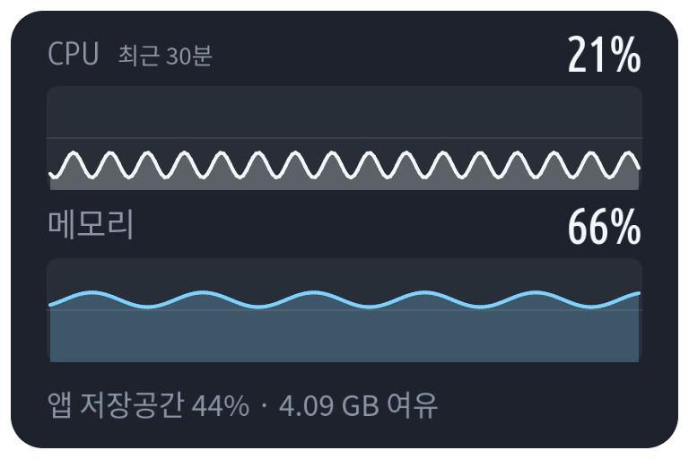
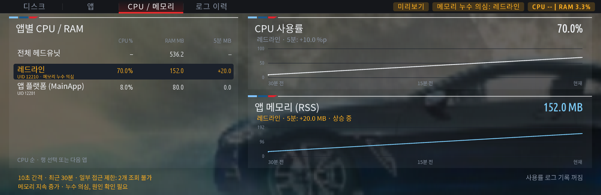

# MGU 모니터 1.1.1

[English](README.md)

기존 **Storage(저장공간)**의 새 이름입니다. 앱 ID `storage` / `storage_en`은
유지하므로 기존 설치에서 **MGU 모니터 / MGU Monitor 1.1.1**으로 업데이트합니다.

BMW MGU / iDrive 7(ID7)의 저장공간을 조회하는 앱입니다. 디스크 사용률,
앱 설치 파티션의 여유 공간, RAM, `/var/opt/public/oap` 아래 앱별 실제 할당
용량을 표시합니다. 홈 위젯도 사용률을 표시하며 경고 기준(기본 80%)에
도달하면 강조합니다. 앱 자체 사용률 로그만 저장·정리하며 차량 설정은 바꾸지 않습니다. 경고는
앱 화면과 위젯 안에서 표시됩니다.

MGU Store에 소스 **`jaimeen77-cmyk/apps`**, 브랜치 **`main`**을 추가하고
새로고침한 뒤 **MGU 모니터 (한국어) 1.1.1** 또는 **MGU Monitor (English) 1.1.1**을
설치하세요. 두 언어판은 각각 설치됩니다. `mgu-deploy >= 0.7.17`과 차량의
SDK donor가 필요하며 SDK는 Store가 설치 중 차량에서 공급합니다.

새로고침으로 다시 측정하고 다음 화면으로 디스크/앱/CPU·메모리 화면을 전환합니다.
설정에서 경고 기준, 시작 화면, RAM·읽기 전용 파티션 표시, 단위와 색상을
바꿀 수 있습니다. 차량에서는 미리보기 데이터를 **자동**으로 두세요.
예시 44/78/95%를 직접 선택하면 실제값 대신 예시값과 미리보기 표시가
나옵니다. PC에서도 자동은 예시값을 사용합니다.

앱 용량 옆 `*`는 접근 제한·측정 한도로 일부만 측정되었음을 뜻하며 실제
용량은 더 클 수 있습니다. 앱별 합계와 파티션 전체 사용량은 서로 다릅니다.
파일시스템 예약 공간 때문에 `df`의 여유 공간이 전체 용량에서 사용량을
뺀 값과 다를 수도 있습니다.

이번 버전은 PC에서 패키지·파서·화면 렌더러를 확인했습니다. 실차 설치와
위젯 동작 검증은 남아 있습니다. 출처는 [NOTICE](NOTICE)를 참고하세요.

설치 패키지의 실제 렌더러로 생성한 예시 데이터 화면입니다.

## 홈 위젯: CPU·메모리 그래프 (1.1.8)

큰 홈 위젯이 헤드유닛 전체 **CPU**와 **메모리(RAM)** 사용률을 **최근 30분 그래프**로
표시합니다(0~100%, 오른쪽이 현재). 앱 화면과 같은 10초 간격 측정값을 쓰므로 앱
화면을 열지 않아도 MGU 모니터가 실행 중이면 그래프가 이어집니다. 새 측정값이 있을 때만
위젯 그림을 다시 그립니다. CPU·메모리 상승/누수 의심 때는 해당 숫자가 주황색이 됩니다.
맨 아래 줄에 앱 저장공간 사용률과 여유 공간을 계속 표시하며, 경고 기준을 넘으면 빨간색이 됩니다.
작은 위젯은 `CPU 23% · 메모리 66%`와 메모리 막대를 표시하고, 저장공간 경고 때에는
기존처럼 저장공간 문구와 막대를 표시합니다. 설정과 UI 템플릿은 바뀌지 않았습니다.

## 로그 이력 (1.1.6)

**로그 이력** 탭은 저장된 30일 사용량 로그를 읽어 보여 줍니다. 왼쪽은 최근 30일의
헤드유닛 전체 **1일 평균** CPU(막대)와 메모리(선), 오른쪽은 기록된 전체 기간의
**앱별 평균 사용량**(CPU %, 평균·최대 RAM MB)입니다. 날짜를 누르거나 **다음 앱**을
누르면 그날만, 다시 누르면 전체 기간을 봅니다. 하루치 로그는 한 번만 읽고 요약을
`usage-summary.json`에 보관하며, 오늘 로그만 1분에 한 번까지 다시 읽습니다. 평균은
앱이 실행되어 로그를 저장한 시간만 포함합니다.

## 앱별 CPU·메모리 (1.1.1)

**CPU / 메모리** 탭에서 실행 중인 앱을 CPU 사용률 순으로 비교합니다.
행을 터치/iDrive로 선택하거나 **다음 앱** 버튼을 누르면 오른쪽 두 그래프가
해당 앱의 CPU %와 RAM(RSS, MB)을 표시합니다. 전체 헤드유닛도 선택할 수
있습니다. 표의 마지막 열은 해당 앱의 **5분간 RAM 증감량(MB)**입니다.
모든 탭의 상단에는 전체 CPU·RAM %를 계속 표시합니다.

수집은 **10초 간격**, 그래프는 **현재 실행 세션의 최근 30분**입니다.
CPU는 두 번 측정해야 하므로 실행 약 10초 뒤 첫 값이 나옵니다. MGU 모니터
프로세스가 실행 중일 때 수집하며, 차량 종료·앱 프로세스 종료 동안에는
기록하지 않습니다. 자동 시작 설정은 이번 업데이트에서 바꾸지 않습니다.

앱 폴더 `oap_<UID>`와 프로세스의 유효 UID로 묶어 보조 프로세스까지
합산합니다. CPU는 전체 코어 기준 0~100%이고, 앱 RAM은 조회 가능한
프로세스의 RSS 합계입니다(이 화면의 MB는 MiB). 공유 페이지가 중복될 수
있어 앱 RAM 합계와 전체 RAM 사용량은 다릅니다. 전체 RAM은 MemAvailable
기준입니다. 앱 UID가 없는 시스템 서비스는 앱 목록에서 제외합니다.
접근 권한 제한은 화면에 표시하고, 프로세스 시작 등 일부만 측정되면 `*`,
확인할 수 없는 값은 `--`로 표시합니다.

앱 RAM이 5분에 **16 MiB 이상** 증가하고 최근 1분(7회)의 값이 기준보다 8 MiB
이상 높으면 상승 알림을 표시합니다. **누수 의심**은 연속 15분 이상 유효한
측정값이 있고, 전체 32 MiB 이상 및 각 5분 구간마다 8 MiB 이상 증가했을
때 표시합니다. 전체 메모리의 기준은 5분 +5%p, 15분 +10%p(구간마다
+2%p)입니다. CPU 상승은 5분 +15%p와 최근 1분간 상승 유지로 판단합니다.
알림 기준에 미달해도 그래프와 증감 수치는 보입니다. 정상 작업 때문에
메모리가 늘 수도 있으므로 **누수 확정이나 원인 코드 판별 기능은 아닙니다**.

## 사용률 로그

기본적으로 저장하며 설정의 **CPU·메모리 사용률 로그 저장**에서 끌 수
있습니다. 실제 측정값을 10초마다 모아 3개씩, 30초 단위 압축 CSV로 앱의 영구 data 폴더에 저장합니다.

`usage-logs/usage-YYYY-MM-DD.csv.gz`

일반적인 전체 경로는 `/var/opt/public/oap/oap_<MGU Monitor UID>/data/usage-logs/`입니다.
표준 gzip 파일이며 `gzip -cd` 또는 Python `gzip.open`으로 읽습니다. 파일 날짜와
시각은 차량 시계 기준 UTC입니다. 전체 CPU·RAM, 5분 증감, 알림 상태,
프로세스 접근 제한 수와 앱별 값이 들어갑니다. `apps_json` 열의 각 항목은
`[UID, 앱 이름, CPU %, RSS 바이트, 프로세스 수, CPU 증감 %p, RSS 증감 MiB, 플래그]`입니다.
플래그 비트는 1 일부 측정, 2 CPU 상승, 4 RAM 상승, 8 누수 의심입니다.
확인 불가 값은 빈칸/null이며 예시 데이터는 저장하지 않습니다.

실행 시와 실행 중 매시간 **30일 기준**으로 오래된 파일·행을 정리합니다.
저장 기능을 꺼도 기존 기록의 정리는 수행합니다. 앱이 꺼져 있던 동안 지난
보관 기한은 다음 실행 때 정리합니다. 다른 앱의 파일은 삭제하지 않습니다.
재실행하면 화면 그래프는 초기화되지만 보관 기한 안의 로그는 유지됩니다.

로그 한도는 하루 3 MiB, 전체 96 MiB이며 공간을 미리 할당하지 않습니다.
앱 패키지의 코드·데이터 허용량은 128 MiB입니다. 앱 수에 따라 실제 로그
크기가 달라집니다. 공간 부족·접근 거부·한도 초과 때에는 화면에 오류를
표시하고 다음 수집 때 다시 시도하며, 보관 기한 안의 기록을 임의로 지우지 않습니다.

### 앱 이름 표시와 1.1.1 업데이트

MGU Store가 **mgu-monitor-names 0.1.0** 보조 도구를 함께 설치합니다.
다른 OAP 앱 폴더와 MainApp의 UID 등록부는 일반 앱에서 읽을 수 없어,
이 도구가 패키지 표시 이름·App Kit 제목·실제 RHMI 메뉴 제목·UID 등록부를
읽어 **UID/앱 ID/이름만** `/dev/shm/mgu-monitor-names/apps.json`으로 내보냅니다.
루트 소유의 읽기 가능한 파일이며 설치 시와 이후 매분 갱신합니다.
다른 앱의 접근 권한이나 설정, 차량 설정은 바꾸지 않습니다.
Store가 보조 도구의 재시작 대기를 표시하면 안내하는 헤드유닛 재시작을
한 번 완료하세요. UID 번호로 이름을 추측하지 않습니다. 아직 이름을
얻지 못한 행은 `앱 이름 조회 대기`로 표시하고 아래에 UID를 남깁니다.
조회한 이름은 앱 목록과 로그에도 적용합니다.

최근 30분 그래프는 최대 181개 측정값을 유지하며, 증가 알림의 확인 시간은
최근 1분(7회), 비교 구간은 기존 5분/15분을 유지합니다. 로그에는 10초마다의
시각과 값이 모두 들어가고 3개를 30초 단위로 묶어 압축합니다. 정상 종료나
로그 끄기 때 남은 값을 저장하며, 갑작스러운 종료 시 최대 20초의 버퍼가
유실될 수 있습니다. 기존 1.1.0 로그도 그대로 읽고 보관 기한에 맞춰 정리합니다.
