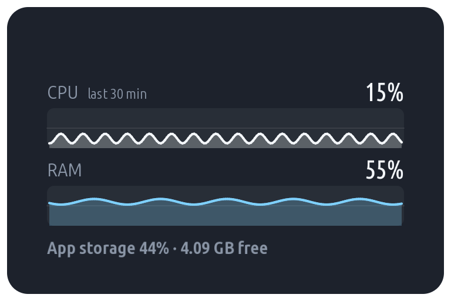
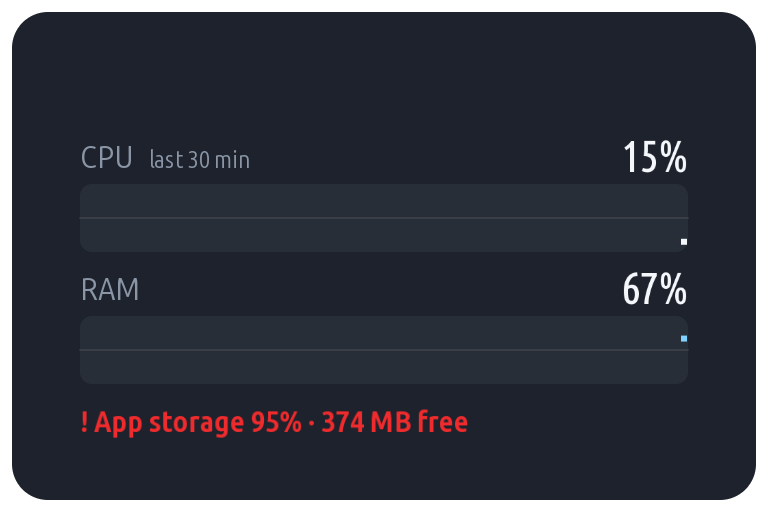
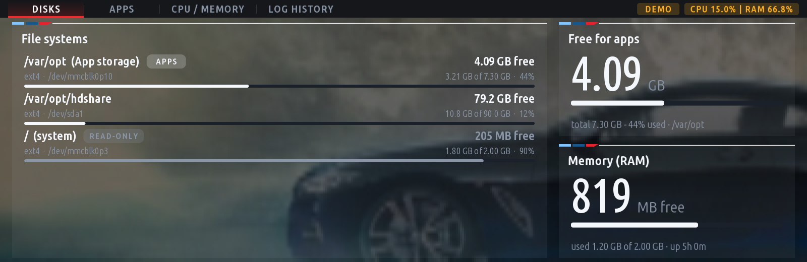
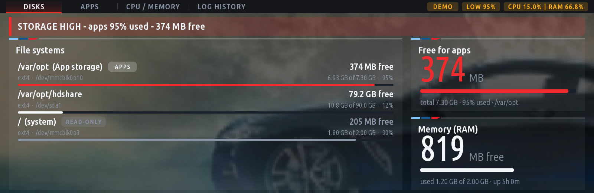
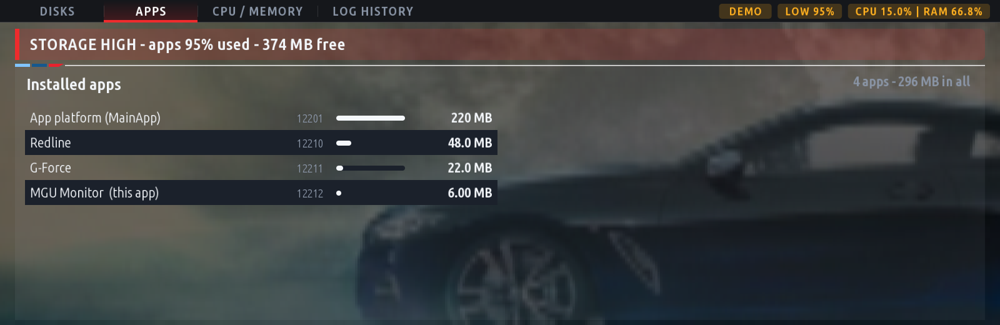
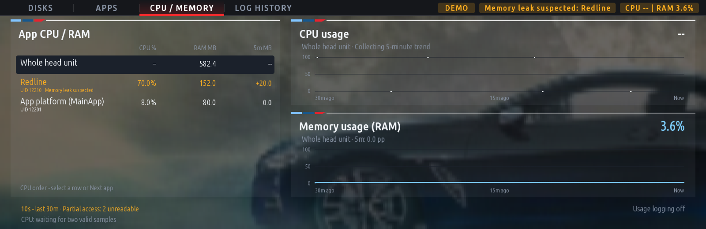
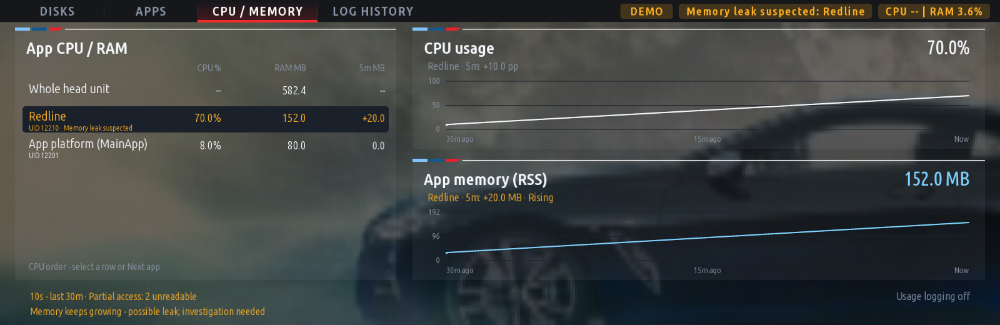
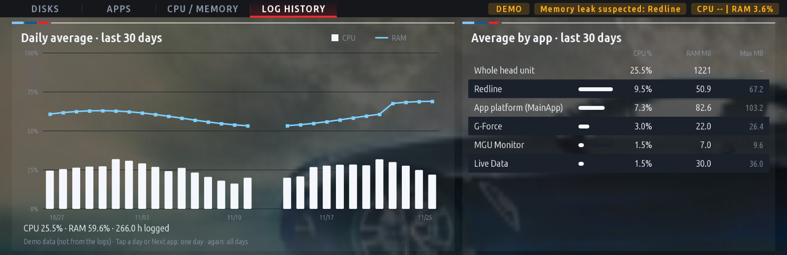
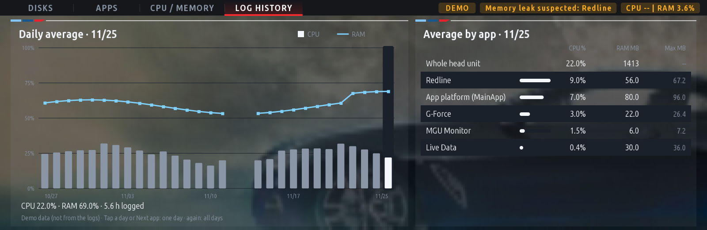

# MGU Monitor 1.1.10 guide

[한국어](README.ko.md) · [Installation](../../docs/INSTALL.md) · [The apps](../../README.md)

MGU Monitor shows the state of the head unit (MGU):

- **Disks**: free space per file system, the space for apps, memory (RAM)
- **Apps**: how much space each installed app takes
- **CPU / Memory**: CPU and memory by app with the last 30 minutes as graphs, and alerts for apps whose memory keeps growing
- **Log history**: daily averages and averages by app from 30 days of usage logs
- **Home-screen widget**: CPU and memory over the last 30 minutes, and the app storage

It only **reads**; the only files it writes and prunes are its own usage logs. It changes no vehicle settings.

> The pictures are drawn by the actual package's drawing code, with example data.

## 1. Install

1. Add MGU Store source **`jaimeen77-cmyk/apps`**, branch **`main`**, and press Check now.
2. Install **MGU Monitor (English)** (the Korean edition is MGU 모니터 (한국어)).
3. The helper that shows app names, **mgu-monitor-names**, is installed with it. If the Store asks for a restart, do it once.

It installs on iDrive 7 and iDrive 8.

## 2. Placing the widget on the home screen

| Large widget: CPU and memory graphs | With a storage warning |
|---|---|
|  |  |

1. On the iDrive **HOME** screen push the controller **up** to open the top menu.
2. Choose **Customize main menu**.
3. Choose a slot and add **MGU Monitor** from the list.
4. A **large tile** gives the large widget above; a narrow tile shows `CPU 23% · RAM 66%` and a memory bar.
5. Save.

- **Large widget**: the whole head unit's **CPU** and **memory** use as graphs of the last 30 minutes (0–100 %, now on the right). The bottom line is the app storage use and its free space.
- A CPU or memory rise, or a suspected memory leak, turns that number **orange**.
- Above the warning threshold (80 % by default) the storage line turns **red**, and the small widget shows the storage warning.
- It measures every 10 s. While MGU Monitor runs the graphs continue, even with its screen closed.

## 3. The app's screens

Change between the four screens with the tabs on top or **Next page**. **Refresh** measures again; **Settings** opens the settings in 5. The current CPU and RAM % show at the top of every screen.

### Disks

- Each file system's free space, used of total and a bar. The partition apps are installed on is marked **APPS**.
- On the right, **Free for apps** and the free **memory (RAM)** in large numbers.
- Above the warning threshold a red warning line shows at the top.

### Apps

The space each app under `/var/opt/public/oap` really takes, largest first. A `*` means only part could be measured (access limits); the real size can be larger.

### CPU / Memory

| The whole head unit | One app chosen |
|---|---|
|  |  |

- The table on the left: running apps in CPU order, with CPU %, RAM MB and the **RAM change over 5 minutes**.
- Choose an app by tapping its row or with **Next app**: the two graphs on the right show that app's CPU % and memory (RSS). **Whole head unit** can be chosen too.
- The graphs cover the last 30 minutes, every 10 s.
- **Rise alerts**: an app's memory up 16 MiB or more in 5 minutes and staying high for the last minute shows **Memory rising**; growing steadily for more than 15 minutes, **Memory leak suspected**. Normal work can grow memory too, so it is not proof of a leak.

### Log history

| Last 30 days | One day chosen |
|---|---|
|  |  |

- Left: the whole head unit's **daily average** CPU (bars) and memory (line) over the last 30 days.
- Right: the **average by app** over the logged time (CPU %, average and peak RAM MB).
- Tap a day or press **Next app** for that day alone; again for all days.
- Averages only cover the time MGU Monitor was running and logging.

## 4. Usage logs

- Saved by default (can be turned off in the settings): measured every 10 s, written in 30-second groups as compressed CSV.
- Where: the app's data folder, `usage-logs/usage-YYYY-MM-DD.csv.gz` (usually `/var/opt/public/oap/oap_<MGU Monitor UID>/data/usage-logs/`). Standard gzip, readable with `gzip -cd`. Times are UTC by the car's clock.
- Logs older than **30 days** are removed automatically. At most 3 MiB a day, 96 MiB in all. Other apps' files are never removed.
- Each entry of the `apps_json` column: `[UID, app name, CPU %, RSS bytes, processes, CPU change pp, RSS change MiB, flags]`. Flag bits: 1 partial, 2 CPU rising, 4 RAM rising, 8 leak suspected.

## 5. Settings

| Setting | Default | What it does |
|---|---|---|
| Alert when apps storage above | 80 % | 70 / 80 / 90 / 95 % |
| Start page | Disks | Disks / Apps / CPU / Memory |
| Save CPU / memory usage logs | On | Off: no new logs (old ones are still pruned) |
| Show RAM disks (tmpfs) | Off | |
| Show read-only system partitions | On | |
| Size units | GB = 1024 MB | like df -h / 1000 MB |
| Colour theme | M Tricolour | M Red / M Tricolour / Ice White / Night Amber |
| Preview data (emulator) | Auto | Keep **Auto** in the car (real values in the car, demo data on a PC). Demo 44/78/95 % shows example values instead |

## 6. The app-name helper (mgu-monitor-names)

An app cannot read other apps' folders or the app registry, so the helper exports **only UIDs, app IDs and names** to `/dev/shm/mgu-monitor-names/apps.json` (at install, then every minute). It changes no other app and no vehicle setting.
An app whose name is not known yet shows as `App name pending` with its UID.

## Notes

- An app's RAM is the RSS of its readable processes, which can count shared pages twice; so the apps' RAM added up differs from the whole RAM use. The whole RAM is by MemAvailable.
- Reserved file-system space can make the free space differ from "total − used".
- Sources and licenses: [NOTICE](NOTICE).
