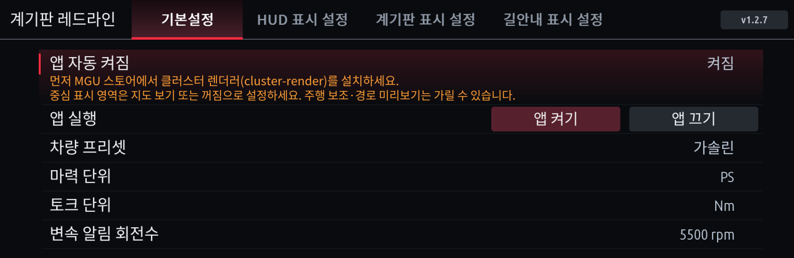
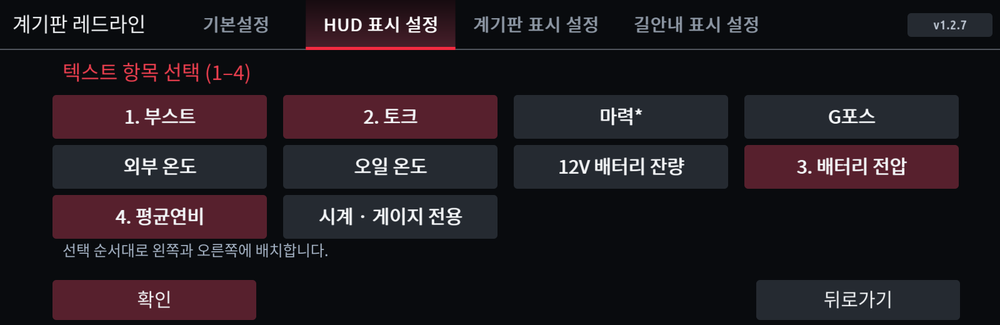
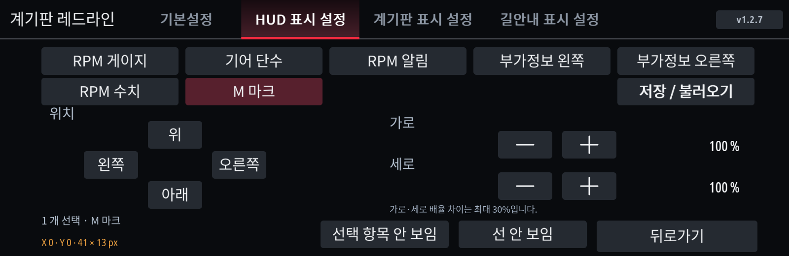
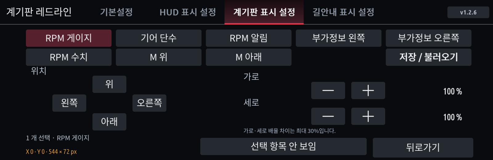
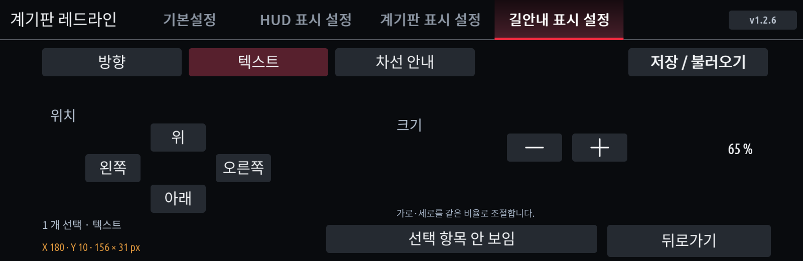

# 계기판 레드라인 · 이전 설명서와 버전별 변경 내역

[현재 사용 설명서](CLUSTER-REDLINE.ko.md) · [업데이트 이력](../CHANGELOG.md)

> 이 문서는 예전 버전의 설명과 버전별 수정 내용을 보관합니다. 지금 버전의 사용법은 [사용 설명서](CLUSTER-REDLINE.ko.md)를 보세요.

계기판과 HUD에 RPM·기어·변속 알림을 표시하고, 수신한 길안내를 HUD에 함께 표시합니다. 아래 그림은 **실제 앱 렌더러와 예시 데이터**로 만든 미리보기입니다. 화면에 나온 수치는 차량 측정값이 아닙니다.

## 기본설정

- **앱 자동 켜짐:** 다음 앱 프로세스 시작 때의 동작입니다.
- **앱 켜기 / 앱 끄기:** 현재 표시 작업을 즉시 시작·중지합니다. 끈 뒤에도 설정 화면에서 다시 켤 수 있습니다.
- **차량 프리셋:** 가솔린·디젤·eDrive·M에 맞는 눈금을 선택합니다. 차량 제원을 자동으로 판별하는 기능은 아닙니다.
- **마력·토크 단위:** 표시 단위를 선택합니다.
- **변속 알림 회전수:** 프리셋 기본값 또는 직접 선택한 RPM을 사용합니다. 가솔린·eDrive·M 기본 5500rpm, 디젤 4200rpm입니다.

## HUD / CLUSTER 출력 선택

HUD와 CLUSTER는 별도로 설정합니다.

| 항목 | 동작 |
|---|---|
| 스포츠 모드 RPM 표시 | 스포츠 계열 모드에서 순정 / 레드라인 앱 선택 |
| 모든 모드 RPM 표시 | 컴포트·컴포트 플러스·에코 계열 등을 포함한 모든 유효한 모드에서 선택 |

**모든 모드에 레드라인을 고르면 스포츠에서도 적용**됩니다. 스포츠에서만 표시하려면 스포츠=레드라인, 모든 모드=순정으로 설정합니다. 기본은 클러스터 스포츠 표시, HUD RPM 순정입니다.

## 두 가지 변속 알림 디자인

**디자인 변경**에서 실제 RPM 그림을 보고 선택합니다.

- **기어 옆 원형 알림:** 원형 알림과 기어가 HUD에서 함께 이동·확대됩니다. HUD 원형 디자인은 기존 위치보다 전체가 두 칸(+20 원본 픽셀) 내려갑니다.
- **상단 알림선:** 알림선과 기어를 별도로 조절합니다.

원형 지름은 기어 글자 높이의 70%입니다. 낮은 RPM에서는 숨겨지고 초록 → 노랑 → 빨강 점멸 순서로 바뀝니다. 기본 5500rpm 설정의 첫 초록은 약 3735rpm, 노랑은 4675rpm, 빨강은 5500rpm부터입니다. 빨강 점멸은 250ms 단위 위상으로 동작하며 RPM 숫자는 빨강을 유지합니다. **아래 빨간 알림 그림은 켜진 위상**입니다.

| HUD 원형 | HUD 상단선 |
|---|---|
|  |  |

| 클러스터 원형 | 클러스터 상단선 |
|---|---|
|  |  |

## 부가정보 선택

**부가정보 → 게이지 / 텍스트 → 항목 선택 → 확인(OK)** 순서로 저장합니다. 선택 화면은 빈 임시 목록으로 시작하고 누른 순서대로 번호가 붙습니다. 확인하지 않고 뒤로가거나 탭을 바꾸면 기존 값이 유지됩니다.

| 항목 | 게이지 모드 | 데이터 의미 |
|---|---|---|
| 부스트 | 막대 | 수신한 과급압, bar |
| 토크 | 막대 | 엔진 토크, 선택 단위 |
| 마력* | 막대 | 엔진 토크와 RPM으로 추정한 출력 |
| G포스 | 직사각형 안의 채운 원 | 수치는 두 축 합성값, 원은 횡가속에 따라 좌우 이동 |
| 외부 온도 | 온도계 | 수신한 외부 온도 |
| 오일 온도 | 온도계 | 수신한 엔진오일 온도 |
| 12V 배터리 잔량 | 배터리 모양 | 12V 배터리 SOC(%), 고전압 배터리 잔량이 아님 |
| 배터리 전압 | 텍스트 | 지원되는 표준 읽기로 받은 전압(V) |
| 평균연비 | 텍스트 | 차량 트립1 평균값을 km/L로 변환 |

**전압·평균연비는 게이지 모드에서도 글자**로 표시합니다. 마력의 `*`는 추정값 표시이며 eDrive 전기모터 합산 출력이 아닙니다. 전압은 선택된 출력에서 최근 엔진 활동이 있을 때만 제한된 읽기 요청을 사용합니다. 값이 없거나 오래됐으면 `--`로 표시합니다.

- 게이지 1개: 왼쪽. 2개: 왼쪽 1번 / 오른쪽 2번.
- 텍스트 1개: 왼쪽. 2개: 왼쪽 1번 / 오른쪽 2번.
- 텍스트 3개: 왼쪽 1·2번 / 오른쪽 3번. 4개: 왼쪽 1·2번 / 오른쪽 3·4번.

## 위치·크기, M 마크와 선

**위치 / 크기**에서 요소를 선택하고 하단의 방향·크기 버튼을 누릅니다. 좌표는 **기본 배치에 더하는 X/Y 오프셋**, 픽셀 크기는 실제 출력 영역의 가로×세로입니다. 전체 HUD·클러스터 배율도 적용되므로 이동 오프셋과 최종 화면 픽셀은 같지 않을 수 있습니다.

| HUD 원형 | HUD 상단선 | CLUSTER |
|---|---|---|
| RPM 게이지, 기어·원형 알림, 부가정보 왼쪽·오른쪽, RPM 수치, M 마크 | RPM 게이지, 기어, RPM 알림, 부가정보 왼쪽·오른쪽, RPM 수치, M 마크 | RPM 게이지, 기어, RPM 알림, 부가정보 왼쪽·오른쪽, RPM 수치, M 위·M 아래 |

좌우 부가정보는 각각 움직입니다. 텍스트가 4개라면 왼쪽 두 개, 오른쪽 두 개가 각 그룹으로 이동합니다. 클러스터 좌우 부가정보의 기본값은 두 디자인 모두 **(0,50)**입니다.

M 마크를 선택하면 **선 안 보임 / M 안 보임** 버튼이 나옵니다. 누르면 각각 숨겨지고, 다시 보이기 버튼으로 복원합니다. 클러스터 위·아래는 별도입니다. **M만 이동하면 선은 기존 위치를 유지**합니다. 가로·세로 배율 비율은 최대 1.3배 차이로 제한합니다.

## NAV 표시 설정

- **안내 표기:** 모든 모드 / 스포츠 제외 / 순정 중 선택합니다. 순정은 앱의 길안내 표시와 관련 조회·구독을 중지합니다. HUD RPM이 순정이어도 앱 NAV는 별도로 표시할 수 있습니다.
- **디자인 변경:** 회색·흰색·파란색 화살표를 선택합니다. 거리와 안내 문구는 흰색입니다.
- **위치 조절:** 방향 / 텍스트 / 차선 안내를 각각 선택합니다. 각 영역은 따로 이동·확대·숨김이 가능하며 가로·세로는 같은 배율로 바뀝니다.

| 영역 | 기본 X/Y 오프셋 | 기본 크기 | 배율 |
|---|---|---|---|
| 텍스트 | (180,10) | 156×31px | 65% |
| 방향·거리 | (210,30) | 168×78px | 70% |
| 차선 | (210,115) | 168×50px | 70% |

현재 안내에서 받은 설명문을 화살표 위에 표시하며, 다음 안내로 바뀌면 문구도 갱신합니다. English판도 수신 한글을 표시합니다. 연결·안내 종료나 정보 만료 후에는 이전 안내를 재사용하지 않습니다.

좌·우회전, 직진, 완만한 회전·갈림길, 유턴, 회전교차로, 차로 이동, 도착과 고속도로 진입·진출 여섯 방향의 도식이 있습니다. 차로 이동 화살표는 **추천 차선 그림과 다릅니다**. 제공받은 도식만 표시하며 지도 영상·교차로 확대 이미지·터널 전용 그림을 재현하는 기능은 없습니다. 지원하지 않는 안내는 순정에 양보합니다. 지도 앱·휴대전화·차량 조합별 전달 여부는 다를 수 있습니다.

## 1.2.1 위치 조절과 데이터 수집

요소 버튼은 한 번 누르면 선택, 다시 누르면 해제됩니다. 여러 개를 선택하면 같이 이동·확대됩니다. HUD/클러스터는 한 개 선택 시 가로·세로를 따로 조절하며, 여러 개 선택 시 두 크기를 함께 바꿉니다. 모든 요소에 숨김/보임이 있고 M의 선은 별도로 숨길 수 있습니다. HUD 텍스트 부가정보는 기본 위치를 한 칸(원본 10px) 내리고 한글 상단 잘림을 보정했습니다.

숨긴 요소에만 필요한 차량 조회·변경 알림 구독은 중지하고, 다시 보이면 재개합니다. 다른 보이는 요소에 필요한 공통 신호는 계속 받습니다. 순정 차량 기능을 끄는 설정은 아닙니다. 배터리 잔량은 Battery12V 스타일의 10칸 배터리로 표시합니다.

## CarPlay 차선과 둥근 유턴

CarPlay가 추천 차선 데이터를 제공하면 추천 차선은 선택한 안내 색상으로, 나머지는 어둡게 표시합니다. 데이터가 없거나 오래되면 차선만 숨깁니다. 현재 수집된 Android Auto 데이터에는 추천 차선이 없으므로 Android Auto의 차선 출력을 보장하지 않습니다. 유턴은 둥근 곡선 화살표입니다.

## 깜빡임 비교

길안내 데이터가 늦어져도 RPM 화면 전체를 내리지 않도록 수정했습니다. 오래된 안내는 지우고 순정 안내에 양보합니다. 실제 주행에서 개선되는지는 확인이 필요합니다. 계속 끊기면 HUD와 CLUSTER 양쪽 부가정보의 왼쪽·오른쪽을 모두 숨기고 같은 경로에서 비교하세요. 한쪽이라도 표시 중이면 공통 데이터 수집은 유지됩니다. 이후 차선, 텍스트, 방향을 한 종류씩 숨겨 비교할 수 있습니다. 동시에 여러 조건을 바꾸지 않아야 영향 구분이 쉽습니다.

## 1.2.2 렌더링 최적화와 설정 갱신

눈금·M 마크·게이지 틀과 변하지 않은 부가정보/안내 그림을 재사용하고, 변경된 영역만 다시 합성합니다. HUD와 계기판은 각자 필요한 값만 비교하며, 네비 데이터의 경과시간만 변하면 그림을 다시 그리지 않습니다. 전송이 밀리면 중간 그림을 계속 만들지 않고 최신 상태를 반영합니다. 신호 만료·순정 팝업 양보 기준은 유지합니다.

RPM·주행모드·토크의 기존 실시간 수신은 유지합니다. 오일·배터리 잔량·평균연비는 5초, 외부 온도는 10초, 정상 수신 중인 배터리 전압은 5초 간격으로 조회합니다. 변경 알림은 즉시 반영합니다.

전용 설정창 조작 때 사용하지 않는 기본 설정창까지 반복 갱신하던 경로를 제거했습니다. 다중 이동/크기/숨김은 한 번에 저장하고 화면 갱신을 합칩니다. 설정 탭·버튼·안내 문구의 한글화를 보완했습니다. 업데이트 후 상단 v1.2.2를 확인하세요.

호스트·설치 검사와 Store 패키지 검증은 수행했으며, 실차에서 설정 이동 및 일반 주행 중 끊김 개선은 확인이 필요합니다.

## 1.2.4 화면·설정 개선

- **HUD 차선:** 순정 차선판 스타일로 바꿨습니다. 차선 수와 관계없이 화살표 크기가 같고, HUD 크기로 직접 그려 깨지지 않습니다.
- **교차로 단순 그림:** 갈림길·본선 분기·회전교차로(출구 번호)·고속도로 진출입·본선 유지·차로 변경은 도로 그림으로 표시합니다. 단순 회전·유턴·도착은 큰 화살표를 유지합니다. 차량 데이터에 교차로 모양 정보가 없어 일반적인 모양으로 그립니다(쓰지 않는 길은 흐리게).
- **글자:** 작은 한글이 깨지지 않도록 다시 그리고 HUD 부가정보 글자를 키웠습니다. 긴 이름은 값과 겹치지 않게 자동으로 줄어듭니다.
- **게이지:** 클러스터 RPM 막대와 부가정보 게이지에 입체감을 넣었고(HUD RPM 막대는 밝기를 위해 평면 유지) 오일·외부 온도는 실제 온도계 모양입니다.
- **시계:** 부가정보 게이지 선택에 시계(23:00)를 추가했습니다. 게이지 전용이며 한 칸을 씁니다. 시간이 맞지 않으면 게이지 선택 화면에서 시계 시간을 UTC+9로 바꾸세요.
- **시프트 알림:** 스포츠 모드는 기존과 같습니다. 컴포트·에코 등은 시프트 RPM의 90%(가솔린 5000)를 기준으로 50%(2500) 초록, 80%(4000) 노랑, 100%(5000) 빨강입니다.
- **위치 / 크기:** 저장·불러오기(3칸)와 기본값 초기화(두 번 누르기)를 추가했습니다. 조정 중인 항목은 숨김이거나 길안내가 없어도 샘플로 보입니다. 뒤로가기 또는 마지막 조정 2분 뒤에 원래대로 돌아갑니다.
- **외부 온도:** 원인 확인용 진단을 상태 파일에 기록합니다. 값이 안 나오면 상태 파일을 보내 주세요.
- 음악·전화 순정 HUD 팝업은 계속 Redline보다 우선합니다(렌더러 정책).

## 1.2.44 수정

- **불러오기 탭(1.2.43)을 즐겨찾기 탭으로 바꿈.** 즐겨찾기 1~5, 줄마다 등록 / 불러오기 / 설정확인. 등록은 지금 설정 전체(기본설정, HUD·계기판 디자인·위치·부가정보, 길안내. 앱 실행 상태 제외)를 기본값과 다른 값만 저장(칸당 약 0.2KB), 저장된 칸은 4초 안에 한 번 더 눌러야 덮어씀. 불러오기는 바뀌는 값만 한 번에, 이미 같은 설정이면 쓰지 않고, 1.5초에 한 번만. 설정확인은 기본설정 / HUD(레이아웃 이름, 부가정보) / 계기판(레이아웃 이름, 부가정보) / 길안내를 보여 주고 불러오기 버튼이 있음. 아래 버튼으로 조작할 때는 길안내 탭에서 NAV를 한 번 더 누르면 즐겨찾기 탭.
- 위치 슬롯은 1.2.42 방식(위치만 저장)으로 되돌림.

## 1.2.43 수정

- **새 탭: 불러오기** (설정의 다섯 번째 탭. 화면 아래 버튼으로 조작할 때는 길안내 탭에서 NAV를 한 번 더 누르면 열림). 저장된 레이아웃만 "HUD · 럭셔리 아크 - 슬롯 1", "계기판 · 스포츠 다이얼 - 슬롯 1", "길안내 - 슬롯 3"처럼 보여 주고, 줄마다 불러오기 버튼이 있습니다.
- 슬롯에 위치·크기와 함께 저장할 때의 디자인(디자인, 알림 방식, 부가정보)도 저장해, 불러오면 저장했던 화면 그대로 돌아옵니다. 1.2.43 이전에 저장한 슬롯(위치만 저장)은 지금 디자인에 위치만 적용하고 "디자인 정보 없음"으로 표시합니다. 깨진 슬롯은 목록에 나오지 않고, 그 화면에서 쓸 수 없는 디자인(HUD에 계기판 전용 레이아웃 등)은 적용하지 않습니다.
- 불러오기는 바뀌는 값만 쓰고, 이미 적용된 레이아웃이면 아무것도 쓰지 않으며, HUD / 계기판 / 길안내 각각 1.5초에 한 번만 적용합니다(더 빨리 누르면 "잠시 후 다시 눌러 주세요"). 그래서 연타해도 다시 그리기가 쌓이지 않습니다. 불러오기 탭에서 불러오면 HUD / 계기판에 남아 있던 위치 미리보기 표시도 끝냅니다.
- 테스트: 저장/불러오기 왕복, 옛/깨진/다른 화면용 슬롯, 2초에 200번 누르기(쓰기 최대 2번), 비용(불러오기 약 0.5ms, 슬롯 9개일 때 불러오기 탭 한 장면 약 0.7ms·그리기 명령 약 1,700개), 동작 중인 출력에 HUD·계기판 레이아웃을 번갈아 불러오며 렌더러 화면이 매 장면 새로 그린 것과 같은지(이전 레이아웃 잔상 없음) 확인.

## 1.2.42 수정

- 도착 표시에서 깃대 아래 점선을 뺐습니다. 빨간 제비꼬리 깃발은 그대로입니다.

## 1.2.41 수정

- HUD 길안내 도착 표시를 빨간 제비꼬리 깃발(흰 테두리, 끝이 V자로 파인 모양)과 깃대로 이어지는 점선으로 바꿨습니다. 목적지 방향에 따른 위치는 그대로입니다.

## 1.2.40 수정

- HUD 길안내 도착 표시를 윤곽선 깃발에서 펄럭이는 체크무늬 결승 깃발(4 x 3칸)로 바꿨습니다. 목적지 방향(왼쪽 / 앞 / 오른쪽)에 따른 위치는 그대로입니다.

## 1.2.39 수정

- **렌더러로 보내는 데이터 감소.** 장면마다 바뀐 부분을 행 묶음별로 가장 바깥 변화까지 넓은 사각형 하나로 보냈습니다(아크 양 끝이 바뀌면 그 사이 전체를 보냄). 이제 바뀐 열을 구간별로 묶고 사각형을 최대 12개로 합쳐 보냅니다. 회전수가 움직일 때 장면당 전송량: 계기판 럭셔리 아크 80 → 33 KB, 스포츠 다이얼 74 → 33 KB, 80년대 디지털 68 → 10 KB, HUD 데이터로거 25 → 1.5 KB. 모든 디자인을 20 fps로 6분 돌린 시험에서 전송량은 약 795 → 480 KB/s, 전송 한도 때문에 건너뛴 장면은 752 → 392개(7200개 중)로 줄었습니다.
- 설정값 정리를 장면마다 4번 하던 것을 1번으로 줄였습니다.
- 새 종단 간 테스트: 출력 → 컨트롤러 → 그리기 → 사각형을 적용하는 가짜 렌더러까지, 모든 디자인 사이에 기본 디자인을 끼워 돌리며 렌더러에 보이는 화면이 보낸 장면을 새로 그린 것과 같은지 확인합니다(1.2.37에서는 기본 디자인 잔상 때문에 실패).

## 1.2.38 수정

- **버그 수정: HUD 기본 디자인의 잔상.** 1.2.27부터 기본 디자인을 그릴 때 화면 상태를 `Object.assign`으로 복사했는데, 이 복사에서 렌더 캐시(컨트롤러가 숨김 속성으로 붙임)가 빠졌습니다. 그래서 기본 디자인이 캐시 화면 위에 직접 그려지고 지워지지 않아, 다른 디자인을 골라도 상단 알림선과 기어 옆 원형 알림이 HUD에 남았습니다(회전수가 내려갈 때도 일부가 남을 수 있었음). 이제 복사본에도 캐시를 넘겨 모든 부분이 바뀌거나 사라질 때 지워집니다.

## 1.2.37 수정

- **버그 수정: 한글판 설정 화면 워터마크에서 "서울II잼님"과 "배움터"가 빠지던 문제.** 한글 글꼴 확인에 `kit/fonts.has()`를 썼는데 스토어 런타임의 kit에는 이 함수가 없어 오류가 났고, 그래서 영문판 워터마크가 그려졌습니다. 이제 `get()`으로 확인합니다.
- **디자인 화면:** 빨간 채움은 지금 쓰는 디자인, 흰 테두리는 커서 위치를 뜻합니다(전에는 둘 다 빨간 채움이라 레드라인 레이아웃을 골라도 기본 디자인이 선택된 것처럼 보였습니다). 디자인/레드라인 레이아웃 화면의 미리보기는 차에서 한 번만 그려 레이어로 재사용합니다(전에는 초당 2번 다시 그림, 계기판 디자인 화면은 한 장면에 약 55,000개 명령 → 약 600개 + 캐시 레이어). 미리보기 그림도 픽셀마다가 아니라 같은 색 구간 단위로 그립니다.
- **그리기 속도 개선:** 레드라인 레이아웃의 각 요소는 보이는 내용이 바뀔 때만 다시 그립니다(모드·부가정보·M 마크·온도·G미터는 회전수가 바뀌어도 다시 그리지 않음). 요소를 캐시 타일에 바로 그리고, 타일 합성·복사를 픽셀 단위 32비트로 처리합니다. 전체 레이아웃을 한 바퀴 그리는 시간이 약 절반으로 줄었습니다.
- 디자인별 위치 저장은 기본값과 다른 값만 남깁니다(모든 레이아웃을 한 번씩 고르면 저장값이 약 24 KB까지 커졌습니다).

## 1.2.36 수정

- **새 레이아웃: 스포츠 HUD** (HUD 전용, 계기판에는 안 나옴): RPM 알림 점 7개(노랑 4 + 빨강 3), 0부터 최고 회전수까지 기울어진 칸 막대(흰색 → 변속 시점 앞 노랑 → 레드존 빨강)와 아래 눈금·RPM ×1000, 계단 모양 틀 안의 큰 기어 단수, 그 아래 큰 회전수, 맨 아래 주행 모드 글자(스포츠 빨강, 컴포트 파랑, 에코 하늘색), 좌우 부가정보 최대 4개.

## 1.2.35 수정

- **새 레이아웃: 럭셔리 아크** (HUD용, 계기판에서도 선택 가능): 위쪽 넓은 금색 아크(촘촘한 눈금, 회전수까지 밝게 켜지고 빛나는 표시선, 레드존 호박색), 가운데 큰 금색 회전수, 금색 알약 모양 기어 표시와 양옆으로 흐려지는 선, 주행 모드 글자, RPM 알림 금색 점 7개(변속 시점에 빨강 깜박임), 좌우 부가정보 최대 4개, 아래 모서리 금색 리본.

## 1.2.34 수정

- 스포츠 다이얼 색이 주행 모드를 따라갑니다: 스포츠 빨강, 컴포트 파랑, 에코 하늘색(빛, 테두리, 네온, 부가정보 표시, RPM 알림).

## 1.2.33 수정

- 스포츠 다이얼과 클래식 다이얼은 계기판 전용입니다. HUD 선택 화면에는 나머지 13종만 나옵니다.

## 1.2.32 수정

- **새 레이아웃: 스포츠 다이얼**: 금속 베젤과 테두리 쪽이 가장 밝은 붉은 빛, 어두운 안쪽 원판, 좌우 붉은 네온 테두리의 큰 원형 회전계(레드라인부터 숫자 노랑, 노란 바늘), 가운데 큰 회전수, 아래 기어 상자와 주행 모드, 좌우 부가정보 최대 4개(게이지 모드는 칸 막대 포함). RPM 알림은 회전수만큼 테두리가 빨갛게 켜지고 변속 시점에 깜박입니다.
- **새 레이아웃: 클래식 다이얼**: 검은 배경 위 크롬 톱니 베젤의 크림색 계기판. 왼쪽 위 조명으로 입체감(베젤 음영, 바늘 그림자, 볼록한 허브, 유리 반사). 레드존, 청동 바늘, 허브 아래 기어 창, 아래쪽 녹색 창에 오일 온도계(C 50 – H 150 °C, 새 요소: 온도 게이지), 좌우 부가정보 최대 4개, 위쪽 RPM 알림 램프.
- 두 레이아웃의 부가정보는 배경 상자 없이 표시합니다.

## 1.2.31 수정

- **램프 (G80 M3/M4) 레이아웃을 실제 G80 계기판처럼 새로 그렸습니다**: 0에서 올라가 2000 rpm에서 둥글게 꺾이는 크림색 띠(현재 회전수까지 채움, 끝에 빨간 표시, 그 뒤는 윗선만), 1000 rpm마다 눈금, 레드존 노랑·빨강 점선, 각진 숫자의 눈금·기어·회전수, 6·8 아래 부가정보.
- **램프에 RPM 알림 추가**: 레드라인까지 6칸, 그 뒤 긴 2칸의 기울어진 블록이 회전수에 따라 노랗게 켜지고 변속 시점부터 모두 빨갛게 바뀝니다. 위치 / 크기에 RPM 알림, RPM 수치 요소가 생겼습니다.

## 1.2.30 수정

- English판 설정 화면에는 'BMW Coding'과 네이버 주소만 표시합니다(서울II잼님, 프로필 사진, 배움터 제외).

## 1.2.29 수정

- 설정 화면 배경 사진이 차에서도 보이게 했습니다(1.2.28은 PC 미리보기에서만 보였습니다).
- HUD·계기판·길안내 탭 오른쪽 아래 빈 곳에 카페 프로필 사진, 서울II잼님, 카페 주소, BMW Coding 배움터를 넣었습니다. 설정 항목과는 겹치지 않습니다.

## 1.2.28 수정

- 설정 화면 배경에 BMW Coding Study Cafe 사진(하늘과 차)을 넣었습니다. 메뉴 글자가 잘 보이도록 어둡게 처리했습니다.

## 1.2.27 수정

- HUD 기본 위치 조정: 기본 디자인(상단 알림선·기어 옆 원형 알림) 전체 2칸 아래, 기어 단수는 추가로 왼쪽 2칸·아래 2칸. 아날로그 바늘 위쪽 부가정보 1칸 아래, 모드 리본 전체 1칸 아래, 헥사곤 위쪽 부가정보 1칸 아래, 벡터 아케이드 전체 1칸 아래.

## 1.2.26 수정

- 클러스터 양보 선택지: 양보 안 함 / 웨이즈 안내 시 양보 · 모든 모드 / 웨이즈 안내 시 양보 · 스포츠 제외(스포츠·스포츠+에서는 길안내 중에도 계기판 RPM 화면 유지).

## 1.2.25 수정

- '클러스터 · 내비게이션에 양보' 선택지를 두 개로 정리: 양보 안 함 / 웨이즈 안내 시 양보(HUD에 길안내가 뜨면). 예전 '모든 길안내'는 '양보'로 읽습니다.

## 1.2.24 수정

- HUD 기본 위치: 데이터 로거 3칸, G포스 링 2칸, 모드 리본 1칸 아래로.

## 1.2.23 수정

- **클러스터 양보가 실제로 적용됨**: 설정 화면에는 저장·표시됐지만 백그라운드 앱이 읽는 설정 목록에 빠져 있어 항상 '끄기'로 동작했습니다(확인 줄에 HUD O인데 '대기'). 이제 HUD에 길안내가 뜨면 클러스터를 끕니다.

## 1.2.22 수정

- 아날로그 바늘 부가정보를 좌우 3칸 더 안쪽으로(처음 위치에서 6칸). 스토어에서 업데이트로 보이도록 버전을 올렸습니다.

## 1.2.21 수정

- **HUD에 길안내가 뜨면 클러스터 양보**: '클러스터 · 내비게이션에 양보'를 'HUD에 길안내가 뜨면'으로 두면, HUD에 길안내가 뜨는 동안(웨이즈 포함) 계기판 RPM 표시를 끕니다. 길안내 탭 확인 줄에 HUD O/X가 나옵니다.
- **HUD 레이아웃별 기본값 조정**: 스탠다드·80년대 디지털·VFD 글로우·램프 1칸, 다이얼·아날로그 바늘·G포스 링 2칸, 아크·M 시프트라이트·헥사곤 3칸 아래로. 부가정보 기본 크기는 M 시프트라이트·헥사곤 200 %, 아날로그 바늘 150 %, G포스 링·모드 리본 120 %, 헥사곤 RPM 수치 150 %. 커진 부가정보는 서로 겹치지 않게 벌어지고, 아날로그 바늘 아래쪽 부가정보는 6칸 위로, 위쪽 부가정보는 4칸 아래로, 좌우 모두 3칸 안쪽으로, G포스 링 부가정보는 2칸 위로, 헥사곤 부가정보는 좌우 각각 5칸 안쪽으로 모으고 부스트·오일·아래 두 개 모두 3칸 위로, M 시프트라이트 부가정보는 4칸 위로 올렸습니다. 이 값이 새 기본값(0 / 100 %)이며 초기화하면 여기로 돌아옵니다.
- **외기 온도**: 설치된 인터페이스 설정에 항목만 있으면 구독합니다(1.2.20은 설정 키 이름이 다르면 건너뛰어 '신호 미설치'가 떴습니다). 확인 줄이 설정 미설치 / 항목 없음 / 설정 내용을 보여줍니다.

## 1.2.20 수정

- **클러스터 양보가 실제로 동작**: 1.2.19에서는 양보 신호가 엉뚱한 곳에 전달되어 클러스터를 놓아주지 않았습니다. 이제 출력 관리 단계에서 클러스터를 놓아줍니다. 카플레이·안드로이드 오토가 보내는 길안내 신호 둘 중 하나(웨이즈처럼 메타데이터 신호만 보내는 앱 포함)나 길안내 채널의 안내 주체가 폰이면 양보합니다. 깜빡임을 막으려고 신호가 끊겨도 8초 유지합니다. 길안내 탭 아래에 현재 상태(양보 중/대기, 카플레이·AA 연결/안내/메타데이터)를 표시합니다.
- **추가 레이아웃이 더 아래에서 시작하고 아래로 이동 가능**: 처음에는 기본 디자인 영역 안(위 15 % 비움, M 마크 포함)에 놓입니다. 전체 레이아웃·요소 위치는 HUD 화면 어디로든 옮길 수 있어서 '아래'가 항상 동작합니다. 키 큰 레이아웃은 영역을 꽉 채워 전혀 움직이지 않았습니다.
- **외기 온도 확인 줄**: HUD·계기판 탭에서 외기 온도를 고르면 아래에 현재 값이나 안 나오는 이유(앱에 신호 미설치 / 차량 인터페이스 없음 / 구독 오류 / 구독됐지만 값 없음 / 받은 원시값)를 보여줍니다.

## 1.2.19 수정

- **클러스터 · 내비게이션에 양보** (길안내 표시 설정 탭): 끄기 / 폰 내비(웨이즈 등 카플레이·안드로이드 오토 길안내) / 모든 길안내(순정 내비 + 폰). 선택한 길안내가 진행 중이면 계기판 RPM 표시가 꺼지고 순정 지도가 보입니다. HUD에는 영향이 없습니다.
- **추가 레이아웃이 HUD 밖으로 나가지 않음**: 기본 디자인이 쓰는 영역(위 12 %, 아래 5 %, 좌우 4 %를 비움) 안에 맞춥니다. 키가 큰 레이아웃은 그만큼 조금 작아지며, 어떤 크기·위치로도 이 영역을 벗어나지 않습니다.
- **기본 디자인 위치 / 크기에 '전체' 버튼**: 모든 요소를 선택하고, 크기를 바꾸면 전체가 한 그림처럼 같은 비율로 커지거나 작아집니다(요소 간 간격도 같은 비율). 모양이 바뀌지 않습니다.
- **가장자리에서 멈추는 문제 수정**: 화면 끝에 닿은 뒤에도 보이지 않는 이동값이 계속 쌓여 반대로 눌러도 한참 안 움직이던 문제를 고쳤습니다. 이전 버전에서 쌓인 값도 건너뜁니다. 더 커질 수 없는 크기도 저장하지 않습니다.
- **외기 온도**: eDrive 앱과 똑같이 알림 구독으로만 읽고, 연결이 잠깐 끊겨도 마지막 값을 유지합니다. Redline 레이아웃은 기본 디자인의 부가정보 숨김과 상관없이 표시값을 요청합니다.
- 새 앱 아이콘. 성능 확인: 프레임당 HUD 0.7–2.1 ms, 계기판 2.0–6.0 ms(PC 기준).

## 1.2.18 수정

- **레이아웃별 위치·크기 저장**: 계기판 레드라인 기본 디자인과 각 Redline 레이아웃이 HUD와 계기판에서 각각 전체 레이아웃·요소 위치, 크기, 숨김을 따로 기억합니다. 레이아웃을 바꾸면 지금 설정은 그 레이아웃에 저장되고, 새 레이아웃의 설정이 돌아옵니다(처음이면 기본값). 저장 / 불러오기 슬롯과 초기화는 지금 고른 레이아웃에 적용됩니다.
- **모든 레이아웃이 화면 안에**: 100 %에서 레이아웃마다 실제 그려지는 영역을 HUD 표시 창(600×180) 또는 계기판 영역에 맞춥니다. 그래서 키가 큰 레이아웃이 아래로 넘어가지 않습니다. 크기를 키우거나 옮겨도 창 밖으로 나가지 않고, 요소를 따로 옮기거나 키워도 마찬가지입니다. 이전에는 레이아웃·크기·위치 조합 380가지가 창을 넘었습니다.
- Redline 레이아웃의 **전체 레이아웃은 크기 조절이 하나**로 바뀌었습니다. 예전에는 가로·세로가 따로 있었는데 세로는 아무 효과가 없었습니다.
- Redline 레이아웃을 골라도 디자인 화면의 기본 그림 두 개(상단 알림선, 기어 옆 원형 알림)가 원래 모습으로 나옵니다.
- 모드 리본의 주행 모드 이름이 잘리던 문제를 고쳤습니다.

## 1.2.17 수정

- Minimal과 Split wings를 선택 목록에서 뺐습니다. Standard에서 위치 / 크기로 요소를 숨기면 같은 모양을 만들 수 있습니다. 선택 화면은 13종이고, 두 레이아웃 중 하나를 쓰고 있었다면 계기판 레드라인 기본 디자인으로 돌아갑니다.

## 1.2.16 수정

- M 마크를 처음 추가할 때의 기본 위치를 레이아웃마다 빈 자리로 정했습니다. 그래서 램프나 부가정보를 가리지 않습니다(Standard·80s digital dash·VFD glow·Vector arcade·Dial은 왼쪽 아래, Split wings·Arc·Ramp는 왼쪽 위, M 시프트 라이트는 기어 옆, 아날로그 바늘은 위 가운데, 나머지는 오른쪽 위).

## 1.2.15 수정

- **모든 레이아웃에 M 마크**: HUD와 계기판의 15개 레이아웃 모두 M 마크 요소가 생겼습니다(계기판 레드라인 기본 디자인과 같은 마크). 기본은 꺼져 있고, 위치 / 크기 화면의 **M 마크 추가** 버튼으로 넣습니다. 넣으면 바로 선택되어 이동·크기 조절·숨김이 되고, 저장 / 불러오기에 포함됩니다. 초기화하면 다시 빠집니다. **M 마크 빼기**로 언제든 뺄 수 있습니다.
- 요소가 10개 이상인 레이아웃은 위치 / 크기 화면의 버튼이 6열로 나와서 모든 요소와 저장 / 불러오기가 들어갑니다.

## 1.2.14 수정

- 5연 원형 계기 레이아웃을 뺐습니다. 헥사곤은 그대로입니다(선택 화면 15종). 5연 원형 계기를 고른 상태였다면 계기판 레드라인 기본 디자인으로 돌아갑니다.

## 1.2.13 수정

- **레이아웃 2종 추가** (HUD·계기판 모두, 선택 화면 16종 4 × 4):
  - **헥사곤**: 각진 육각형 회전계가 노랑으로 차오르고 레드라인부터 빨강, 육각 칸 안의 기어 단수, 회전수, 변속 알림 삼각 표시 2개, 양옆 각진 칸에 부가정보 최대 4개.
  - **5연 원형 계기**: 바늘·레드존·변속 알림 램프 5개가 있는 큰 원형 회전계 안에 기어 단수와 회전수, 양옆 작은 원형 계기 4개에 부가정보.
- 둘 다 오리지널 디자인이며, 부가정보 교체와 요소별 위치 / 크기 조절이 됩니다.

## 1.2.12 수정

- **새 레이아웃 5종** (HUD·계기판 모두, 디자인 → Redline 앱 레이아웃에서 Redline 앱 9종 다음에 나옵니다. 선택 화면은 4 × 4로 바뀌었습니다):
  - **M 시프트 라이트**: 위쪽 램프 15개가 변속 시점까지 초록·노랑·빨강으로 차오르고 변속 시점에서 깜빡입니다. 큰 기어 단수, 회전수, 부가정보 한 줄.
  - **데이터로거**: 눈금이 있는 40칸 회전수 바, 네모 칸 안의 기어 단수, 회전수, 부가정보 최대 4칸.
  - **아날로그 바늘**: 레드라인부터 빨간 구역이 있는 반원 다이얼과 바늘, 기어 단수, 네 모서리에 부가정보 최대 4개.
  - **G-포스 + 회전수 링**: 왼쪽 G-포스 미터(점과 합성 G), 오른쪽 270° 회전수 링과 기어 단수, 가운데 부가정보. 부가정보에 G-포스를 고르지 않아도 미터용으로 읽어옵니다.
  - **모드 리본**: 회전수에 따라 차오르는 곡선 리본이 주행 모드 색(컴포트 파랑, 스포츠 주황, 에코 초록)으로 바뀌고, 기어 단수·주행 모드·부가정보 최대 4개.
- 부가정보는 다른 레이아웃처럼 각 표시 설정의 부가정보를 따릅니다. 이미지가 조금 더 높아(400×176, 계기판 100 % 기준 800×352) 정보가 많이 들어갑니다. 위치 / 크기에서 요소별 이동·크기·숨김(링 레이아웃은 G-포스 미터 요소 추가), 저장 / 불러오기, 초기화가 됩니다.

## 1.2.11 수정

- **계기판에서도 Redline 앱 레이아웃**: 계기판 표시 설정 → 디자인에 상단 알림 바, 기어 옆 원과 함께 Redline 앱 레이아웃 9종(Standard, Minimal, Split wings, 80s digital dash, VFD glow, Vector arcade, Arc, Ramp, Dial)이 생겼습니다. 레이아웃을 고르면 계기판 화면 전체를 대신합니다. 100 %일 때 800×260 크기로 계기판 영역 가운데에 놓이고, 부가정보는 계기판 쪽 설정을 씁니다. 위치 / 크기는 HUD와 똑같이 전체 레이아웃과 요소별 이동·크기·숨김, 저장 / 불러오기, 초기화가 됩니다. HUD와 계기판은 디자인을 따로 고릅니다.

## 1.2.10 수정

- 기본설정의 변속 알림 두 줄 이름을 적용되는 모드로 바꿨습니다: **변속 알림 회전수 · 스포츠**, **변속 알림 회전수 · 컴포트 / 에코**. 컴포트 / 에코의 자동은 *자동 (스포츠 값의 90 %)*으로 표시됩니다. 동작은 1.2.9와 같습니다.

## 1.2.9 수정

- **컴포트 / 에코 변속 알림 회전수** (기본설정, 변속 알림 회전수 아래): *자동*은 지금처럼 변속 알림 회전수의 90 %를 씁니다(가솔린 5500 → 5000, 초록 표시는 2500부터). 2000~5000 rpm 중에서 값을 고르면, 스포츠가 아닌 모든 모드(컴포트, 컴포트+, 에코 프로 등)에서 그 회전수에 빨간 변속 알림이 뜹니다. 초록 표시는 그 회전수의 50 %부터, 노랑은 80 %부터 들어옵니다. 스포츠 모드는 기존 변속 알림 회전수를 그대로 씁니다.

## 1.2.8 수정

- **Redline 앱 레이아웃 요소별 조절**: HUD 디자인으로 Redline 앱 레이아웃을 고르면, 위치 / 크기 화면에 기존의 *전체 레이아웃*과 함께 그 레이아웃의 요소가 각각 나옵니다. 요소는 기어 단수, 주행 모드, RPM 알림, RPM 수치, RPM 게이지, 부가정보입니다. 부가정보는 Standard·80s digital dash·VFD glow·Vector arcade에서는 한 묶음이고, Arc·Ramp·Dial에서는 하나씩 따로입니다. Ramp에서 첫 부가정보 위의 선은 그 부가정보와 함께 움직입니다. 요소마다 이동, 크기(가로·세로 함께), 안 보이게 / 보이게가 되고, 저장 / 불러오기와 기본값 초기화에도 함께 포함됩니다. 기본 위치에서는 예전과 똑같이 보입니다.
- 레이아웃마다 그리는 요소만 나옵니다. Vector arcade에는 RPM 수치가 없고, Minimal과 Split wings에는 부가정보가 없습니다. 요소 위치는 아홉 레이아웃이 같이 씁니다.
- **시계 한국 시간**: 한국어판은 부가정보의 시계를 기본으로 한국 시간(UTC+9)으로 보여줍니다. 헤드유닛 시계는 보통 UTC입니다. *헤드유닛 시간*을 직접 고른 경우에는 그대로 유지됩니다.

## 1.2.7 수정

- **외기온도**: eDrive 앱과 같은 방식으로 읽습니다. 차량이 외기온도 알림을 보내면 그 값을 쓰고, 10초마다 값을 직접 조회하지 않습니다. 일부 차량은 직접 조회하면 쓸 수 없는 값이 돌아와 eDrive에는 온도가 나오는데 HUD에는 `--`로 나왔습니다. 잘못된 값이 한 번 들어와도 마지막 정상 값을 유지합니다.

## 1.2.6 수정

- **외기온도**: 외기온도를 알림으로만 보내는 차량(eDrive·12V 배터리 앱과 같은 방식)에서도 표시됩니다. 차량이 첫 값을 보내면 나타나고 값이 바뀔 때까지 유지됩니다.
- **위치 / 크기**: 뒤로가기를 누르지 않고 홈이나 다른 앱으로 나가도 위치 조절과 미리보기가 바로 종료됩니다.

## 1.2.5 Redline 앱 HUD 레이아웃

HUD 표시 설정 → **디자인** → **Redline 앱 레이아웃**에서 Redline 앱(appsKOR, MIT)의 HUD 레이아웃 9종을 고를 수 있습니다: 스탠다드, 미니멀, 스플릿 윙, 80년대 디지털, VFD 글로우, 벡터 아케이드, 아크(F80 M3/M4), 램프(G80 M3/M4), 다이얼(E60 M5). 같은 화면의 기본 디자인 버튼을 누르면 계기판 레드라인 디자인으로 돌아갑니다.

- RPM, 기어, 주행 모드별 시프트 지점(시프트 1500rpm 전부터 불이 차고 시프트에서 깜빡임), 레드존, 선택한 부가정보 항목을 판독값으로 사용합니다. 길안내·차선·문구는 함께 표시됩니다.
- 위치 / 크기의 **Redline HUD** 항목으로 옮기고 키웁니다. 기본 크기는 400×130입니다.
- Redline 앱을 따로 설치할 필요는 없습니다. Redline 앱의 학습(레브 리밋·최적 변속점·반응 시간), 변속 점수, 다운시프트 화살표, 피크 표시는 포함하지 않았습니다.
