# 계기판 레드라인 1.2.48 설치·사용 설명서

**제작: 잼님** · [GitHub 다운로드 (jaimeen77-cmyk/apps)](https://github.com/jaimeen77-cmyk/apps) · [네이버 블로그 jaimeen77](https://blog.naver.com/jaimeen77) · [English](CLUSTER-REDLINE.md)

계기판(클러스터)과 HUD에 RPM·기어·변속 알림·부가정보를 표시하고, 차에서 받은 길안내를 HUD에 함께 보여주는 iDrive 7용 앱입니다. 이 문서의 그림은 **실제 앱 화면 코드에 예시 데이터를 넣어 만든 미리보기**이며, 화면 속 수치는 차량 측정값이 아닙니다.

| MGU Store 소스 | 브랜치 | 앱 이름 |
|---|---|---|
| `jaimeen77-cmyk/apps` | `main` | 계기판 레드라인 (한국어) · Cluster Redline (English) |

목차: [1. 설치](#1-설치) · [2. 처음 설정](#2-처음-설정-5분) · [3. 기본설정](#3-기본설정-탭) · [4. HUD 표시 설정](#4-hud-표시-설정-탭) · [5. 계기판 표시 설정](#5-계기판-표시-설정-탭) · [6. 길안내 표시 설정](#6-길안내-표시-설정-탭) · [7. 위치 / 크기](#7-위치--크기) · [8. 레이아웃 모음](#8-레이아웃-모음) · [9. 업데이트·삭제](#9-업데이트중지삭제) · [10. 문제 해결](#10-문제-해결)

---

## 1. 설치

### 준비물

- **MGU Store가 설치된 iDrive 7** 헤드유닛과 인터넷 연결 (MGU Store 설치는 [MGU Store 안내](https://github.com/robertnisipeanu/mgu-store)를 따릅니다)
- **Cluster renderer (`cluster-render`) 0.4.0 이상**: 계기판·HUD에 그림을 띄우는 도구입니다. 스토어에서 앱을 설치할 때 함께 안내됩니다.
- 설치하는 동안 주차 상태와 안정적인 차량 전원

### MGU Store에서 설치

1. 차량에서 **MGU Store**를 엽니다.
2. **Settings → 소스 추가(Add source)** 를 누릅니다.
3. 저장소에 **`jaimeen77-cmyk/apps`**, 브랜치에 **`main`** 을 입력하고 저장합니다.
4. **새로고침(Check now)** 을 누릅니다. Offline으로 나오면 인터넷 연결부터 확인합니다.
5. 목록에서 **계기판 레드라인 (한국어)** 를 고르고 **Install** 을 누릅니다.
6. `cluster-render` 등 필요한 도구 설치 안내가 나오면 그대로 진행합니다. 재시작 안내가 나오면 설치가 끝난 뒤 따릅니다.
7. 차량 앱 목록에서 **계기판 레드라인** 을 엽니다. 화면 오른쪽 위에 **v1.2.48** 이 보이면 설치가 끝난 것입니다.

> 한국어판과 English판은 서로 다른 앱입니다. 둘 다 설치했다면 쓰지 않는 쪽에서 **앱 실행 꺼짐 + 앱 자동 켜짐 꺼짐** 으로 두세요. 두 앱이 동시에 화면을 차지하려고 다투지 않게 하기 위함입니다.

같은 제작자의 한국어 앱 15개(앰비언트, 라이브 데이터 등)는 별도 소스 **`jaimeen77-cmyk/appsKOR`** ([appsKOR](https://github.com/jaimeen77-cmyk/appsKOR))에 있습니다. 같은 방법으로 소스를 추가하면 됩니다.

---

## 2. 처음 설정 (5분)

1. **기본설정** 에서 **차량 프리셋** (가솔린 / 디젤 / eDrive / M)을 고릅니다. 변속 알림 기본 회전수가 이것에 맞춰집니다.
2. **계기판 표시 설정 → 스포츠 모드 RPM 표시** 를 **레드라인 앱** 으로 둡니다 (기본값). 컴포트·에코에서도 보고 싶으면 **모든 모드 RPM 표시** 도 레드라인 앱으로 바꿉니다.
3. HUD에도 띄우려면 **HUD 표시 설정** 에서 같은 방법으로 레드라인 앱을 고릅니다 (HUD 기본값은 순정 표시).
4. 차량의 **계기판 설정 → 중심 표시 영역** 을 **지도 보기** 또는 **꺼짐** 으로 둡니다. 다른 표시(주행 보조 등)가 켜져 있으면 그 위에 가려질 수 있습니다.
5. **기본설정 → 앱 실행 → 앱 켜기** 를 누릅니다. 시동 때마다 자동으로 켜지게 하려면 **앱 자동 켜짐** 을 켜짐으로 둡니다.
6. 주행 모드를 스포츠로 바꾸면 계기판에 레드라인 화면이 뜹니다.

---

## 3. 기본설정 탭

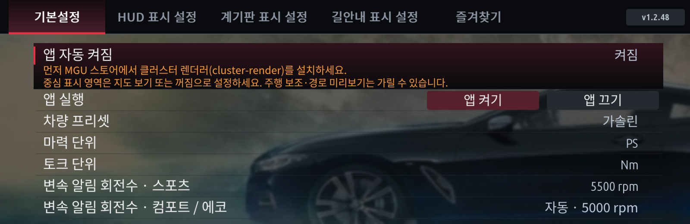

| 메뉴 | 선택지 | 설명 |
|---|---|---|
| 앱 자동 켜짐 | 켜짐 / 꺼짐 | 다음 시동(앱 시작) 때 자동으로 표시를 시작할지 정합니다. |
| 앱 실행 | 앱 켜기 / 앱 끄기 | 지금 바로 표시를 시작·중지합니다. 꺼도 설정 화면은 그대로 쓸 수 있습니다. |
| 차량 프리셋 | 가솔린 / 디젤 / eDrive (플러그인 하이브리드) / M | RPM 눈금과 변속 알림 기본값을 정합니다. 차를 자동으로 알아보는 기능은 아닙니다. |
| 마력 단위 | PS / kW | 마력 표시 단위입니다. |
| 토크 단위 | Nm / kgf·m | 토크 표시 단위입니다. |
| 변속 알림 회전수 · 스포츠 | 프리셋 기본값, 2000 ~ 7500 rpm | 스포츠 계열 모드에서 변속 알림(빨강)이 켜지는 회전수입니다. 가솔린·eDrive·M 기본 5500, 디젤 4200. |
| 변속 알림 회전수 · 컴포트 / 에코 | 자동 (스포츠의 90 %), 2000 ~ 5000 rpm | 컴포트·에코 등 스포츠가 아닌 모든 모드의 변속 알림 회전수입니다. 예를 들어 2500으로 두면 모든 컴포트/에코 모드에서 2500 rpm에 알림이 뜹니다. |

변속 알림은 설정 회전수의 50 %부터 초록, 80 %부터 노랑, 설정 회전수에서 빨강으로 깜박입니다.

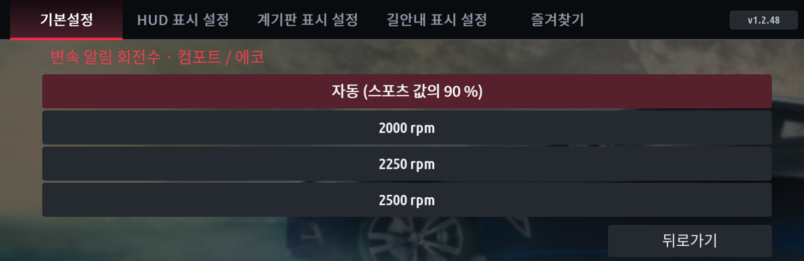

---

## 4. HUD 표시 설정 탭

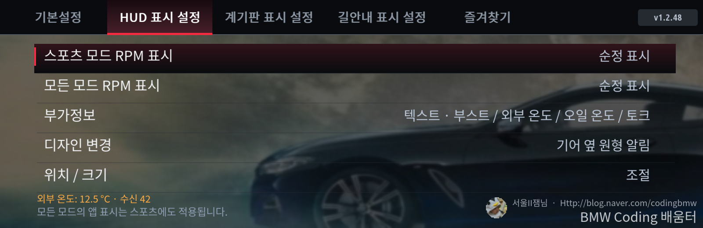

| 메뉴 | 설명 |
|---|---|
| 스포츠 모드 RPM 표시 | 스포츠 계열 모드에서 HUD에 **레드라인 앱** 또는 **순정 표시** |
| 모든 모드 RPM 표시 | 모든 주행 모드에서 레드라인 앱 / 순정 표시. 여기서 레드라인을 고르면 스포츠에서도 적용됩니다. |
| 부가정보 | 게이지 / 텍스트 방식과 표시할 항목 (아래 4-1) |
| 디자인 변경 | 기본 디자인 2종 또는 Redline 앱 레이아웃(HUD 15종, 계기판 17종) (아래 4-2) |
| 위치 / 크기 | 요소별 이동·크기·숨김, 저장 / 불러오기 ([7장](#7-위치--크기)) |

**스포츠에서만** 보이게 하려면 스포츠 = 레드라인 앱, 모든 모드 = 순정 표시로 둡니다.

화면 아래 주황색 글씨는 **확인 줄** 입니다. 부가정보에 외부 온도를 고르면 지금 받은 값(예: `외부 온도: 12.5 °C · 수신 42`) 또는 값이 안 나오는 이유를 보여줍니다.

### 4-1. 부가정보

**부가정보 → 게이지 / 텍스트 선택 → 항목을 누른 순서대로 선택 → 확인** 으로 저장합니다. 확인을 누르지 않고 뒤로가면 바뀌지 않습니다.

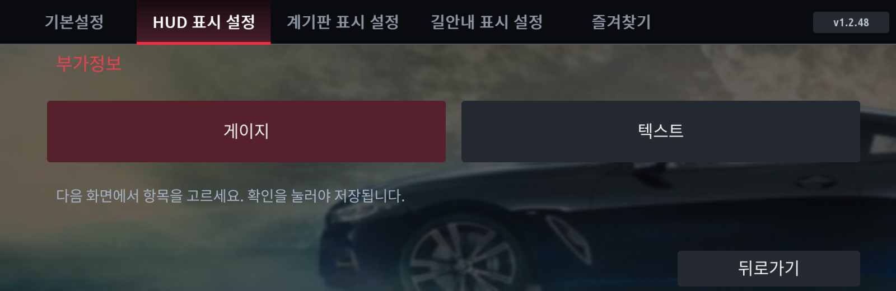
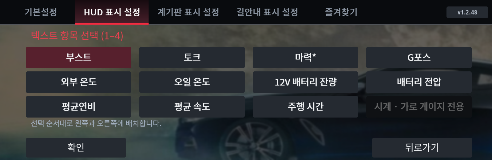

| 항목 | 내용 |
|---|---|
| 부스트 | 과급압 (bar) |
| 토크 | 엔진 토크 (기본설정의 단위) |
| 마력* | 토크와 RPM으로 계산한 추정 출력 (eDrive 모터 합산 아님) |
| G포스 | 가로·세로 가속도를 합친 값. 게이지에서는 점이 좌우로 움직입니다. |
| 외부 온도 | 차량 외기 온도 (eDrive 앱과 같은 방식으로 읽음) |
| 오일 온도 | 엔진 오일 온도 |
| 12V 배터리 잔량 | 12V 배터리 충전 상태(%). 고전압 배터리 잔량이 아닙니다. |
| 배터리 전압 | 12V 배터리 전압 (V) |
| 평균연비 | 트립 평균 연비 (km/L) |
| 평균 속도 | 트립(여행 1) 평균 속도 (km/h) |
| 주행 시간 | 트립(여행 1) 주행 시간 (시:분) |
| 시계 | **가로 게이지 전용** (텍스트 방식과 헥사곤 · 클래식 다이얼에서는 쓸 수 없음). 아래 버튼으로 **UTC+9 (한국)** / 헤드유닛 시간을 고릅니다. |

- 게이지는 최대 2개, 텍스트는 최대 4개입니다.
- 텍스트 1·2개는 왼쪽 → 오른쪽, 3개는 왼쪽 2개 + 오른쪽 1개, 4개는 왼쪽 2개 + 오른쪽 2개로 놓입니다.
- 값을 받지 못했거나 오래된 값은 `--` 로 표시합니다. 없는 값을 추정해서 채우지 않습니다.

### 4-2. 디자인 변경

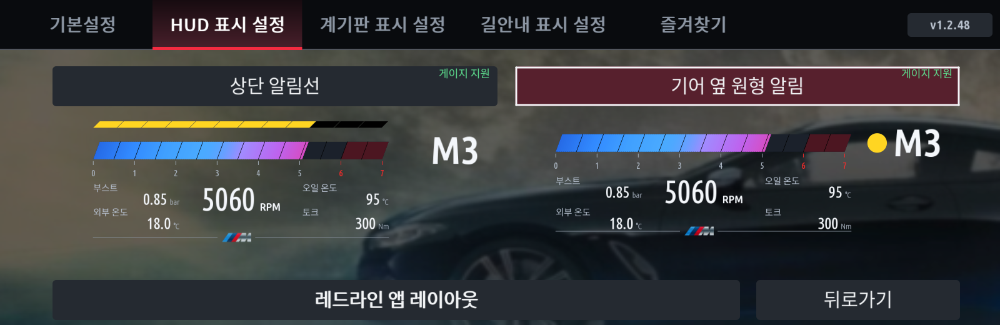

- **상단 알림선**: RPM 막대 위에 알림선이 켜집니다. 알림선과 기어를 따로 옮길 수 있습니다.
- **기어 옆 원형 알림**: 기어 옆 동그라미가 초록 → 노랑 → 빨강으로 바뀝니다. 동그라미와 기어가 함께 움직입니다.
- **레드라인 앱 레이아웃**: 누르면 레이아웃 선택 화면(HUD 15종, 계기판 17종)이 열립니다.

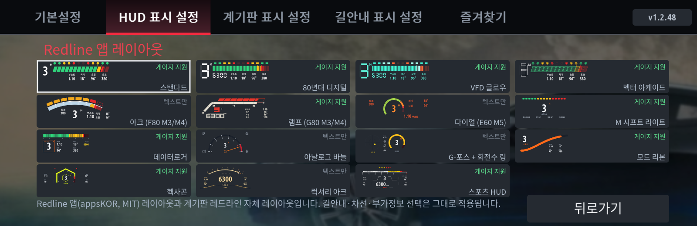

레이아웃마다 위치·크기가 따로 저장됩니다. 다른 레이아웃으로 바꿨다가 돌아와도 그 레이아웃에서 맞춘 위치가 그대로 돌아옵니다. 레이아웃별 모양은 [8장](#8-레이아웃-모음)에 있습니다.

---

## 5. 계기판 표시 설정 탭

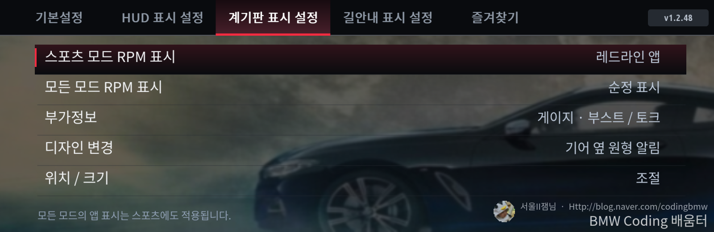

메뉴 구성과 사용법은 HUD 표시 설정과 같습니다. 계기판과 HUD는 출력, 부가정보, 디자인, 위치를 **각각 따로** 설정합니다.

- 계기판 기본값은 **스포츠 모드 = 레드라인 앱**, 모든 모드 = 순정 표시입니다.
- 계기판에 보이려면 차량의 **중심 표시 영역** 이 **지도 보기 또는 꺼짐** 이어야 합니다.

---

## 6. 길안내 표시 설정 탭

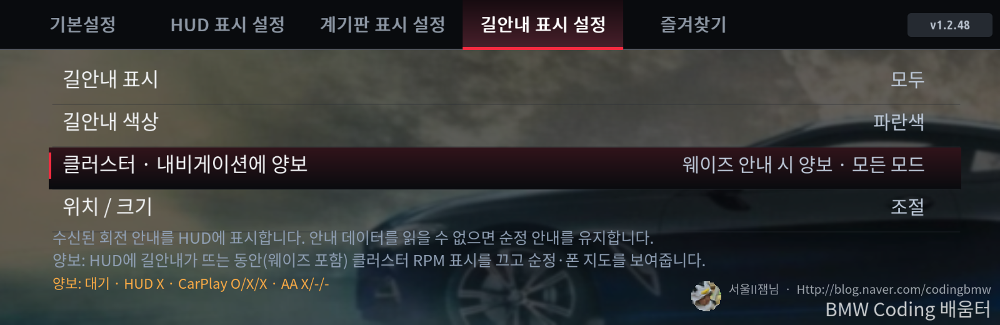

| 메뉴 | 선택지 | 설명 |
|---|---|---|
| 길안내 표시 | 모두 / 스포츠 제외 / 순정 표시 | HUD에 앱의 회전 안내(방향·거리·문구·차선)를 언제 보여줄지 정합니다. 순정 표시는 앱 길안내를 끕니다. |
| 길안내 색상 | 회색 / 흰색 / 파란색 | 화살표 색입니다. 거리와 문구는 흰색입니다. |
| 클러스터 · 내비게이션에 양보 | 양보 안 함 / 웨이즈 안내 시 양보 · 모든 모드 / 웨이즈 안내 시 양보 · 스포츠 제외 | 길안내 중 계기판 RPM 화면을 꺼서 순정·폰(웨이즈 등) 지도를 보여줄지 정합니다. |
| 위치 / 크기 | 방향 / 텍스트 / 차선 | HUD 길안내 영역을 각각 옮기고 키우고 숨깁니다. |

### 클러스터 양보 (웨이즈)

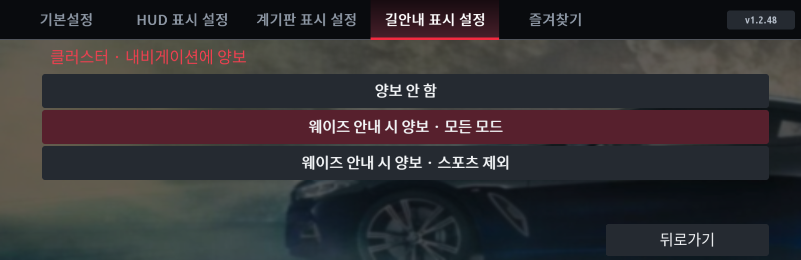

- **웨이즈 안내 시 양보 · 모든 모드**: HUD에 길안내가 뜨는 동안(웨이즈 포함) 계기판 RPM 화면을 끕니다.
- **웨이즈 안내 시 양보 · 스포츠 제외**: 스포츠·스포츠+·스포츠 개인 모드에서는 길안내 중에도 RPM 화면을 유지하고, 그 밖의 모드에서만 양보합니다.
- 길안내가 끝나면 약 **8초 뒤** 계기판 RPM 화면이 자동으로 다시 들어옵니다. 교차로 사이처럼 신호가 잠깐 끊길 때 화면이 깜빡이지 않게 하려는 것입니다.
- 화면 아래 확인 줄: `양보: 클러스터 양보 중 / 대기 · HUD O/X · CarPlay 연결/안내/메타데이터 · AA …`. **HUD O** 인데 계속 **대기** 라면 이 화면을 찍어 문의해 주세요.

웨이즈 안내가 HUD에 뜨지 않으면 앱도 길안내 중인지 알 수 없어 양보하지 못합니다. 지도 앱·휴대전화·차량 조합에 따라 안내가 전달되지 않을 수 있습니다.

### 길안내 위치 / 크기

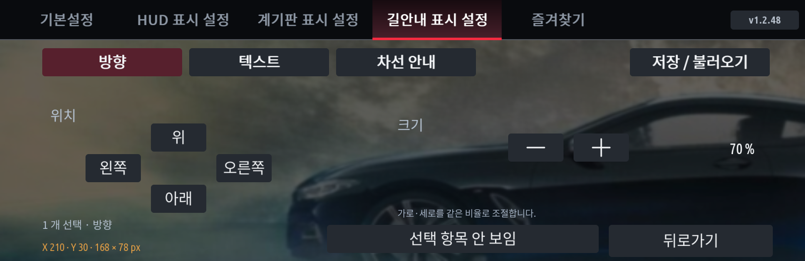

방향·텍스트·차선을 각각 선택해 옮기고 키우고 숨깁니다. 가로·세로는 같은 비율로 커집니다. CarPlay가 추천 차선을 보내면 추천 차선을 안내 색으로 표시합니다.

---

## 7. 위치 / 크기

HUD 탭과 계기판 탭의 **위치 / 크기** 에서 화면의 각 요소를 고른 뒤, 아래 버튼으로 조절합니다.

- **위 / 아래 / 왼쪽 / 오른쪽**: 한 번 누를 때마다 한 칸(원본 10) 이동합니다. 화면 끝에 닿으면 더 저장되지 않으므로, 반대로 누르면 바로 돌아옵니다.
- **크기 − / +**: 5 %씩 바뀝니다. 한 요소만 고르면 가로·세로를 따로 조절하며, 차이는 최대 30 %까지입니다.
- **선택 항목 안 보임 / 보이기**: 고른 요소를 숨기거나 다시 보입니다. 숨긴 요소에만 필요한 차량 신호는 읽지 않습니다.
- 요소 버튼을 한 번 누르면 선택, 다시 누르면 해제됩니다. 여러 개를 고르면 함께 움직입니다.

### 기본 디자인 (상단 알림선 / 기어 옆 원형 알림)

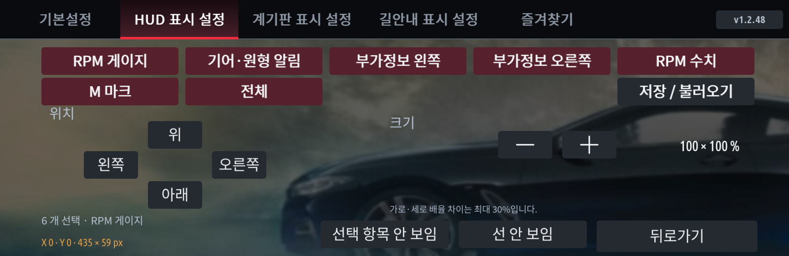

| HUD 요소 | 계기판 요소 |
|---|---|
| RPM 게이지, 기어(· 원형 알림), RPM 알림(상단 알림선일 때), 부가정보 왼쪽·오른쪽, RPM 수치, M 마크 | RPM 게이지, 기어, RPM 알림, 부가정보 왼쪽·오른쪽, RPM 수치, M 위, M 아래 |

- **전체**: 모든 요소를 한 번에 고릅니다. 이 상태에서 크기를 바꾸면 전체가 **같은 비율로** 커지거나 작아지고, 요소 사이 간격도 함께 바뀌어 모양이 그대로 유지됩니다. 전체를 한 번 더 누르면 한 요소 선택으로 돌아갑니다.
- **M 마크** 를 고르면 **선 안 보임** 버튼이 생깁니다. M 아래의 선만 따로 숨길 수 있습니다.

### Redline 앱 레이아웃

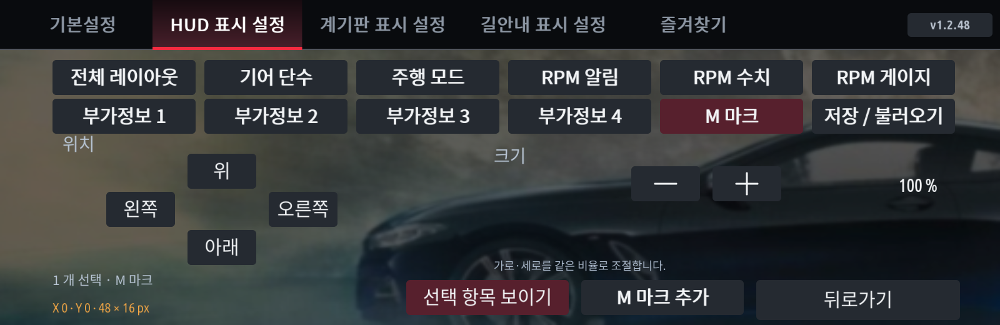

- **전체 레이아웃**: 레이아웃 전체를 옮기고, 크기는 한 가지로 조절합니다(가로·세로 같은 비율).
- 그 밖의 버튼은 레이아웃마다 다릅니다: 기어 단수, 주행 모드, RPM 알림, RPM 수치, RPM 게이지, 부가정보(또는 부가정보 1~4), G포스 미터, 온도 게이지(클래식 다이얼), M 마크.
- **M 마크**: 모든 레이아웃에 BMW M 마크를 넣을 수 있습니다. M 마크를 고르고 **M 마크 추가 / M 마크 빼기** 를 누릅니다. 처음에는 빠져 있습니다.
- HUD에서 처음 위치는 기본 디자인이 쓰는 영역 안이며, 실제 차량에서 맞춘 레이아웃별 기본 위치·크기가 적용되어 있습니다. 위치 / 크기 화면에는 이 값이 0 / 100 %로 보입니다. 위치는 HUD 화면 안이면 어디로든 옮길 수 있습니다.

### 저장 / 불러오기 / 초기화

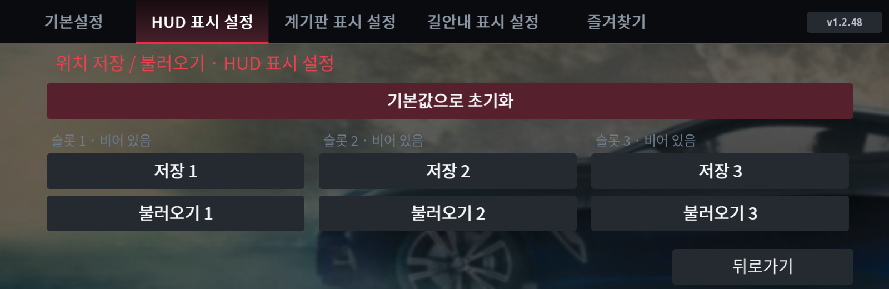

- **저장 1~3**: 지금 위치·크기·숨김을 슬롯에 저장합니다. HUD·계기판·지금 고른 디자인마다 따로 저장됩니다.
- **불러오기 1~3**: 저장한 값을 다시 적용합니다.
- **기본값으로 초기화**: 두 번 누르면 지금 디자인의 위치·크기를 처음 값으로 되돌립니다.

---

## 8. 레이아웃 모음

### HUD 기본 디자인

### HUD Redline 앱 레이아웃 15종

스탠다드, 80년대 디지털, VFD 글로우, 벡터 아케이드, 아크 (F80 M3/M4), 램프 (G80 M3/M4), 다이얼 (E60 M5), M 시프트 라이트, 데이터로거, 아날로그 바늘, G-포스 + 회전수 링, 모드 리본, 헥사곤, 럭셔리 아크, 스포츠 HUD (HUD 전용). 스포츠 다이얼과 클래식 다이얼은 계기판 전용입니다.

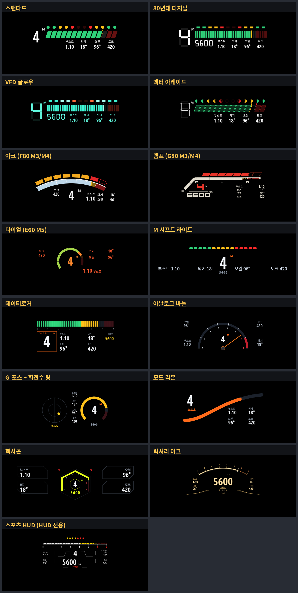

### 계기판 Redline 앱 레이아웃 17종

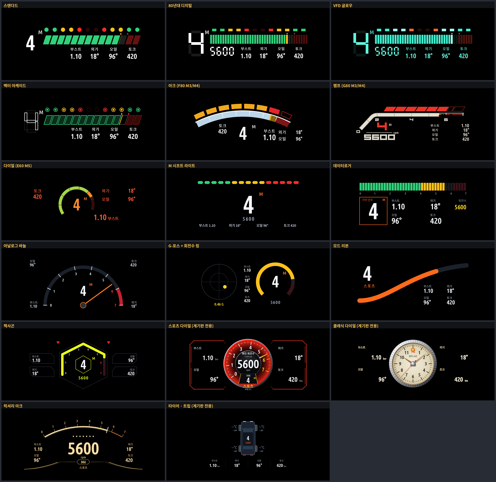

레이아웃 선택 화면의 각 칸 오른쪽 위에 **게이지 지원 / 텍스트만**이 표시됩니다. 게이지 지원 레이아웃(기본 디자인 2종, 스탠다드, 80년대 디지털, VFD 글로우, 벡터 아케이드, 램프, M 시프트라이트, 데이터로거, 모드리본, 헥사곤, 클래식 다이얼, 스포츠 HUD, 스포츠 다이얼, 타이어 · 트립)은 부가정보를 "게이지"로 고르면 막대 게이지로 보여 주고, 나머지는 게이지로 골라도 숫자로 보여 줍니다. 오일 · 외기 온도는 온도계 모양(헥사곤 · 클래식 다이얼은 세워진 온도계)이고, 시계는 가로 게이지 전용이라 헥사곤 · 클래식 다이얼에서는 표시되지 않습니다.

**타이어 · 트립 (계기판 전용)**: 위에서 본 차 그림 가운데에 기어 단수와 주행 모드, 바퀴 옆에 타이어 온도(°C)와 공기압(psi)이 나옵니다. 바퀴 색은 온도에 따라 파랑(20 °C 미만) → 초록 → 노랑 → 빨강(75 °C 이상)으로 바뀝니다. 차 아래에 부가정보가 텍스트 4칸 또는 게이지 2칸으로 나옵니다. 타이어 값은 TPMS 신호라 차에 따라 "--"로 나올 수 있습니다.

Redline 앱 레이아웃은 Redline 앱(appsKOR, MIT 라이선스)의 디자인을 이 앱에서 다시 그린 것입니다.

---

## 9. 업데이트·중지·삭제

- **업데이트**: MGU Store에서 소스를 새로고침한 뒤 **Installed → 계기판 레드라인 → Update** 를 누릅니다. 업데이트 후 앱 오른쪽 위 버전을 확인합니다.
- **잠시 끄기**: 기본설정 → 앱 실행 → **앱 끄기**. 다음 시동에도 켜지지 않게 하려면 **앱 자동 켜짐 → 꺼짐**.
- **특정 화면만 순정으로**: HUD / 계기판 표시 설정에서 해당 모드를 **순정 표시** 로 바꿉니다.
- **삭제**: MGU Store → Installed → 계기판 레드라인 → 삭제.

설정은 업데이트해도 유지됩니다. 버전별 변경 내용은 [업데이트 이력](../CHANGELOG.md)과 [이전 설명서](CLUSTER-REDLINE-HISTORY.ko.md)에 있습니다.

---

## 10. 문제 해결

| 증상 | 확인할 것 |
|---|---|
| 스토어 목록에 앱이 없음 | 인터넷 연결, 소스 철자 `jaimeen77-cmyk/apps`, 브랜치 `main`, 새로고침 |
| 업데이트했는데 예전 그대로 | 앱 오른쪽 위 버전. 한국어판/English판 중 어느 쪽을 쓰는지, 다른 판이 켜져 있지 않은지 |
| 계기판에 RPM 화면이 안 뜸 | 앱 실행 켜짐, 지금 주행 모드의 RPM 표시가 레드라인 앱인지, 중심 표시 영역이 지도 보기/꺼짐인지, `cluster-render` 0.4.0 이상인지 |
| 위치를 바꿔도 생각한 곳과 다름 | 저장 / 불러오기 → 기본값으로 초기화 후 다시 조절 |
| 외부 온도가 `--` | HUD·계기판 탭 아래 주황색 확인 줄의 이유를 확인합니다 (인터페이스 설정 미설치 / 항목 없음 / 구독됐지만 값 없음 등). |
| 웨이즈 길안내 때 계기판이 양보하지 않음 | 길안내 탭의 양보 설정과 확인 줄 (HUD O/X). HUD에 안내가 안 뜨면 양보할 수 없습니다. |
| 설치 실패 / interface 오류 | [설치 오류 진단](REDLINE-INSTALL-FAILED.ko.md), [로그 수집](COLLECT-CLUSTER-REDLINE.ko.md) |

문의와 소식은 [네이버 블로그 jaimeen77](https://blog.naver.com/jaimeen77)에 남겨주세요. 문의할 때 앱 버전, 설정 화면 사진, 확인 줄 사진을 함께 보내주시면 빠르게 확인할 수 있습니다.

---

제작: **잼님** · 다운로드: [github.com/jaimeen77-cmyk/apps](https://github.com/jaimeen77-cmyk/apps) · MGU Store 소스: `jaimeen77-cmyk/apps` (`main`) · [라이선스·원작 고지](../NOTICE.cluster-redline.md)
