# 계기판 레드라인 1.3.67 설명서

[English](CLUSTER-REDLINE.md) · [설치 안내](INSTALL.ko.md) · [앱 소개](../README.ko.md) · [업데이트 이력](../CHANGELOG.md)

계기판 레드라인은 BMW 계기판(클러스터)과 HUD에 회전수(RPM)·변속 알림·기어·부가정보를 그리는 앱입니다.
주행 모드마다 레드라인 화면과 순정 화면을 고를 수 있고, HUD에는 길안내·차량 알림·깜빡이·문 열림 경고 등을 겹쳐 보여 줍니다.

| 계기판 (게이지 부가정보) | 계기판 (빨간 변속 알림) |
|---|---|
|  | 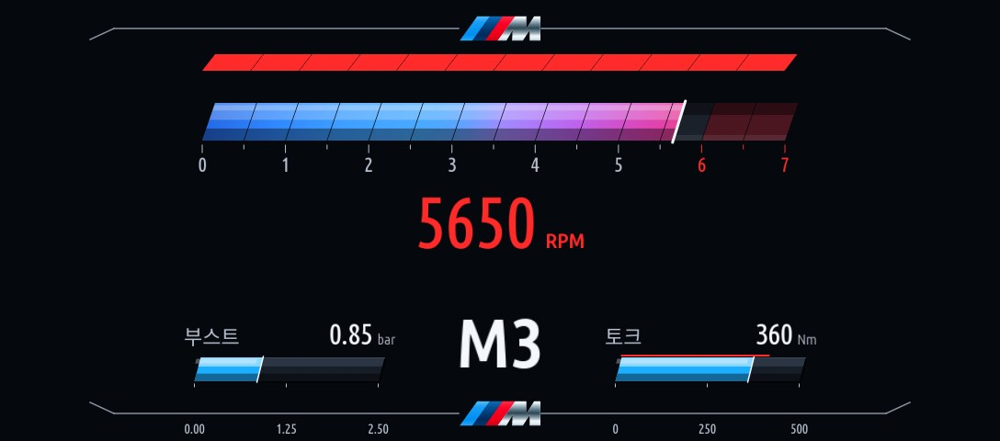 |

| HUD (기어 옆 원형 알림) | HUD (상단 알림선) |
|---|---|
| 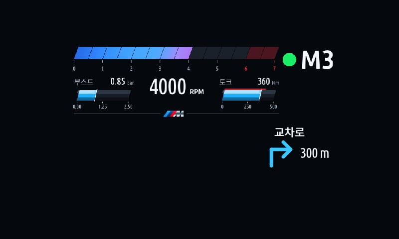 | 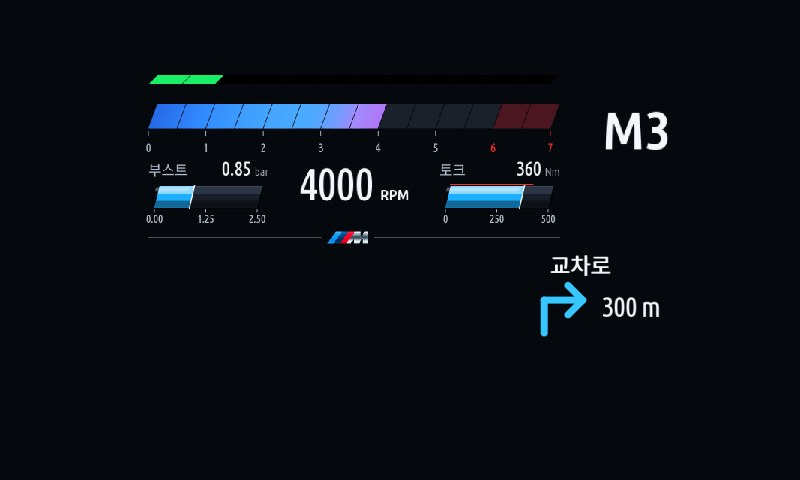 |

> 이 설명서의 그림은 실제 앱 패키지(1.3.67)의 그리기 코드로 만든 예시 화면입니다. 값은 예시 데이터이고, 차의 화면과 색·위치가 조금 다를 수 있습니다.

## 목차

1. [설치](#1-설치)
2. [처음 설정 (5분)](#2-처음-설정-5분)
3. [설정 화면 사용법](#3-설정-화면-사용법)
4. [기본설정 탭](#4-기본설정-탭)
5. [HUD 표시 설정 탭](#5-hud-표시-설정-탭)
6. [계기판 표시 설정 탭](#6-계기판-표시-설정-탭)
7. [길안내 표시 설정 탭](#7-길안내-표시-설정-탭)
8. [즐겨찾기 탭](#8-즐겨찾기-탭)
9. [업데이트·끄기·삭제](#9-업데이트끄기삭제)
10. [문제 해결](#문제-해결)

---

## 1. 설치

1. MGU Store → **Settings → Add source**에서 저장소 **`jaimeen77-cmyk/apps`**, 브랜치 **`main`**을 등록하고 **Check now**를 누릅니다.
2. **계기판 레드라인 (한국어)**(영어판은 Cluster Redline (English))를 **Install**합니다.
3. 계기판 렌더러 **`cluster-render` 0.4.0 이상**이 함께 설치됩니다. 이 도구는 MGU Store 기본 소스(`robertnisipeanu/idrive-apps`)가 제공하므로, 그 소스가 등록되어 있어야 합니다.
4. 앱을 열어 오른쪽 위에 **v1.3.67**이 보이면 끝입니다.

iDrive 7과 iDrive 8에 설치됩니다. 자세한 내용은 [설치 안내](INSTALL.ko.md)를 보세요.

> 한국어판과 English판은 서로 다른 앱입니다. 둘 다 설치했다면 쓰지 않는 쪽은 **앱 끄기(자동 켜기 꺼짐)**로 두세요. 두 앱이 계기판을 서로 차지하려고 다투지 않게 하기 위함입니다.

## 2. 처음 설정 (5분)

1. **기본설정 → 차량 프리셋**에서 차량 종류(가솔린 / 디젤 / eDrive / M)를 고릅니다. 변속 알림 기본 회전수가 이것에 맞춰집니다.
2. **계기판 표시 설정 → 스포츠 모드 RPM 표시**가 **레드라인 앱**인지 확인합니다(기본값). 컴포트·에코에서도 보려면 **모든 모드 RPM 표시**도 레드라인 앱으로 바꿉니다.
3. HUD에도 띄우려면 **HUD 표시 설정**에서 같은 방법으로 레드라인 앱을 고릅니다(HUD 기본값은 순정 표시).
4. 차의 **계기판 설정 → 중심 표시 영역**을 **지도 보기** 또는 **꺼짐**으로 둡니다. 다른 표시(주행 보조 등)가 켜져 있으면 그 화면에 가려질 수 있습니다.
5. **기본설정 → 앱 실행 → 앱 켜기 (자동 켜기)**를 누릅니다. 다음 시동부터 자동으로 켜집니다.

이제 주행 모드를 스포츠로 바꾸면 계기판에 레드라인 화면이 나옵니다.

## 3. 설정 화면 사용법

| 탭 | 하는 일 |
|---|---|
| **기본설정** | 앱 켜기/끄기, 운전자별 설정, HUD 표시등(앞차 간격·깜빡이·문 열림), 차량 프리셋 |
| **HUD 표시 설정** | HUD에 무엇을 언제 보여 줄지, 디자인, 위치·크기, BC 모드 화면 |
| **계기판 표시 설정** | 계기판에 무엇을 언제 보여 줄지, 디자인(애니메이션 포함), 위치·크기, BC 모드 화면 |
| **길안내 표시 설정** | HUD 길안내, 색상, 계기판 양보, 위치·크기, 차량 알림 |
| **즐겨찾기** | 지금 설정을 5칸에 저장하고 불러오기 |

- **조작**: 화면을 터치하거나, iDrive 컨트롤러를 돌려 항목을 고르고 누릅니다. 탭은 위쪽 탭을 누르거나 아래 버튼줄로 바꿉니다.
- 행 오른쪽 글자는 지금 값입니다. 행을 누르면 바로 값이 바뀌거나, 그 항목의 화면이 열립니다. 열린 화면에서는 **뒤로가기**로 돌아옵니다.
- 화면 아래 주황색 글씨는 **확인 줄**입니다. 차에서 값을 받고 있는지, 왜 안 나오는지 알려 줍니다. 문의할 때 이 줄을 찍어 보내 주세요.

---

## 4. 기본설정 탭

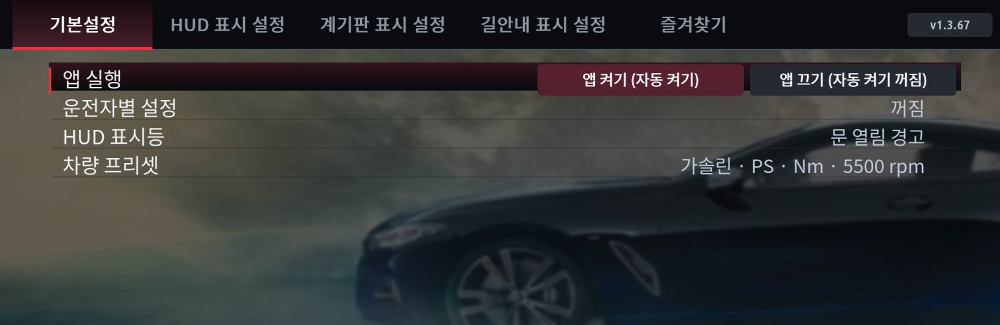

| 항목 | 선택지 | 설명 |
|---|---|---|
| 앱 실행 | **앱 켜기 (자동 켜기)** / **앱 끄기 (자동 켜기 꺼짐)** | 지금 표시를 시작·중지하고, 다음 시동 때 자동으로 켤지도 함께 정합니다. 꺼도 설정 화면은 쓸 수 있습니다. |
| 운전자별 설정 | 꺼짐(기본) / 켜짐 | 차의 운전자 프로필마다 설정을 따로 기억합니다. 아래 [4-3](#4-3-운전자별-설정과-인사). |
| HUD 표시등 | 화면 열기 | 앞차 간격, HUD 깜빡이 표시, 문 열림 경고. 아래 [4-1](#4-1-hud-표시등). |
| 차량 프리셋 | 화면 열기 | 차량 종류, 단위, 변속 알림 회전수. 아래 [4-2](#4-2-차량-프리셋). |

### 4-1. HUD 표시등

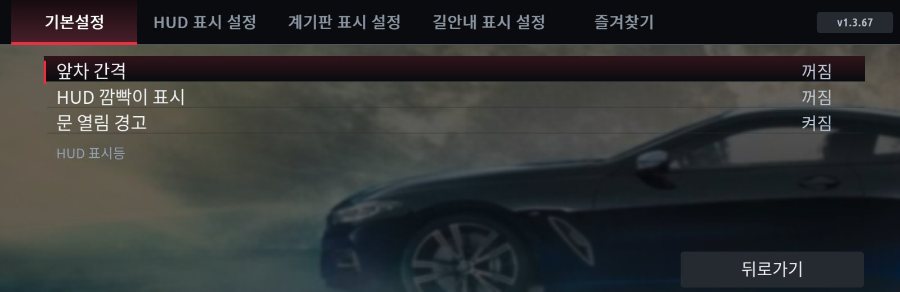

| 항목 | 설명 |
|---|---|
| **앞차 간격** | 꺼짐(기본) / 간단히(시간 간격 + 거리) / 자세히(+ 다가오는·멀어지는 속도). 레이더(ACC)가 잰 앞차 거리를 읽어 HUD의 깜빡이 화살표 사이에 작게 보여 줍니다. 시간 간격 1.0초 미만 빨강, 1.0~1.5초 주황, 1.5초 이상 청록. **거리 보정**(1.3.91): 차는 앞유리 뒤 센서에서 거리를 재므로, 범퍼 기준이 되도록 보여 줄 거리에서 뺍니다. 0 ~ −3 m, 0.5 m 단위, 기본 −2 m(앞차와 딱 붙으면 0 m). 시간 간격도 보정한 거리로 계산합니다. 화면 아래에 차에서 받은 값과, 차가 레이더 서비스를 앱에 주고 있는지가 나옵니다. |
| **HUD 깜빡이 표시** | 켜짐 / 꺼짐(기본). 방향지시등·비상등이 깜빡이면 HUD에 화살표가 차의 주기(약 0.64초)에 맞춰 깜빡입니다. 모양(기본 화살표 · `<<< >>>` · `< >`), 색(초록·파랑·주황), 위치/크기를 고릅니다. 순정 HUD일 때도 위에 겹쳐 보입니다. 같은 화면에 **측후방 경고**(사이드미러 경고등이 켜지면 그쪽 화살표 밑에 위에서 본 차 그림, 깜빡이를 켜면 빨강)가 있습니다. 측후방 경고는 진단 읽기를 자주 쓰므로 기본 꺼짐입니다. |
| **문 열림 경고** | 켜짐(기본) / 꺼짐. 문·보닛·트렁크가 열려 있으면 HUD 가운데에 위에서 본 차 그림을 띄우고 열린 곳을 빨갛게 그립니다. 정차 중에도 보이고, 모두 닫히면 사라집니다. 위치/크기를 따로 맞출 수 있습니다. |

깜빡이·측후방·문 열림 그림은 위치/크기를 맞추는 동안 미리보기로 HUD에 보입니다. 화면을 나가면 사라집니다.

### 4-2. 차량 프리셋

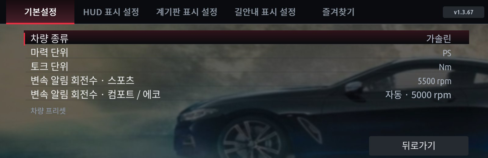

| 항목 | 선택지 | 설명 |
|---|---|---|
| 차량 종류 | 가솔린 / 디젤 / eDrive (플러그인 하이브리드) / M | RPM 눈금과 변속 알림 기본값을 정합니다. 차를 자동으로 알아보지는 않습니다. |
| 마력 단위 | PS / kW | |
| 토크 단위 | Nm / kgf·m | |
| 변속 알림 회전수 · 스포츠 | 프리셋 기본값, 2000~7500 rpm | 스포츠 계열 모드의 변속 알림 회전수. 가솔린·eDrive·M 기본 5500, 디젤 4200. |
| 변속 알림 회전수 · 컴포트 / 에코 | 자동(스포츠의 90 %), 2000~5000 rpm | 스포츠가 아닌 모든 모드의 변속 알림 회전수. |

변속 알림은 설정 회전수의 50 %부터 초록, 80 %부터 노랑, 설정 회전수에서 빨강으로 깜빡입니다.

### 4-3. 운전자별 설정과 인사

- **켜짐**이면 차의 현재 사용자(운전자 프로필)를 5초마다 확인해, 운전자마다 설정을 따로 기억합니다. 처음 보는 운전자는 지금 설정을 이어받습니다.
- 운전자마다 따로 기억하는 것: 디자인, 위치/크기, 부가정보, 길안내 색, 깜빡이, 차량 알림 등과 **즐겨찾기 5칸**, 위치/크기 저장 칸. **차량 프리셋**과 앱 자동 켜짐은 모든 운전자가 함께 씁니다.
- 행 오른쪽에 `켜짐 · 홍길동 (2 / 3)`처럼 지금 운전자 이름과 번호가 나옵니다.
- **운전자 인사**: 시동을 걸 때 HUD 위쪽과 계기판 가운데에 `홍길동님 안녕하세요`를 5초, P단에서 시동을 끌 때 `안녕히 가세요`를 5초 보여 줍니다. 오토 스타트·스톱으로 다시 켜질 때는 나오지 않습니다. 운전자별 설정 화면에서 환영 인사·작별 인사를 따로 켜고 끕니다.

---

## 5. HUD 표시 설정 탭

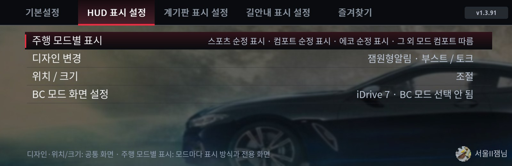

| 항목 | 선택지 | 설명 |
|---|---|---|
| 스포츠 모드 RPM 표시 | 레드라인 앱 / 순정 표시(기본) / BC 모드 | 스포츠·스포츠+·스포츠 개별에서 HUD에 무엇을 보일지 |
| 모든 모드 RPM 표시 | 레드라인 앱 / 레드라인 앱 · 스포츠 모드 제외 / 순정 표시(기본) / BC 모드 | 모든 주행 모드. **레드라인 앱**은 스포츠에도 적용, **스포츠 모드 제외**는 스포츠 계열만 위 줄을 따릅니다. |
| 디자인 변경 | 디자인 → 부가정보 | 아래 5-1 |
| 위치 / 크기 | 화면 열기 | 아래 5-2 |
| BC 모드 화면 설정 | 화면 열기 | 아래 5-3 |

- **스포츠에서만** 보이게: 스포츠 = 레드라인 앱, 모든 모드 = 순정 표시.
- **스포츠에서만 순정**으로: 스포츠 = 순정 표시, 모든 모드 = 레드라인 앱 · 스포츠 모드 제외.

### 5-1. 디자인 변경과 부가정보

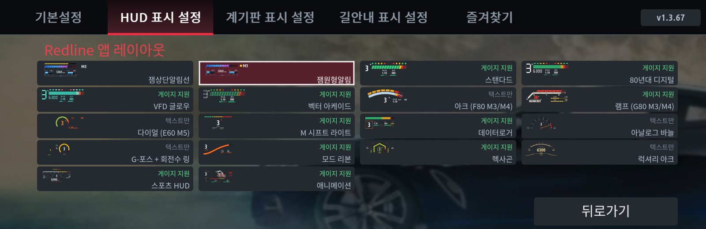

- 목록 맨 앞의 **잼상단알림선 / 잼원형알림**은 이 앱의 기본 디자인이고, 나머지는 Redline 앱 레이아웃(HUD 16종)입니다. 각 칸 오른쪽 위에 **게이지 지원 / 텍스트만**이 표시됩니다.
- 디자인을 고르면 바로 **부가정보**를 고릅니다: **게이지**(최대 2개) / **텍스트**(최대 4개) / **부가정보 없음**. 항목을 누른 순서대로 놓이고, **확인**을 눌러야 저장됩니다.

| 부가정보 항목 | 내용 |
|---|---|
| 부스트 | 과급압 (bar) |
| 토크 / 마력* | 엔진 토크, 토크와 회전수로 계산한 추정 출력 |
| G포스 | 가로·세로 가속도 |
| 외부 온도 / 오일 온도 | °C |
| 12V 배터리 잔량 / 배터리 전압 | 12V 배터리(고전압 배터리 아님) |
| 평균연비 / 평균 속도 / 주행 시간 | 트립(여행 1) 값 |
| 시계 | 가로 게이지 전용. UTC+9(한국) / 헤드유닛 시간 |

값을 아직 받지 못했거나 오래된 값은 `--`로 나옵니다. 없는 값을 추정해 채우지 않습니다.

### 5-2. 위치 / 크기

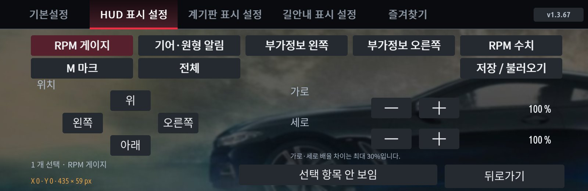

- 위쪽 버튼에서 요소(RPM 게이지, 기어·원형 알림, 부가정보 왼쪽·오른쪽, RPM 수치, M 마크 등)를 고릅니다. 다시 누르면 해제되고, 여러 개를 고르면 함께 움직입니다. **전체**는 모든 요소를 같은 비율로 키우고 줄입니다.
- **위 / 아래 / 왼쪽 / 오른쪽**으로 한 칸씩 옮기고, **가로 / 세로 − +**로 5 %씩 키웁니다(한 요소의 가로·세로 차이는 최대 30 %).
- **선택 항목 안 보임**으로 고른 요소를 숨깁니다. 숨긴 요소에만 필요한 차량 신호는 읽지 않습니다.
- **저장 / 불러오기**: 저장 1~3, 불러오기 1~3, 기본값으로 초기화(두 번 누름). 디자인마다 따로 저장됩니다.
- Redline 레이아웃에서는 레이아웃마다 버튼이 다르고, **M 마크 추가 / 빼기**로 BMW M 마크를 넣을 수 있습니다.

### 5-3. BC 모드 화면 설정

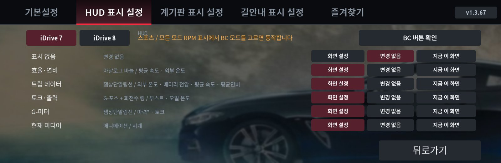

RPM 표시에서 **BC 모드**를 고르면, 왼쪽 레버의 **BC 버튼**으로 순정 BC 페이지를 넘길 때 레드라인 화면도 그 페이지에 맞춰 바뀝니다.

- 위쪽에서 **iDrive 7 / iDrive 8** 페이지 목록을 고릅니다.
- 페이지마다 **화면 설정**(디자인 → 부가정보 → 위치/크기, 페이지마다 저장) / **변경 없음** / **지금 이 화면**(순서가 어긋났을 때 지금 페이지로 맞추기)을 고릅니다.
- 차가 지금 어떤 BC 페이지인지 알려 주지 않으므로, BC를 **누른 횟수**로 순정 순서를 따라갑니다. BC 누름은 BC 모드가 아닐 때도 앱이 켜져 있으면 셉니다.
- **BC 버튼 확인**: BC를 누를 때 레버 값이 바뀌는지와 누른 횟수를 봅니다.

---

## 6. 계기판 표시 설정 탭

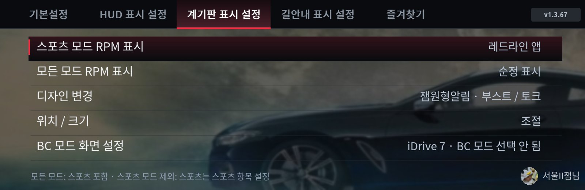

메뉴는 HUD 탭과 같고, 계기판과 HUD는 출력·디자인·부가정보·위치를 **각각 따로** 설정합니다.

- 기본값: **스포츠 모드 = 레드라인 앱**, 모든 모드 = 순정 표시.
- 계기판에 보이려면 차의 **중심 표시 영역**이 **지도 보기 또는 꺼짐**이어야 합니다.

### 6-1. 디자인 변경

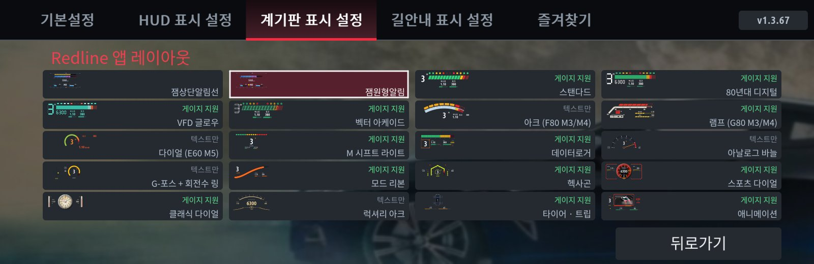

계기판 디자인은 **24종**입니다: 잼상단알림선, 잼원형알림, 그리고 Redline 앱 레이아웃 22종(스탠다드, 80년대 디지털, VFD 글로우, 벡터 아케이드, 아크(F80 M3/M4), 램프(G80 M3/M4), 다이얼(E60 M5), M 시프트 라이트, 데이터로거, 아날로그 바늘, G-포스 + 회전수 링, 모드 리본, 헥사곤, 스포츠 다이얼, 클래식 다이얼, 럭셔리 아크, 타이어 · 트립, 차분한 시계, 레트로 VU 미터, 길안내 중심, G-G 궤적, **애니메이션**). 애니메이션은 항상 맨 끝입니다.

**차분한 시계**(1.3.71, 계기판·HUD): 가운데 큰 시계와 날짜, 아래에 고른 부가정보(최대 4개, 예: 외기·주행 시간·연비), 위에 기어·속도·주행 모드가 작게 나옵니다. 회전수는 평소 보이지 않다가 변속 시점 1,500 rpm 전부터 시계 위에 가는 막대로 나타납니다. 색상은 부가정보 화면에서 **차가운 색 / 따뜻한 색** 중 고릅니다. 시계·속도도 위치/크기에서 따로 옮기고 숨길 수 있습니다.

**레트로 VU 미터**(1.3.72, 계기판): 오디오 앰프 같은 크림색 바늘 계기 두 개. 왼쪽은 회전수, 오른쪽은 부가정보에서 고른 첫 항목(부스트·토크 등, 없으면 회전수 계기 하나만 가운데). 레드존에서 바늘 끝이 빨개지고 PEAK 램프가 켜집니다. 아래에 주행 모드·기어·시계.

**길안내 중심**(1.3.72, 계기판): 가운데에 큰 회전 화살표, 거리, 방면(고속도로 진출·진입 표시 포함), 아래에 차로 안내와 "그다음 ○○ 120 m". 왼쪽 작은 회전수 링, 오른쪽 기어·속도. 길안내가 없으면 가운데에 속도가 크게 나옵니다. 길안내는 HUD와 같은 데이터를 쓰고, 길안내 표시(주행 모드) 설정을 따릅니다.

**G-G 궤적**(1.3.72, 계기판·HUD): 0.4·0.8·1.2 G 동심원 위에 최근 2.5초의 좌우·앞뒤 G가 꼬리처럼 남아 코너 모양을 그립니다. 바깥은 회전수 링, 왼쪽 기어·속도, 오른쪽 지금 G와 회전수, 아래에 이번 주행의 최고 좌·우·제동 G.

| 텍스트 부가정보 4개 | 게이지 부가정보 2개 |
|---|---|
| 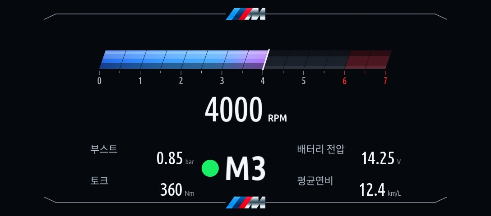 | 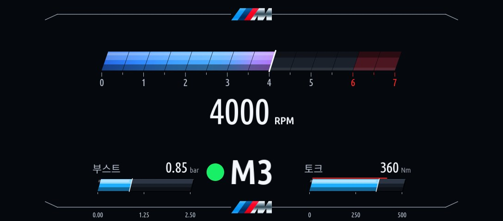 |

### 6-2. 애니메이션 (자동차 그림 / 내 그림 넣기)

디자인 목록에서 **애니메이션**을 고르면 내 GIF 화면이 열립니다.

| GIF를 넣지 않았을 때: 자동차 그림 | 내 GIF를 넣었을 때 |
|---|---|
| 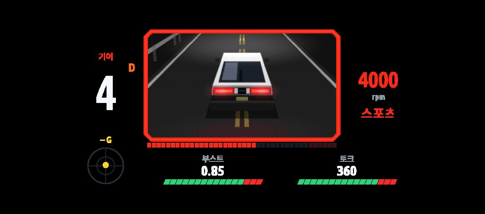 | 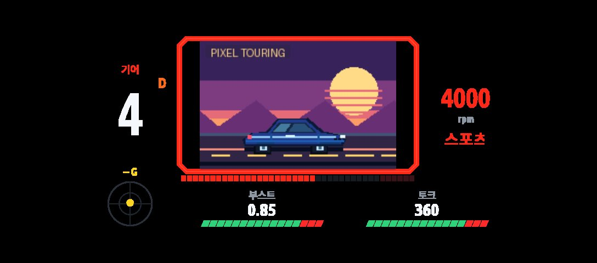 |

- **자동차 그림**: GIF를 넣지 않으면 나옵니다. 내 M3 그림으로, 차의 G와 기어에 따라 브레이크등, 좌우 4단계 코너링(0.10·0.25·0.35 G, 0.50 G부터는 드리프트), 가속 불꽃, 후진등, 정차가 바뀝니다.
- **내 그림(내 GIF)**: [GIF 플레이어](../apps/gif_home/README.ko.md)에 휴대폰으로 올린 GIF를 가져와, 주행·정지·후진·좌회전·우회전 장면마다 다른 GIF를 보여 줍니다. 가운데 그림 자리에 GIF가 나오고, 기어·회전수·부가정보·G 미터는 그대로 나옵니다.

#### 내 그림 넣기

**준비**: GIF 플레이어(0.4.3 이상)를 설치하고, 휴대폰으로 넣고 싶은 GIF를 올려 둔 뒤 GIF 플레이어를 한 번 실행합니다. GIF 플레이어에서 따로 설정할 것은 없습니다. ([GIF 올리는 방법](../apps/gif_home/README.ko.md#4-휴대폰으로-gif-올리기))

**1. 애니메이션 화면 열기**: 계기판 표시 설정 → **디자인 변경** → **애니메이션**.

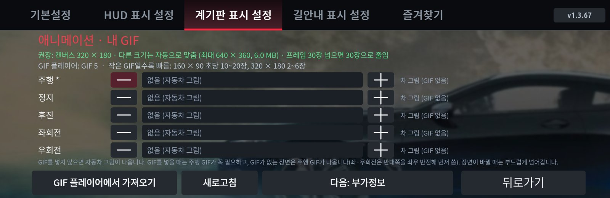

위쪽에 `GIF 플레이어: GIF 5`처럼 GIF 플레이어에서 받은 GIF 수가 나옵니다. `대기 중`이나 오류가 나오면 GIF 플레이어를 한 번 실행하고 **새로고침**을 누르세요.

**2. 장면마다 GIF 고르기**: 각 줄의 **− / +**로 GIF를 고릅니다. 가운데에 GIF 이름·크기·용량이 나옵니다.

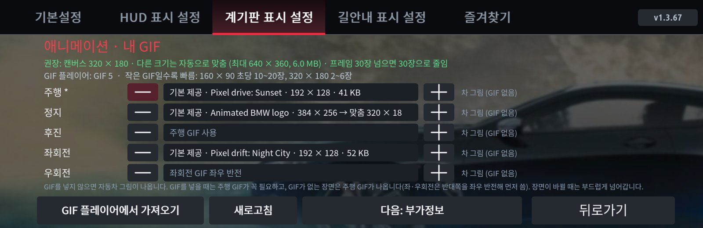

| 장면 | 언제 나오나 |
|---|---|
| **주행 \*** (꼭 골라야 함) | 앞으로 갈 때. 다른 장면에 GIF가 없으면 이 GIF가 대신 나옵니다 |
| 정지 | 서 있을 때(1 km/h 미만, 속도를 모르면 P 기어) |
| 후진 | R 기어 |
| 좌회전 / 우회전 | 좌우 G가 0.12 G를 넘을 때(0.08 G 아래로 내려가면 끝). 한쪽만 고르면 반대쪽은 좌우를 뒤집어 씁니다 |

**3. 가져오기**: **GIF 플레이어에서 가져오기**를 누릅니다. 오른쪽에 `사용 중: 192 × 128 · 18 프레임`처럼 나오면 계기판에 들어갔습니다.

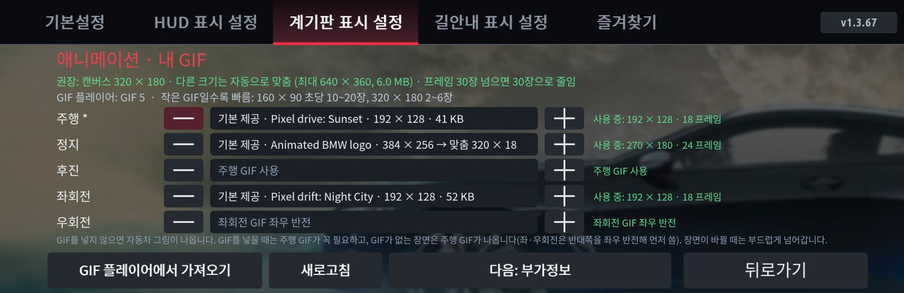

**4. 부가정보**: **다음: 부가정보**를 눌러 그림 아래에 나올 부가정보(게이지 / 텍스트 / 없음)를 고르면 끝입니다. 위치/크기에서 기어·회전수·부가정보 등을 하나씩 옮기거나 숨길 수 있습니다.

HUD의 애니메이션 디자인에도 같은 GIF가 나옵니다(검은 부분은 투명).

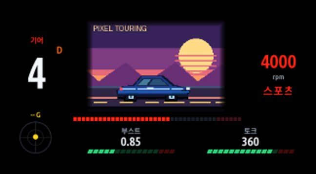

**알아 둘 점**

- 권장 크기 **320 × 180**. 더 큰 GIF(최대 640 × 360, 6 MB)는 가져올 때 비율을 지켜 자동으로 줄이고, 30장이 넘으면 30장으로 줄입니다(재생 시간은 그대로).
- **작은 GIF일수록 빠릅니다**: 160 × 90은 초당 10~20장, 320 × 180은 2~6장 정도(차의 상태에 따라 다름).
- 장면이 바뀔 때는 0.4초 동안 부드럽게 넘어갑니다.
- 가져온 뒤에는 GIF 플레이어가 꺼져 있어도 됩니다. GIF 플레이어의 GIF를 바꾸거나 다른 GIF를 고르면 다시 **가져오기**를 누르세요.
- 자동차 그림으로 돌아가려면 다섯 줄을 모두 `없음`으로 두고 **가져오기**를 누릅니다.

### 6-3. 위치 / 크기

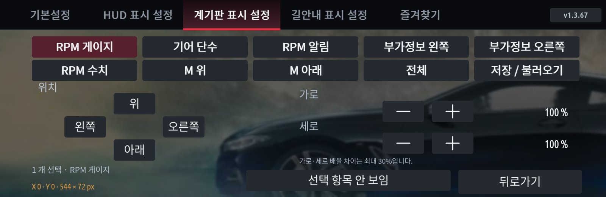

HUD와 같습니다. 계기판 요소는 RPM 게이지, 기어 단수, RPM 알림, 부가정보 왼쪽·오른쪽, RPM 수치, M 위, M 아래입니다.

### 6-4. BC 모드 화면 설정

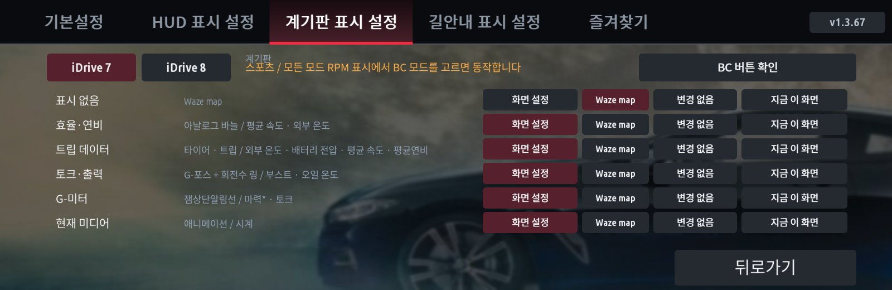

HUD와 같고, 계기판에는 **Waze map**(레드라인이 비켜서 Waze·순정 지도를 보여 줌)이 더 있습니다. iDrive 7의 기본 화면:

| 순정 BC 페이지 | 계기판 기본 | HUD 기본 |
|---|---|---|
| 표시 없음 | Waze map | 변경 없음 |
| 효율·연비 | 아날로그 바늘 / 평균 속도·외부 온도 | 같음 |
| 트립 데이터 | 타이어·트립 / 외부 온도·배터리 전압·평균 속도·평균 연비 | 잼상단알림선 / 같은 텍스트 |
| 토크·출력 | G-포스+회전수 링 / 부스트·오일 온도 | 같음 |
| G-미터 | 잼상단알림선 / 마력·토크 | 같음 |
| 현재 미디어 | 애니메이션 / 시계 | 애니메이션 / 시계 |

---

## 7. 길안내 표시 설정 탭

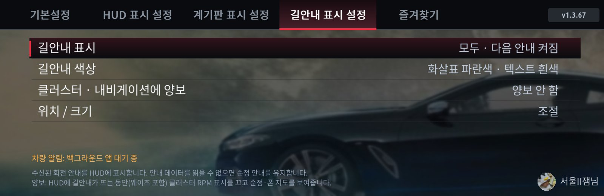

| 항목 | 설명 |
|---|---|
| 길안내 표시 | HUD에 앱의 회전 안내(방향·거리·도로 이름·차선)를 언제 보일지 |
| 길안내 색상 | 화살표 색과 텍스트 색 |
| 클러스터 · 내비게이션에 양보 | 길안내 중 계기판 RPM 화면을 비켜 줄지 |
| 위치 / 크기 | 방향·텍스트·차선 안내·다음 안내·차량 알림의 위치와 크기 |

**차량 알림**(과속·어린이 보호 표지·단속 카메라)은 항상 켜져 있고, 위치/크기에서 옮기거나 숨깁니다. 화면 아래 확인 줄에 받은 신호 수가 나옵니다.

### 7-1. 길안내 표시

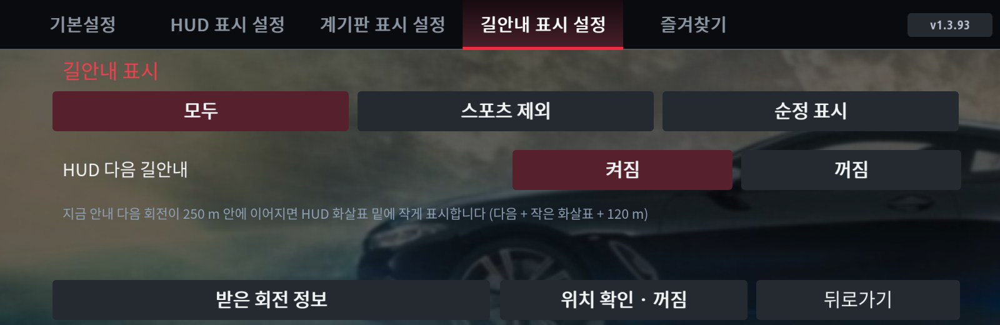

- **모두 / 스포츠 제외 / 순정 표시**: 순정 표시는 앱 길안내를 끕니다.
- **HUD 다음 길안내**: 켜짐(기본)이면 다음 회전이 250 m 안에 바로 이어질 때 화살표 밑에 `다음 ↰ 120 m`처럼 작게 보여 줍니다.
- **받은 회전 정보**: 내비(티맵·카카오내비·순정 등)가 보낸 최근 회전 10개와 경로의 회전 목록(1.3.67부터)을 보여 줍니다. 다음 회전이 왜 나오거나 안 나오는지 확인할 때 씁니다.

### 7-2. 길안내 색상

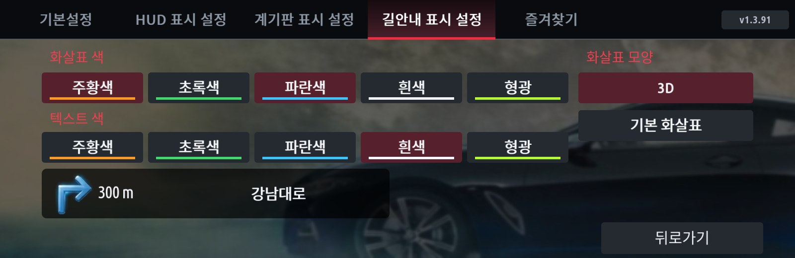

화살표 색(회전 화살표·추천 차선)과 텍스트 색(거리·도로 이름)을 주황·초록·파랑·흰색 중에서 고릅니다. 아래 미리보기로 확인합니다. 기본은 파란 화살표·흰 텍스트입니다.

### 7-3. 클러스터 · 내비게이션에 양보

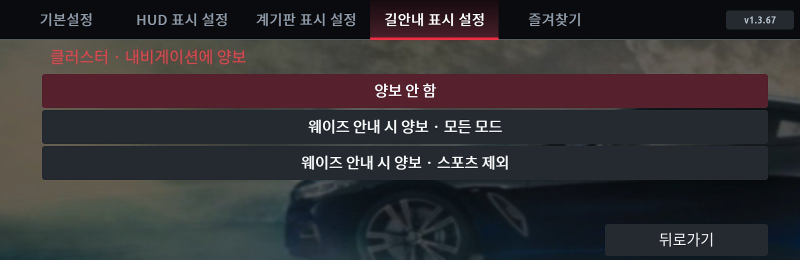

- **양보 안 함**(기본) / **웨이즈 안내 시 양보 · 모든 모드** / **웨이즈 안내 시 양보 · 스포츠 제외**.
- HUD에 길안내가 뜨는 동안(웨이즈 포함) 계기판 RPM 화면을 꺼서 순정·휴대폰 지도를 보여 줍니다. 안내가 끝나고 약 8초 뒤 다시 들어옵니다.
- 휴대폰 지도 앱의 안내가 HUD에 오지 않으면 앱도 길안내 중인지 알 수 없어 양보하지 못합니다.

### 7-4. 길안내 위치 / 크기

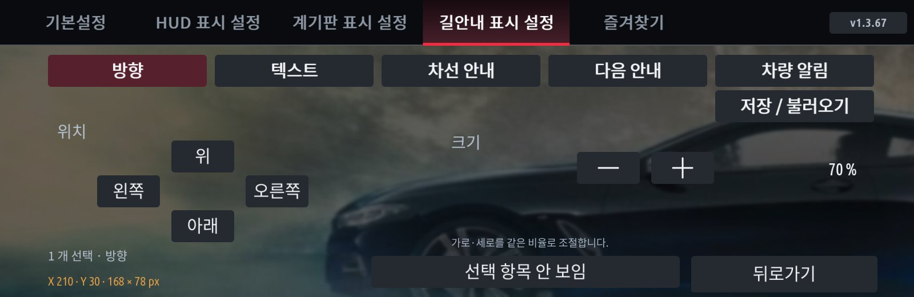

방향·텍스트·차선 안내·다음 안내·차량 알림을 각각 골라 옮기고 키우고 숨깁니다. 길안내는 가로·세로가 같은 비율로 커집니다.

---

## 8. 즐겨찾기 탭

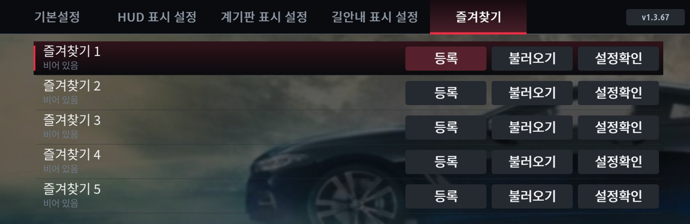

지금 설정(디자인, 부가정보, 위치/크기, 길안내 색, 깜빡이, 차량 알림 등)을 5칸에 저장해 두고 한 번에 바꿉니다.

| 버튼 | 동작 |
|---|---|
| **등록** | 지금 설정을 그 칸에 저장합니다. 이미 저장된 칸은 4초 안에 한 번 더 눌러야 덮어씁니다. |
| **불러오기** | 그 칸의 설정을 적용합니다. 이미 같은 설정이면 `이미 사용 중`이 나옵니다. 연달아 누르면 잠깐 기다렸다 다시 누르라고 나옵니다. |
| **설정확인** | 그 칸에 무엇이 저장되어 있는지 봅니다. 이 화면에서도 불러올 수 있습니다. |

- 운전자별 설정이 켜져 있으면 즐겨찾기 5칸도 운전자마다 따로입니다.
- BC 모드로 쓰는 중이면 불러온 직후에도 지금 BC 페이지의 화면으로 맞춥니다.

---

## 9. 업데이트·끄기·삭제

- **업데이트**: MGU Store에서 소스를 Check now → **Installed → 계기판 레드라인 → Update**. 앱 오른쪽 위 버전을 확인합니다. 설정은 유지됩니다.
- **잠시 끄기**: 기본설정 → 앱 실행 → **앱 끄기 (자동 켜기 꺼짐)**.
- **특정 모드만 순정으로**: HUD / 계기판 표시 설정에서 그 모드를 **순정 표시**로.
- **삭제**: MGU Store → Installed → 계기판 레드라인 → 삭제.

## 문제 해결

| 증상 | 확인할 것 |
|---|---|
| 스토어 목록에 앱이 없음 | 소스 `jaimeen77-cmyk/apps`, 브랜치 `main`, Check now, 인터넷 |
| 계기판에 RPM 화면이 안 뜸 | 앱 실행 켜짐, 지금 주행 모드의 RPM 표시가 레드라인 앱인지, 중심 표시 영역이 지도 보기/꺼짐인지, `cluster-render` 0.4.0 이상인지 |
| 업데이트했는데 예전 그대로 | 앱 오른쪽 위 버전, 다른 언어판이 켜져 있지 않은지 |
| 위치가 생각한 곳과 다름 | 위치/크기 → 저장/불러오기 → 기본값으로 초기화 후 다시 조절 |
| 외부 온도·부가정보가 `--` | 탭 아래 주황색 확인 줄의 이유(신호 미설치, 값 없음 등). 신호 미설치면 스토어에서 다시 설치 |
| 애니메이션 GIF가 안 나옴 | 애니메이션 화면의 GIF 플레이어 상태, 주행 GIF를 골랐는지, **가져오기**를 눌렀는지 |
| 애니메이션이 끊겨 보임 | 더 작은 GIF(160 × 90 등)를 쓰고 다시 가져오기 |
| 웨이즈 길안내 때 양보하지 않음 | 길안내 탭의 양보 설정과 확인 줄(HUD O/X). HUD에 안내가 안 뜨면 양보할 수 없습니다 |
| 앞차 간격이 안 나옴 | HUD 표시등 → 앞차 간격 화면 아래의 받은 값과 레이더 서비스 제공 여부 |
| 설치 실패 | [설치 오류 진단](REDLINE-INSTALL-FAILED.ko.md), [로그 수집](COLLECT-CLUSTER-REDLINE.ko.md) |

문의할 때 앱 버전, 설정 화면 사진, 확인 줄 사진을 함께 보내 주시면 빠르게 확인할 수 있습니다.
예전 버전의 자세한 변경 내용은 [업데이트 이력](../CHANGELOG.md)과 [이전 설명서](CLUSTER-REDLINE-HISTORY.ko.md)에 있습니다.

---

제작: **잼님** · [github.com/jaimeen77-cmyk/apps](https://github.com/jaimeen77-cmyk/apps) · MGU Store 소스 `jaimeen77-cmyk/apps` (`main`)

**라이선스**: 1.3.10부터 **허락 필요**([LICENSE](../apps/cluster_redline/LICENSE)). 본인 차량에서 쓰는 것은 자유이고, 복사·재배포·수정·다른 앱에 넣기·상업적 이용은 미리 허락을 받아야 합니다. 1.3.9까지는 MIT. 다른 사람이 만든 구성 요소는 원래 라이선스를 따릅니다([NOTICE](../NOTICE.cluster-redline.md)). Redline 앱 레이아웃은 Redline 앱(appsKOR, MIT)의 디자인을 이 앱에서 다시 그린 것입니다.
