# 계기판 레드라인 1.2.56 설치·사용 설명서

새로운 [HUD 교통 표지 알림 · 시험 기능](HUD-TRAFFIC.ko.md)은 HUD 설정에서 선택할 수 있습니다. 기본값은 꺼짐이며, 일부 인식 제한속도와 어린이 주의 표지만 지원합니다.

**제작: 잼님** · [GitHub 다운로드 (jaimeen77-cmyk/apps)](https://github.com/jaimeen77-cmyk/apps) · [네이버 블로그 jaimeen77](https://blog.naver.com/jaimeen77) · [English](CLUSTER-REDLINE.md)

계기판(클러스터)과 HUD에 RPM·기어·변속 알림·부가정보를 표시하고, 차에서 받은 길안내를 HUD에 함께 보여주는 iDrive 7용 앱입니다. 이 문서의 그림은 **실제 앱 화면 코드에 예시 데이터를 넣어 만든 미리보기**이며, 화면 속 수치는 차량 측정값이 아닙니다.

| MGU Store 소스 | 브랜치 | 앱 이름 |
|---|---|---|
| `jaimeen77-cmyk/apps` | `main` | 계기판 레드라인 (한국어) · Cluster Redline (English) |

목차: [1. 설치](#1-설치) · [2. 처음 설정](#2-처음-설정-5분) · [3. 기본설정](#3-기본설정-탭) · [4. HUD 표시 설정](#4-hud-표시-설정-탭) · [5. 계기판 표시 설정](#5-계기판-표시-설정-탭) · [6. 길안내 표시 설정](#6-길안내-표시-설정-탭) · [7. 위치 / 크기](#7-위치--크기) · [8. 레이아웃 모음](#8-레이아웃-모음) · [9. 업데이트·삭제](#9-업데이트중지삭제) · [10. 문제 해결](#10-문제-해결)

---

## 1. 설치

### 준비물

- **MGU Store가 설치된 iDrive 7** 헤드유닛과 인터넷 연결 (MGU Store 설치는 [MGU Store 안내](https://github.com/robertnisipeanu/mgu-store)를 따릅니다)
- **Cluster renderer (`cluster-render`) 0.4.0 이상**: 계기판·HUD에 그림을 띄우는 도구입니다. 스토어에서 앱을 설치할 때 함께 안내됩니다.
- 설치하는 동안 주차 상태와 안정적인 차량 전원

### MGU Store에서 설치

1. 차량에서 **MGU Store**를 엽니다.
2. **Settings → 소스 추가(Add source)** 를 누릅니다.
3. 저장소에 **`jaimeen77-cmyk/apps`**, 브랜치에 **`main`** 을 입력하고 저장합니다.
4. **새로고침(Check now)** 을 누릅니다. Offline으로 나오면 인터넷 연결부터 확인합니다.
5. 목록에서 **계기판 레드라인 (한국어)** 를 고르고 **Install** 을 누릅니다.
6. `cluster-render` 등 필요한 도구 설치 안내가 나오면 그대로 진행합니다. 재시작 안내가 나오면 설치가 끝난 뒤 따릅니다.
7. 차량 앱 목록에서 **계기판 레드라인** 을 엽니다. 화면 오른쪽 위에 **v1.2.56** 이 보이면 설치가 끝난 것입니다.

> 한국어판과 English판은 서로 다른 앱입니다. 둘 다 설치했다면 쓰지 않는 쪽에서 **앱 실행 꺼짐 + 앱 자동 켜짐 꺼짐** 으로 두세요. 두 앱이 동시에 화면을 차지하려고 다투지 않게 하기 위함입니다.

같은 제작자의 한국어 앱 15개(앰비언트, 라이브 데이터 등)는 별도 소스 **`jaimeen77-cmyk/appsKOR`** ([appsKOR](https://github.com/jaimeen77-cmyk/appsKOR))에 있습니다. 같은 방법으로 소스를 추가하면 됩니다.

---

## 2. 처음 설정 (5분)

1. **기본설정** 에서 **차량 프리셋** (가솔린 / 디젤 / eDrive / M)을 고릅니다. 변속 알림 기본 회전수가 이것에 맞춰집니다.
2. **계기판 표시 설정 → 스포츠 모드 RPM 표시** 를 **레드라인 앱** 으로 둡니다 (기본값). 컴포트·에코에서도 보고 싶으면 **모든 모드 RPM 표시** 도 레드라인 앱으로 바꿉니다.
3. HUD에도 띄우려면 **HUD 표시 설정** 에서 같은 방법으로 레드라인 앱을 고릅니다 (HUD 기본값은 순정 표시).
4. 차량의 **계기판 설정 → 중심 표시 영역** 을 **지도 보기** 또는 **꺼짐** 으로 둡니다. 다른 표시(주행 보조 등)가 켜져 있으면 그 위에 가려질 수 있습니다.
5. **기본설정 → 앱 실행 → 앱 켜기** 를 누릅니다. 시동 때마다 자동으로 켜지게 하려면 **앱 자동 켜짐** 을 켜짐으로 둡니다.
6. 주행 모드를 스포츠로 바꾸면 계기판에 레드라인 화면이 뜹니다.

---

## 3. 기본설정 탭

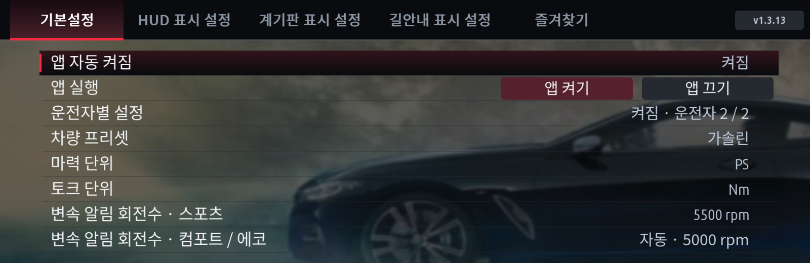

| 메뉴 | 선택지 | 설명 |
|---|---|---|
| 앱 자동 켜짐 | 켜짐 / 꺼짐 | 다음 시동(앱 시작) 때 자동으로 표시를 시작할지 정합니다. |
| 앱 실행 | 앱 켜기 / 앱 끄기 | 지금 바로 표시를 시작·중지합니다. 꺼도 설정 화면은 그대로 쓸 수 있습니다. |
| 운전자별 설정 | 꺼짐(기본) / 켜짐 | 켜면 차의 현재 사용자(운전자 프로필)에 따라 설정을 따로 기억합니다. 아래 3-1. |
| 문 열림 경고 | 켜짐(기본) / 꺼짐, 위치 / 크기 | 문이 열려 있는 동안(정차 중에도) HUD 가운데에 차 그림을 띄우고 열린 문·보닛·트렁크를 빨갛게 표시합니다. 아래 3-2. |
| 차량 프리셋 | 가솔린 / 디젤 / eDrive (플러그인 하이브리드) / M | RPM 눈금과 변속 알림 기본값을 정합니다. 차를 자동으로 알아보는 기능은 아닙니다. |
| 마력 단위 | PS / kW | 마력 표시 단위입니다. |
| 토크 단위 | Nm / kgf·m | 토크 표시 단위입니다. |
| 변속 알림 회전수 · 스포츠 | 프리셋 기본값, 2000 ~ 7500 rpm | 스포츠 계열 모드에서 변속 알림(빨강)이 켜지는 회전수입니다. 가솔린·eDrive·M 기본 5500, 디젤 4200. |
| 변속 알림 회전수 · 컴포트 / 에코 | 자동 (스포츠의 90 %), 2000 ~ 5000 rpm | 컴포트·에코 등 스포츠가 아닌 모든 모드의 변속 알림 회전수입니다. 예를 들어 2500으로 두면 모든 컴포트/에코 모드에서 2500 rpm에 알림이 뜹니다. |

변속 알림은 설정 회전수의 50 %부터 초록, 80 %부터 노랑, 설정 회전수에서 빨강으로 깜박입니다.

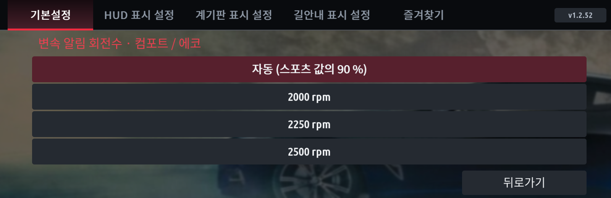

설치 전 준비(클러스터 렌더러 cluster-render 설치, 중심 표시 영역을 지도 보기 또는 꺼짐으로)는 위 1. 설치를 참고하세요. 1.3.13부터 이 안내는 기본설정 탭에 표시하지 않습니다.

### 3-2. 문 열림 경고

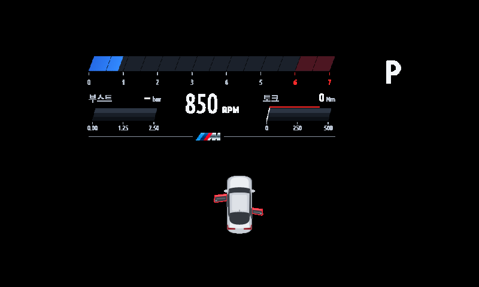

- 문 4개(운전석·조수석·뒷좌석 좌우) 중 하나라도 열려 있으면 HUD 가운데(RPM 화면과 깜빡이 화살표 아래)에 위에서 본 은색 차 그림을 띄우고, 열린 문만 바깥으로 젖혀진 빨간 모양으로 그립니다(1.3.26부터). **보닛·트렁크**가 열려도 그 부분을 빨갛게 표시합니다(1.3.28부터).
- 보닛·트렁크 신호는 문 상태 신호 안에 함께 들어오는데, 차에서 쓰는 이름을 아직 확인하지 못해 이름(hood·bonnet·tailgate·trunk 등)으로 찾습니다. 문 열림 경고 화면 아래에 `보닛: (찾은 이름) · 트렁크: 못 찾음`과 차에서 받은 다른 항목 이름이 나옵니다. 보닛·트렁크를 열어도 표시되지 않으면 이 화면을 찍어 보내 주세요. 모두 닫히면 사라집니다. 정차 중에도 계속 보입니다.
- 차의 문 상태 신호(`DoorsWindowsRoofMirrors`, appsKOR Ambient Config가 쓰는 것과 같은 신호)를 읽기만 합니다. 설치할 때 차 목록에 있으면 넣으므로, **1.3.19로 스토어에서 업데이트(다시 설치)**해야 동작합니다.
- 줄 오른쪽에 `켜짐 · 열림 2`처럼 지금 열린 문 수가 나옵니다. `미설치 (스토어에서 다시 설치)`가 나오면 설치 패키지에 문 신호가 없는 것입니다.
- **위치 / 크기**: 기본설정 → 문 열림 경고 → **위치 / 크기**에서 그림을 옮기고 키우고 숨깁니다. 조정하는 동안에는 문 4개가 모두 열린 그림이 HUD에 보입니다. 운전자별 설정·즐겨찾기에도 함께 저장됩니다.

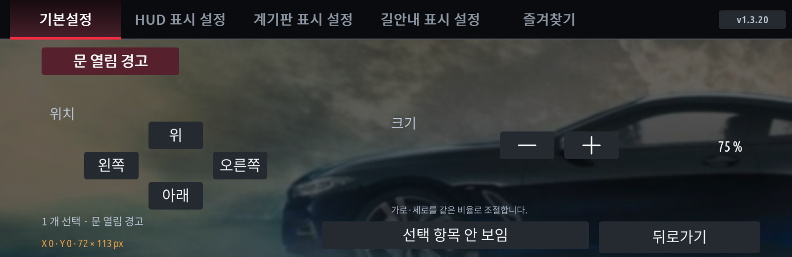

- 1.3.28까지는 문이 열려 있는 동안 계기판의 레드라인 화면이 순정 경고에 양보했지만, 1.3.29부터는 양보하지 않고 계기판 화면을 그대로 둡니다(HUD 그림으로 충분).
- 차는 문이 바뀔 때만 상태를 보내므로, 앱이 켜진 뒤 문을 처음 여닫을 때부터 표시됩니다.

### 3-1. 운전자별 설정

- 차의 현재 사용자 계정(운전자 프로필)을 5초마다 확인해, 운전자마다 설정을 따로 기억합니다.
- 설정을 바꾸면 그때 운전 중인 운전자의 설정으로 저장됩니다. 다른 운전자로 바뀌면 그 사람 설정으로 자동으로 바뀝니다.
- 처음 보는 운전자는 지금 설정을 그대로 이어받습니다.
- 운전자별로 기억하는 범위는 즐겨찾기와 같습니다(디자인, 위치/크기, 부가정보, 길안내 색, 깜빡이, 차량 알림 등). **즐겨찾기 5칸과 위치/크기 저장 칸(HUD·계기판·길안내 탭 각 3칸)도 운전자마다 따로**입니다(1.3.15부터; 업데이트 전에 함께 쓰던 즐겨찾기는 기억된 운전자 모두에게 똑같이 복사된 뒤 따로 바뀝니다). **차량 프리셋**과 **앱 자동 켜짐**은 차 설정이라 모든 운전자가 함께 씁니다.
- 줄 오른쪽에 `켜짐 · 홍길동 (2 / 3)`처럼 지금 운전자의 이름(차에 등록된 사용자 이름)과, 처음 본 순서대로 붙인 번호 / 기억한 운전자 수가 나옵니다. 이름을 읽지 못하면 `켜짐 · 운전자 2 / 3`처럼 번호만 나옵니다. **운전자 확인 불가**가 나오면 이 차에서 운전자 프로필을 읽을 수 없는 것입니다.
- 이름은 차의 사용자 계정 신호에서 읽습니다. 실차에서 아직 확인하지 않았습니다.
- 기억한 설정은 앱 데이터 폴더의 `driver-profiles.json`에 있습니다. 차에는 아무것도 쓰지 않습니다.
- **운전자 인사**: 운전자별 설정이 켜져 있으면, **시동을 걸 때**(엔진 회전이 시작될 때) HUD에서 보이는 영역의 위쪽과 **계기판 가운데**(1.3.28부터)에 `홍길동님 안녕하세요`를 **5초** 보여줍니다(1.3.31부터). 그동안 레드라인 HUD·계기판 화면은 잠깐 숨겼다가 다시 나옵니다(깜빡이·문 열림 등은 그대로).
  - 오토 스타트·스톱으로 엔진이 다시 켜질 때는 나오지 않습니다. 엔진이 3분 이상 꺼져 있었거나, 꺼져 있는 동안 **문을 열었다 닫았으면**(1.3.28부터, 주유소 등 잠깐 내렸다 탈 때) 다시 인사합니다.
  - **시동을 끌 때**(1.3.29부터): P단에서 엔진을 끄면(또는 엔진이 꺼진 뒤 5초 안에 P로 바꾸면) `홍길동님 안녕히 가세요`를 HUD와 계기판에 5초 보여줍니다. D단에서 오토 스타트·스톱으로 꺼질 때는 나오지 않습니다. 시동을 끄면 HUD는 바로 꺼지므로 HUD에서는 짧게 보이거나 안 보일 수 있고, 계기판에서는 꺼질 때까지 보입니다. eDrive(플러그인 하이브리드)는 해당되지 않습니다.
  - 시동이 걸린 상태에서 운전자가 바뀌면 바로 인사합니다. 시동이 꺼져 있을 때(문을 열어 차가 깨어나며 키의 운전자로 바뀔 때 등)는 시동을 걸 때 인사합니다(1.3.30부터).
  - 시동이 운전자 확인보다 빠르면 운전자를 최대 15초 기다렸다가 이름으로 인사하고, 그래도 모르면 `안녕하세요`만 나옵니다.
  - eDrive(플러그인 하이브리드)는 엔진 없이 출발할 수 있어서, 운전자를 확인했을 때 인사합니다.
  - HUD·계기판이 아직 준비되지 않았으면 준비되는 쪽에 보여주고, 3분이 지나면 생략합니다(1.3.27까지는 1분).
  - 기본설정의 **운전자별 설정**을 누르면 운전자별 설정·**환영 인사(시동 켤 때)**·**작별 인사(시동 끌 때)**를 각각 켜고 끌 수 있습니다(1.3.34부터, 기본 모두 켜짐).
  - 기본설정의 **운전자별 설정** 줄 오른쪽에 마지막 인사 결과가 나옵니다: `인사 표시함 2분 전`, `인사 건너뜀(3분 내 재시동)`, `인사 못 띄움(화면 준비 안 됨)`. 인사가 안 나왔을 때 이유를 여기서 확인합니다.

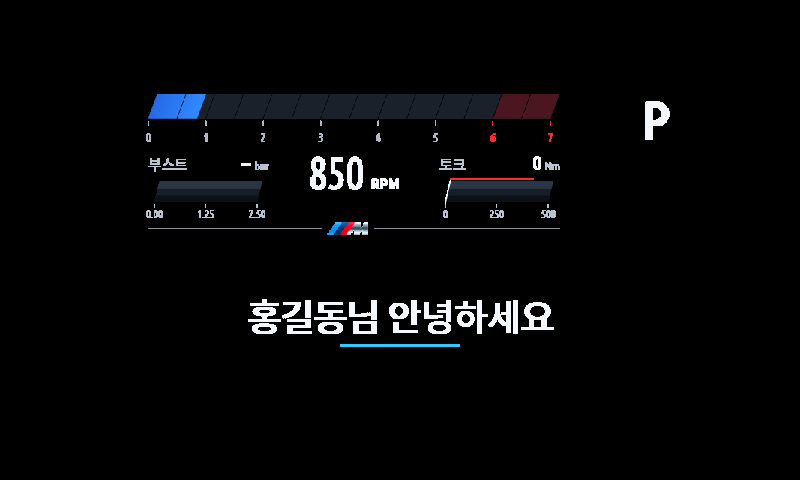

---

## 4. HUD 표시 설정 탭

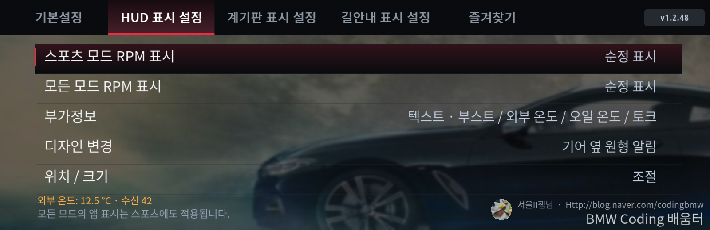

| 메뉴 | 설명 |
|---|---|
| 스포츠 모드 RPM 표시 | 스포츠 계열 모드에서 HUD에 **레드라인 앱** 또는 **순정 표시** |
| 모든 모드 RPM 표시 | **레드라인 앱** / **레드라인 앱 · 스포츠 모드 제외** / **순정 표시**. 레드라인 앱을 고르면 스포츠에서도 적용됩니다. 스포츠 모드 제외를 고르면 스포츠·스포츠+·스포츠 개별(PHEV 스포츠 포함)을 뺀 모든 모드에서 레드라인 앱을 보이고, 스포츠 계열은 위의 스포츠 모드 RPM 표시를 따릅니다. |
| 부가정보 | 게이지 / 텍스트 방식과 표시할 항목 (아래 4-1) |
| 디자인 변경 | 기본 디자인 2종 또는 Redline 앱 레이아웃(HUD 15종, 계기판 17종) (아래 4-2) |
| 위치 / 크기 | 요소별 이동·크기·숨김, 저장 / 불러오기 ([7장](#7-위치--크기)) |
| HUD 깜빡이 표시 | 켜짐 / 꺼짐(기본), 모양(기본 화살표 · `<<< >>>` · `< >`), 색(초록 · 파랑 · 주황), 위치 / 크기 (아래 4-3) |

**스포츠에서만** 보이게 하려면 스포츠 = 레드라인 앱, 모든 모드 = 순정 표시로 둡니다. **스포츠에서만 순정**으로 보려면 스포츠 = 순정 표시, 모든 모드 = 레드라인 앱 · 스포츠 모드 제외로 둡니다.

화면 아래 주황색 글씨는 **확인 줄** 입니다. 부가정보에 외부 온도를 고르면 지금 받은 값(예: `외부 온도: 12.5 °C · 수신 42`) 또는 값이 안 나오는 이유를 보여줍니다.

### 4-3. HUD 깜빡이 표시

방향지시등을 켜면 HUD에 깜빡이 화살표가 차량 깜빡임 주기(약 0.64초)에 맞춰 깜빡입니다. 비상등은 양쪽이 함께 깜빡입니다. 차량의 조명 모듈 신호(`de.bmw.body.Light`)를 읽기만 합니다.

- **켜짐 / 꺼짐**: 기본은 꺼짐입니다.
- **모양**: 기본 화살표, `<<< >>>`, `< >`. `<<< >>>`는 꺼지지 않고 `>` → `>>` → `>>>` 순서로 하나씩 늘어나며 반복합니다(깜빡임 한 주기에 한 번).
- **기본 위치**: 기본 디자인의 RPM 게이지 바로 아래 가운데입니다.
- **색**: 초록색, 파란색, 주황색
- **위치 / 크기**: **깜빡이 전체**를 고르면 두 화살표를 함께 옮기고 크기를 바꿉니다. **왼쪽 깜빡이**, **오른쪽 깜빡이**는 각각 따로 옮깁니다. 조정하는 동안(위치 / 크기 화면이 떠 있는 동안)만 HUD에 양쪽 화살표가 켜진 채로 보이고, 뒤로 가기·탭 이동·다른 화면으로 나가면 바로(늦어도 약 3초 안에) 사라집니다. 선택 항목 안 보임으로 한쪽만 숨길 수도 있습니다.
- 레드라인 HUD가 HUD에 떠 있으면 그 화면 안에 함께 그립니다. 순정 HUD일 때(레드라인 HUD가 꺼져 있거나 순정 화면이 HUD를 차지할 때)는 HUD 맨 위에 따로 얹는 작은 그림(오버레이)으로 표시합니다. 어느 경우든 방향지시등·비상등이 깜빡이면 보이고, 레버를 되돌리면 사라집니다(오버레이는 약 1.2초 뒤).
- 화면 아래쪽 **깜빡이 신호** 줄에 차에서 받은 신호 횟수와 마지막 방향(왼쪽·오른쪽·양쪽), 화살표를 어디에 그리는지가 나옵니다. 레버를 움직였는데 수신 횟수가 늘지 않으면 차에서 신호가 들어오지 않는 것입니다.

### 4-4. 측후방 경고 (사이드미러 램프)

- HUD 표시 설정 → HUD 깜빡이 표시 화면의 **측후방 경고 켜짐 / 꺼짐**(기본 꺼짐).
- 사이드미러의 측후방(사각지대) 경고등이 켜지면 HUD의 그쪽 깜빡이 화살표 **밑**에 위에서 본 그림을 띄웁니다. 내 차(파란색, 크게)와 옆 차로 뒤쪽의 차(작게)가 나오고, 옆 차와 감지 물결이 **주황색**으로 표시됩니다. 그쪽으로 깜빡이를 켜거나 차가 경고를 깜빡이면 **빨간색**으로 바뀝니다(1.3.23부터). 순정 HUD에서도 보입니다.
- 깜빡이 **위치 / 크기** 화면에서 **측후방 양쪽 / 왼쪽 / 오른쪽**을 골라 깜빡이와 따로 위치와 크기를 바꾸거나 숨길 수 있습니다(1.3.25부터). 측후방 항목을 고르면 경고가 꺼져 있어도 미리보기로 나옵니다. 깜빡이 화살표를 옮겨도 측후방 경고는 따라가지 않습니다.
- 차의 차체 제어기(BDC)에서 사이드미러 경고등 상태를 진단 **읽기**로 0.3초마다 가져옵니다(읽기 전용, 같은 값을 쓰는 요청은 앱이 보낼 수 없게 막혀 있음). 시동이 켜져 있을 때만 읽습니다.
- 진단 통로를 자주 쓰므로 기본은 꺼짐입니다. 같은 기능을 쓰는 다른 앱(appsKOR Redline, AK Cluster Info 등)과 함께 켜 두면 진단 요청이 겹칠 수 있습니다.
- 화면 아래 상태 줄에 `측후방 차량 / -`(왼쪽 / 오른쪽)처럼 나옵니다. `이 차 미지원`이 나오면 이 차의 BDC가 이 값을 주지 않는 것입니다.

### 4-5. 앞차 간격 (HUD)

- HUD 표시 설정 → **앞차 간격**: 꺼짐(기본) / 간단히(시간 간격 + 거리) / 자세히(+ 접근·이탈 속도), 위치 / 크기 (1.3.37부터).
- ACC·전방 레이더가 잰 앞차 거리(`GapVehicleAhead`)를 읽기만 합니다. 설치할 때 차 목록에 있으면 넣으므로 **스토어에서 다시 설치(업데이트)**해야 동작하고, 켜져 있을 때만 읽습니다. 신호가 없는 차에서는 아무것도 나오지 않습니다.
- 시간 간격 = 앞차 거리 ÷ 내 속도. 1.0초 미만 빨강, 1.0~1.5초 주황, 1.5초 이상 청록. 시속 12 km 미만에서는 거리만 크게 보여줍니다. 접근 속도는 앞차 거리가 줄어드는 빠르기입니다(음수: 다가감).
- 다른 HUD 화면은 그대로 두고, 깜빡이 화살표 사이(RPM 화면 아래)에 작게 얹습니다.
- 이 신호는 G30에서만 확인된 것이라, 설정 화면 아래에 **차에서 받은 값**(status, gap, gapX, object, qualifier)이 나옵니다. 앞차가 있는데 표시가 안 되거나 거리가 이상하면 이 줄을 찍어 보내 주세요.

### 4-6. BC 버튼 따라가기 (계기판)

- 계기판 표시 설정의 **스포츠 모드 / 모든 모드 RPM 표시**에서 **BC 모드**를 고르면 그 주행 모드에서 BC 버튼을 따라갑니다(1.3.42부터; 스포츠에서는 스포츠 줄이 우선). 화면별 설정은 **BC 모드 화면 설정**에서 합니다: iDrive 7 / 8 목록, 시작 화면(마지막 화면 / 첫 화면).
- BC를 누른 횟수는 BC 모드가 아닌 주행 모드에서도 세므로 순서가 어긋나지 않고, BC 모드로 돌아오면 맞는 화면이 나옵니다.
- 순정 BC 화면마다 레드라인 계기판 화면을 정합니다: **화면 설정**(부가정보 고르기 → 디자인 고르기 → 위치 / 크기, 1.3.41부터 위치·크기도 화면별로 저장), **Waze**(레드라인이 비키고 Waze·순정 지도), **변경 없음**, **빼기**(순정에서 그 화면을 꺼 둔 경우).
- 차가 순정 BC가 어느 화면인지 알려 주지 않아서, **BC를 누른 횟수**로 순정 순서를 따라갑니다(iDrive 7: 표시 없음 → 효율·연비 → 트립 데이터 → 토크·출력 → G-미터 → 현재 미디어). iDrive 메뉴에서 순정 화면을 직접 바꿔 어긋나면, 그 화면 줄의 **지금 이 화면**을 눌러 맞춥니다.
- 계기판 탭에서 손으로 바꾼 화면은 다음에 BC를 누를 때까지 유지됩니다. 화면 설정에서 위치·크기까지 맞춘 화면은 그 위치·크기로, 기본값 화면은 운전자가 정해 둔 위치·크기 그대로 나옵니다. 즐겨찾기에도 저장됩니다.
- 레버 신호가 필요하므로 **스토어에서 다시 설치(업데이트)**해야 동작합니다. 같은 화면의 **BC 버튼 확인**에서 BC를 누를 때 왼쪽 레버 값이 0 ↔ 64로 바뀌는지 볼 수 있습니다.

### 4-1. 부가정보

**부가정보 → 게이지 / 텍스트 선택 → 항목을 누른 순서대로 선택 → 확인** 으로 저장합니다. 확인을 누르지 않고 뒤로가면 바뀌지 않습니다.

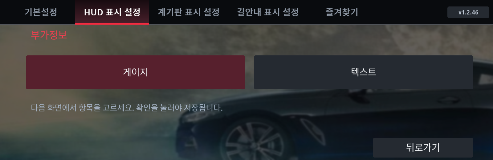
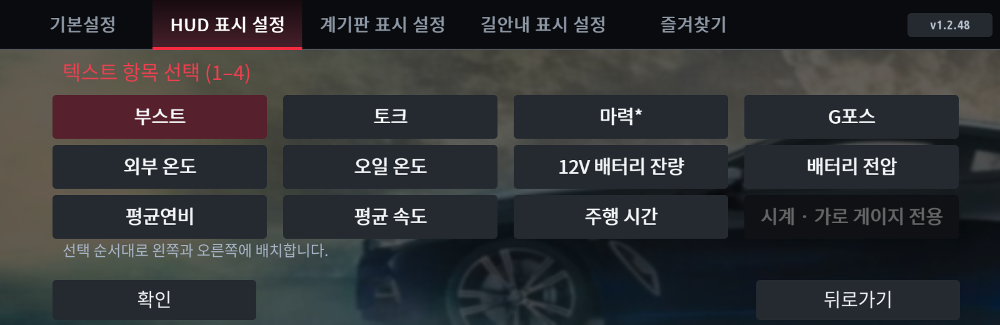

| 항목 | 내용 |
|---|---|
| 부스트 | 과급압 (bar) |
| 토크 | 엔진 토크 (기본설정의 단위) |
| 마력* | 토크와 RPM으로 계산한 추정 출력 (eDrive 모터 합산 아님) |
| G포스 | 가로·세로 가속도를 합친 값. 게이지에서는 점이 좌우로 움직입니다. |
| 외부 온도 | 차량 외기 온도 (eDrive 앱과 같은 방식으로 읽음) |
| 오일 온도 | 엔진 오일 온도 |
| 12V 배터리 잔량 | 12V 배터리 충전 상태(%). 고전압 배터리 잔량이 아닙니다. |
| 배터리 전압 | 12V 배터리 전압 (V) |
| 평균연비 | 트립 평균 연비 (km/L) |
| 평균 속도 | 트립(여행 1) 평균 속도 (km/h) |
| 주행 시간 | 트립(여행 1) 주행 시간 (시:분) |
| 시계 | **가로 게이지 전용** (텍스트 방식과 헥사곤 · 클래식 다이얼에서는 쓸 수 없음). 아래 버튼으로 **UTC+9 (한국)** / 헤드유닛 시간을 고릅니다. |

- 게이지는 최대 2개, 텍스트는 최대 4개입니다.
- 텍스트 1·2개는 왼쪽 → 오른쪽, 3개는 왼쪽 2개 + 오른쪽 1개, 4개는 왼쪽 2개 + 오른쪽 2개로 놓입니다.
- 값을 받지 못했거나 오래된 값은 `--` 로 표시합니다. 없는 값을 추정해서 채우지 않습니다.

### 4-2. 디자인 변경

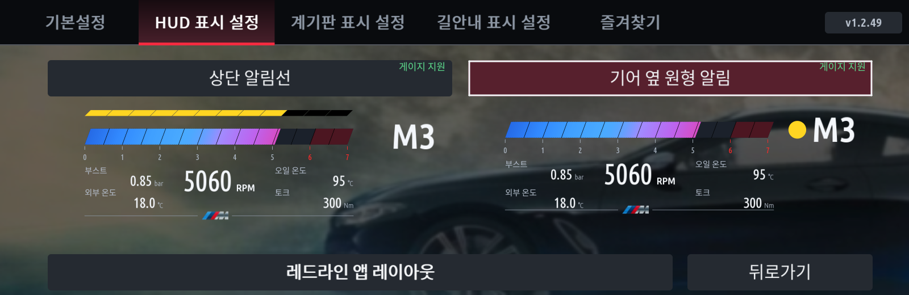

- **상단 알림선**: RPM 막대 위에 알림선이 켜집니다. 알림선과 기어를 따로 옮길 수 있습니다.
- **기어 옆 원형 알림**: 기어 옆 동그라미가 초록 → 노랑 → 빨강으로 바뀝니다. 동그라미와 기어가 함께 움직입니다.
- **레드라인 앱 레이아웃**: 누르면 레이아웃 선택 화면(HUD 15종, 계기판 17종)이 열립니다.

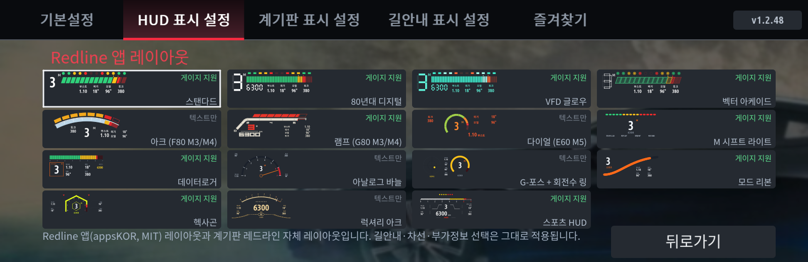

레이아웃마다 위치·크기가 따로 저장됩니다. 다른 레이아웃으로 바꿨다가 돌아와도 그 레이아웃에서 맞춘 위치가 그대로 돌아옵니다. 레이아웃별 모양은 [8장](#8-레이아웃-모음)에 있습니다.

---

## 5. 계기판 표시 설정 탭

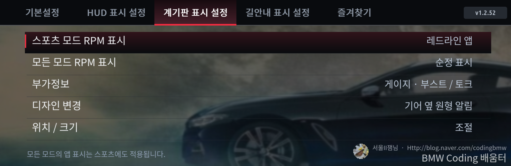

메뉴 구성과 사용법은 HUD 표시 설정과 같습니다. 계기판과 HUD는 출력, 부가정보, 디자인, 위치를 **각각 따로** 설정합니다.

- 계기판 기본값은 **스포츠 모드 = 레드라인 앱**, 모든 모드 = 순정 표시입니다. 모든 모드에는 HUD와 같이 **레드라인 앱 · 스포츠 모드 제외** 선택지가 있습니다.
- 계기판에 보이려면 차량의 **중심 표시 영역** 이 **지도 보기 또는 꺼짐** 이어야 합니다.

---

## 6. 길안내 표시 설정 탭

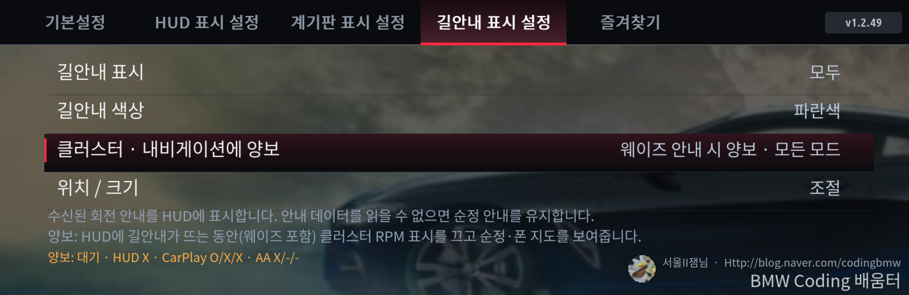

| 메뉴 | 선택지 | 설명 |
|---|---|---|
| 길안내 표시 | 모두 / 스포츠 제외 / 순정 표시 | HUD에 앱의 회전 안내(방향·거리·문구·차선)를 언제 보여줄지 정합니다. 순정 표시는 앱 길안내를 끕니다. |
| 길안내 색상 | 화살표 색: 주황색 / 초록색 / 파란색 / 흰색 텍스트 색: 주황색 / 초록색 / 파란색 / 흰색 | 화살표 색은 회전 화살표와 추천 차선에, 텍스트 색은 거리·도로 이름·출구 이름에 쓰입니다. 한 화면에서 둘을 고르고 아래 미리보기로 확인합니다. 기본은 파란 화살표·흰 텍스트입니다. |
| HUD 다음 길안내 (길안내 표시 화면 안) | 켜짐(기본) / 꺼짐 | 지금 안내 다음 회전이 250m 안에 바로 이어지면, HUD 화살표의 거리 밑에 `다음 ↰ 120 m`처럼 작게 보여줍니다(1.3.35부터). 1.3.36부터는 **길안내 표시**를 누르면 나오는 화면에서 주행 모드와 함께 켜고 끕니다. BMW 순정 내비는 다음 안내를 함께 보내고, CarPlay·안드로이드 오토는 다음 회전이 가까울 때만 보내서 그때만 나옵니다. 계기판에는 나오지 않습니다. |
| 클러스터 · 내비게이션에 양보 | 양보 안 함 / 웨이즈 안내 시 양보 · 모든 모드 / 웨이즈 안내 시 양보 · 스포츠 제외 | 길안내 중 계기판 RPM 화면을 꺼서 순정·폰(웨이즈 등) 지도를 보여줄지 정합니다. |
| 차량 알림 | 끄기 / 과속 / 어린이보호구역 / 단속 카메라 / 전체 표시 | 차 내비게이션이 보내는 알림을 HUD에 표시합니다(아래 6-1). |
| 받은 회전 정보 (길안내 표시 화면 안) | 기록 파일 저장 켜짐 / 꺼짐(기본) | 내비(티맵·카카오내비·순정)가 보낸 최근 회전 10개를 위가 최신으로 보여줍니다. 각 줄에는 시각, 출처(CarPlay/AA/BMW), 회전 종류, 받은 원본 값(`branchType=7` 등), 거리, 설명 글자, HUD에 그린 것(고속도로 그림/화살표 등)이 나옵니다. 같은 회전이 다시 오면 거리만 바뀝니다. 기록 파일 저장을 켜면 회전 원본 전체를 앱 데이터 폴더의 `nav-probe.log`에 남깁니다(최대 1 MB, 이전 파일 `.1` 하나). 1.3.43부터. |
| 위치 / 크기 | 방향 / 텍스트 / 차선 / 다음 안내 / 차량 알림 | HUD 길안내 영역과 차량 알림을 각각 옮기고 키우고 숨깁니다. **다음 안내**(`다음 ↰ 120 m`)는 1.3.43부터 따로 옮기고 키울 수 있습니다. 기본 위치는 방향 그림의 거리 밑이고, 방향을 옮기면 함께 따라갑니다. |

### 클러스터 양보 (웨이즈)

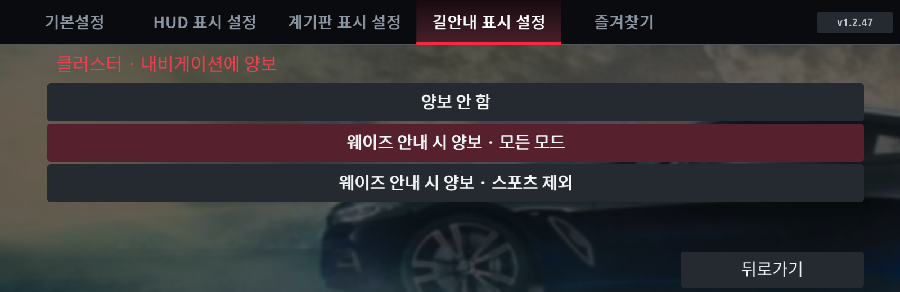

- **웨이즈 안내 시 양보 · 모든 모드**: HUD에 길안내가 뜨는 동안(웨이즈 포함) 계기판 RPM 화면을 끕니다.
- **웨이즈 안내 시 양보 · 스포츠 제외**: 스포츠·스포츠+·스포츠 개인 모드에서는 길안내 중에도 RPM 화면을 유지하고, 그 밖의 모드에서만 양보합니다.
- 길안내가 끝나면 약 **8초 뒤** 계기판 RPM 화면이 자동으로 다시 들어옵니다. 교차로 사이처럼 신호가 잠깐 끊길 때 화면이 깜빡이지 않게 하려는 것입니다.
- 화면 아래 확인 줄: `양보: 클러스터 양보 중 / 대기 · HUD O/X · CarPlay 연결/안내/메타데이터 · AA …`. **HUD O** 인데 계속 **대기** 라면 이 화면을 찍어 문의해 주세요.

웨이즈 안내가 HUD에 뜨지 않으면 앱도 길안내 중인지 알 수 없어 양보하지 못합니다. 지도 앱·휴대전화·차량 조합에 따라 안내가 전달되지 않을 수 있습니다.

### 6-1. 차량 알림

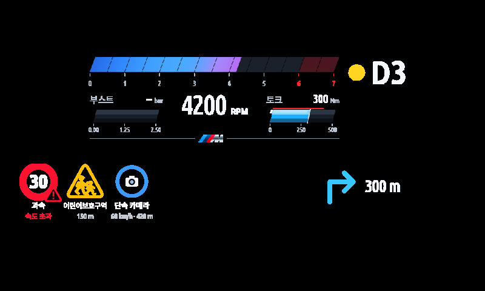

차가 보내는 신호로 과속·어린이보호구역·단속 카메라 알림을 HUD 위에 따로 얹어(오버레이) 표시합니다. 순정 HUD든 레드라인 HUD든 위에 보입니다. 데이터는 2026-11-14 주행 기록(speed-probe 로그 두 개)에서 실제로 들어온 신호를 기준으로 골랐습니다.

| 알림 | 차에서 받는 신호 | 표시 |
|---|---|---|
| **과속** | 앞 카메라 표지 인식 제한속도 + 종합 표지 인식(둘이 같을 때만) + 차량 속도 | 제한속도보다 3 km/h 넘게 1초 이상 달리면 빨간 원(제한속도)과 경고 삼각형. 1 km/h 초과 이하로 내려가면 사라짐 |
| **어린이보호구역** | 앞 카메라가 인식한 어린이 주의 표지 | 노란 어린이 표지와 **표지 감지**를 6초 표시(같은 표지가 반복돼도 30초에 한 번) |
| **단속 카메라** | 차 내비게이션 길안내 이벤트 | 1 km 앞부터 카메라 표지와 제한속도·남은 거리(50 m 단위)(구간 단속은 평균 제한속도, 구간 안). **주행 기록에서는 아직 한 번도 들어오지 않은 신호입니다** |

- **전체 표시**: 해당하는 알림을 왼쪽부터 나란히 표시합니다.
- 제한속도는 주행 기록에서 확인된 **10·30·40·50 km/h**만 사용합니다(종합 인식 등급 2·6·8·10과 카메라 숫자가 일치한 값). 다른 속도·해제 표지·보조 표지가 붙은 표지는 쓰지 않습니다.
- 어린이 주의 표지는 표지를 인식했다는 뜻이며, 법적 보호구역의 시작·끝이나 남은 거리를 뜻하지는 않습니다.
- 위치/크기: 길안내 위치/크기에서 **차량 알림**을 골라 옮기고 키우고 숨깁니다. 조정하는 동안에는 세 알림 예시가 HUD에 보입니다.
- 화면 아래 확인 줄: `차량 알림: 표지 인식 N · 카메라 N · 속도 N · 단속 카메라 N/M`
  - 표지 인식·카메라·속도는 차에서 받은 횟수입니다. **X**는 이 설치에 그 신호가 없다는 뜻이라 스토어에서 다시 설치해야 합니다(설치할 때 차 카탈로그에 있으면 넣습니다).
  - 단속 카메라 N/M은 받은 응답 M개 중 카메라가 있던 수입니다. **차가 알림 조회를 거부함**이면 이 차는 길안내 이벤트 알림을 보내지 않습니다.

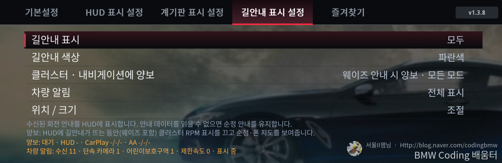

### 길안내 위치 / 크기

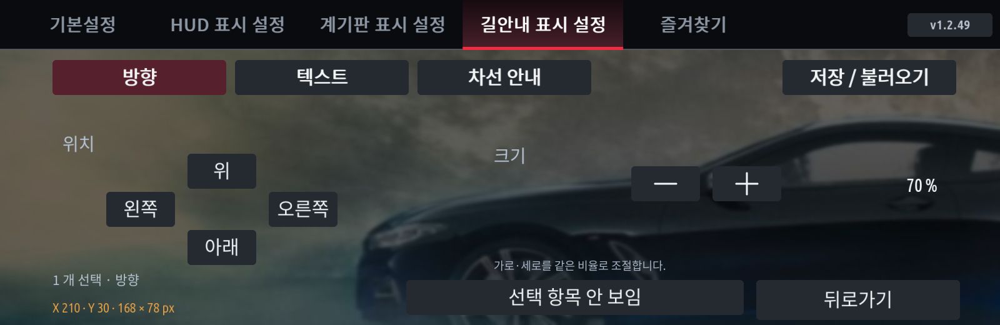

방향·텍스트·차선을 각각 선택해 옮기고 키우고 숨깁니다. 가로·세로는 같은 비율로 커집니다. CarPlay가 추천 차선을 보내면 추천 차선을 안내 색으로 표시합니다.

---

## 7. 위치 / 크기

HUD 탭과 계기판 탭의 **위치 / 크기** 에서 화면의 각 요소를 고른 뒤, 아래 버튼으로 조절합니다.

- **위 / 아래 / 왼쪽 / 오른쪽**: 한 번 누를 때마다 한 칸(원본 10) 이동합니다. 화면 끝에 닿으면 더 저장되지 않으므로, 반대로 누르면 바로 돌아옵니다.
- **크기 − / +**: 5 %씩 바뀝니다. 한 요소만 고르면 가로·세로를 따로 조절하며, 차이는 최대 30 %까지입니다.
- **선택 항목 안 보임 / 보이기**: 고른 요소를 숨기거나 다시 보입니다. 숨긴 요소에만 필요한 차량 신호는 읽지 않습니다.
- 요소 버튼을 한 번 누르면 선택, 다시 누르면 해제됩니다. 여러 개를 고르면 함께 움직입니다.

### 기본 디자인 (상단 알림선 / 기어 옆 원형 알림)

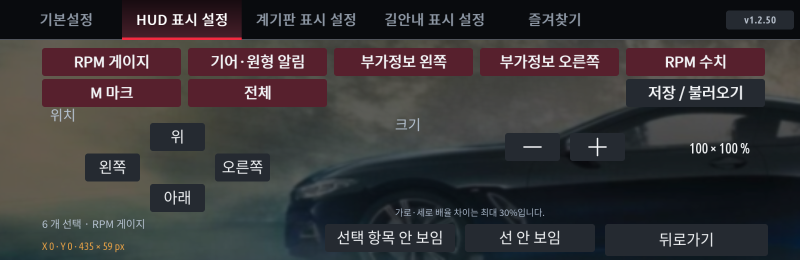

| HUD 요소 | 계기판 요소 |
|---|---|
| RPM 게이지, 기어(· 원형 알림), RPM 알림(상단 알림선일 때), 부가정보 왼쪽·오른쪽, RPM 수치, M 마크 | RPM 게이지, 기어, RPM 알림, 부가정보 왼쪽·오른쪽, RPM 수치, M 위, M 아래 |

- **전체**: 모든 요소를 한 번에 고릅니다. 이 상태에서 크기를 바꾸면 전체가 **같은 비율로** 커지거나 작아지고, 요소 사이 간격도 함께 바뀌어 모양이 그대로 유지됩니다. 전체를 한 번 더 누르면 한 요소 선택으로 돌아갑니다.
- **M 마크** 를 고르면 **선 안 보임** 버튼이 생깁니다. M 아래의 선만 따로 숨길 수 있습니다.

### Redline 앱 레이아웃

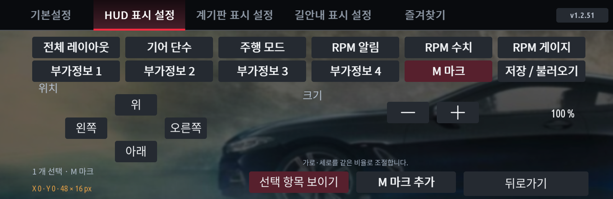

- **전체 레이아웃**: 레이아웃 전체를 옮기고, 크기는 한 가지로 조절합니다(가로·세로 같은 비율).
- 그 밖의 버튼은 레이아웃마다 다릅니다: 기어 단수, 주행 모드, RPM 알림, RPM 수치, RPM 게이지, 부가정보(또는 부가정보 1~4), G포스 미터, M 마크.
- **M 마크**: 모든 레이아웃에 BMW M 마크를 넣을 수 있습니다. M 마크를 고르고 **M 마크 추가 / M 마크 빼기** 를 누릅니다. 처음에는 빠져 있습니다.
- HUD에서 처음 위치는 기본 디자인이 쓰는 영역 안이며, 실제 차량에서 맞춘 레이아웃별 기본 위치·크기가 적용되어 있습니다. 위치 / 크기 화면에는 이 값이 0 / 100 %로 보입니다. 위치는 HUD 화면 안이면 어디로든 옮길 수 있습니다.

### 저장 / 불러오기 / 초기화

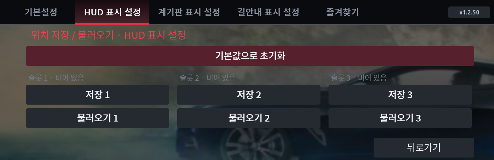

- **저장 1~3**: 지금 위치·크기·숨김을 슬롯에 저장합니다. HUD·계기판·지금 고른 디자인마다 따로 저장됩니다.
- **불러오기 1~3**: 저장한 값을 다시 적용합니다.
- **기본값으로 초기화**: 두 번 누르면 지금 디자인의 위치·크기를 처음 값으로 되돌립니다.

---

## 8. 레이아웃 모음

### HUD 기본 디자인

### HUD Redline 앱 레이아웃 15종

스탠다드, 80년대 디지털, VFD 글로우, 벡터 아케이드, 아크 (F80 M3/M4), 램프 (G80 M3/M4), 다이얼 (E60 M5), M 시프트 라이트, 데이터로거, 아날로그 바늘, G-포스 + 회전수 링, 모드 리본, 헥사곤, 럭셔리 아크, 스포츠 HUD (HUD 전용). 스포츠 다이얼과 클래식 다이얼(한국 시간 시계)은 계기판 전용입니다.

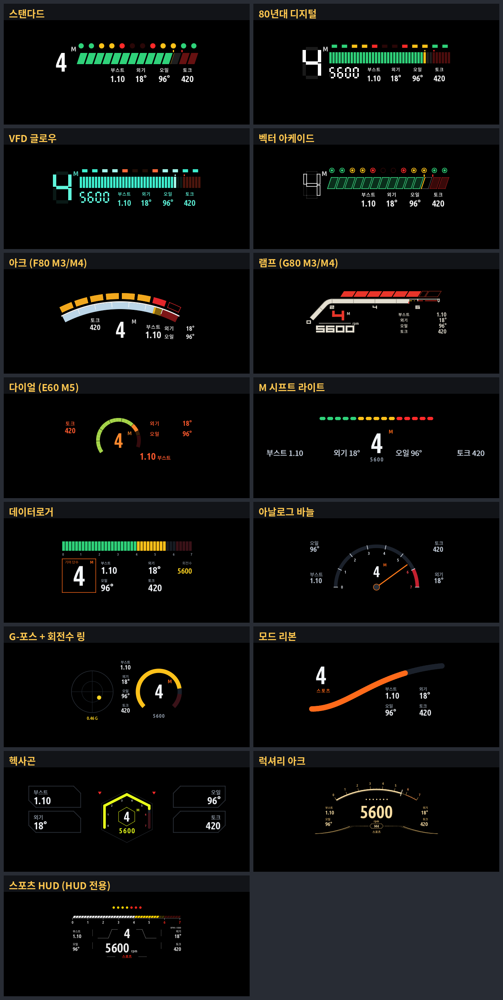

### 계기판 Redline 앱 레이아웃 17종

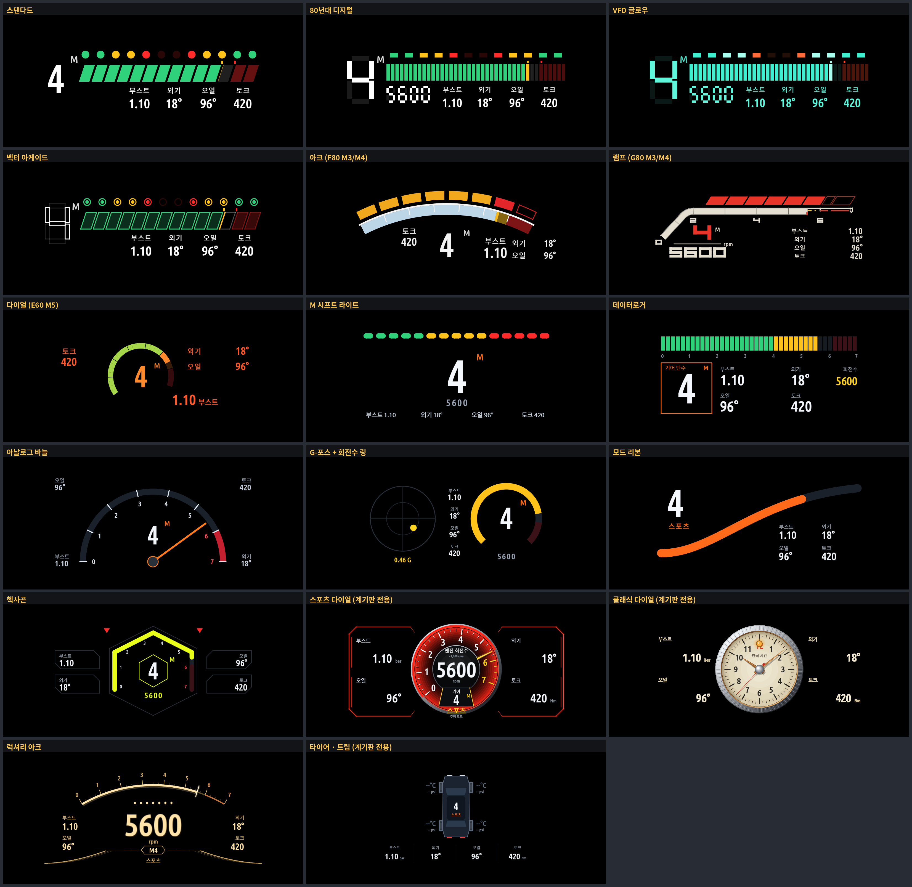

레이아웃 선택 화면의 각 칸 오른쪽 위에 **게이지 지원 / 텍스트만**이 표시됩니다. 게이지 지원 레이아웃(기본 디자인 2종, 스탠다드, 80년대 디지털, VFD 글로우, 벡터 아케이드, 램프, M 시프트라이트, 데이터로거, 모드리본, 헥사곤, 클래식 다이얼, 스포츠 HUD, 스포츠 다이얼, 타이어 · 트립)은 부가정보를 "게이지"로 고르면 막대 게이지로 보여 주고, 나머지는 게이지로 골라도 숫자로 보여 줍니다. 오일 · 외기 온도는 온도계 모양(헥사곤 · 클래식 다이얼은 세워진 온도계)이고, 시계는 가로 게이지 전용이라 헥사곤 · 클래식 다이얼에서는 표시되지 않습니다.

**타이어 · 트립 (계기판 전용)**: 위에서 본 차 그림 가운데에 기어 단수와 주행 모드, 바퀴 옆에 타이어 온도(°C)와 공기압(psi)이 나옵니다. 바퀴 색은 온도에 따라 파랑(20 °C 미만) → 초록 → 노랑 → 빨강(75 °C 이상)으로 바뀝니다. 차 아래에 부가정보가 텍스트 4칸 또는 게이지 2칸으로 나옵니다. 타이어 값은 TPMS 신호라 차에 따라 "--"로 나올 수 있습니다.

Redline 앱 레이아웃은 Redline 앱(appsKOR, MIT 라이선스)의 디자인을 이 앱에서 다시 그린 것입니다.

---

## 9. 업데이트·중지·삭제

- **업데이트**: MGU Store에서 소스를 새로고침한 뒤 **Installed → 계기판 레드라인 → Update** 를 누릅니다. 업데이트 후 앱 오른쪽 위 버전을 확인합니다.
- **잠시 끄기**: 기본설정 → 앱 실행 → **앱 끄기**. 다음 시동에도 켜지지 않게 하려면 **앱 자동 켜짐 → 꺼짐**.
- **특정 화면만 순정으로**: HUD / 계기판 표시 설정에서 해당 모드를 **순정 표시** 로 바꿉니다.
- **삭제**: MGU Store → Installed → 계기판 레드라인 → 삭제.

설정은 업데이트해도 유지됩니다. 버전별 변경 내용은 [업데이트 이력](../CHANGELOG.md)과 [이전 설명서](CLUSTER-REDLINE-HISTORY.ko.md)에 있습니다.

---

1.2.58부터 로그 수집 숨김 메뉴와 교통 표지 알림 시험 기능은 제거되었습니다. 이전 기록 설정으로 수집을 재개하지 않습니다.

## 10. 문제 해결

| 증상 | 확인할 것 |
|---|---|
| 스토어 목록에 앱이 없음 | 인터넷 연결, 소스 철자 `jaimeen77-cmyk/apps`, 브랜치 `main`, 새로고침 |
| 업데이트했는데 예전 그대로 | 앱 오른쪽 위 버전. 한국어판/English판 중 어느 쪽을 쓰는지, 다른 판이 켜져 있지 않은지 |
| 계기판에 RPM 화면이 안 뜸 | 앱 실행 켜짐, 지금 주행 모드의 RPM 표시가 레드라인 앱인지, 중심 표시 영역이 지도 보기/꺼짐인지, `cluster-render` 0.4.0 이상인지 |
| 위치를 바꿔도 생각한 곳과 다름 | 저장 / 불러오기 → 기본값으로 초기화 후 다시 조절 |
| 외부 온도가 `--` | HUD·계기판 탭 아래 주황색 확인 줄의 이유를 확인합니다 (인터페이스 설정 미설치 / 항목 없음 / 구독됐지만 값 없음 등). |
| 웨이즈 길안내 때 계기판이 양보하지 않음 | 길안내 탭의 양보 설정과 확인 줄 (HUD O/X). HUD에 안내가 안 뜨면 양보할 수 없습니다. |
| 설치 실패 / interface 오류 | [설치 오류 진단](REDLINE-INSTALL-FAILED.ko.md), [로그 수집](COLLECT-CLUSTER-REDLINE.ko.md) |

문의와 소식은 [네이버 블로그 jaimeen77](https://blog.naver.com/jaimeen77)에 남겨주세요. 문의할 때 앱 버전, 설정 화면 사진, 확인 줄 사진을 함께 보내주시면 빠르게 확인할 수 있습니다.

---

제작: **잼님** · 다운로드: [github.com/jaimeen77-cmyk/apps](https://github.com/jaimeen77-cmyk/apps) · MGU Store 소스: `jaimeen77-cmyk/apps` (`main`) · [라이선스·원작 고지](../NOTICE.cluster-redline.md)

---

## 라이선스

Cluster Redline 1.3.10부터는 **허락 필요** 라이선스입니다([apps/cluster_redline/LICENSE](../apps/cluster_redline/LICENSE)). 이 저장소(MGU Store 소스)에서 설치해 본인 차량에서 쓰는 것은 자유이고, 복사·재배포·수정·다른 앱에 넣기·상업적 이용은 미리 허락을 받아야 합니다(저장소 이슈 또는 blog.naver.com/jaimeen77). 1.3.9까지 공개된 버전은 MIT였고, 다른 사람이 만든 구성 요소는 원래 라이선스를 따릅니다([NOTICE.cluster-redline.md](../NOTICE.cluster-redline.md)).
