# Cluster Redline 1.3.94 user guide

[한국어](CLUSTER-REDLINE.ko.md) · [Installation](INSTALL.md) · [The apps](../README.md) · [Changelog](../CHANGELOG.md)

Cluster Redline draws rpm, shift alerts, the gear and auxiliary information on the BMW instrument cluster and the HUD.
For each drive mode you choose the Redline screen, the stock one or BC mode, and on the HUD it adds navigation, vehicle alerts, the lead-car headway, lane lines, turn signals, the door-open warning and more.

| Cluster (gauges) | Cluster (red shift alert) |
|---|---|
|  |  |

| HUD (circle beside the gear) | HUD (top alert bar) |
|---|---|
| 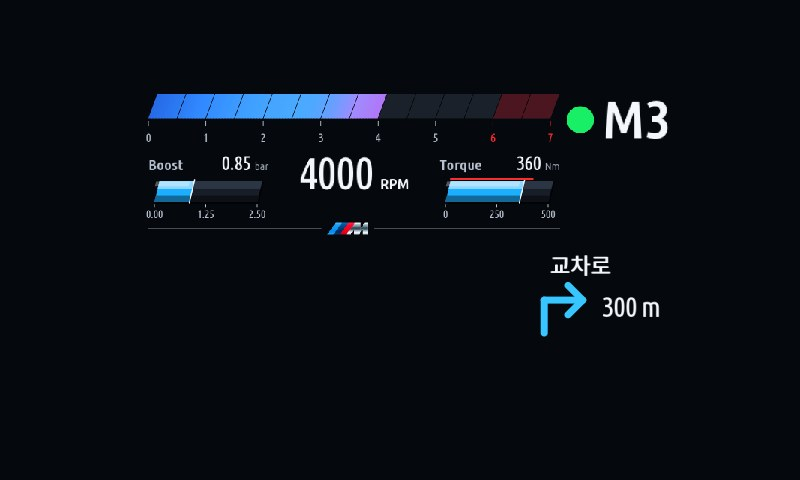 |  |

> The pictures in this guide are drawn by the actual 1.3.91 package's drawing code, with example data. Colours and positions on the car can differ a little.

## Contents

1. [Install](#1-install)
2. [First setup (5 minutes)](#2-first-setup-5-minutes)
3. [Using the settings screen](#3-using-the-settings-screen)
4. [Basic settings](#4-basic-settings)
5. [HUD display setting](#5-hud-display-setting)
6. [Cluster display setting](#6-cluster-display-setting)
7. [Nav display setting](#7-nav-display-setting)
8. [Favorites](#8-favorites)
9. [Update, stop, remove](#9-update-stop-remove)
10. [All designs](#10-all-designs)
11. [Troubleshooting](#troubleshooting)

---

## 1. Install

1. In MGU Store → **Settings → Add source**, add repository **`jaimeen77-cmyk/apps`**, branch **`main`**, and press **Check now**.
2. **Install** **Cluster Redline (English)** (the Korean edition is 계기판 레드라인 (한국어)).
3. Installed with it:
   - The cluster renderer **`cluster-render` 0.4.0 or later**. It comes from the Store's default source (`robertnisipeanu/idrive-apps`), which must be registered.
   - **Cluster Redline lead-car helper (`redline-lead`) 0.4.0**, from this source. It **only reads** the front camera's and the radar's car ahead, the lane lines and the road users, as root (some cars keep them from apps). The lead-car headway, lane lines and scene recording use it.
4. Open the app: **v1.3.94** at the top right means it is done.

It installs on iDrive 7 and iDrive 8. See [Installation](INSTALL.md) for details.

> The English and Korean editions are separate apps. If both are installed, set the one you do not use to **Stop app (no auto start)**, so the two do not fight over the cluster.

## 2. First setup (5 minutes)

1. **Basic settings → Vehicle preset**: choose the vehicle type (Petrol / Diesel / eDrive / M). The default shift-alert rpm follows it.
2. **Cluster display setting → Drive-mode display**: Sport should be **Redline app** (the default). To see it in Comfort and Eco too, set those rows to Redline app as well.
3. For the HUD, choose Redline app the same way in **HUD display setting → Drive-mode display** (the HUD's default is the stock display in every mode).
4. In the car's **cluster settings**, set the **centre display area** to **map view** or **off**. Other displays there (driving assistance and so on) can cover the Redline screen.
5. **Basic settings → App operation → Start app (auto start)**. From the next start it comes on by itself.

Now switch the drive mode to Sport and the Redline screen shows on the cluster.

## 3. Using the settings screen

| Tab | What it is for |
|---|---|
| **Basic settings** | Start and stop the app, settings per driver, HUD lamps (lead-car headway, lane lines, turn signals, door-open warning), vehicle preset |
| **HUD display setting** | What the HUD shows in each drive mode, design, position / size, BC mode screens |
| **Cluster display setting** | What the cluster shows in each drive mode, design (including Animation), position / size, BC mode screens |
| **Nav display setting** | HUD navigation, colours and arrow style, yielding the cluster, position / size, vehicle alerts |
| **Favorites** | Save the current settings in five slots and load them back |

- **Using it**: tap the screen, or turn the iDrive controller to a row and press. Change tabs with the tabs on top or the button bar.
- The text on the right of a row is its current value. A press either changes the value or opens that item's screen; **Back** returns.
- The orange text at the bottom is the **status line**: whether values arrive from the car, or why not. Send a photo of it with any question.

---

## 4. Basic settings

| Item | Choices | What it does |
|---|---|---|
| App operation | **Start app (auto start)** / **Stop app (no auto start)** | Starts or stops the display now, and sets whether it starts by itself next time. The settings screen works either way. |
| Settings per driver | Off (default) / On | Keeps settings per driver profile of the car. See [4-3](#4-3-settings-per-driver-and-greetings). |
| HUD lamps | opens a screen | Lead-car headway, lane lines, turn signals on the HUD, door-open warning. See [4-1](#4-1-hud-lamps). |
| Vehicle preset | opens a screen | Vehicle type, units, shift-alert rpm. See [4-2](#4-2-vehicle-preset). |

### 4-1. HUD lamps

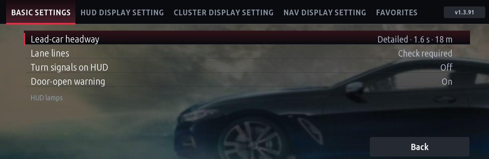

| Item | What it does |
|---|---|
| **Lead-car headway** | Off (default) / Simple (time gap + distance) / Detailed (+ closing speed). The time gap to the car ahead, small between the HUD's turn arrows: under 1.0 s red, 1.0–1.5 s orange, 1.5 s and more teal. Below 12 km/h the distance takes the big place. The **lead car departure alert** and the **distance correction** are on this screen too. See [Lead-car headway](#lead-car-headway). |
| **Lane lines** | Off (default) / On. The lines either side of your lane, and the car ahead, as the front camera sees them, drawn in perspective above the headway badge. See [Lane lines](#lane-lines). |
| **Turn signals on HUD** | On / Off (default). When the indicators or the hazards flash, HUD arrows flash with the car's rhythm (about 0.64 s). Shape (arrow · `<<< >>>` · `< >`), colour (green, blue, orange) and position / size. Also over the stock HUD. The same screen has the **blind spot warning** (when a door mirror's warning lamp lights, a top view under that side's arrow; red with that indicator on). The blind spot warning uses frequent diagnostic reads, so it is off by default. |
| **Door-open warning** | On (default) / Off. With a door, the bonnet or the boot open, a top view of the car shows in the middle of the HUD with the open parts in red. Also while parked; gone when all are shut. It has its own position / size. |

While you adjust their position / size, the turn arrows, blind spot and door pictures show on the HUD as a preview; they go when you leave the screen.

On the HUD (from the left: the default lane colour with teal 1.6 s, the lime green lane with orange 1.2 s, the car ahead moving off with the **Moving off** badge):

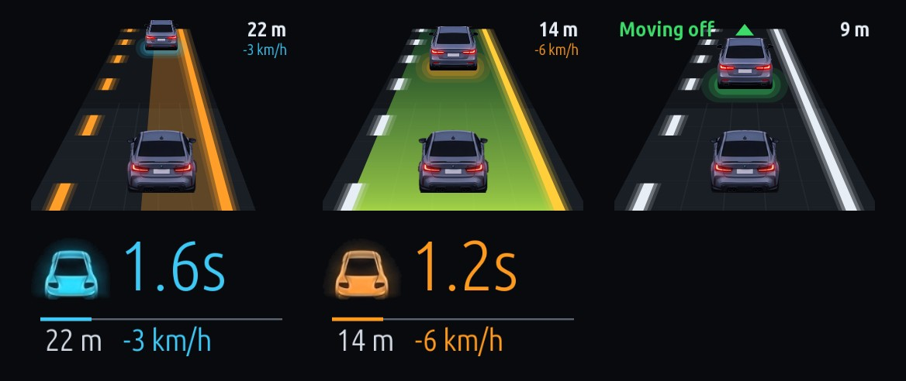

#### Lead-car headway

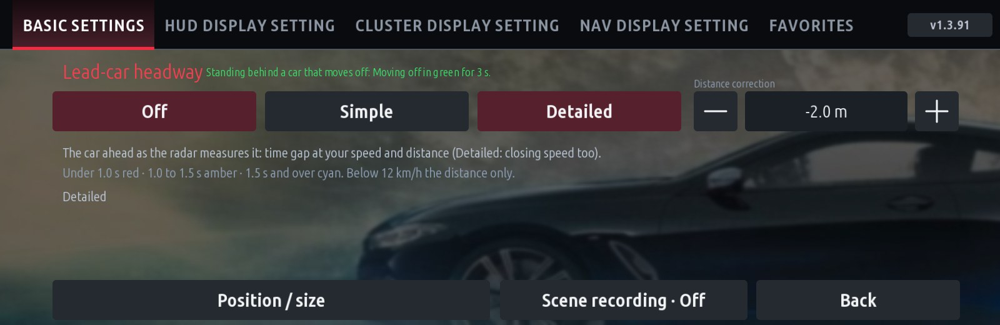

- Choose **Off / Simple / Detailed** on top. **Distance correction** at the top right (− / +, 0 to −3 m in 0.5 m steps, **−2.0 m** by default) is taken off the distance shown: the car measures from its sensor behind the windscreen, so without it a car right in front still reads about 2 m (1.3.91). The time gap and its colour use the corrected distance, which never goes under 0 m.
- **Where the car ahead comes from**: the **lead-car helper** (`redline-lead`: the front camera's object list and the radar) first; without it, the radar (ACC) service the car offers to apps, the front camera's object list, then the Drive assist view. The lines at the bottom show whether each one arrives, and the values received (before the correction). When the car gives apps none of them, `this car does not give the app the car ahead` shows.
- **Lead car departure alert** (on with the headway badge): standing (under 1 km/h) for 1 s with a car within 20 m, when that car moves further than its nearest by the set distance (or is lost having been within 12 m), **Moving off** shows in green for 3 s.
  - The **Moving-off alert** button under the headway screen (1.3.101) steps through **Off** / **Faster** (1 m, 0.2 s) / **Quick** (1.5 m, 0.3 s, the default) / **Relaxed** (3 m, 0.5 s).
  Once per stop; not in P, nor once you move. With the lane lines on, the car ahead turns green with an arrow too.
- **Position / size**: the badge's place and size. The lane lines move and scale with it.

#### Lane lines

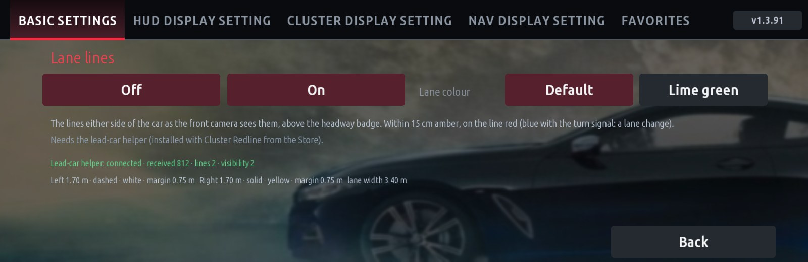

- **Off / On**, and **Lane colour**: **Default** (the dark road) or **Lime green** (the lane lit, brightest near the car).
- The lines are drawn as the camera reports them: dashed, solid, double, road edge; white or yellow.
- Within **15 cm** of a line that side turns amber; **over the line** red. With the turn signal on towards it, it is a lane change: teal, no warning.
- A car ahead is drawn at its distance as the camera's class (car, truck, motorbike, bicycle, pedestrian), its headway colour glowing on the road under it; its distance and closing speed sit small at the top right. Your car at the bottom is an M3 seen from behind.
- **The lead-car helper is required** (installed from the Store with the app). The lines at the bottom show the helper, events received, lines seen, both lines' distance, type and margin, and the lane width. Lines not seen for 1.2 s are hidden.

#### Scene recording

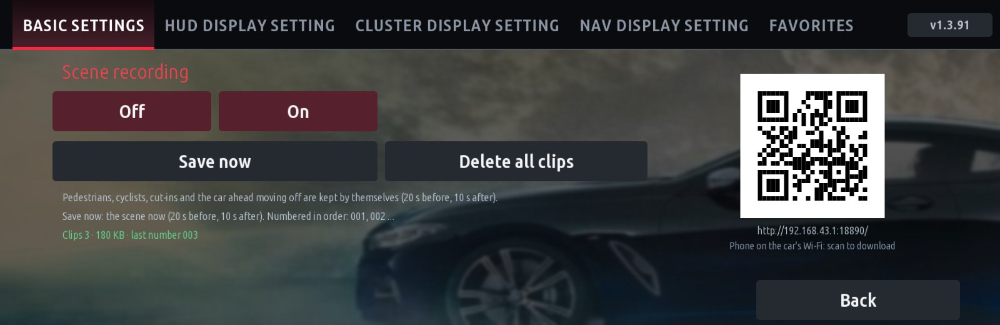

**Scene recording** on the Lead-car headway screen (off by default) collects the scenes needed to set up the pedestrian / cyclist warning, the cut-in warning and the road users around, without SSH.

- While it is on, the lead-car helper keeps the last 30 s of what the front camera measures (objects, the car followed, lane lines) with your speed and gear.
- **20 s before and 10 s after** are saved by themselves for: a pedestrian or cyclist on your path within 30 m, a car beside you coming into your lane, the car ahead moving off. **Save now** keeps the scene now.
- Clips are numbered in order (`001-1127-1010-보행자자전거.jsonl`, `002-…-끼어들기`, `003-…-직접저장`). At most 50 clips / 5 MB are kept, the oldest going first. **Delete all clips** deletes on a second press within 5 s.
- **To your phone**: join the phone to the car's Wi-Fi (as for the GIF player's phone page) and scan the QR code: a page lists the clips with **모두 받기** (download all; the page is in Korean). It is read only, and there only while recording is on.

### 4-2. Vehicle preset

| Item | Choices | What it does |
|---|---|---|
| Vehicle type | Petrol / Diesel / eDrive (PHEV) / M | Sets the rpm scale and the shift-alert defaults. It does not detect the car. |
| Power unit | PS / kW | |
| Torque unit | Nm / kgf·m | |
| Shift alert RPM · Sport | preset default, 2000–7500 rpm | Shift-alert rpm in the Sport modes. Petrol, eDrive and M 5500, Diesel 4200. |
| Shift alert RPM · Comfort / Eco | Automatic (90 % of Sport), 2000–5000 rpm | Shift-alert rpm in every mode that is not Sport. |

The shift alert is green from 50 % of the set rpm, yellow from 80 %, and flashes red at the set rpm.

### 4-3. Settings per driver and greetings

- **On**: the car's current user (driver profile) is checked every 5 s and settings are kept per driver. A new driver starts from the current settings.
- Kept per driver: design, position / size, auxiliary information, navigation colours, turn signals, vehicle alerts and so on, the **five favourites** and the position / size slots. The **vehicle preset** and auto start are shared by all drivers.
- The row shows the current driver's name and number, e.g. `On · John (2 / 3)`.
- **Driver greeting**: at engine start `Hello, John` shows for 5 s on top of the HUD and in the middle of the cluster; switching off in P shows `Goodbye` for 5 s. Not after an auto start-stop restart. The hello and the goodbye can be turned off separately on the Settings per driver screen.

---

## 5. HUD display setting

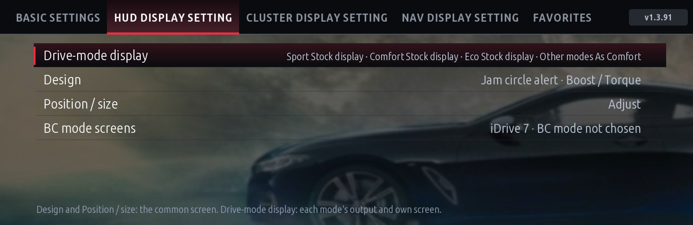

| Item | Choices | What it does |
|---|---|---|
| Drive-mode display | opens a screen | What the HUD shows in Sport / Comfort / Eco / other modes. See [5-0](#5-0-drive-mode-display) |
| Design | design → auxiliary information | See 5-1 |
| Position / size | opens a screen | See 5-2 |
| BC mode screens | opens a screen | See 5-3 |

### 5-0. Drive-mode display

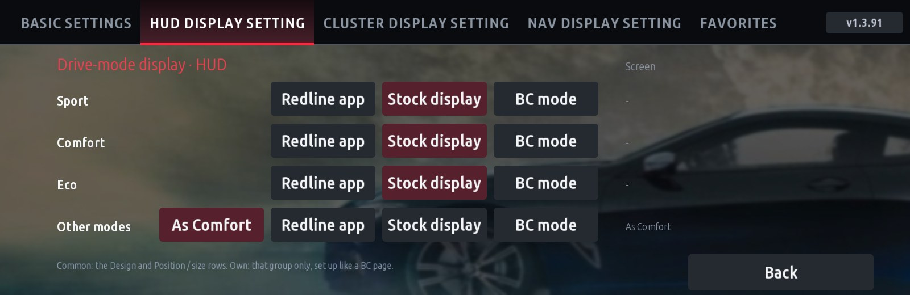

From 1.3.84 this screen replaces the two rows **Sport mode RPM display / All modes RPM display**. Your older settings carry over, and nothing changes until you touch it.

| Group | Drive modes in it |
|---|---|
| Sport | Sport, Sport+, Sport Individual, PHEV Sport, Boost |
| Comfort | Comfort, Comfort+, Comfort Individual, PHEV Hybrid, a mode not known yet |
| Eco | Eco Pro, Eco Pro+, Eco Pro Individual, PHEV Hybrid Eco |
| Other modes | Adaptive, PHEV Electric, Battery control, off-road and the rest. **As Comfort** by default |

- Each group gets **Redline app / Stock display / BC mode**.
- With Redline app, the **Screen** column on the right is **Common** (the Design and Position / size rows' screen) or **Set own**: set up like a BC page (design → auxiliary information → position / size) and used in that group only. The common screen is not changed.
- BC mode keeps one set of BC page screens for every drive mode.
- Examples: **only in Sport** = Sport Redline app, the rest Stock display. **Stock only in Sport** = Sport Stock display, the rest Redline app.

### 5-1. Design and auxiliary information

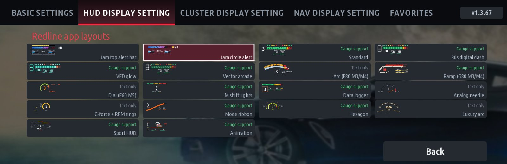

- The first two, **Jam top alert bar / Jam circle alert**, are this app's own designs; the rest are the Redline app layouts (18 on the HUD, 20 designs in all). Pictures: [10. All designs](#hud-20). Each tile says **Gauge support** or **Text only** at its top right.
- After a design you choose the **auxiliary information**: **Gauges** (up to 2) / **Text** (up to 4) / **No auxiliary information**. They are placed in the order you press them, and saved only with **OK**.

| Auxiliary information | What it is |
|---|---|
| Boost | Boost pressure (bar) |
| Torque / Power* | Engine torque; power estimated from torque and rpm |
| G-force | Lateral and longitudinal acceleration |
| Outside / oil temperature | °C |
| 12 V battery charge / battery voltage | The 12 V battery (not the high-voltage battery) |
| Average consumption / average speed / trip time | Trip (journey 1) values |
| Clock | Horizontal gauges only. UTC+9 (Korea) / head-unit time |

A value not received yet, or too old, shows as `--`. Missing values are never estimated.

### 5-2. Position / size

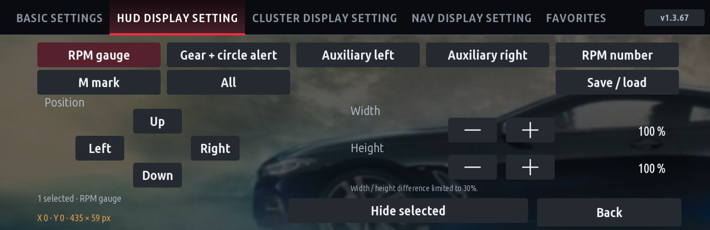

- Pick the parts at the top (RPM gauge, gear and circle alert, auxiliary left / right, RPM number, M mark…). Pressed again, a part is deselected; several parts move together. **All** scales everything at one ratio.
- **Up / Down / Left / Right** move one step; **Width / Height − +** change the size by 5 % (a part's width and height differ by at most 30 %).
- **Hide selected** hides the parts chosen. Vehicle signals needed only by hidden parts are not read.
- **Save / load**: Save 1–3, Load 1–3, Reset to defaults (press twice). Kept per design.
- In a Redline layout the buttons depend on the layout, and **Add M mark / Remove M mark** puts a BMW M mark in.

### 5-3. BC mode screens

With **BC mode** chosen in Drive-mode display, the Redline screen follows the stock BC pages as you step them with the **BC button** on the left stalk.

- At the top choose the **iDrive 7 / iDrive 8** page list.
- For each page: **Set screen** (design → auxiliary information → position / size, kept per page) / **No change** / **This page now** (to put the count right when it is out of step).
- The car does not say which BC page shows, so the app follows the stock order by **counting the presses**. Presses are counted whenever the app runs, BC mode or not.
- **BC button check**: whether the stalk value changes when you press BC, and the count.

---

## 6. Cluster display setting

The same menus as the HUD tab; the cluster and the HUD have **separate** outputs, designs, auxiliary information and positions.

- Defaults: in Drive-mode display **Sport = Redline app**, the rest Stock display.

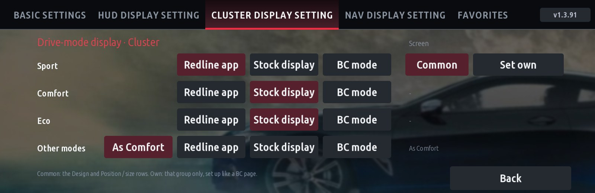
- For the cluster, the car's **centre display area** must be **map view or off**.

### 6-1. Design

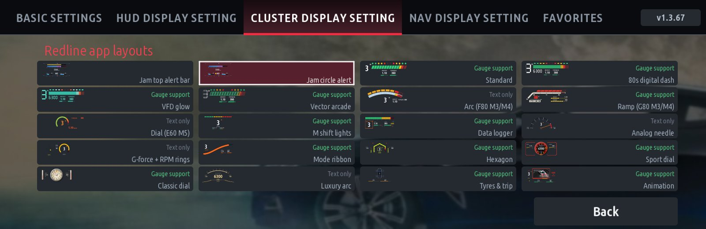

The cluster has **24 designs** (pictures: [10. All designs](#cluster-24)): Jam top alert bar, Jam circle alert and 22 Redline app layouts (Standard, 80s digital dash, VFD glow, Vector arcade, Arc (F80 M3/M4), Ramp (G80 M3/M4), Dial (E60 M5), M shift lights, Data logger, Analog needle, G-force + RPM rings, Mode ribbon, Hexagon, Sport dial, Classic dial, Luxury arc, Tyres & trip, Calm clock, Retro VU meters, Navigation focus, G-G trail, **Animation**). Animation is always last.

**Calm clock** (1.3.71, cluster and HUD): the time big and thin with its date, up to four readouts in quiet figures under it (the auxiliary items chosen), the gear, speed and drive mode small at the top. The rpm stays out of sight until 1,500 rpm before the shift point, then a thin bar fills above the clock. **Cool / warm** colours on the Auxiliary information screen. The clock and the speed are Position / size parts of their own.

**Retro VU meters** (1.3.72, cluster): two lit cream meters as on a hi-fi amplifier: the rpm and the first readout chosen (boost, torque…; without one the rpm alone, centred). In the red zone the needle's tip turns red and the PEAK lamp lights. Drive mode, gear and clock under them.

**Navigation focus** (1.3.72, cluster): the turn big in the middle, its distance and description (highway exits and entries named), the lanes and the turn after it; a small rpm ring on the left, gear and speed on the right. Without guidance the speed takes the middle. It uses the HUD's guidance and follows the Navigation display setting.

**G-G trail** (1.3.72, cluster and HUD): the sideways and forward G of the last 2.5 s as a fading tail over rings at 0.4 / 0.8 / 1.2 G, this drive's highest left, right and braking G, and the G now; an rpm ring around it, gear and speed on the left.

| Four text values | Two gauges |
|---|---|
| 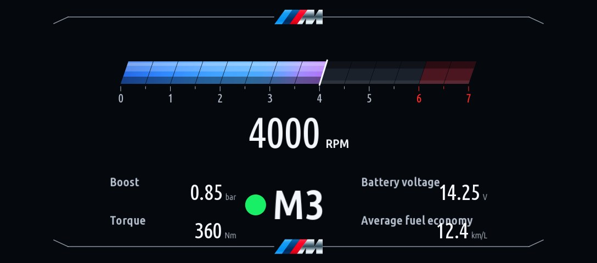 |  |

### 6-2. Animation (the animated car / adding your own pictures)

Choosing **Animation** in the design list opens the My GIFs screen.

**No GIF: the animated car** (the M3), going through driving → accelerating → braking → left bend steps 1–3 → drift → right bend → right drift → standing still → reverse (drawn by the actual package; the yellow caption at the top right is only for this guide).

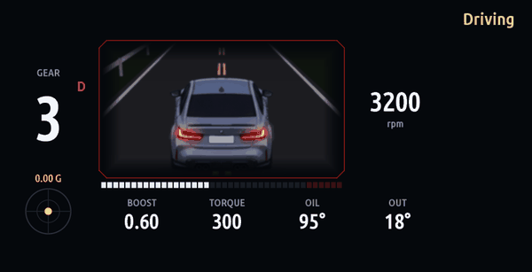

The HUD's Animation design goes through the same M3 scenes (on the HUD black is see-through).

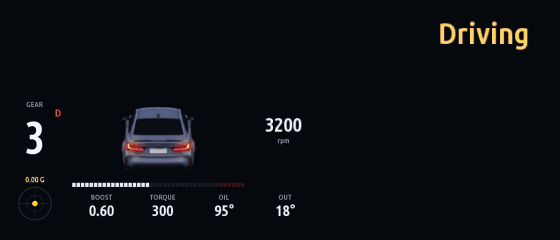

**With your GIF**, filmed on the car (the phone's name hidden; the car's language is Korean):

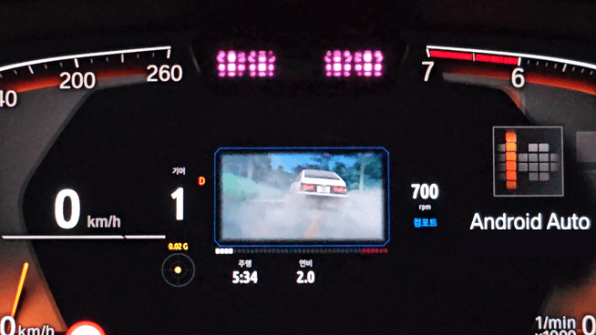

| Your GIF (PC preview) |
|---|
| 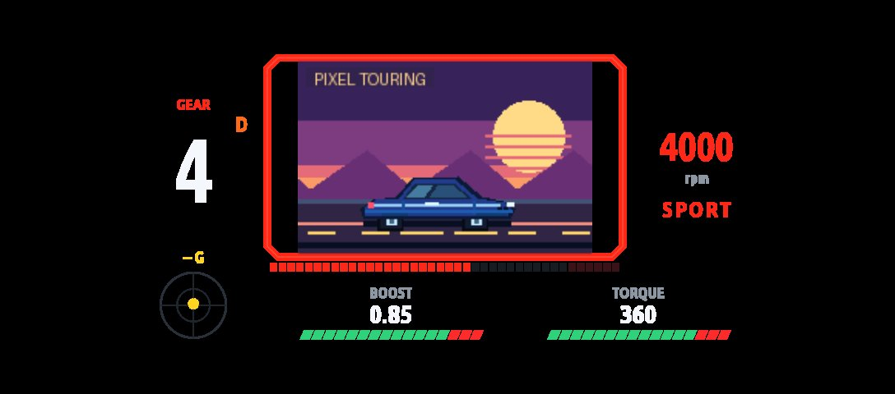 |

- **The animated car** (the owner's M3) shows when no GIF is added: brake lights, four cornering steps left and right (from 1.3.94 the nose turns into the bend about the tail lamps: 10° from 0.10 G, 20° from 0.25 G, 30° from 0.35 G, and a drift from 0.50 G), flames when accelerating, reversing lamps and standing still, from the car's G and gear.
- **Your pictures (your GIFs)** come from the [GIF player](../apps/gif_home/README.md): the GIFs you uploaded to it from your phone, a different one for driving, standing still, reverse, turning left and turning right. The GIF takes the picture's place; the gear, rpm, auxiliary information and G-meter stay.

#### Adding your pictures

**Before**: install the GIF player (0.4.3 or later), upload the GIFs you want from your phone, and run the GIF player once. Nothing needs setting up in the GIF player. ([How to upload](../apps/gif_home/README.md#4-uploading-gifs-from-your-phone))

**1. Open the Animation screen**: Cluster display setting → **Design** → **Animation**.

The top line shows how many GIFs came from the GIF player, e.g. `GIF player: GIF 5`. If it says waiting or an error, run the GIF player once and press **Refresh**.

**2. Choose a GIF per scene**: use **− / +** on each row. The GIF's name, size and file size show in the middle.

| Scene | When it shows |
|---|---|
| **Driving \*** (required) | Moving forward. A scene without its own GIF shows this one |
| Standing still | Under 1 km/h (P when the speed is unknown) |
| Reverse | R gear |
| Turning left / right | Lateral G above 0.12 G (ends below 0.08 G). With only one chosen, the other turn uses it mirrored |

**3. Fetch**: press **Fetch from GIF player**. When the right side says `In use: 192 × 128 · 18 frames`, it is on the cluster.

**4. Auxiliary information**: press **Next: Auxiliary information** and choose what shows under the picture (gauges / text / none). Position / size moves or hides the gear, rpm, auxiliary information and the rest one by one.

The HUD's Animation design shows the same GIFs (black is see-through).

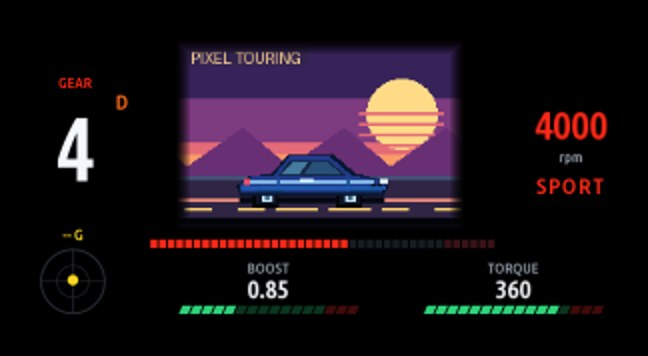

**Good to know**

- Recommended size **320 × 180**. Larger GIFs (up to 640 × 360, 6 MB) are scaled down, keeping their shape, when fetched; more than 30 frames are thinned to 30 (the duration is kept).
- **Smaller GIFs run faster**: 160 × 90 at about 10–20 frames a second, 320 × 180 at about 2–6 (depending on the car).
- Scene changes fade over 0.4 s.
- The GIF is always drawn on its own fast layer (from 1.3.66; the old Fast GIF layer switch is gone).
- Once fetched, the GIF player may be off. After changing the GIFs in the GIF player, or choosing others, press **Fetch** again.
- To go back to the animated car, set all five rows to none and press **Fetch**.

### 6-3. Position / size

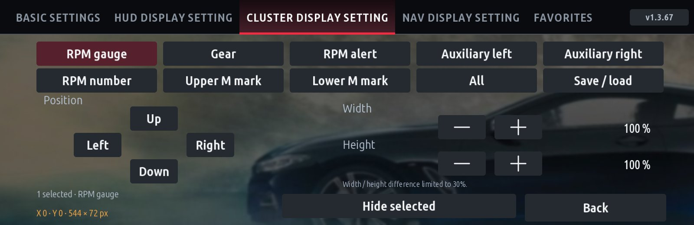

As on the HUD. The cluster's parts are the RPM gauge, gear, RPM alert, auxiliary left / right, RPM number, upper M mark and lower M mark.

### 6-4. BC mode screens

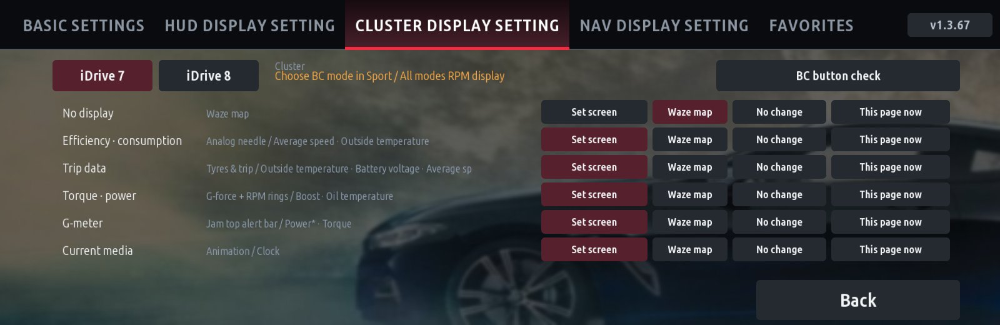

As on the HUD, plus **Waze map** on the cluster (Redline steps aside for Waze or the stock map). The iDrive 7 defaults:

| Stock BC page | Cluster default | HUD default |
|---|---|---|
| No display | Waze map | No change |
| Efficiency · consumption | Analog needle / average speed, outside temperature | Same |
| Trip data | Tyres & trip / outside temperature, battery voltage, average speed, average consumption | Jam top alert bar / the same text |
| Torque · power | G-force + RPM rings / boost, oil temperature | Same |
| G-meter | Jam top alert bar / power, torque | Same |
| Current media | Animation / clock | Animation / clock |

---

## 7. Nav display setting

| Item | What it does |
|---|---|
| Navigation display | When the HUD shows the app's turn guidance (direction, distance, road name, lanes) |
| Navigation colour | Arrow colour and text colour, arrow style (3D / drawn arrows) |
| Cluster · yield to navigation | Whether the cluster's RPM screen steps aside during guidance |
| Position / size | Direction, text, lane guidance, next turn and vehicle alerts |

**Vehicle alerts** (speeding, children signs, speed cameras) are always on; move or hide them in Position / size. The status line counts the signals received.

### 7-1. Navigation display

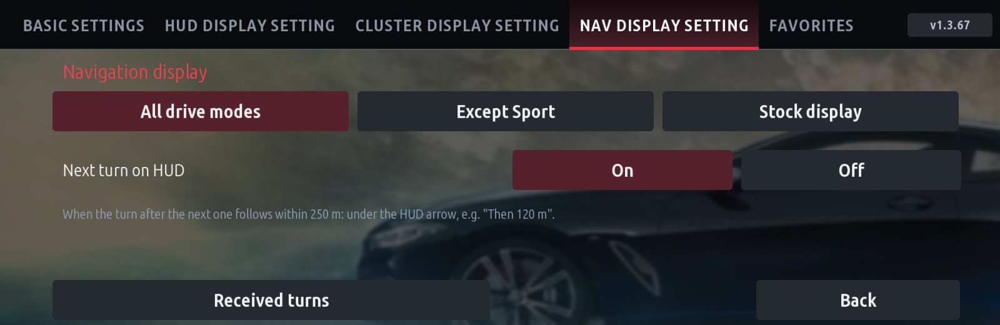

- **All drive modes / Except Sport / Stock display**: the stock display turns the app's guidance off.
- **Next turn on HUD**: On (default) shows the turn after the next one small under the arrow, e.g. `Then ↰ 120 m`, when it follows within 250 m.
- **Received turns**: the last 10 turns the navigation (BMW, CarPlay, Android Auto) sent, and the route's turn list (up to 10 turns from 1.3.75). With only one turn in the list, `only one turn: no next turn` shows (the navigation sends just the next turn). Use it to see why the next turn shows or not.
- Exit / IC and road numbers sent as icons now show in the turn's description too (1.3.75).
- **Position check** (1.3.93, off by default): for the speed camera warnings to come (from a Korean camera list, without route guidance), whether the app gets the car's GPS position. **Nothing is warned yet.**
  - At install, the fields and events of this car's catalog that hold a latitude and a longitude are found and up to four are added **read only** (never an interface the app already uses).
  - While it is on, each is read: the position (4 decimals), in Korea or not, the heading, and per candidate what it received (count, per second, unit, `not offered`). The one in use is marked `>`.
  - Read only while it is on; a position never goes to the log. It is off again after an app start.
  - Turn it on, drive a little and send a photo of this screen: the speed camera warnings are the next step.

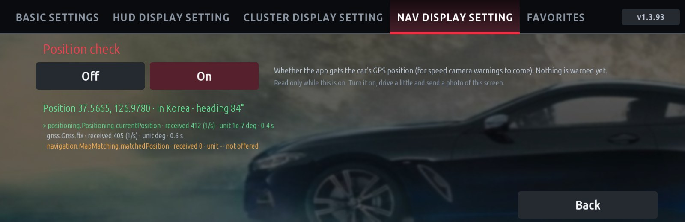

### 7-2. Navigation colour

- **Arrow colour** (turn arrow, recommended lanes) and **text colour** (distance, road name): orange, green, blue, white or **Neon**. Default: blue arrow, white text.
- **Arrow style**: **3D** (the default, glowing icons) / **Drawn arrows** (the line arrows up to 1.3.80). It applies to the turn box, the next-turn arrow, the lanes and the Navigation focus layout. Forks and branches stay drawn either way.
- With 3D, **Neon** uses its own neon yellow-green icons (grey roads, orange arrival flags, its own highway exits) and lights the lane to take in neon. The other colours tint the blue icons.
- The preview below shows the choice.

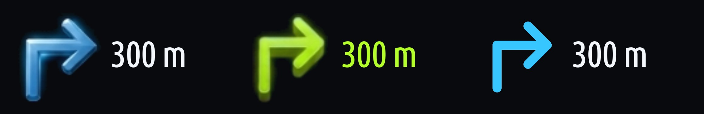

### 7-3. Cluster · yield to navigation

- **Do not yield** (default) / **Yield during Waze guidance · all modes** / **Yield during Waze guidance · except Sport**.
- While the HUD shows guidance (Waze included) the cluster's RPM screen goes, so the stock or phone map shows. It comes back about 8 s after the guidance ends.
- If the phone's guidance does not reach the HUD, the app cannot know a route is running and cannot yield.

### 7-4. Navigation position / size

Pick direction, text, lane guidance, next turn or vehicle alerts and move, resize or hide them. Navigation parts keep their width-to-height ratio.

---

## 8. Favorites

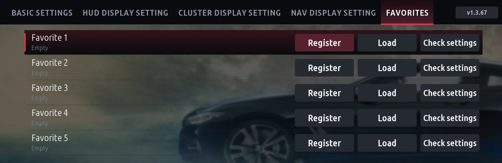

Save the current settings (design, auxiliary information, position / size, navigation colours, turn signals, vehicle alerts…) in five slots and switch them in one go.

| Button | What it does |
|---|---|
| **Register** | Saves the current settings in that slot. Over a saved slot, press it again within 4 s to overwrite. |
| **Load** | Applies the slot. If it is already in use, `Already in use` shows; pressed in quick succession, it asks you to wait a moment. |
| **Check settings** | Shows what the slot holds; it can be loaded from there too. |

- Since 1.3.101 a favourite also keeps the drive-mode display, BC follow, the lane lines (colour, warning sensitivity), the 3D navigation icons, the next-turn box's place, the moving-off alert, the greetings and My picture's GIFs. Checks and logs (Position check, log recording) are not kept.
- With Settings per driver on, each driver has their own five favourites.
- In BC mode the screen of the current BC page is shown again right after a load.

---

## 9. Update, stop, remove

- **Update**: in MGU Store, Check now → **Installed → Cluster Redline → Update**, then check the version at the top right. Settings are kept.
- **Stop for now**: Basic settings → App operation → **Stop app (no auto start)**.
- **Stock in one mode only**: set that mode to **Stock display** in HUD / Cluster display setting → Drive-mode display.
- **Remove**: MGU Store → Installed → Cluster Redline → remove.

## 10. All designs

Every design you can choose in 1.3.92, drawn by the actual package with example data (4,600 rpm, 3rd gear, four text values: boost, torque, oil temperature, outside). They change with the auxiliary information and position / size.

### Cluster (24)

Sport dial, Classic dial, Tyres & trip, Retro VU meters and Navigation focus are cluster only (too detailed for the HUD). Animation is the M3 picture shown without your own GIFs.

|  |  |  |
|---|---|---|
| 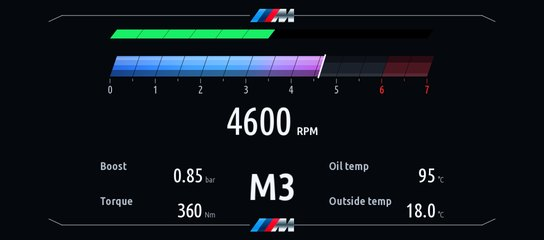 1. **Jam top alert bar** | 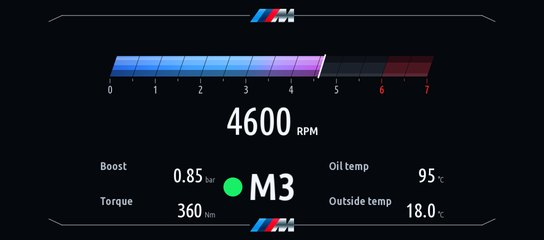 2. **Jam circle alert** | 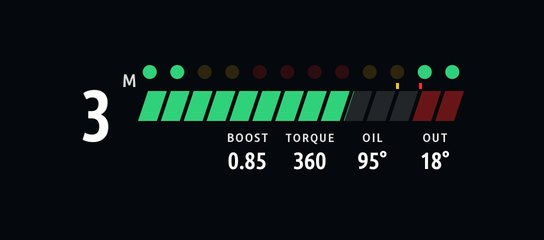 3. **Standard** |
| 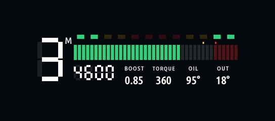 4. **80s digital dash** | 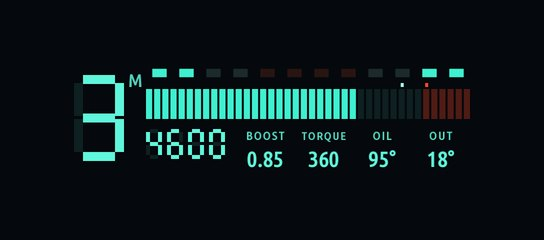 5. **VFD glow** | 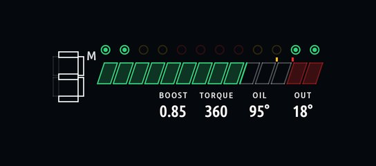 6. **Vector arcade** |
| 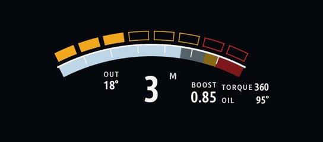 7. **Arc (F80 M3/M4)** | 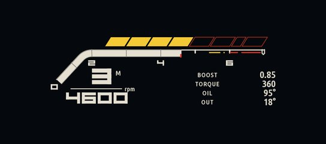 8. **Ramp (G80 M3/M4)** | 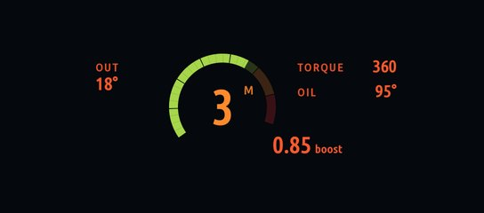 9. **Dial (E60 M5)** |
| 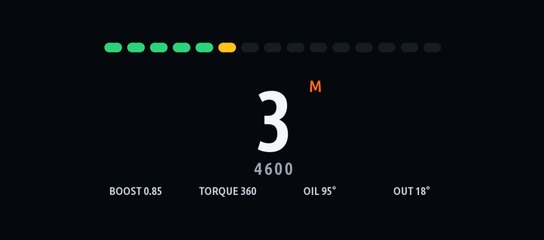 10. **M shift lights** | 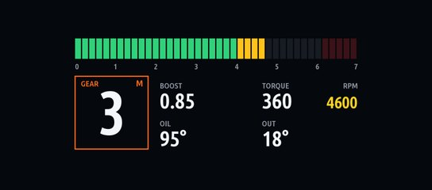 11. **Data logger** | 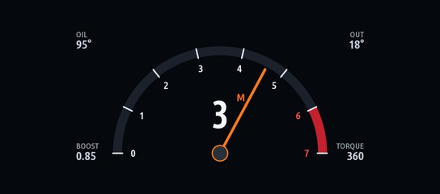 12. **Analog needle** |
| 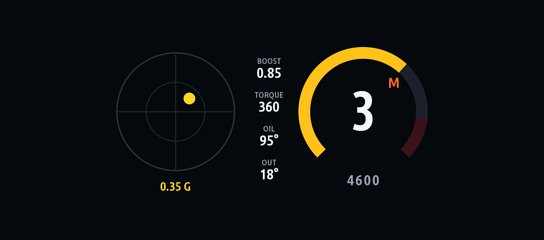 13. **G-force + RPM rings** | 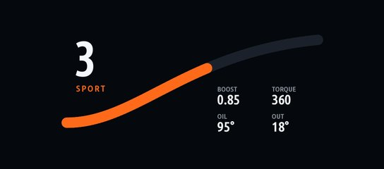 14. **Mode ribbon** | 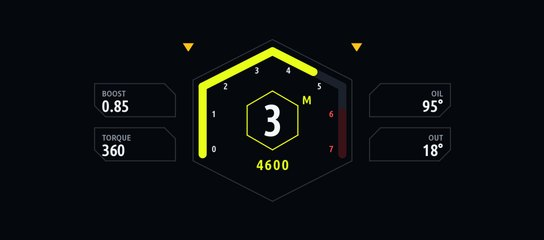 15. **Hexagon** |
| 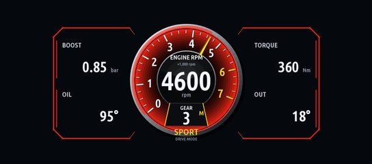 16. **Sport dial** | 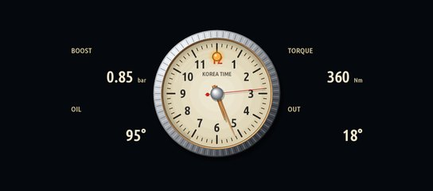 17. **Classic dial** | 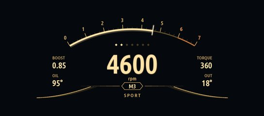 18. **Luxury arc** |
| 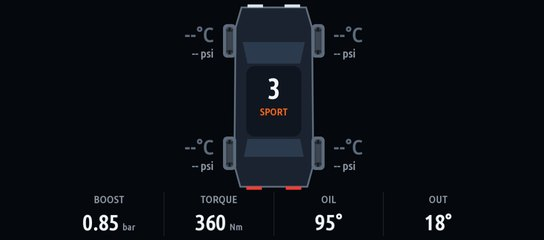 19. **Tyres & trip** | 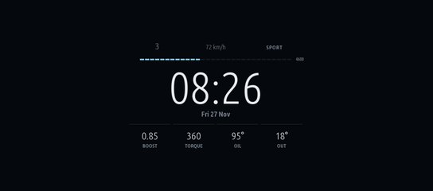 20. **Calm clock** | 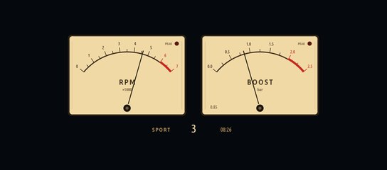 21. **Retro VU meters** |
| 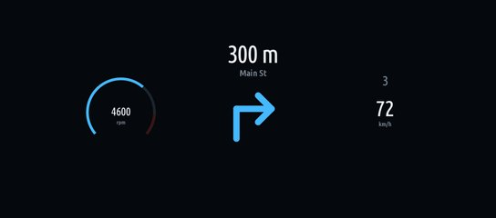 22. **Navigation focus** | 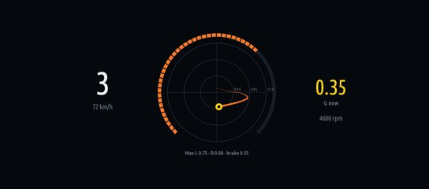 23. **G-G trail** | 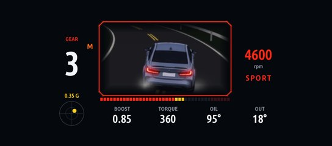 24. **Animation** |

### HUD (20)

Sport HUD is HUD only. On the HUD black is see-through.

|  |  |  |
|---|---|---|
| 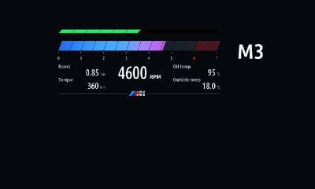 1. **Jam top alert bar** | 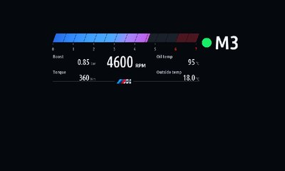 2. **Jam circle alert** |  3. **Standard** |
|  4. **80s digital dash** |  5. **VFD glow** |  6. **Vector arcade** |
|  7. **Arc (F80 M3/M4)** |  8. **Ramp (G80 M3/M4)** |  9. **Dial (E60 M5)** |
|  10. **M shift lights** |  11. **Data logger** |  12. **Analog needle** |
|  13. **G-force + RPM rings** |  14. **Mode ribbon** |  15. **Hexagon** |
|  16. **Luxury arc** |  17. **Sport HUD** |  18. **Calm clock** |
|  19. **G-G trail** |  20. **Animation** |  |

## Troubleshooting

| Symptom | Check |
|---|---|
| The app is not in the Store list | Source `jaimeen77-cmyk/apps`, branch `main`, Check now, internet |
| No RPM screen on the cluster | App running, the current mode set to Redline app in Drive-mode display, centre display area map view / off, `cluster-render` 0.4.0 or later |
| Updated but nothing changed | The version at the top right; that the other language edition is not running |
| Positions not where expected | Position / size → Save / load → Reset to defaults, then adjust again |
| Outside temperature or auxiliary information `--` | The reason in the orange status line (signal not installed, no value…). Not installed: reinstall from the Store |
| No GIF in the Animation layout | The GIF player's state on the Animation screen, that a driving GIF is chosen, that **Fetch** was pressed |
| The animation looks choppy | Use a smaller GIF (160 × 90 for example) and fetch again |
| The cluster does not yield during Waze guidance | The yield setting and the status line (HUD O/X). Without guidance on the HUD it cannot yield |
| No lead-car headway | The lines at the bottom of HUD lamps → Lead-car headway: the lead-car helper, camera and radar received. Helper `not installed`: install Cluster Redline again from the Store (the helper comes with it) |
| Not 0 m right behind a car | Adjust the distance correction (−2.0 m by default) with − / + on the Lead-car headway screen |
| No lane lines | The lines at the bottom of the Lane lines screen: helper, received, lines seen. On roads with faint or no markings they are hidden |
| The scene recording QR does not open | That the phone is on the car's Wi-Fi and recording is on |

When you ask, send the app version, a photo of the settings screen and of the status line.
Older details are in the [Changelog](../CHANGELOG.md).

---

Made by **잼님 (jaimeen77)** · [github.com/jaimeen77-cmyk/apps](https://github.com/jaimeen77-cmyk/apps) · MGU Store source `jaimeen77-cmyk/apps` (`main`)

**License**: from 1.3.10 **permission required** ([LICENSE](../apps/cluster_redline/LICENSE)). Using it in your own car is free; copying, redistributing, modifying, putting it into other apps or commercial use needs permission first. Up to 1.3.9: MIT. Components by others keep their own licenses ([NOTICE](../NOTICE.cluster-redline.md)). The Redline app layouts are this app's redrawing of the Redline app's designs (appsKOR, MIT).
