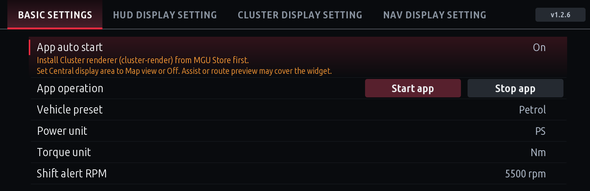
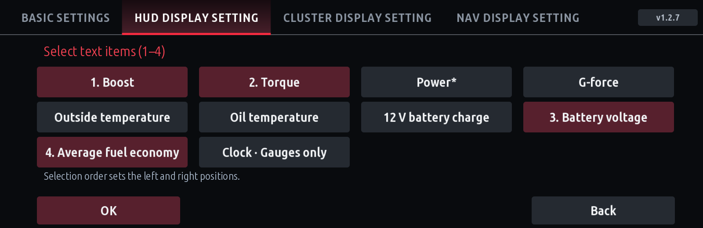
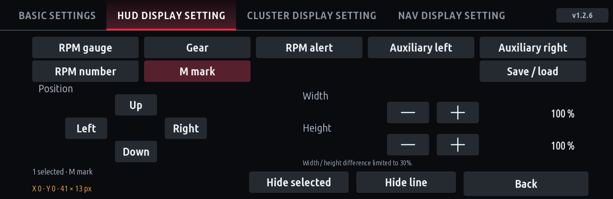
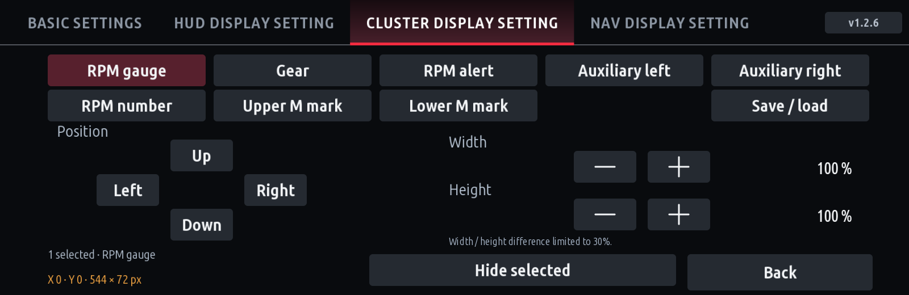
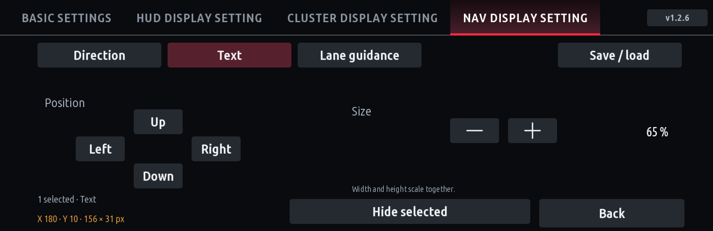

# Cluster Redline 1.2.50 user guide

[한국어](CLUSTER-REDLINE.ko.md) · [Installation](INSTALL.md) · [All screenshots](../screenshots/README.md) · [Changelog](../CHANGELOG.md)

Display RPM, gear and shift alerts on the cluster/HUD, with received navigation guidance alongside HUD RPM. Images below are **actual app renders with example data**, not measurements or photographs from a vehicle.

## Basic settings

- **App auto start:** operation at the next app-process launch.
- **Start app / Stop app:** start/stop the live worker now; settings remain available.
- **Vehicle preset:** Petrol, Diesel, eDrive or M display scales; it does not discover vehicle specifications.
- **Power / Torque unit:** display units.
- **Shift alert RPM:** use a preset or your own threshold. Defaults are 5500rpm for Petrol/eDrive/M, 4200rpm for Diesel.

## Separate HUD / CLUSTER output choices

| Setting | Behavior |
|---|---|
| Sport mode RPM display | Stock / Redline for Sport variants |
| All modes RPM display | Choice covering all valid modes, including Comfort Plus and Eco variants |

**All modes Redline also applies in Sport.** For Sport only, choose Sport=Redline and All=Stock. Defaults are Sport cluster output and Stock HUD RPM.

## Two alert designs

Open **Design** and choose using the live RPM previews.

- **Circle beside gear:** the HUD gear and filled circle share one position/scale control. The circle HUD face is lowered by two existing source-coordinate steps (+20px).
- **Top alert bar:** gear and alert-bar position/scale remain independent.

The circle diameter is 70% of gear glyph height. It stays hidden at low RPM, then progresses green → yellow → flashing red. With a 5500rpm threshold, first green is about 3735rpm, yellow 4675rpm and red 5500rpm. Red phases switch every 250ms; RPM digits stay red. **Red screenshots show the on phase.**

| HUD circle | HUD bar |
|---|---|
|  |  |

| Cluster circle | Cluster bar |
|---|---|
|  |  |

## Auxiliary information

Choose **Auxiliary information → Gauges / Text → items → OK**. Selection starts as an empty draft; items are numbered in tap order. Back or switching tabs discards the draft. Only OK commits the mode and ordered items.

| Metric | Gauge-mode appearance | Meaning |
|---|---|---|
| Boost | Bar | Received boost pressure in bar |
| Torque | Bar | Engine torque in the selected unit |
| Power* | Bar | Output estimated from engine torque and RPM |
| G-force | Filled dot in a rectangular track | Value is the two-axis magnitude; dot follows lateral acceleration |
| Outside temperature | Thermometer | Received ambient temperature |
| Oil temperature | Thermometer | Received engine-oil temperature |
| 12 V battery charge | Battery icon | 12V SOC%, not high-voltage traction-battery charge |
| Battery voltage | Text | Voltage from supported standard read requests |
| Average fuel economy | Text | Vehicle trip-1 average converted to km/L |

**Voltage and economy remain text even in Gauges mode.** Power* is an estimate and excludes combined electric-motor output. Voltage reads are bounded and run only for a selected active output with recent engine activity. Missing/stale values show `--`.

- One gauge: left. Two: item 1 left / item 2 right.
- One text item: left. Two: item 1 left / item 2 right.
- Three: items 1–2 left / item 3 right. Four: items 1–2 left / items 3–4 right.

## Position, size, M marks and lines

In **Position / size**, choose an element and use the direction/size buttons. X/Y are **offsets from its base layout**; width × height is the output region in pixels. Overall HUD/cluster scaling also applies, so a source-coordinate offset need not equal final screen pixels.

| HUD circle | HUD bar | CLUSTER |
|---|---|---|
| RPM gauge, Gear + circle alert, Auxiliary left/right, RPM number, M mark | RPM gauge, Gear, RPM alert, Auxiliary left/right, RPM number, M mark | RPM gauge, Gear, RPM alert, Auxiliary left/right, RPM number, Upper/Lower M mark |

Left/right auxiliary groups move independently, including two text items together on each side. Both cluster designs default each auxiliary group to **(0,50)**.

Select an M mark to reveal **Hide line / Hide M mark**. Each toggles independently and can be shown again. Cluster upper/lower marks have separate controls. **Moving an M leaves its decorative line anchored.** Width/height scale ratios are limited to 1.3.

## NAV display setting

- **Guidance display:** All modes / Except Sport / Stock. Stock stops app navigation output and its reads/subscriptions. NAV may run separately while HUD RPM is Stock.
- **Design:** gray, white or blue arrows; descriptions and distances remain white.
- **Position:** select Direction, Text or Lanes. Each moves/scales/hides independently; width and height scale uniformly.

| Region | Default X/Y offset | Size | Scale |
|---|---|---|---|
| Text | (180,10) | 156×31px | 65% |
| Direction/distance | (210,30) | 168×78px | 70% |
| Lanes | (210,115) | 168×50px | 70% |

The received current-maneuver description appears above the arrow and updates with the next instruction. English UI can display received Hangul text. Previous instructions are cleared on route/source loss or expiry.

Supported diagrams include turns, straight/slight/fork directions, U-turns, roundabouts, lane-change arrows, arrivals and six highway entry/exit variants. A lane-change arrow is **not a recommended-lane picture**. These diagrams do not reproduce map video, junction images or tunnel-specific pictures. Unsupported guidance yields to stock. Delivery varies by map app, phone and vehicle.

## Validation scope

Rendering, settings and optional installation interfaces are host-tested. Battery/economy delivery, Assist recovery and final combined-HUD placement still need real-vehicle checks for this release. See [installation/troubleshooting](INSTALL.md) and the [log guide](COLLECT-CLUSTER-REDLINE.ko.md) for problems.

## 1.2.1 visibility and collection

Tap a component to select it and tap again to deselect. Multiple selections move and resize together. HUD/cluster single selections have separate width/height controls; groups resize both dimensions. Every component can be hidden/shown; M lines remain independent. HUD text metrics move down one 10px source step with full Hangul glyph bounds. Battery charge uses a Battery12V-style ten-segment icon.

Hidden-only signal reads and notification subscriptions stop, then resume when visible. Shared inputs needed by another visible component continue. Stock vehicle functions are unaffected. CarPlay recommended lanes use the selected navigation colour, with other lanes dimmed; missing/stale lane data clears independently. Recorded Android Auto sessions did not contain lane data. U-turn arrows have rounded arches.

## Flicker comparison

Late navigation replies no longer remove the entire RPM image. Stale guidance clears and yields to stock; real-vehicle improvement is not yet verified. If flicker persists, hide both auxiliary groups on both HUD and CLUSTER and compare the same route. Any visible dependent retains shared collection. Then test hiding lanes, text or direction one kind at a time.

## 1.2.2 retained rendering and settings updates

Reuse static tracks/ticks, M marks and unchanged auxiliary/navigation rasters; recompose only damaged regions. Each output compares its own visible pixel inputs, ignoring guidance-age metadata. Skip intermediate raster work while image transport is blocked, then draw current state. Keep signal expiry and native-popup yielding unchanged.

Core RPM/mode/torque delivery is unchanged. Poll oil/SOC/economy every 5 seconds, outside temperature every 10 seconds and successful battery voltage every 5 seconds; consume notifications immediately.

The custom settings UI no longer refreshes the unused generic HMI settings page. Persist multi-component moves/resizes/visibility in one batch and coalesce page updates. Korean tab/button/instruction coverage is checked. Verify v1.2.2 after updating. Host/installation and Store package checks do not replace vehicle validation.

## 1.2.4 display and settings

- **HUD lanes:** stock lane-board style with one arrow size for any lane count, painted at HUD size (no resampling).
- **Junction diagrams:** forks, branches, roundabouts (exit number), highway entries/exits, keep-on-main-road and lane changes show a simplified road; plain turns, U-turns and arrivals keep the large arrow. Shapes are generic because the vehicle data has no junction geometry.
- **Text:** sharper small Korean text, larger HUD auxiliary labels; long labels shrink instead of colliding with values.
- **Gauges:** depth shading on the cluster RPM bar and auxiliary gauges (HUD RPM bar stays flat for brightness); oil/outside temperature as a glass thermometer.
- **Clock:** gauge-only HH:MM item in one auxiliary slot; choose head-unit time or UTC+9 in the gauge picker.
- **Shift alert:** Sport unchanged; Comfort/Eco and other modes use 90 % of the shift RPM with 50/80/100 % green/yellow/red.
- **Position / size:** Save / load (three slots) and two-press reset; the selected part is drawn while adjusting even when hidden or without guidance (expires two minutes after the last edit, clears on Back).
- **Outside temperature:** diagnostics in the status file. Stock HUD music/phone popups still take priority (renderer policy).

## 1.2.50 changes

- Hidden menu (tap Basic settings three times within 2 s): speed limit data collection, off by default; while on it records to `speed-probe.log` in the app data folder (1 MB, one older file).

## 1.2.49 changes

- Classic dial is now an analogue clock in Korean time, nothing else on the dial (no rpm scale, oil window, gear or drive mode; the rpm alert lamp stays).
- The app keeps no logs: nothing to the system log, its log file removed (and blocked), no status file.

## 1.2.48 changes

- Tyres & trip 150 % with the car 110 % by default; oil and outside temperatures as thermometers on every gauge layout (upright on Hexagon and Classic dial); unlit gauge parts filled faintly to the end of the scale; the clock on horizontal gauges only.

## 1.2.47 changes

- Gauge mode on Standard, 80s digital, VFD glow, Vector arcade, Ramp, M shift lights, Data logger, Mode ribbon, Hexagon (vertical), Classic dial (vertical) and Sport HUD, each in its own look.

## 1.2.46 changes

- Average speed and Driving time auxiliary items; cluster-only Tyres & trip layout (tyre temperatures and pressures); gauge support shown in the layout pickers.

## 1.2.45 changes

- Settings screen: the background photo starts where the menu does (right of the HMI's back arrow column, under the tab bar).

## 1.2.44 changes

- Favorites tab (1–5: Register / Load / Check settings) replaces the Load tab.

## 1.2.43 changes

- New Load tab listing saved layouts (with their design) and a Load button each; loads are rate-limited and write only what differs.

## 1.2.42 changes

- Arrival sign without the dotted trail.

## 1.2.41 changes

- Arrival sign: red swallowtail flag with a dotted trail.

## 1.2.40 changes

- Arrival sign: chequered finish flag.

## 1.2.39 changes

- Tighter dirty rectangles (much less renderer traffic), settings normalised once per frame, end-to-end renderer test.

## 1.2.38 changes

- Fixed the default HUD design's afterimage (alert bar / circle left behind after choosing another design).

## 1.2.37 changes

- Korean watermark restored on the Store runtime; design screen shows the design in use apart from the cursor; faster Redline drawing and settings previews.

## 1.2.36 changes

- New layout: Sport HUD (HUD only).

## 1.2.35 changes

- New layout: Luxury arc (HUD).

## 1.2.34 changes

- Sport dial colour follows the drive mode.

## 1.2.33 changes

- Sport dial and Classic dial are cluster-only. Classic dial is a clock in Korean time (since 1.2.49).

## 1.2.32 changes

- New layouts: Sport dial and Classic dial (with an oil temperature dial).

## 1.2.31 changes

- Ramp (G80) redrawn after the real G80 cluster, with an RPM alert row.

## 1.2.30 changes

- English edition watermark: BMW Coding and the Naver address only.

## 1.2.29 changes

- Settings background drawn on the car too; cafe watermark in free space.

## 1.2.28 changes

- Settings screen background photo.

## 1.2.27 changes

- HUD defaults: default design 2 steps lower (gear 2 more down, 2 left); needle upper readouts, ribbon, hexagon upper readouts and vector 1 step lower.

## 1.2.26 changes

- Cluster yield: all modes, or every mode except Sport.

## 1.2.25 changes

- Cluster yield setting: two choices (Do not yield / Yield while guidance shows on the HUD).

## 1.2.24 changes

- HUD defaults: data logger 3, G-force rings 2, mode ribbon 1 step lower.

## 1.2.23 changes

- Cluster yield setting now reaches the background app (it always ran as Off).

## 1.2.22 changes

- Analog needle readouts three more steps closer to the centre.

## 1.2.21 changes

- Cluster yield when guidance shows on the HUD (Waze included). Tuned HUD defaults per layout (lower, larger readouts without overlap). Outside temperature subscribed whenever the installed config has the field; clearer check line.

## 1.2.20 changes

- Cluster yield to navigation now releases the cluster (1.2.19 did not apply it); Waze's metadata flag counts; a live check line on the Navigation tab. Redline layouts start lower and move anywhere on the HUD picture. Outside temperature check line on the HUD / cluster tabs.

## 1.2.19 changes

- Navigation tab: **Cluster · yield to navigation** (Off / Phone navigation such as Waze / Any route guidance): the cluster RPM display steps aside while that guidance runs. Redline layouts kept in the HUD area the default design uses. **All** in Position / size with proportional group size. No dead zone at the edges. Outside temperature read exactly as eDrive. New icon.

## 1.2.18 changes

- Positions and sizes saved per layout; every layout kept inside the HUD window and the cluster area; Whole layout has one Size; the Design page pictures show the own designs again.

## 1.2.17 changes

- Minimal and Split wings removed from the picker (Standard with hidden elements covers them).

## 1.2.16 changes

- The M mark's default place is set per layout so it covers nothing when added.

## 1.2.15 changes

- **M mark** on every layout (HUD and cluster): Add / Remove M mark in Position / size; it moves, sizes and hides like any element.

## 1.2.14 changes

- Five dials removed; Hexagon stays.

## 1.2.13 changes

- **Hexagon** and **Five dials** layouts for the HUD and the cluster.

## 1.2.12 changes

- **Five new layouts** for the HUD and the cluster: M shift lights, data logger, analog needle, G-force + RPM rings, mode ribbon. Readouts follow the auxiliary setting; every element is adjustable in Position / size.

## 1.2.11 changes

- **Redline app layouts on the cluster**: Design on the cluster tab offers the nine layouts; Position / size works as on the HUD. HUD and cluster designs are chosen separately.

## 1.2.10 changes

- The shift alert rows are named **Shift alert RPM · Sport** and **Shift alert RPM · Comfort / Eco** (automatic: 90 % of Sport). Behaviour unchanged.

## 1.2.9 changes

- **Comfort / Eco shift alert RPM** (Basic settings): Automatic keeps 90 % of the shift alert RPM; a set RPM is the shift point in every non-sport mode (lights from 50 %, yellow from 80 %, red at it). Sport modes are unchanged.

## 1.2.8 changes

- **Redline app layouts, element by element**: Position / size lists *Whole layout* and then each element of the chosen layout (gear, drive mode, RPM alert, RPM number, RPM gauge, readouts: one group on the bar layouts, one each on Arc, Ramp and Dial). Each moves, sizes and hides on its own and is included in Save / load and Reset.
- **Clock**: the Korean version shows Korean time (UTC+9) by default.

## 1.2.7 fixes

- **Outside temperature**: read the way the eDrive app does, from the car's notifications rather than asking for the value every 10 s. On some cars the direct read has no usable value, so eDrive showed the temperature while the HUD showed `--`. An invalid reading keeps the last good value.

## 1.2.6 fixes

- **Outside temperature**: shown on cars that only notify the exterior temperature (as in the eDrive / 12V battery app). It appears after the car sends its first value and stays until the value changes.
- **Position / size**: leaving the settings screen in any way (home, another app) ends adjustment and the preview; Back is no longer needed.

## 1.2.5 Redline app HUD layouts

HUD display setting → **Design** → **Redline app layouts** offers the Redline app's nine HUD layouts (appsKOR, MIT): Standard, Minimal, Split wings, 80s digital dash, VFD glow, Vector arcade, Arc (F80 M3/M4), Ramp (G80 M3/M4) and Dial (E60 M5). Choosing one of Cluster Redline's designs switches back.

- Uses rpm, gear, the drive-mode shift point (lights count the last 1500 rpm and flash at it), the red zone and the selected auxiliary items as readouts; navigation, lanes and text stay alongside.
- Move and size it with **Redline HUD** in Position / size (400×130 by default).
- The Redline app is not needed. Its learning, shift grades, downshift cue and peak hold are not included.
