# Cluster Redline 1.3.67 user guide

[한국어](CLUSTER-REDLINE.ko.md) · [Installation](INSTALL.md) · [The apps](../README.md) · [Changelog](../CHANGELOG.md)

Cluster Redline draws rpm, shift alerts, the gear and auxiliary information on the BMW instrument cluster and the HUD.
For each drive mode you choose the Redline screen or the stock one, and on the HUD it adds navigation, vehicle alerts, turn signals, the door-open warning and more.

| Cluster (gauges) | Cluster (red shift alert) |
|---|---|
| 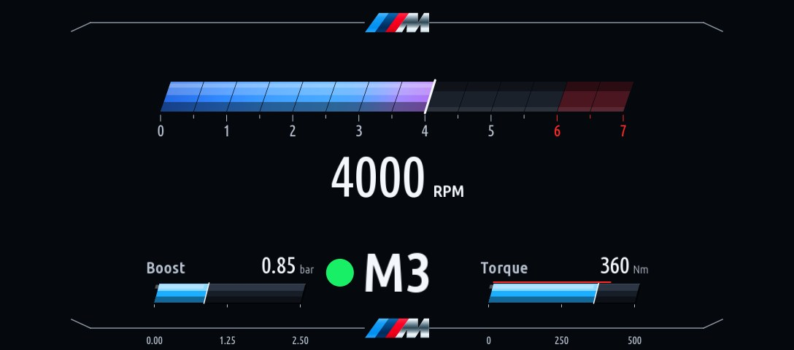 | 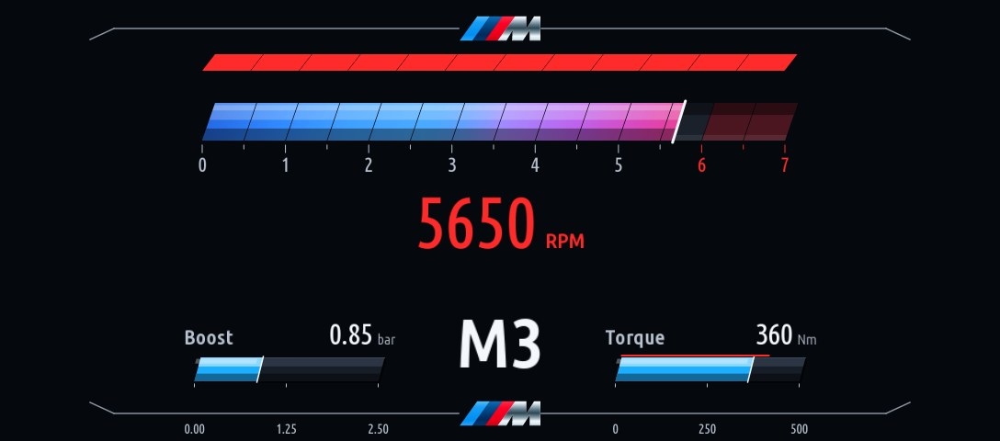 |

| HUD (circle beside the gear) | HUD (top alert bar) |
|---|---|
|  | 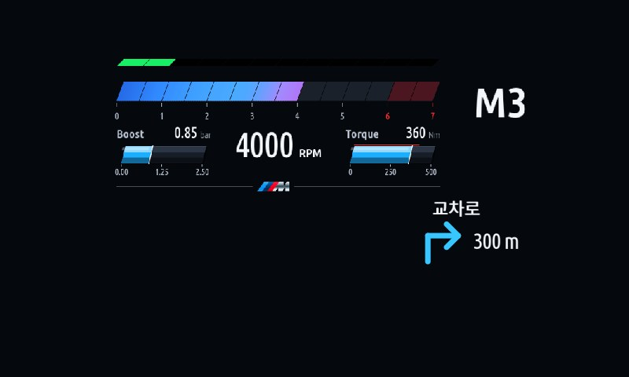 |

> The pictures in this guide are drawn by the actual 1.3.67 package's drawing code, with example data. Colours and positions on the car can differ a little.

## Contents

1. [Install](#1-install)
2. [First setup (5 minutes)](#2-first-setup-5-minutes)
3. [Using the settings screen](#3-using-the-settings-screen)
4. [Basic settings](#4-basic-settings)
5. [HUD display setting](#5-hud-display-setting)
6. [Cluster display setting](#6-cluster-display-setting)
7. [Nav display setting](#7-nav-display-setting)
8. [Favorites](#8-favorites)
9. [Update, stop, remove](#9-update-stop-remove)
10. [Troubleshooting](#troubleshooting)

---

## 1. Install

1. In MGU Store → **Settings → Add source**, add repository **`jaimeen77-cmyk/apps`**, branch **`main`**, and press **Check now**.
2. **Install** **Cluster Redline (English)** (the Korean edition is 계기판 레드라인 (한국어)).
3. The cluster renderer **`cluster-render` 0.4.0 or later** is installed with it. It comes from the Store's default source (`robertnisipeanu/idrive-apps`), which must be registered.
4. Open the app: **v1.3.67** at the top right means it is done.

It installs on iDrive 7 and iDrive 8. See [Installation](INSTALL.md) for details.

> The English and Korean editions are separate apps. If both are installed, set the one you do not use to **Stop app (no auto start)**, so the two do not fight over the cluster.

## 2. First setup (5 minutes)

1. **Basic settings → Vehicle preset**: choose the vehicle type (Petrol / Diesel / eDrive / M). The default shift-alert rpm follows it.
2. **Cluster display setting → Sport mode RPM display** should be **Redline app** (the default). To see it in Comfort and Eco too, set **All modes RPM display** to Redline app as well.
3. For the HUD, choose Redline app the same way in **HUD display setting** (the HUD's default is the stock display).
4. In the car's **cluster settings**, set the **centre display area** to **map view** or **off**. Other displays there (driving assistance and so on) can cover the Redline screen.
5. **Basic settings → App operation → Start app (auto start)**. From the next start it comes on by itself.

Now switch the drive mode to Sport and the Redline screen shows on the cluster.

## 3. Using the settings screen

| Tab | What it is for |
|---|---|
| **Basic settings** | Start and stop the app, settings per driver, HUD lamps (lead-car headway, turn signals, door-open warning), vehicle preset |
| **HUD display setting** | What the HUD shows and when, design, position / size, BC mode screens |
| **Cluster display setting** | What the cluster shows and when, design (including Animation), position / size, BC mode screens |
| **Nav display setting** | HUD navigation, colours, yielding the cluster, position / size, vehicle alerts |
| **Favorites** | Save the current settings in five slots and load them back |

- **Using it**: tap the screen, or turn the iDrive controller to a row and press. Change tabs with the tabs on top or the button bar.
- The text on the right of a row is its current value. A press either changes the value or opens that item's screen; **Back** returns.
- The orange text at the bottom is the **status line**: whether values arrive from the car, or why not. Send a photo of it with any question.

---

## 4. Basic settings

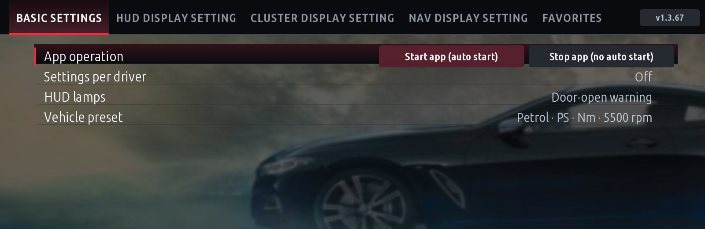

| Item | Choices | What it does |
|---|---|---|
| App operation | **Start app (auto start)** / **Stop app (no auto start)** | Starts or stops the display now, and sets whether it starts by itself next time. The settings screen works either way. |
| Settings per driver | Off (default) / On | Keeps settings per driver profile of the car. See [4-3](#4-3-settings-per-driver-and-greetings). |
| HUD lamps | opens a screen | Lead-car headway, turn signals on the HUD, door-open warning. See [4-1](#4-1-hud-lamps). |
| Vehicle preset | opens a screen | Vehicle type, units, shift-alert rpm. See [4-2](#4-2-vehicle-preset). |

### 4-1. HUD lamps

| Item | What it does |
|---|---|
| **Lead-car headway** | Off (default) / Simple (time gap + distance) / Detailed (+ closing speed). Reads the distance the radar (ACC) measured and shows it small between the HUD's turn arrows. Time gap under 1.0 s red, 1.0–1.5 s orange, 1.5 s and more teal. **Distance correction** (1.3.91): the car measures from its sensor behind the windscreen, so this is taken off the distance shown to read from the bumper: 0 to −3 m in 0.5 m steps, −2 m by default (right behind a car: 0 m). The time gap uses the corrected distance too. The values received from the car, and whether the car offers the radar's service to the app, show at the bottom. |
| **Turn signals on HUD** | On / Off (default). When the indicators or the hazards flash, HUD arrows flash with the car's rhythm (about 0.64 s). Shape (arrow · `<<< >>>` · `< >`), colour (green, blue, orange) and position / size. Also over the stock HUD. The same screen has the **blind spot warning** (when a door mirror's warning lamp lights, a top view under that side's arrow; red with that indicator on). The blind spot warning uses frequent diagnostic reads, so it is off by default. |
| **Door-open warning** | On (default) / Off. With a door, the bonnet or the boot open, a top view of the car shows in the middle of the HUD with the open parts in red. Also while parked; gone when all are shut. It has its own position / size. |

While you adjust their position / size, the turn arrows, blind spot and door pictures show on the HUD as a preview; they go when you leave the screen.

### 4-2. Vehicle preset

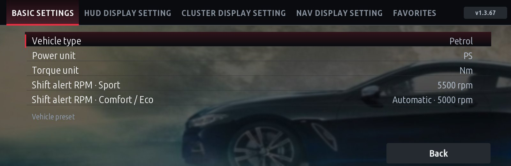

| Item | Choices | What it does |
|---|---|---|
| Vehicle type | Petrol / Diesel / eDrive (PHEV) / M | Sets the rpm scale and the shift-alert defaults. It does not detect the car. |
| Power unit | PS / kW | |
| Torque unit | Nm / kgf·m | |
| Shift alert RPM · Sport | preset default, 2000–7500 rpm | Shift-alert rpm in the Sport modes. Petrol, eDrive and M 5500, Diesel 4200. |
| Shift alert RPM · Comfort / Eco | Automatic (90 % of Sport), 2000–5000 rpm | Shift-alert rpm in every mode that is not Sport. |

The shift alert is green from 50 % of the set rpm, yellow from 80 %, and flashes red at the set rpm.

### 4-3. Settings per driver and greetings

- **On**: the car's current user (driver profile) is checked every 5 s and settings are kept per driver. A new driver starts from the current settings.
- Kept per driver: design, position / size, auxiliary information, navigation colours, turn signals, vehicle alerts and so on, the **five favourites** and the position / size slots. The **vehicle preset** and auto start are shared by all drivers.
- The row shows the current driver's name and number, e.g. `On · John (2 / 3)`.
- **Driver greeting**: at engine start `Hello, John` shows for 5 s on top of the HUD and in the middle of the cluster; switching off in P shows `Goodbye` for 5 s. Not after an auto start-stop restart. The hello and the goodbye can be turned off separately on the Settings per driver screen.

---

## 5. HUD display setting

| Item | Choices | What it does |
|---|---|---|
| Sport mode RPM display | Redline app / Stock display (default) / BC mode | What the HUD shows in Sport, Sport+ and Sport Individual |
| All modes RPM display | Redline app / Redline app · except Sport modes / Stock display (default) / BC mode | Every drive mode. **Redline app** includes Sport; **except Sport modes** leaves the Sport modes to the row above. |
| Design | design → auxiliary information | See 5-1 |
| Position / size | opens a screen | See 5-2 |
| BC mode screens | opens a screen | See 5-3 |

- **Only in Sport**: Sport = Redline app, All modes = Stock display.
- **Stock only in Sport**: Sport = Stock display, All modes = Redline app · except Sport modes.

### 5-1. Design and auxiliary information

- The first two, **Jam top alert bar / Jam circle alert**, are this app's own designs; the rest are the Redline app layouts (16 on the HUD). Each tile says **Gauge support** or **Text only** at its top right.
- After a design you choose the **auxiliary information**: **Gauges** (up to 2) / **Text** (up to 4) / **No auxiliary information**. They are placed in the order you press them, and saved only with **OK**.

| Auxiliary information | What it is |
|---|---|
| Boost | Boost pressure (bar) |
| Torque / Power* | Engine torque; power estimated from torque and rpm |
| G-force | Lateral and longitudinal acceleration |
| Outside / oil temperature | °C |
| 12 V battery charge / battery voltage | The 12 V battery (not the high-voltage battery) |
| Average consumption / average speed / trip time | Trip (journey 1) values |
| Clock | Horizontal gauges only. UTC+9 (Korea) / head-unit time |

A value not received yet, or too old, shows as `--`. Missing values are never estimated.

### 5-2. Position / size

- Pick the parts at the top (RPM gauge, gear and circle alert, auxiliary left / right, RPM number, M mark…). Pressed again, a part is deselected; several parts move together. **All** scales everything at one ratio.
- **Up / Down / Left / Right** move one step; **Width / Height − +** change the size by 5 % (a part's width and height differ by at most 30 %).
- **Hide selected** hides the parts chosen. Vehicle signals needed only by hidden parts are not read.
- **Save / load**: Save 1–3, Load 1–3, Reset to defaults (press twice). Kept per design.
- In a Redline layout the buttons depend on the layout, and **Add M mark / Remove M mark** puts a BMW M mark in.

### 5-3. BC mode screens

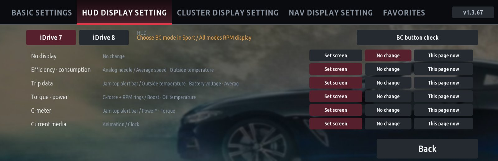

With **BC mode** chosen as the RPM display, the Redline screen follows the stock BC pages as you step them with the **BC button** on the left stalk.

- At the top choose the **iDrive 7 / iDrive 8** page list.
- For each page: **Set screen** (design → auxiliary information → position / size, kept per page) / **No change** / **This page now** (to put the count right when it is out of step).
- The car does not say which BC page shows, so the app follows the stock order by **counting the presses**. Presses are counted whenever the app runs, BC mode or not.
- **BC button check**: whether the stalk value changes when you press BC, and the count.

---

## 6. Cluster display setting

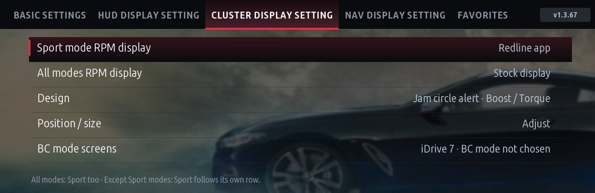

The same menus as the HUD tab; the cluster and the HUD have **separate** outputs, designs, auxiliary information and positions.

- Defaults: **Sport mode = Redline app**, All modes = Stock display.
- For the cluster, the car's **centre display area** must be **map view or off**.

### 6-1. Design

The cluster has **20 designs**: Jam top alert bar, Jam circle alert and 18 Redline app layouts (Standard, 80s digital dash, VFD glow, Vector arcade, Arc (F80 M3/M4), Ramp (G80 M3/M4), Dial (E60 M5), M shift lights, Data logger, Analog needle, G-force + RPM rings, Mode ribbon, Hexagon, Sport dial, Classic dial, Luxury arc, Tyres & trip, **Animation**).

| Four text values | Two gauges |
|---|---|
|  |  |

### 6-2. Animation (the animated car / adding your own pictures)

Choosing **Animation** in the design list opens the My GIFs screen.

| No GIF: the animated car | With your GIF |
|---|---|
| 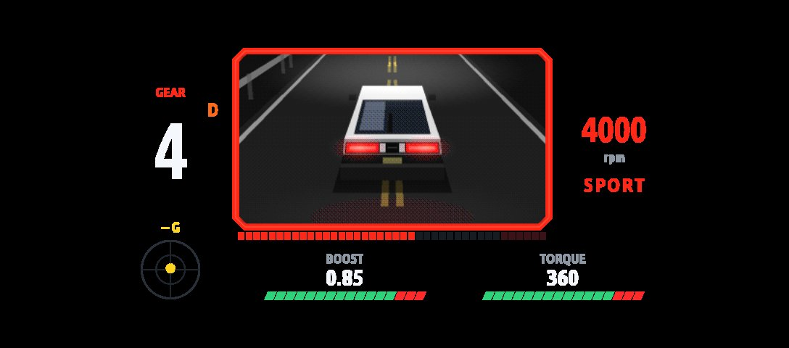 |  |

- **The animated car** (the owner's M3) shows when no GIF is added: brake lights, four cornering steps left and right (from 0.10, 0.25 and 0.35 G, and a drift from 0.50 G), flames when accelerating, reversing lamps and standing still, from the car's G and gear.
- **Your pictures (your GIFs)** come from the [GIF player](../apps/gif_home/README.md): the GIFs you uploaded to it from your phone, a different one for driving, standing still, reverse, turning left and turning right. The GIF takes the picture's place; the gear, rpm, auxiliary information and G-meter stay.

#### Adding your pictures

**Before**: install the GIF player (0.4.3 or later), upload the GIFs you want from your phone, and run the GIF player once. Nothing needs setting up in the GIF player. ([How to upload](../apps/gif_home/README.md#4-uploading-gifs-from-your-phone))

**1. Open the Animation screen**: Cluster display setting → **Design** → **Animation**.

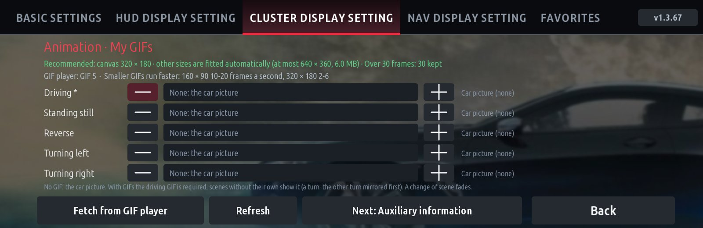

The top line shows how many GIFs came from the GIF player, e.g. `GIF player: GIF 5`. If it says waiting or an error, run the GIF player once and press **Refresh**.

**2. Choose a GIF per scene**: use **− / +** on each row. The GIF's name, size and file size show in the middle.

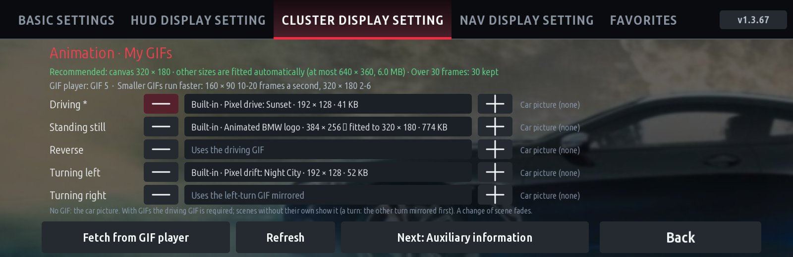

| Scene | When it shows |
|---|---|
| **Driving \*** (required) | Moving forward. A scene without its own GIF shows this one |
| Standing still | Under 1 km/h (P when the speed is unknown) |
| Reverse | R gear |
| Turning left / right | Lateral G above 0.12 G (ends below 0.08 G). With only one chosen, the other turn uses it mirrored |

**3. Fetch**: press **Fetch from GIF player**. When the right side says `In use: 192 × 128 · 18 frames`, it is on the cluster.

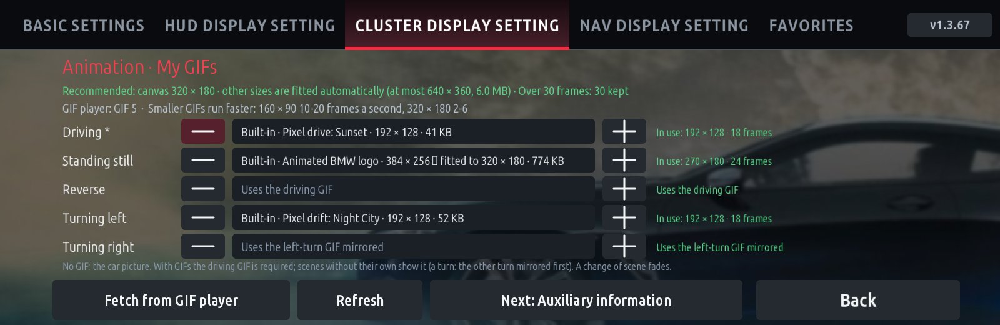

**4. Auxiliary information**: press **Next: Auxiliary information** and choose what shows under the picture (gauges / text / none). Position / size moves or hides the gear, rpm, auxiliary information and the rest one by one.

The HUD's Animation design shows the same GIFs (black is see-through).

**Good to know**

- Recommended size **320 × 180**. Larger GIFs (up to 640 × 360, 6 MB) are scaled down, keeping their shape, when fetched; more than 30 frames are thinned to 30 (the duration is kept).
- **Smaller GIFs run faster**: 160 × 90 at about 10–20 frames a second, 320 × 180 at about 2–6 (depending on the car).
- Scene changes fade over 0.4 s.
- Once fetched, the GIF player may be off. After changing the GIFs in the GIF player, or choosing others, press **Fetch** again.
- To go back to the animated car, set all five rows to none and press **Fetch**.

### 6-3. Position / size

As on the HUD. The cluster's parts are the RPM gauge, gear, RPM alert, auxiliary left / right, RPM number, upper M mark and lower M mark.

### 6-4. BC mode screens

As on the HUD, plus **Waze map** on the cluster (Redline steps aside for Waze or the stock map). The iDrive 7 defaults:

| Stock BC page | Cluster default | HUD default |
|---|---|---|
| No display | Waze map | No change |
| Efficiency · consumption | Analog needle / average speed, outside temperature | Same |
| Trip data | Tyres & trip / outside temperature, battery voltage, average speed, average consumption | Jam top alert bar / the same text |
| Torque · power | G-force + RPM rings / boost, oil temperature | Same |
| G-meter | Jam top alert bar / power, torque | Same |
| Current media | Animation / clock | Animation / clock |

---

## 7. Nav display setting

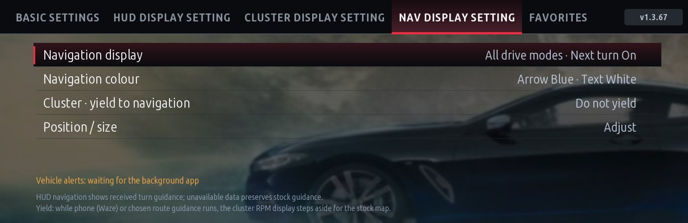

| Item | What it does |
|---|---|
| Navigation display | When the HUD shows the app's turn guidance (direction, distance, road name, lanes) |
| Navigation colour | Arrow colour and text colour |
| Cluster · yield to navigation | Whether the cluster's RPM screen steps aside during guidance |
| Position / size | Direction, text, lane guidance, next turn and vehicle alerts |

**Vehicle alerts** (speeding, children signs, speed cameras) are always on; move or hide them in Position / size. The status line counts the signals received.

### 7-1. Navigation display

- **All drive modes / Except Sport / Stock display**: the stock display turns the app's guidance off.
- **Next turn on HUD**: On (default) shows the turn after the next one small under the arrow, e.g. `Then ↰ 120 m`, when it follows within 250 m.
- **Received turns**: the last 10 turns the navigation (BMW, CarPlay, Android Auto) sent and, from 1.3.67, the route's turn list. Use it to see why the next turn shows or not.

### 7-2. Navigation colour

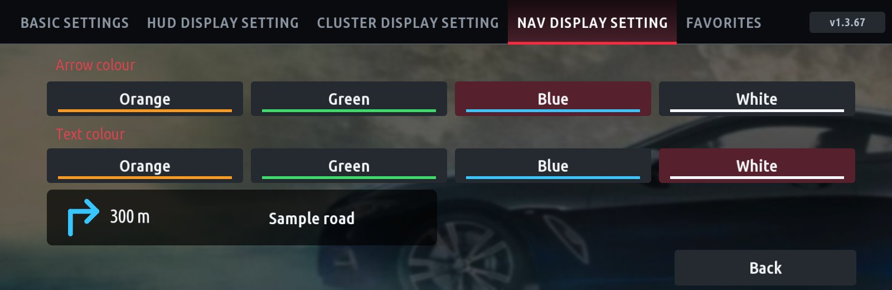

Arrow colour (turn arrow, recommended lanes) and text colour (distance, road name): orange, green, blue or white, with a preview below. Default: blue arrow, white text.

### 7-3. Cluster · yield to navigation

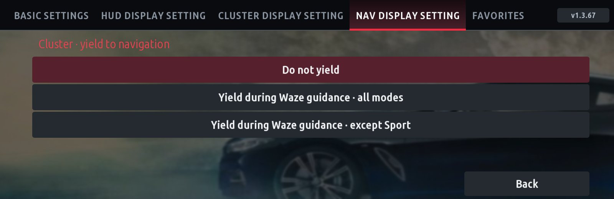

- **Do not yield** (default) / **Yield during Waze guidance · all modes** / **Yield during Waze guidance · except Sport**.
- While the HUD shows guidance (Waze included) the cluster's RPM screen goes, so the stock or phone map shows. It comes back about 8 s after the guidance ends.
- If the phone's guidance does not reach the HUD, the app cannot know a route is running and cannot yield.

### 7-4. Navigation position / size

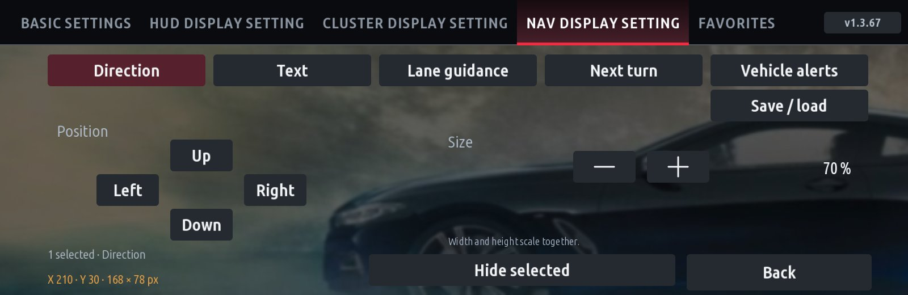

Pick direction, text, lane guidance, next turn or vehicle alerts and move, resize or hide them. Navigation parts keep their width-to-height ratio.

---

## 8. Favorites

Save the current settings (design, auxiliary information, position / size, navigation colours, turn signals, vehicle alerts…) in five slots and switch them in one go.

| Button | What it does |
|---|---|
| **Register** | Saves the current settings in that slot. Over a saved slot, press it again within 4 s to overwrite. |
| **Load** | Applies the slot. If it is already in use, `Already in use` shows; pressed in quick succession, it asks you to wait a moment. |
| **Check settings** | Shows what the slot holds; it can be loaded from there too. |

- With Settings per driver on, each driver has their own five favourites.
- In BC mode the screen of the current BC page is shown again right after a load.

---

## 9. Update, stop, remove

- **Update**: in MGU Store, Check now → **Installed → Cluster Redline → Update**, then check the version at the top right. Settings are kept.
- **Stop for now**: Basic settings → App operation → **Stop app (no auto start)**.
- **Stock in one mode only**: set that mode to **Stock display** in the HUD / Cluster display setting.
- **Remove**: MGU Store → Installed → Cluster Redline → remove.

## Troubleshooting

| Symptom | Check |
|---|---|
| The app is not in the Store list | Source `jaimeen77-cmyk/apps`, branch `main`, Check now, internet |
| No RPM screen on the cluster | App running, the current drive mode's RPM display set to Redline app, centre display area map view / off, `cluster-render` 0.4.0 or later |
| Updated but nothing changed | The version at the top right; that the other language edition is not running |
| Positions not where expected | Position / size → Save / load → Reset to defaults, then adjust again |
| Outside temperature or auxiliary information `--` | The reason in the orange status line (signal not installed, no value…). Not installed: reinstall from the Store |
| No GIF in the Animation layout | The GIF player's state on the Animation screen, that a driving GIF is chosen, that **Fetch** was pressed |
| The animation looks choppy | Use a smaller GIF (160 × 90 for example) and fetch again |
| The cluster does not yield during Waze guidance | The yield setting and the status line (HUD O/X). Without guidance on the HUD it cannot yield |
| No lead-car headway | The values received and the radar service state at the bottom of HUD lamps → Lead-car headway |

When you ask, send the app version, a photo of the settings screen and of the status line.
Older details are in the [Changelog](../CHANGELOG.md).

---

Made by **잼님 (jaimeen77)** · [github.com/jaimeen77-cmyk/apps](https://github.com/jaimeen77-cmyk/apps) · MGU Store source `jaimeen77-cmyk/apps` (`main`)

**License**: from 1.3.10 **permission required** ([LICENSE](../apps/cluster_redline/LICENSE)). Using it in your own car is free; copying, redistributing, modifying, putting it into other apps or commercial use needs permission first. Up to 1.3.9: MIT. Components by others keep their own licenses ([NOTICE](../NOTICE.cluster-redline.md)). The Redline app layouts are this app's redrawing of the Redline app's designs (appsKOR, MIT).
