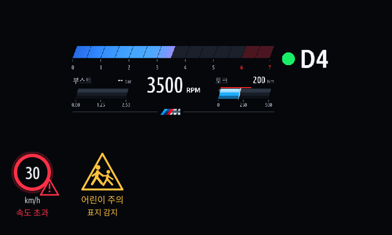
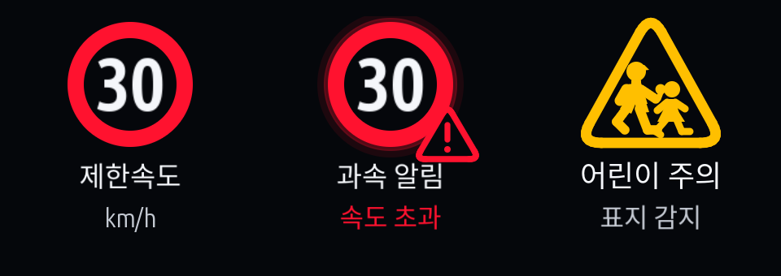
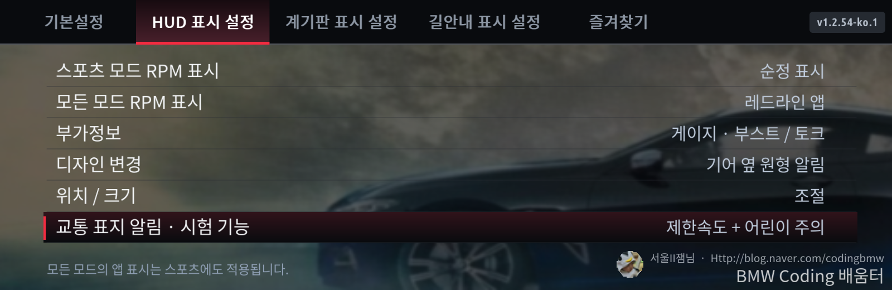
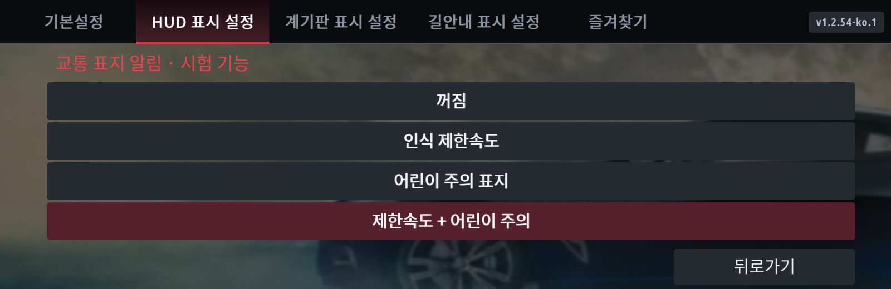

# HUD 교통 표지 알림 · 1.2.57 시험 기능

첨부된 두 번째 로그에서 수신한 제한속도·어린이 주의 표지 데이터를 사용하는 선택 기능입니다. 실차 HUD 동작은 아직 검증 전이며 기본값은 꺼짐입니다. 공식 스쿨존 경계나 지도 기반 카메라 단속 정보를 제공하는 기능이 아닙니다.

## 켜는 방법

1. MGU Store 소스 `jaimeen77-cmyk/apps`의 main을 새로고침하고 **1.2.57**으로 업데이트 설치합니다. 한국어·영어 모두 지원합니다.
2. **HUD 표시 설정 → 교통 표지 알림 · 시험 기능 → 제한속도 + 어린이 주의**를 선택합니다. 각각만 켜거나 끌 수도 있습니다. 숨김 메뉴의 로그 수집은 켤 필요가 없습니다.
3. 같은 HUD 탭의 **모든 모드 RPM 표시** 또는 **스포츠 모드 RPM 표시**를 **앱 표시**로 선택합니다. 기존 Redline HUD가 표시되는 모드에서만 알림이 함께 나옵니다. 순정 HUD를 선택한 모드나 앱 정지 상태에서는 표시되지 않습니다.
4. 확인된 표지 입력이 들어오면 HUD 왼쪽 아래에 인식 제한속도를 표시합니다. 인식 제한속도보다 3km/h 넘는 값이 1초간 유지되면 숫자·원과 ‘속도 초과’를 빨간색으로 강조합니다. 1km/h 초과 이하로 내려가면 강조를 지웁니다. 소리는 내지 않습니다.
5. 어린이 주의 표지가 인식되면 **어린이 주의 · 표지 감지**를 6초 표시합니다. 반복 패킷으로 알림이 계속 붙어 있지 않도록 30초 재알림 간격을 둡니다.

시안의 굵은 원·큰 흰색 숫자·둥근 삼각형·채워진 어린이 실루엣을 반영한 확대 그림입니다. 실제 HUD와 같은 코드로 그리며, 생성 이미지 파일을 HUD에 덮어씌우는 방식은 아닙니다.

1.2.57에서는 제한속도를 빨간 원형 표지로, 과속을 작은 경고 삼각형으로, 어린이 주의를 두 어린이가 걷는 노란 삼각형으로 표시합니다. 아래는 실제 설정 메뉴를 렌더링한 화면입니다.

그림은 실제 렌더링 코드에 예시 데이터를 넣어 만든 시안이며 실차 측정 결과가 아닙니다. 이번 버전의 알림 위치는 왼쪽 아래에 고정돼 있어 다른 레이아웃 요소와 겹치면 기존 위치/크기 설정에서 그 요소를 이동해야 합니다.

## 표시가 안 될 때 · 1.2.57 진단

RPM·기어와 길안내가 보이더라도 교통 표지 입력은 별도 서비스입니다. 1.2.57은 실제 이벤트가 수신됐는데 연결 상태 플래그가 아직 켜지지 않아 값을 지우던 경로를 수정합니다. 실제 차량의 원인이 이 경로였는지는 업데이트 후 확인해야 합니다.

교통 표지 알림을 켜고 HUD 설정 화면 아래 주황색 상태줄을 확인하세요. **카메라 N · 종합 인식 N**은 앱 실행 후 수신 횟수입니다. ‘카메라 표지 데이터 대기’면 아직 수신되지 않았고, ‘입력 없음 · 스토어 재설치’면 설치 구성에 신호가 없습니다. ‘시험 지원 범위 밖 제한속도’면 현재 해석하지 않는 클래스입니다. ‘유효한 일치 표지 대기’면 두 입력의 유효성·일치 조건을 아직 만족하지 못한 상태입니다. 이 상태줄을 사진으로 보내면 다음 점검 대상을 구분할 수 있습니다. 기록 수집을 켤 필요는 없습니다.

## 표시가 없을 수 있는 이유

- 신호가 없거나 공급 서비스가 끊겼으면 숨깁니다. 기존 RPM·길안내 표시와 양보 규칙은 유지합니다.
- 종합 인식값과 카메라 표지가 일치할 때만 제한속도를 표시하며, 양쪽 입력은 30초 안에 수신한 값이어야 합니다. 현재 속도가 2초 넘게 갱신되지 않으면 과속 강조를 지웁니다.
- 이번 로그에서 직접 짝이 확인된 **10·30·40·50km/h**만 시험 지원합니다. 종합 클래스 `12`를 60으로 추측해 표시하지 않습니다. 다른 속도, 미지원 단위, 제한 해제, 무효값, 복수의 서로 다른 표지, 적용 방향을 구분하기 어려운 표지, 보조 조건이 붙은 표지 등은 숨깁니다.
- 카메라 타입 품질 100과 값 품질 40 이상인 유효 후보만 사용합니다. 이는 이번 차량 데이터에 대한 보수적인 시험 필터이며 품질값을 정확한 확률로 해석하는 것은 아닙니다. 낮은 품질의 표지를 놓칠 수 있습니다.
- 도로 표지를 인식했다고 해서 항상 현재 차로의 법적 제한속도를 정확히 판단하는 것은 아닙니다. 특히 **어린이 주의 표지 감지**는 ‘어린이보호구역 진입·해제’, 구간의 남은 거리, 자동 30km/h 적용을 뜻하지 않습니다.

## 검증 범위

정상·무효·단위 불일치·제한 해제·만료·과속 대기/해제·어린이 재알림 간격·옵션 꺼짐의 수집 차단을 테스트했습니다. 기존 worker·길안내·출력 및 HUD 캐시의 만료 픽셀 지우기도 검증합니다. 첨부 로그 재생에서는 필터를 통과한 30·40·50 표지와 어린이 주의 알림을 확인했습니다. 이 결과는 차량의 실시간 HUD 검증을 대체하지 않습니다.
