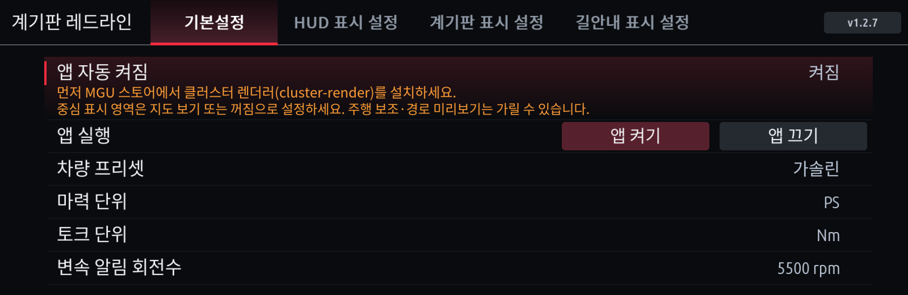

# 설치 설명서

[English](INSTALL.md) · [사용 설명서](USER-GUIDE.ko.md) · [스크린샷](../screenshots/README.md) · [업데이트 이력](../CHANGELOG.md)

BMW iDrive 7(MGU)에 MGU Store로 이 저장소의 앱을 설치하는 방법입니다. 헤드유닛 플래시·코딩은 다루지 않습니다.

## 제공 앱

| Store 표시 이름 | 설치 ID | 버전 | 필요 조건 | 시작 방식 |
|---|---|---|---|---|
| 계기판 레드라인 (한국어) | `cluster_redline` | 1.2.7 | mgu-deploy 0.7.17+, cluster-render 0.4.0+ | 백그라운드 자동 시작 |
| Cluster Redline (English) | `cluster_redline_en` | 1.2.7 | 위와 같음 | 백그라운드 자동 시작 |
| 아이드라이브 회로 (한국어) | `idrive_circuit` | 1.0.0 | mgu-deploy 0.7.17+ | 앱 목록에서 직접 실행 |
| iDrive Circuit (English) | `idrive_circuit_en` | 1.0.0 | 위와 같음 | 앱 목록에서 직접 실행 |
| 저장공간 (한국어) | `storage` | 1.0.2 | mgu-deploy 0.7.17+ | 앱 목록에서 직접 실행 |
| Storage (English) | `storage_en` | 1.0.2 | 위와 같음 | 앱 목록에서 직접 실행 |

일반 한국어 iDrive 앱 15개는 별도 저장소 [appsKOR](https://github.com/jaimeen77-cmyk/appsKOR)에서 설치합니다.

## 준비

- MGU Store가 설치된 iDrive 7과 인터넷 연결. Store 자체 설치는 [MGU Store 안내](https://github.com/robertnisipeanu/mgu-store)를 따릅니다.
- 설치하는 동안 주차 상태와 안정적인 차량 전원.
- 레드라인을 쓸 경우 Store 소스 목록에 기본 소스 **`robertnisipeanu/idrive-apps`**가 있어야 합니다. 레드라인에 필요한 계기판 렌더러(`cluster-render`)를 여기서 받습니다. 지웠다면 다시 추가하고 **Releases → Check now**를 실행합니다.

## 1. 소스 추가

1. MGU Store에서 **Settings → Add source**를 엽니다.
2. 저장소에 **`jaimeen77-cmyk/apps`**를 입력합니다. `https://github.com/jaimeen77-cmyk/apps`도 됩니다.
3. 채널은 **main** 브랜치를 선택합니다. Releases가 아닙니다.
4. **Check now**를 실행합니다. Offline이면 Settings에서 인터넷 연결부터 확인합니다.

## 2. 앱 설치

1. Store 목록에서 원하는 언어의 앱을 고르고 **Install**을 누릅니다.
2. 레드라인은 필요한 렌더러를 Store가 먼저 처리합니다.

   | 렌더러 상태 | Store 동작 |
   |---|---|
   | 설치되지 않음 | cluster-render 설치 → 레드라인 설치 |
   | 0.4.0보다 낮음 | cluster-render 업데이트 → 레드라인 설치 |
   | 0.4.0 이상 | 그대로 사용하고 레드라인만 설치 |
   | 소스에서 찾지 못함 | 설치를 멈추고 필요한 버전을 안내 → 위 준비의 소스를 확인 |

3. 재시작 안내가 나오면 설치가 끝난 뒤 안내대로 진행합니다.
4. 차량 앱 목록에서 앱을 열고 화면 위쪽 버전(레드라인은 오른쪽 위 **v1.2.7**)을 확인합니다.



## 3. 레드라인 처음 켜기

레드라인은 설치하면 백그라운드에서 자동으로 시작합니다. 기본값은 **스포츠 모드에서 계기판에만** 표시이고 HUD RPM은 순정입니다.

1. **기본설정**에서 **차량 프리셋**(가솔린·디젤·eDrive·M)을 고릅니다.
2. HUD에도 띄우려면 **HUD 표시 설정 → 스포츠 모드 RPM 표시**를 **레드라인 앱**으로 바꿉니다.
3. 계기판에 보이지 않으면 BMW 설정에서 **계기판 → 중심 표시 영역**을 **지도 보기** 또는 **꺼짐**으로 둡니다. 주행 보조 화면이나 경로 미리보기가 위에 올라오면 가려질 수 있습니다.
4. 스포츠 모드로 바꿔 RPM이 나오는지 봅니다.

자세한 설정은 [사용 설명서](USER-GUIDE.ko.md)를 보세요.

## 업데이트

1. Store에서 이 소스를 **Check now**로 새로고침합니다.
2. **Installed**에서 앱을 고르고 **Update**를 누릅니다.
3. 앱을 열어 버전이 바뀌었는지 확인합니다. 설정과 저장한 위치는 그대로 유지됩니다.

## 끄기와 삭제

- **앱 끄기**(레드라인 기본설정 → 앱 실행): 지금 표시를 멈추고 차량 신호 구독을 끝냅니다. 설정 화면에서 다시 켤 수 있습니다.
- **앱 자동 켜짐**: 다음 시동·재시작 때 자동으로 켤지 정합니다. 업데이트 뒤에도 꺼 두려면 이것도 끕니다.
- **삭제**: Store의 **Installed**에서 앱을 골라 삭제합니다.

## 한국어판과 영문판

- 두 판은 서로 다른 앱입니다. Store 목록에서 원하는 언어가 붙은 항목을 설치하면 되고, 따로 언어를 입력할 필요는 없습니다.
- 차량이나 Store의 언어를 바꿔도 설치된 앱의 언어는 바뀌지 않습니다.
- 설정과 저장한 위치는 판끼리 옮겨지지 않습니다.
- 레드라인 두 판을 모두 설치했다면 쓰지 않는 쪽에서 **앱 끄기**와 **앱 자동 켜짐 꺼짐**을 설정하세요. 둘이 같은 화면을 두고 경쟁합니다.

## 문제 해결

| 증상 | 확인할 것 |
|---|---|
| Store 목록에 앱이 없음 | 인터넷 연결, 저장소 철자, **main** 브랜치, Check now |
| 렌더러를 찾을 수 없다는 오류 | 소스 목록의 `robertnisipeanu/idrive-apps`, Releases → Check now |
| 업데이트했는데 예전 화면 | 앱 오른쪽 위 버전, 설치한 언어판, 다른 언어판이 켜져 있는지 |
| 계기판·HUD에 RPM이 안 나옴 | 앱 실행 상태, 해당 모드의 RPM 표시가 **레드라인 앱**인지, 지금 주행 모드 |
| 계기판에서 가려짐 | 중심 표시 영역(지도 보기/꺼짐), 주행 보조 화면, 다른 앱의 출력 |
| 음악·전화 때 HUD에서 사라짐 | 순정 HUD 팝업이 우선입니다(렌더러 정책). 팝업이 닫히면 돌아옵니다. |
| 부가정보 값이 `--` | 차량이 그 값을 보내지 않거나 오래된 값입니다. 추정해서 채우지 않습니다. 외부 온도는 차가 첫 값을 보낸 뒤 나타납니다. |
| 길안내가 순정으로 바뀜 | 읽을 수 있는 최신 안내가 없으면 순정 안내에 양보합니다. |
| `UPDATE_FAILED` / install failed | 이전 버전이 유지된 상태입니다. 오류 문구와 버전을 적어 두고 아래 로그를 수집합니다. |

## 로그 수집 (Windows PC, SSH 사용자)

차량에 SSH로 접속할 수 있는 경우에만 해당합니다. 두 도구 모두 차량 파일을 바꾸거나 서비스를 재시작하지 않으며, 키 파일은 결과에 넣지 않습니다.

| 상황 | 도구 | 결과 파일 |
|---|---|---|
| 설치·업데이트 실패 | `tools/collect-redline-install.ps1` | `cluster-redline-install-report-날짜-시간.txt` |
| 화면 깜빡임·표시 문제 | `tools/collect-cluster-redline.ps1` | `cluster-redline-report-날짜-시간.txt` |

```powershell
powershell.exe -NoProfile -ExecutionPolicy Bypass -File .\collect-redline-install.ps1 -CarIp "차량IP" -IdentityFile "C:\경로\id_rsa"
powershell.exe -NoProfile -ExecutionPolicy Bypass -File .\collect-cluster-redline.ps1 -CarIp "차량IP" -IdentityFile "C:\경로\id_rsa"
```

표시 문제 수집 중 안내가 나오면 스포츠 모드로 한 번 바꾸고 끝날 때까지(약 55초) 기다립니다. 만들어진 TXT 파일만 보내 주세요. 키 파일은 보내지 마세요.

## 고급: PC에서 직접 빌드해 설치

Store 대신 기존 idrive7-apps 방식(`make_kit` + `push-to-car`)을 쓰는 경우입니다. 본인 차량에서 추출한 SDK가 필요합니다.

1. 이 저장소와 원본 `idrive7-apps`를 나란히 두고, 이 저장소 폴더에서 세 앱(회로·레드라인·저장공간)을 합칩니다.

   ```powershell
   python tools/install-overlay.py ../idrive7-apps
   ```

   일부만 넣으려면 `--apps cluster_redline storage`처럼 고릅니다. 원본 파일과 내용이 다르면 아무것도 바꾸지 않고 멈추며, 확인 뒤 `--force`로 덮어씁니다. 저장공간은 홈 위젯을 만들 수 있는 키트(appsKOR 등)가 필요하며, 지원하지 않는 키트면 복사 전에 알려 줍니다.
2. 합쳐진 `idrive7-apps` 폴더에서 키트를 만듭니다. `--language ko`를 빼면 영어입니다.

   ```powershell
   python kit/tools/make_kit.py --language ko cluster_redline idrive_circuit storage
   ```

3. 검사한 뒤 설치합니다.

   ```powershell
   powershell -ExecutionPolicy Bypass -File deploy\push-to-car.ps1 check -Kit dist\mgu-custom-apps-ko.tar.gz -Key <SSH키경로> -Ip <헤드유닛IP>
   powershell -ExecutionPolicy Bypass -File deploy\push-to-car.ps1 install -Kit dist\mgu-custom-apps-ko.tar.gz -Key <SSH키경로> -Ip <헤드유닛IP>
   ```

이 방식은 렌더러를 자동으로 설치하지 않으므로 `cluster-render`를 먼저 준비해야 합니다. 만든 키트에는 SDK가 들어갈 수 있으니 공개하지 마세요.
