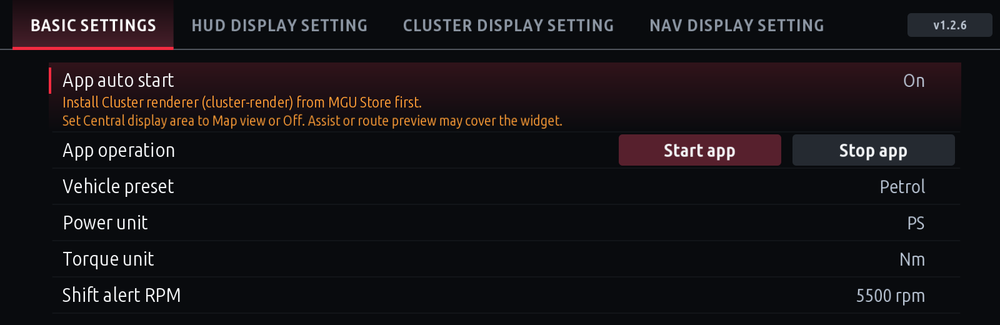

# Installation guide

[한국어](INSTALL.ko.md) · [User guide](USER-GUIDE.md) · [Screenshots](../screenshots/README.md) · [Changelog](../CHANGELOG.md)

How to install the apps in this repository on a BMW iDrive 7 (MGU) head unit with MGU Store. Flashing and coding the head unit are not covered.

## Apps

| Store name | Install ID | Version | Requires | Starts |
|---|---|---|---|---|
| 계기판 레드라인 (한국어) | `cluster_redline` | 1.2.6 | mgu-deploy 0.7.17+, cluster-render 0.4.0+ | automatically, in the background |
| Cluster Redline (English) | `cluster_redline_en` | 1.2.6 | same | automatically, in the background |
| 아이드라이브 회로 (한국어) | `idrive_circuit` | 1.0.0 | mgu-deploy 0.7.17+ | from the app list |
| iDrive Circuit (English) | `idrive_circuit_en` | 1.0.0 | same | from the app list |
| 저장공간 (한국어) | `storage` | 1.0.2 | mgu-deploy 0.7.17+ | from the app list |
| Storage (English) | `storage_en` | 1.0.2 | same | from the app list |

The 15 general Korean iDrive apps are installed from the separate [appsKOR](https://github.com/jaimeen77-cmyk/appsKOR) repository.

## Before you start

- iDrive 7 with MGU Store and an internet connection. To install MGU Store itself, follow the [MGU Store instructions](https://github.com/robertnisipeanu/mgu-store).
- Keep the car parked with stable power while installing.
- For Cluster Redline, the default source **`robertnisipeanu/idrive-apps`** must be in the Store's source list: the cluster renderer (`cluster-render`) comes from it. If you removed it, add it again and run **Releases → Check now**.

## 1. Add the source

1. In MGU Store open **Settings → Add source**.
2. Enter **`jaimeen77-cmyk/apps`** (or `https://github.com/jaimeen77-cmyk/apps`).
3. Choose the **main** branch as the channel, not Releases.
4. Run **Check now**. If the Store shows Offline, check the internet connection in Settings first.

## 2. Install

1. Pick the app in the language you want and press **Install**.
2. For Cluster Redline the Store handles the renderer first:

   | Renderer | What the Store does |
   |---|---|
   | not installed | installs cluster-render, then Cluster Redline |
   | older than 0.4.0 | updates cluster-render, then Cluster Redline |
   | 0.4.0 or newer | keeps it and installs Cluster Redline only |
   | not found in any source | stops and names the version needed; check the source above |

3. If a restart is requested, follow the prompt after installation finishes.
4. Open the app from the car's app list and check the version (Cluster Redline shows **v1.2.6** at the top right).



## 3. First start of Cluster Redline

Cluster Redline starts on its own after installation. By default it shows **on the cluster in Sport only**, and the HUD keeps the stock RPM.

1. In **Basic settings** choose the **Vehicle preset** (Petrol, Diesel, eDrive (PHEV), M).
2. To show it on the HUD too, set **HUD display setting → Sport mode RPM display** to **Redline app**.
3. If nothing appears on the cluster, set the BMW **Instrument cluster → Central display area** to **Map view** or **Off**. Driving assistant views or route previews can cover it.
4. Switch to Sport and check the RPM display.

See the [user guide](USER-GUIDE.md) for every setting.

## Updating

1. Refresh this source in the Store with **Check now**.
2. In **Installed**, pick the app and press **Update**.
3. Open the app and check the new version. Settings and saved positions are kept.

## Stopping and removing

- **Stop app** (Basic settings → App operation): stops the display now and ends the vehicle subscriptions. You can start it again from the settings screen.
- **App auto start**: whether the app starts on the next ignition or restart. Turn it off too if you want it to stay off after updates.
- **Remove**: in the Store, open **Installed**, pick the app and remove it.

## Korean and English editions

- The two editions are separate apps. Install the entry with the language you want; nothing else needs to be typed.
- Changing the car or Store language does not change an installed app's language.
- Settings and saved positions are not shared between editions.
- If both Cluster Redline editions are installed, set **Stop app** and **App auto start: Off** in the one you don't use. Otherwise both compete for the same screen.

## Troubleshooting

| Symptom | Check |
|---|---|
| The apps are not listed | internet connection, repository spelling, **main** branch, Check now |
| "renderer not found" | `robertnisipeanu/idrive-apps` in the source list, Releases → Check now |
| Old screens after updating | version at the top right of the app, which edition you installed, whether the other edition is running |
| No RPM on the cluster or HUD | app running, **Redline app** selected for the current drive mode, the drive mode itself |
| Covered on the cluster | Central display area (Map view/Off), driving assistant view, other apps' output |
| Disappears from the HUD during music or calls | stock HUD pop-ups take priority (renderer policy); it returns when the pop-up closes |
| An auxiliary value shows `--` | the car does not send it or the value is stale; values are never guessed. Outside temperature appears after the car sends its first value. |
| Navigation switches to stock | without current guidance the app gives way to the stock guidance |
| `UPDATE_FAILED` / install failed | the previous version was kept; note the message and version and collect the logs below |

## Collecting logs (Windows PC, SSH users)

Only if you can reach the car over SSH. Neither tool changes files on the car or restarts services, and your key file is never included in the report.

| Situation | Tool | Report |
|---|---|---|
| Install or update failed | `tools/collect-redline-install.ps1` | `cluster-redline-install-report-<date>-<time>.txt` |
| Flicker or display problems | `tools/collect-cluster-redline.ps1` | `cluster-redline-report-<date>-<time>.txt` |

```powershell
powershell.exe -NoProfile -ExecutionPolicy Bypass -File .\collect-redline-install.ps1 -CarIp "CAR_IP" -IdentityFile "C:\path\id_rsa"
powershell.exe -NoProfile -ExecutionPolicy Bypass -File .\collect-cluster-redline.ps1 -CarIp "CAR_IP" -IdentityFile "C:\path\id_rsa"
```

When the display tool asks, switch to Sport once and wait until it finishes (about 55 s). Send only the TXT report, never the key file.

## Advanced: build on a PC and install

For the classic idrive7-apps workflow (`make_kit` + `push-to-car`) instead of the Store. You need the SDK extracted from your own car.

1. Put this repository next to the original `idrive7-apps` and merge the three apps (Circuit, Cluster Redline, Storage) from this repository's folder:

   ```powershell
   python tools/install-overlay.py ../idrive7-apps
   ```

   Choose some with `--apps cluster_redline storage`. If an existing file differs it stops without changing anything; check it, then use `--force`. Storage needs a kit that builds home-screen widgets (such as appsKOR); an unsupported kit is reported before anything is copied.
2. In the merged `idrive7-apps` folder build the kit (`--language ko` for Korean; omit it for English):

   ```powershell
   python kit/tools/make_kit.py cluster_redline idrive_circuit storage
   ```

3. Check, then install:

   ```powershell
   powershell -ExecutionPolicy Bypass -File deploy\push-to-car.ps1 check -Kit dist\mgu-custom-apps.tar.gz -Key <SSH key path> -Ip <head unit IP>
   powershell -ExecutionPolicy Bypass -File deploy\push-to-car.ps1 install -Kit dist\mgu-custom-apps.tar.gz -Key <SSH key path> -Ip <head unit IP>
   ```

This path does not install the renderer, so `cluster-render` must already be installed. The kit can contain the SDK; do not publish it.
