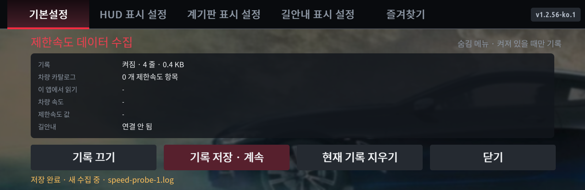

# 기록 저장 · 계속 (1.2.56)

**기본설정 탭을 2초 안에 세 번** 누르면 수집 숨김 메뉴가 열립니다. 아래에 **기록 켜기/끄기 · 기록 저장·계속 · 현재 기록 지우기 · 닫기** 네 버튼이 있습니다.

1. **기록 켜기**를 누르고 첫 번째 구간을 기록합니다.
2. 구간이 끝나면 **기록 저장 · 계속**을 누릅니다. `speed-probe-1.log`로 보관하고 새 `speed-probe.log`에 수집을 이어갑니다. 화면 아래에 저장한 파일명이 표시됩니다.
3. 다음 구간이 끝나면 다시 누릅니다. `speed-probe-2.log`, `speed-probe-3.log` 순으로 보관합니다. 앱을 다시 실행해도 번호가 이어집니다.
4. 더 기록하지 않을 때는 **기록 끄기**를 누릅니다. 저장 버튼은 다음 수집까지 자동으로 켜므로 종료할 때 별도로 꺼주세요.

예를 들어 1번 파일을 안드로이드 오토, 2번 파일을 카플레이 구간으로 사용하고 어느 연결이었는지 메모하면 됩니다. 파일 번호가 연결 종류를 자동으로 판별하는 것은 아닙니다.

파일은 기존 앱 데이터 폴더에 저장됩니다. 현재 파일과 자동 회전된 최근 파일을 순서대로 묶어서 저장하며, 기존 자동 회전 한도 때문에 아주 긴 수집 전체가 아니라 버튼을 누를 때 남아 있는 최근 약 2MB 범위일 수 있습니다. 새 수집에는 버전·카탈로그·수집 대상·연결·조회 상태를 다시 기록합니다. 동일 값도 새 파일에서 다시 기록될 수 있고 관련 원본 응답 저장 제한도 파일별로 초기화합니다.

**현재 기록 지우기**는 활성 파일과 자동 회전 파일만 지웁니다. 번호를 붙여 저장한 파일과 `speed-probe-sequence.json` 번호 정보는 남깁니다. 저장 파일은 버튼을 누를 때마다 추가되며 자동 삭제하지 않습니다. PC로 보관 후 차량에서 정리하려면 필요한 파일을 먼저 확인하세요.

저장에 실패하면 오류를 표시하고 활성 로그를 유지합니다. 번호 파일 저장 뒤 새 수집 시작에 실패한 경우에도 보관 파일은 남습니다. 화면 아래 파일명과 오류를 함께 확인하세요. 파일명 충돌은 다음 번호로 넘어가며 기존 파일을 덮어쓰지 않습니다.

기존 PowerShell 진단 수집기는 번호 파일도 찾지만 각 파일의 앞·뒤 일부만 보고서에 넣습니다. 전체 분석이 필요하면 해당 `speed-probe-N.log` 원본을 내려받아 보내주세요.

그림은 실제 앱 코드를 테스트 환경에서 렌더링한 예시입니다. 이 버전은 파일 보관 방식의 변경이며, 카메라·구간단속·스쿨존 경계·T맵 신호등의 새로운 수집 경로를 추가한 버전은 아닙니다.
