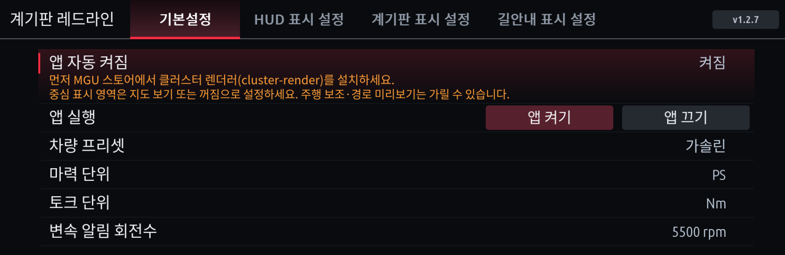
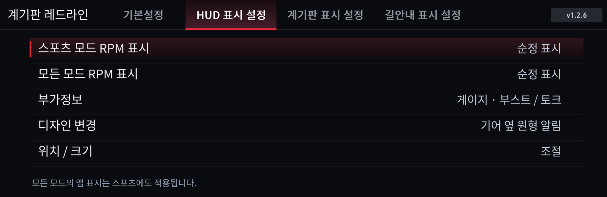
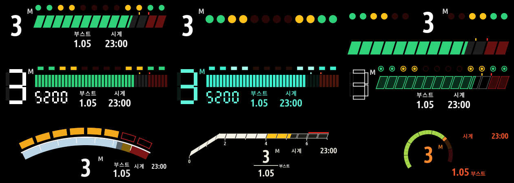
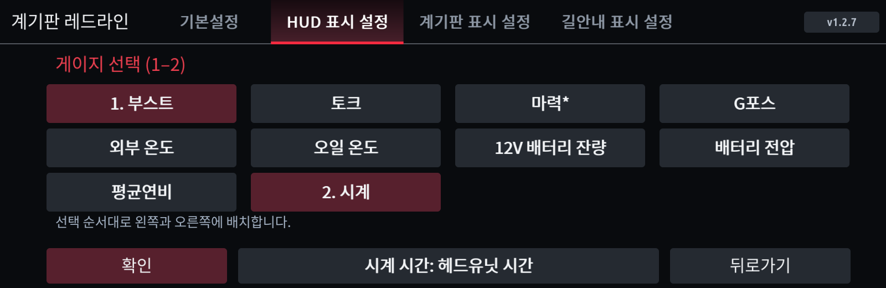
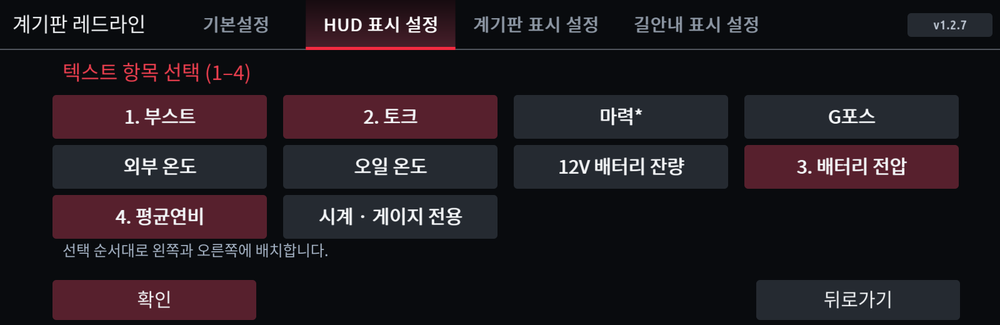
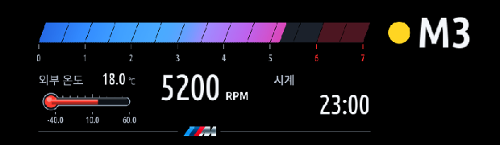
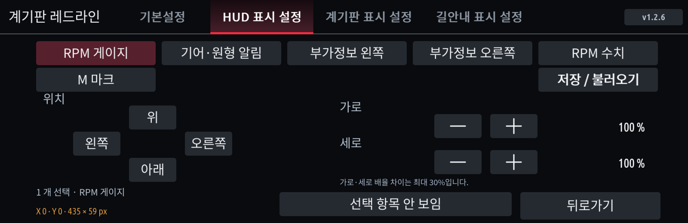
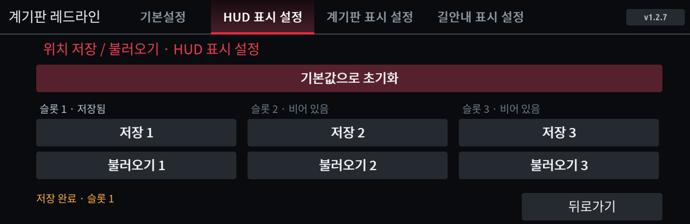
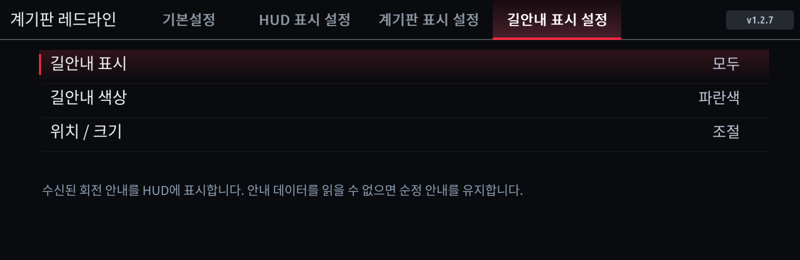
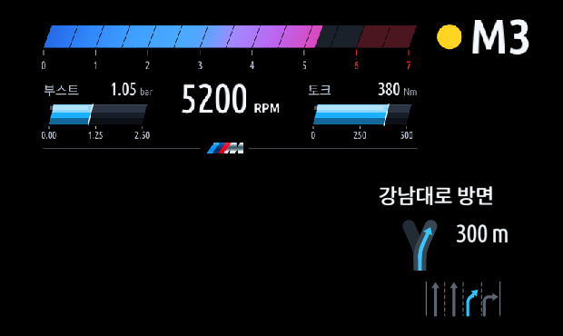

# 사용 설명서

[English](USER-GUIDE.md) · [설치 설명서](INSTALL.ko.md) · [스크린샷](../screenshots/README.md) · [업데이트 이력](../CHANGELOG.md)

- [계기판 레드라인 1.2.6](#계기판-레드라인)
- [저장공간 1.0.2](#저장공간)
- [아이드라이브 회로 1.0.0](#아이드라이브-회로)

그림은 실제 앱 렌더러에 예시 데이터를 넣어 만든 화면입니다. 차량에서 찍은 사진이 아니며, 숫자도 측정값이 아닙니다.

---

## 계기판 레드라인

계기판과 HUD에 RPM·기어·변속 알림과 부가정보(부스트·토크·온도·시계 등)를 띄우고, 휴대전화 길안내를 HUD에 함께 보여 주는 앱입니다.

| HUD | 계기판 |
|---|---|
|  |  |

설정 화면은 네 탭입니다: **기본설정 · HUD 표시 설정 · 계기판 표시 설정 · 길안내 표시 설정**. 오른쪽 위에 앱 버전이 표시됩니다.

### 기본설정

| 항목 | 내용 |
|---|---|
| 앱 자동 켜짐 | 시동·재시작 때 앱을 자동으로 켭니다. 기본 켜짐. |
| 앱 실행 | **앱 켜기 / 앱 끄기**로 지금 표시를 바로 시작·중지합니다. |
| 차량 프리셋 | 가솔린 · 디젤 · eDrive(플러그인 하이브리드) · M. RPM 눈금과 기본 변속 RPM이 바뀝니다. 차량을 자동으로 알아내지는 않습니다. |
| 마력 단위 / 토크 단위 | PS·kW / Nm·kgf·m |
| 변속 알림 회전수 | **프리셋 기본값**(가솔린·eDrive·M 5500, 디젤 4200 rpm) 또는 직접 고른 RPM |

### 언제 표시되나 (HUD·계기판 각각)

HUD 표시 설정과 계기판 표시 설정에서 따로 정합니다.

| 항목 | 선택 | 의미 |
|---|---|---|
| 스포츠 모드 RPM 표시 | 레드라인 앱 / 순정 표시 | 스포츠 계열 모드일 때 |
| 모든 모드 RPM 표시 | 레드라인 앱 / 순정 표시 | 컴포트·에코 등 모든 모드 (스포츠 포함) |

- 기본값: 계기판은 스포츠 모드만 레드라인, HUD는 순정.
- **모든 모드를 레드라인으로 하면 스포츠에서도 나옵니다.** 스포츠에서만 보려면 스포츠 = 레드라인, 모든 모드 = 순정.

### 변속 알림

**디자인 변경**에서 두 가지 중 고릅니다.

- **기어 옆 원형 알림**: 기어 옆의 동그라미가 초록 → 노랑 → 빨강(깜빡임)으로 바뀝니다.
- **상단 알림선**: RPM 막대 위의 선이 같은 순서로 바뀝니다.

알림 기준은 주행 모드에 따라 다릅니다 (변속 RPM 5500 기준 예).

| 주행 모드 | 초록 | 노랑 | 빨강 깜빡임 |
|---|---|---|---|
| 스포츠 계열 | 65% (약 3600) | 85% (약 4700) | 100% (5500) |
| 컴포트·에코 등 | 변속점 50% (2500) | 80% (4000) | 100% (5000) |

컴포트·에코의 변속점은 변속 RPM의 90%를 100 rpm 단위로 맞춘 값입니다(5500 → 5000, 디젤 4200 → 3800).

| 빨강 (HUD) | 빨강 (계기판) |
|---|---|
|  |  |

### HUD 디자인: 레드라인 앱 레이아웃

HUD 표시 설정 → **디자인 변경** → **레드라인 앱 레이아웃**에서 Redline 앱(appsKOR, MIT)의 HUD 레이아웃 9종을 고를 수 있습니다. Redline 앱을 따로 설치할 필요는 없습니다.

스탠다드 · 미니멀 · 스플릿 윙 / 80년대 디지털 · VFD 글로우 · 벡터 아케이드 / 아크(F80 M3/M4) · 램프(G80 M3/M4) · 다이얼(E60 M5)

- RPM, 기어, 주행 모드별 변속점, 레드존, 고른 부가정보가 그대로 쓰입니다. 길안내도 함께 표시됩니다.
- 위치 / 크기에서는 **Redline HUD** 한 항목으로 옮기고 키웁니다.
- 원래 디자인으로 돌아가려면 디자인 변경에서 상단 알림선 또는 기어 옆 원형 알림을 누릅니다.
- Redline 앱의 학습 기능(레브 리밋·최적 변속점·반응 시간), 변속 점수, 다운시프트 화살표는 없습니다.

### 부가정보

**부가정보 → 게이지 또는 텍스트 → 항목 선택 → 확인** 순서입니다. **확인**을 눌러야 저장되며, 뒤로가기나 탭 이동으로 나가면 바뀌지 않습니다. 누른 순서대로 번호가 붙고 그 순서로 왼쪽·오른쪽에 놓입니다.

| 게이지 선택 (1–2개) | 텍스트 선택 (1–4개) |
|---|---|
|  |  |

| 항목 | 게이지 모양 | 내용 |
|---|---|---|
| 부스트 | 막대 | 과급압 (bar) |
| 토크 | 막대 | 엔진 토크 (선택 단위) |
| 마력* | 막대 | 토크와 RPM으로 계산한 추정값. eDrive 모터 합산 출력이 아님 |
| G포스 | 사각형 안의 점 | 숫자는 합성 G, 점은 좌우 G에 따라 이동 |
| 외부 온도 | 온도계 | 차량이 보내는 외기온도 |
| 오일 온도 | 온도계 | 엔진오일 온도 |
| 12V 배터리 잔량 | 배터리 | 12V 배터리 충전량(%). 고전압 배터리 아님 |
| 배터리 전압 | 글자 | 12V 전압 (V) |
| 평균연비 | 글자 | 트립1 평균연비 (km/L) |
| 시계 | 글자 | HH:MM. **게이지 전용**, 한 칸 사용 |

- 배치: 1개는 왼쪽, 2개는 왼쪽 1번·오른쪽 2번. 텍스트 3개는 왼쪽 1·2번·오른쪽 3번, 4개는 왼쪽 1·2번·오른쪽 3·4번.
- 시계를 고르면 아래에 **시계 시간** 버튼이 나옵니다. 헤드유닛 시간이 맞지 않으면 **UTC+9 (한국)**으로 바꿉니다.
- 값이 없거나 오래되면 `--`로 표시합니다. 외부 온도는 차량이 첫 값을 보낸 뒤 나타나고, 다음 값이 올 때까지 유지됩니다.
- 숨긴 쪽에만 필요한 차량 신호는 받지 않습니다. 다시 보이면 이어서 받습니다.

| 외부 온도 + 시계 (HUD) | 배터리 (HUD) |
|---|---|
|  |  |

### 위치 / 크기

1. 위쪽 버튼에서 옮길 항목을 누릅니다. 다시 누르면 선택이 풀리고, 여러 개를 고르면 함께 움직입니다.
2. **위 · 아래 · 왼쪽 · 오른쪽**으로 옮기고 **가로 · 세로 − / +**로 크기를 바꿉니다. 한 개만 골랐을 때 가로·세로를 따로 바꿀 수 있으며 차이는 최대 30%입니다.
3. **선택 항목 안 보임 / 보이기**로 숨깁니다. M 마크는 **선 안 보임**으로 아래 선만 숨길 수도 있습니다.
4. 왼쪽 아래에 선택 항목, 기본 위치에서 옮긴 X·Y, 실제 크기(px)가 표시됩니다.

| 탭 | 조절 항목 |
|---|---|
| HUD (원형 알림) | RPM 게이지 · 기어·원형 알림 · 부가정보 왼쪽 · 부가정보 오른쪽 · RPM 수치 · M 마크 |
| HUD (상단 알림선) | RPM 게이지 · 기어 단수 · RPM 알림 · 부가정보 왼쪽 · 부가정보 오른쪽 · RPM 수치 · M 마크 |
| HUD (레드라인 앱 레이아웃) | Redline HUD |
| 계기판 | RPM 게이지 · 기어 단수 · RPM 알림 · 부가정보 왼쪽 · 부가정보 오른쪽 · RPM 수치 · M 위 · M 아래 |
| 길안내 | 방향 · 텍스트 · 차선 안내 (가로·세로 같은 비율) |

- 조정하는 동안에는 숨긴 항목이나 길안내가 없는 화면도 예시로 보입니다.
- 설정 화면을 벗어나면(뒤로가기, 홈, 다른 앱) 조정이 끝나고 원래 화면으로 돌아갑니다.

**저장 / 불러오기**: HUD·계기판·길안내 탭마다 슬롯 3칸이 있습니다.

- **저장 1–3**: 이 탭의 현재 위치·크기·숨김 상태를 저장합니다.
- **불러오기 1–3**: 저장한 상태로 되돌립니다. 빈 슬롯은 아무것도 바꾸지 않습니다.
- **기본값으로 초기화**: 한 번 누르면 확인 문구가 나오고, 한 번 더 누르면 이 탭만 초기화합니다.

### 길안내 (HUD)

| 항목 | 선택 |
|---|---|
| 길안내 표시 | **모두** / **스포츠 제외** / **순정 표시** (순정이면 앱의 길안내를 끄고 관련 신호도 받지 않음) |
| 길안내 색상 | 회색 / 흰색 / 파란색 (화살표·추천 차선 색. 거리와 문구는 흰색) |
| 위치 / 크기 | 방향 · 텍스트 · 차선 안내를 각각 이동·확대·숨김 |

- HUD RPM이 순정이어도 길안내는 따로 표시할 수 있습니다.
- **방향**: 좌·우회전, 직진, 유턴, 도착은 큰 화살표로, 갈림길·분기·회전교차로(출구 번호)·고속도로 진출입·본선 유지·차로 변경은 단순한 도로 그림으로 그립니다. 차량 데이터에 교차로 모양이 없어서 실제 도로와 모양이 다를 수 있습니다.
- **텍스트**: 받은 안내 문구(도로·방면 이름)를 화살표 위에 표시합니다. 영문판도 한글 문구를 그대로 보여 줍니다.
- **차선 안내**: 추천 차선은 고른 색으로, 나머지는 어둡게 그립니다. 차선 수가 많아도 화살표 크기는 같습니다. CarPlay가 차선 정보를 보낼 때만 나오며, Android Auto는 차선 정보를 보내지 않아 표시되지 않습니다.
- 안내 정보가 없거나 오래되면 앱 길안내를 지우고 순정 안내에 양보합니다. 지도 앱·휴대전화·차량 조합에 따라 전달되지 않는 안내가 있을 수 있습니다.

| 일반 안내 | 고속도로 |
|---|---|
|  |  |

### 알아 둘 점

- 음악·전화 같은 순정 HUD 팝업은 레드라인보다 우선합니다. 팝업이 닫히면 돌아옵니다.
- 계기판 표시는 BMW **중심 표시 영역**이 지도 보기 또는 꺼짐일 때 보입니다. 주행 보조 화면이 위에 올라오면 가려질 수 있습니다.
- 화면이 끊기면 부가정보·차선·텍스트·방향을 한 종류씩 숨겨 보며 원인을 찾을 수 있습니다. 한 번에 하나씩만 바꾸세요.

---

## 저장공간

iDrive 7의 저장공간을 보여 주는 앱입니다. 파일을 지우거나 차량 설정을 바꾸지 않습니다.

- **디스크**: 파티션별 사용률과 앱 설치 파티션의 여유 공간, RAM.
- **앱 목록**: `/var/opt/public/oap` 아래 앱별 실제 사용 용량. 용량 옆 `*`는 일부만 측정됐다는 뜻으로, 실제는 더 클 수 있습니다.
- **새로고침**으로 다시 측정하고 **다음 화면**으로 디스크/앱 목록을 오갑니다.
- **홈 위젯**: 사용률을 보여 주고 경고 기준(기본 80%)을 넘으면 강조합니다.

설정에서 경고 기준, 시작 화면, RAM·읽기 전용 파티션 표시, 단위와 색상을 바꿉니다. **미리보기 데이터는 차량에서 반드시 자동**으로 두세요. 44/78/95% 예시를 고르면 실제 값 대신 예시가 표시됩니다.

앱별 합계와 파티션 사용량은 서로 다를 수 있고, 파일시스템 예약 공간 때문에 여유 공간이 "전체 − 사용"과 다를 수 있습니다.

---

## 아이드라이브 회로

주차 중에 즐기는 회로 퍼즐입니다. 타일을 돌려 모든 모듈에 전력을 연결하면 됩니다.

- 튜토리얼을 포함한 30개 레벨, 되돌리기·힌트·다시 시작, 최소 회전 수와 별 평가, 진행 저장.
- **조작**: 노브를 돌려 타일 선택, 방향으로 밀어 이동, 누르거나 터치해 회전. 버튼 메뉴의 **다음 타일 · 회전**도 쓸 수 있습니다.
- 기본 설정 **주차 중에만 실행**에서는 3 km/h를 넘으면 입력이 잠깁니다. 운전 중에는 조작하지 마세요.
- 차량 속도만 읽으며 차량에 아무 값도 쓰지 않습니다. 계기판 렌더러가 필요 없습니다.
