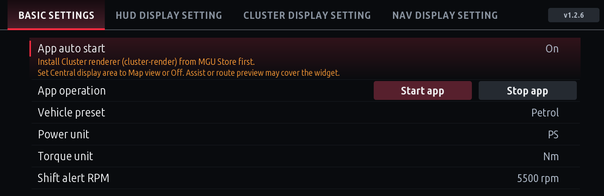
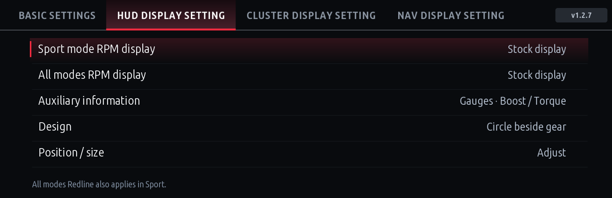
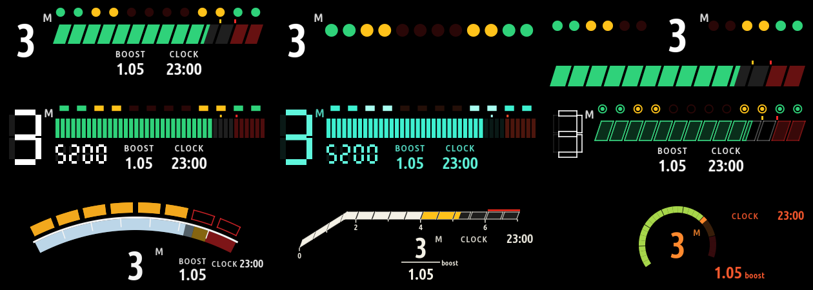
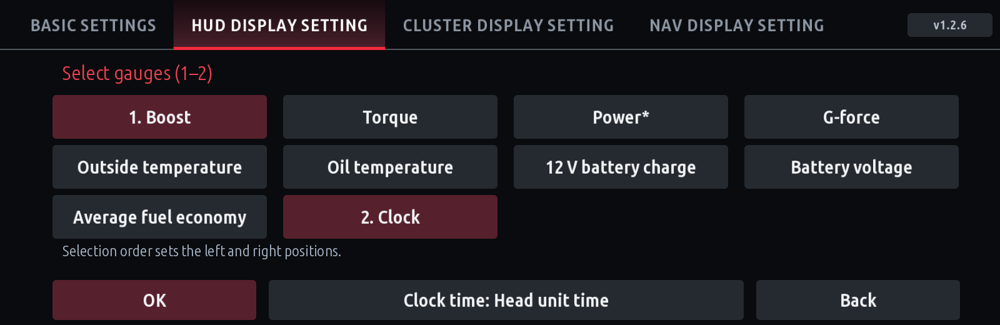
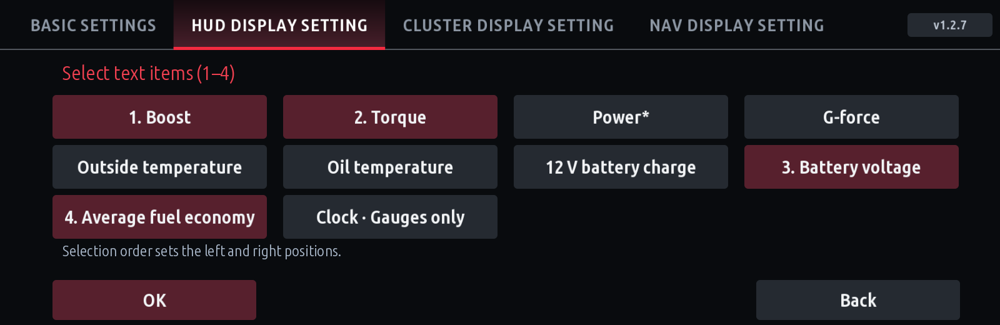
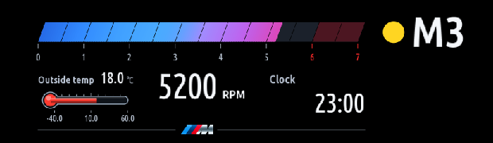
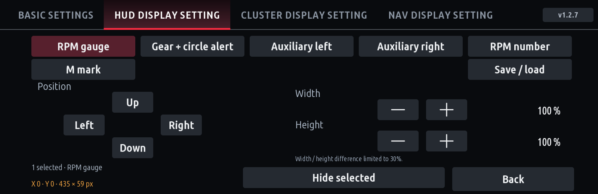
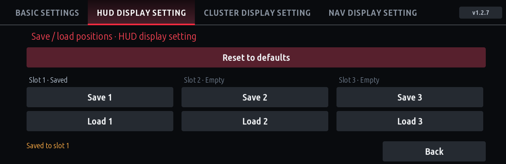
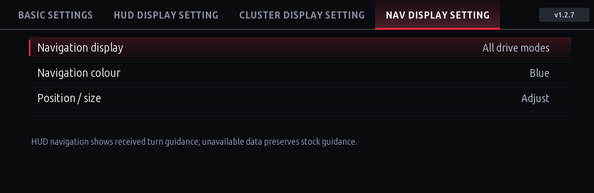
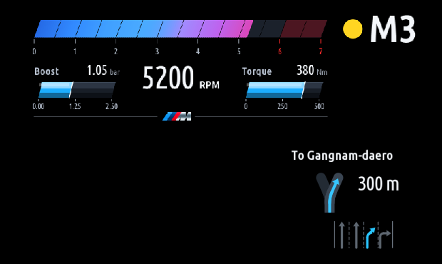

# User guide

[한국어](USER-GUIDE.ko.md) · [Installation guide](INSTALL.md) · [Screenshots](../screenshots/README.md) · [Changelog](../CHANGELOG.md)

- [Cluster Redline 1.2.6](#cluster-redline)
- [Storage 1.0.2](#storage)
- [iDrive Circuit 1.0.0](#idrive-circuit)

Pictures are rendered by the real app with example data. They are not photographs from a car, and the numbers are not measurements.

---

## Cluster Redline

Shows RPM, gear, a shift alert and auxiliary readings (boost, torque, temperatures, clock and more) on the instrument cluster and the HUD, and shows phone navigation on the HUD.

| HUD | Cluster |
|---|---|
|  |  |

Settings have four tabs: **Basic settings · HUD display setting · CLUSTER display setting · NAV display setting**. The app version is shown at the top right.

### Basic settings

| Item | Meaning |
|---|---|
| App auto start | Start the app on ignition or restart. On by default. |
| App operation | **Start app / Stop app** starts or stops the display now. |
| Vehicle preset | Petrol · Diesel · eDrive (PHEV) · M. Sets the RPM scale and default shift RPM. The car is not detected automatically. |
| Power unit / Torque unit | PS·kW / Nm·kgf·m |
| Shift alert RPM | **Preset default** (Petrol, eDrive, M 5500; Diesel 4200 rpm) or a chosen RPM |

### When it shows (HUD and cluster separately)

Set in HUD display setting and CLUSTER display setting.

| Item | Choices | Applies to |
|---|---|---|
| Sport mode RPM display | Redline app / Stock display | Sport drive modes |
| All modes RPM display | Redline app / Stock display | every drive mode, Sport included |

- Defaults: cluster shows Redline in Sport only; the HUD stays stock.
- **Redline for all modes also covers Sport.** For Sport only, set Sport = Redline app and All modes = Stock display.

### Shift alert

Pick one in **Design**:

- **Circle beside gear**: a dot next to the gear turns green → yellow → flashing red.
- **Top alert bar**: a line above the RPM bar does the same.

The alert follows the drive mode (example with 5500 rpm shift RPM):

| Drive mode | Green | Yellow | Flashing red |
|---|---|---|---|
| Sport | 65 % (≈3600) | 85 % (≈4700) | 100 % (5500) |
| Comfort, Eco and others | 50 % of the shift point (2500) | 80 % (4000) | 100 % (5000) |

The Comfort/Eco shift point is 90 % of the shift RPM rounded to 100 rpm (5500 → 5000; Diesel 4200 → 3800).

| Red (HUD) | Red (cluster) |
|---|---|
|  |  |

### HUD design: Redline app layouts

HUD display setting → **Design** → **Redline app layouts** offers the nine HUD layouts of the Redline app (appsKOR, MIT). The Redline app itself is not needed.

Standard · Minimal · Split wings / 80s digital dash · VFD glow · Vector arcade / Arc (F80 M3/M4) · Ramp (G80 M3/M4) · Dial (E60 M5)

- They use Cluster Redline's RPM, gear, drive-mode shift point, red zone and your auxiliary items. Navigation is shown alongside.
- In Position / size the whole layout is one item, **Redline HUD**.
- To go back, press Top alert bar or Circle beside gear in Design.
- The Redline app's learning (rev limit, best upshift, reaction time), shift grades and downshift arrow are not included.

### Auxiliary information

**Auxiliary information → Gauges or Text → select items → OK**. Nothing is saved until **OK**; leaving with Back or another tab keeps the previous choice. Items are numbered in the order you press them, and that order sets left and right.

| Gauges (1–2) | Text (1–4) |
|---|---|
|  |  |

| Item | Gauge | Meaning |
|---|---|---|
| Boost | bar | boost pressure (bar) |
| Torque | bar | engine torque (selected unit) |
| Power* | bar | estimated from torque and RPM; not the eDrive combined output |
| G-force | dot in a box | number is combined g, dot moves with lateral g |
| Outside temperature | thermometer | exterior temperature from the car |
| Oil temperature | thermometer | engine oil temperature |
| 12 V battery charge | battery | 12 V battery state of charge (%), not the high-voltage battery |
| Battery voltage | text | 12 V voltage (V) |
| Average fuel economy | text | trip 1 average (km/L) |
| Clock | text | HH:MM; **gauges only**, uses one slot |

- Layout: 1 item on the left; 2 items left (1) and right (2). Text with 3 items: left 1·2, right 3; with 4: left 1·2, right 3·4.
- With Clock selected a **Clock time** button appears. If the head unit time is wrong, switch it to **UTC+9 (Korea)**.
- Missing or stale values show `--`. Outside temperature appears after the car sends its first value and stays until the next one.
- Vehicle signals needed only by hidden items are not read; they resume when shown again.

| Outside temperature + clock (HUD) | Battery (HUD) |
|---|---|
|  |  |

### Position / size

1. Press the item to move at the top. Press it again to deselect; several selected items move together.
2. Move with **Up · Down · Left · Right**, resize with **Width · Height − / +**. With one item selected width and height change separately, up to 30 % apart.
3. **Hide selected / Show selected** hides items. For the M mark, **Hide line** hides just the line.
4. The bottom left shows the selection, the X·Y offset from the default position and the actual size in pixels.

| Tab | Items |
|---|---|
| HUD (circle alert) | RPM gauge · Gear + circle alert · Auxiliary left · Auxiliary right · RPM number · M mark |
| HUD (top alert bar) | RPM gauge · Gear · RPM alert · Auxiliary left · Auxiliary right · RPM number · M mark |
| HUD (Redline app layout) | Redline HUD |
| Cluster | RPM gauge · Gear · RPM alert · Auxiliary left · Auxiliary right · RPM number · Upper M mark · Lower M mark |
| Navigation | Direction · Text · Lane guidance (width and height scale together) |

- While adjusting, hidden items and navigation are shown with sample content.
- Leaving the settings screen (Back, Home or another app) ends adjusting and restores the normal display.

**Save / load**: three slots for each of the HUD, cluster and navigation tabs.

- **Save 1–3** stores this tab's positions, sizes and hidden states.
- **Load 1–3** restores them. An empty slot changes nothing.
- **Reset to defaults** asks for a second press, then resets this tab only.

### Navigation (HUD)

| Item | Choices |
|---|---|
| Navigation display | **All drive modes** / **Except Sport** / **Stock display** (stock turns the app's guidance and its signals off) |
| Navigation colour | Gray / White / Blue (arrows and recommended lanes; distance and text stay white) |
| Position / size | move, scale or hide Direction, Text and Lane guidance separately |

- Navigation can be shown even when the HUD RPM is stock.
- **Direction**: turns, straight, U-turns and arrival use a large arrow; forks, branches, roundabouts (with exit number), motorway entries/exits, keep-on-main-road and lane changes use a simple road diagram. The car does not send junction geometry, so the shape is generic.
- **Text**: the received guidance text (road or direction name) above the arrow. The English edition shows Korean text as received.
- **Lane guidance**: recommended lanes in the chosen colour, the rest dimmed; arrows keep one size for any lane count. Only when CarPlay sends lane data; Android Auto does not send it.
- Without current guidance the app clears its navigation and gives way to the stock guidance. Some map app, phone and car combinations may not deliver every instruction.

| Turns | Motorway |
|---|---|
|  |  |

### Good to know

- Stock HUD pop-ups (music, calls) take priority over Cluster Redline; it returns when they close.
- The cluster display needs the BMW **Central display area** set to Map view or Off. Driving assistant views can cover it.
- If the display stutters, hide auxiliary items, lanes, text and direction one kind at a time to find the cause. Change one thing at a time.

---

## Storage

Shows the iDrive 7 storage. It never deletes files or changes car settings.

- **Disks**: usage per partition, free space on the app partition, RAM.
- **Apps**: space used by each app under `/var/opt/public/oap`. A `*` means only part could be measured; the real size may be larger.
- **Refresh** measures again; **Next screen** switches between disks and apps.
- **Home widget**: shows usage and highlights it above the warning level (80 % by default).

Settings change the warning level, start screen, RAM and read-only partition display, units and colours. **Keep Preview data on Auto in the car**; choosing the 44/78/95 % examples shows example values instead of real ones.

Per-app totals and partition usage can differ, and filesystem reserved space can make free space differ from "total − used".

---

## iDrive Circuit

A circuit puzzle for when you're parked: rotate tiles until every module has power.

- 30 levels including a tutorial, undo, hint and restart, minimum-rotation star rating, saved progress.
- **Controls**: turn the knob to select a tile, push to move, press or touch to rotate. The button menu also has **Next tile · Rotate**.
- With the default **Parked only** setting input locks above 3 km/h. Do not play while driving.
- It reads vehicle speed only and writes nothing to the car. No cluster renderer needed.
